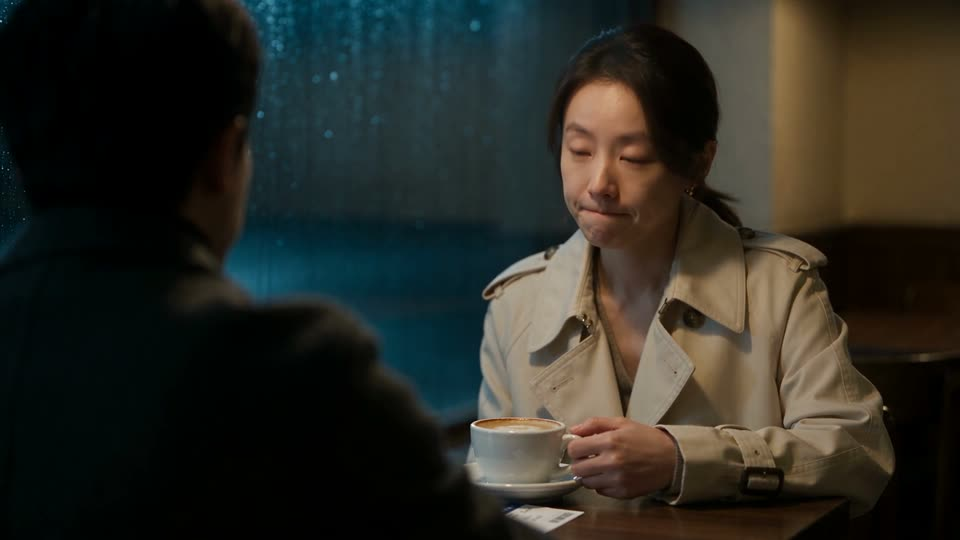
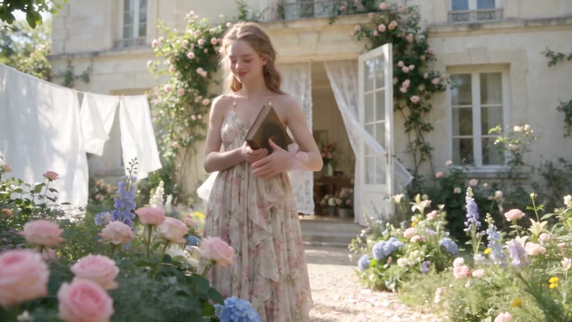
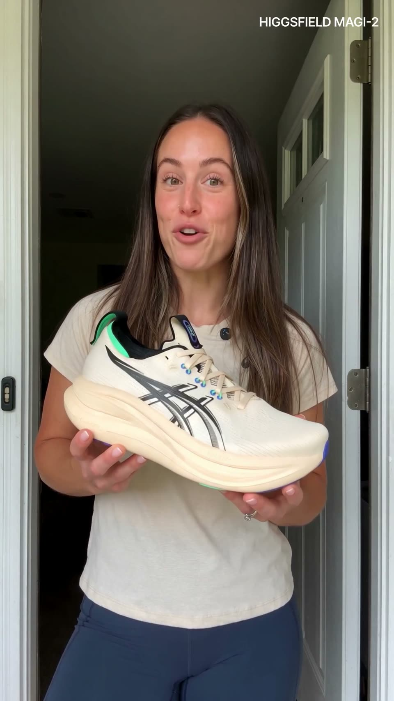
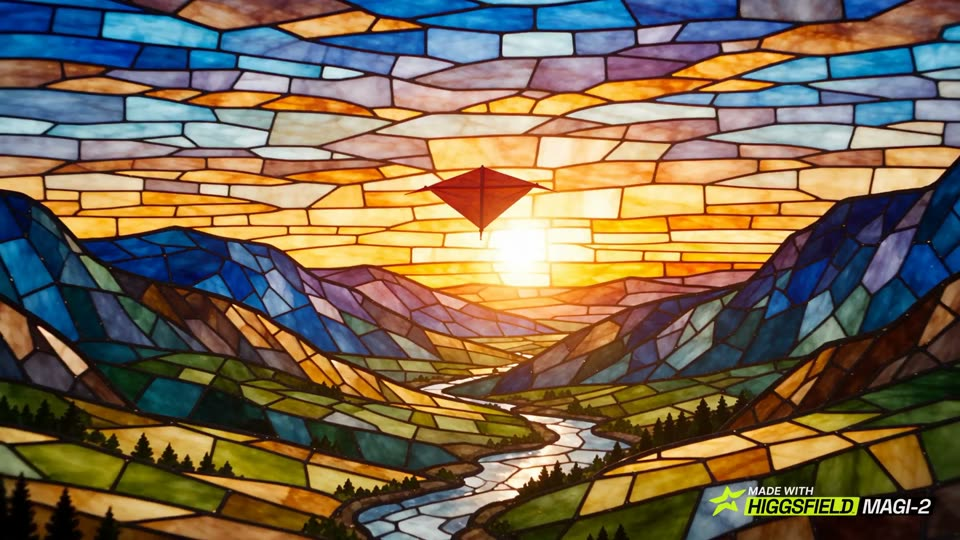
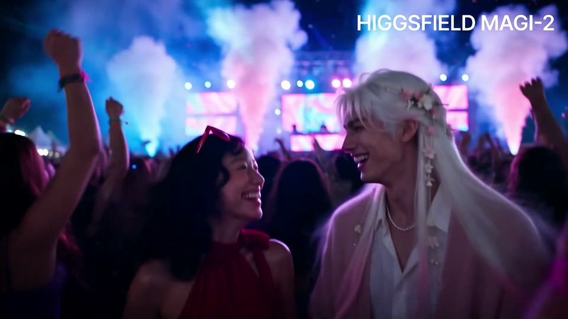
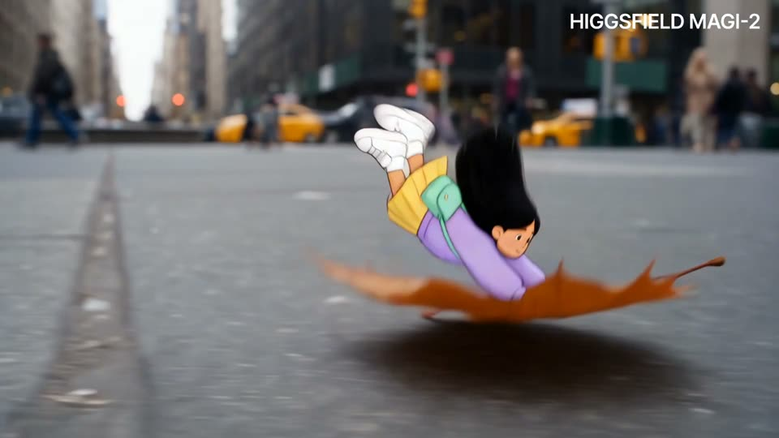
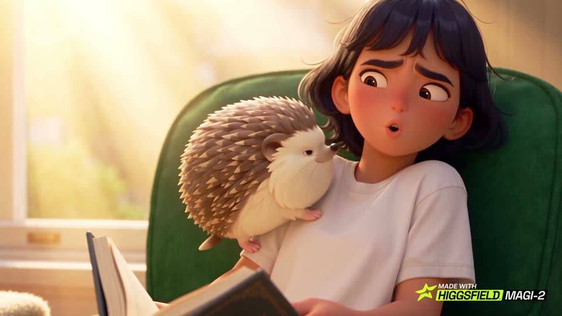
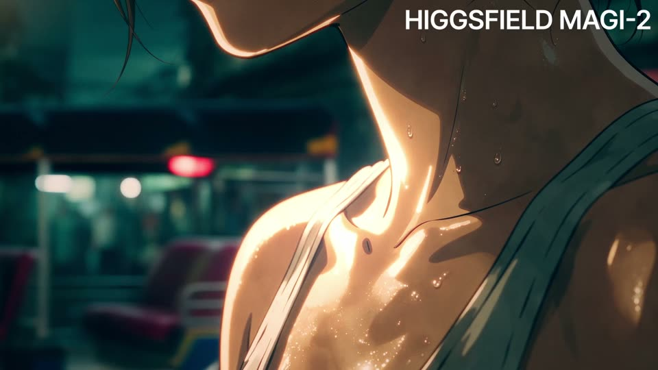
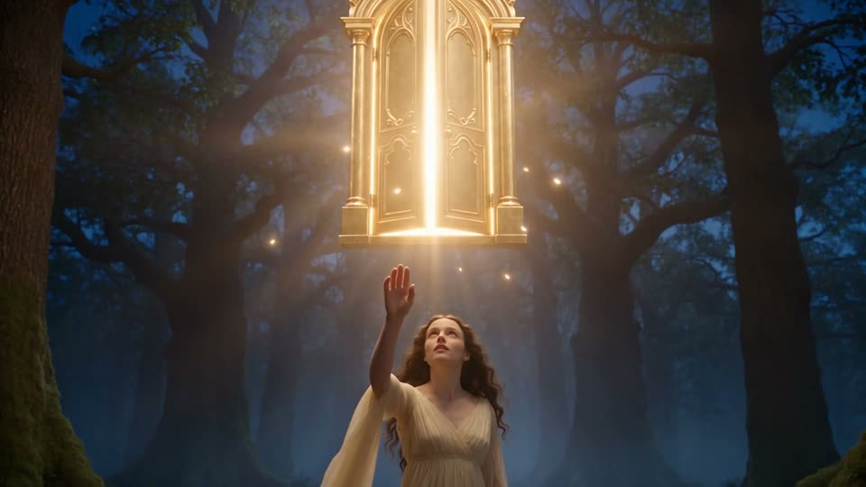

<!-- Generated by scripts/build_readme.py. Edit site.config.json, content/prompts.json, and generator scripts. -->

<a id="top"></a>

[](https://raphael.app/?utm_source=github&utm_medium=repository&utm_campaign=magi_2_launch&utm_content=hero&utm_term=en)

# 🎬 Awesome MAGI-2 Prompts

[](https://github.com/sindresorhus/awesome)
[](https://github.com/RaphaelAI-OpenLab/awesome-magi-2-prompts)
[](LICENSE)
[](https://github.com/RaphaelAI-OpenLab/awesome-magi-2-prompts/actions/workflows/validate.yml)
[](CONTRIBUTING.md)

> 🎥 Curated MAGI-2 & MAGI-2-preview prompts, native audio-video templates, Omni-Reference workflows, and structured PE (Prompt Enhancement) schemas.

> ⚠️ **Media & Copyright Notice**: This collection indexes public prompts, original reproductions, and developer PE templates for educational use. Playable MP4 videos stay on external storage or official links rather than inside Git. To report an issue or request removal, [open an issue](https://github.com/RaphaelAI-OpenLab/awesome-magi-2-prompts/issues/new?template=report-problem.yml).

---

<a href="README.md"></a> <a href="README.zh-CN.md"></a>

---

<a id="gallery"></a>

## 🌐 Generate & Compare Online

**[👉 Try AI Video Generation on Raphael](https://raphael.app/ai-video-generator?utm_source=github&utm_medium=repository&utm_campaign=magi_2_launch&utm_content=top_cta&utm_term=en)**

| Feature | GitHub README | Raphael Website |
| --- | --- | --- |
| 🎬 Video + Audio Workflows | Copy short prompts & PE JSON templates | Generate in browser without local GPU setup |
| 🧩 Multi-Model Switching | Compare MAGI-2 vs MAGI-2-preview formats | Switch across leading AI video models |
| 📱 Access Anywhere | Lightweight Markdown & JSON index | Direct web generation on desktop & mobile |

<a id="categories"></a>

## 🏷️ Browse by category

[All (10)](#all-cases) · [Dialogue & Lip-Sync (2)](#category-dialogue-lip-sync) · [Multi-Shot Storytelling (2)](#category-multi-shot-storytelling) · [Omni-Reference Consistency (2)](#category-omni-reference) · [Product & Commercials (1)](#category-product-commercials) · [SFX, Music & Ambience (1)](#category-sfx-ambience) · [Cinematic & Animation (2)](#category-cinematic-animation)

<a id="contents"></a>

## 📖 Contents

- [What is MAGI-2 (Flagship vs MAGI-2-preview)?](#about)
- [Developer Quickstart & Structured PE Templates](#quickstart)
- [Statistics](#statistics)
- [Featured cases](#featured)
- [All cases](#all-cases)
- [How to use](#using)
- [Contribute](#contribute)
- [License & Attribution](#license)

<a id="about"></a>

## 🤔 What is MAGI-2 (Flagship vs MAGI-2-preview)?

Sand.ai introduced **MAGI-2** (a 480B-parameter flagship Multi-Head Latent MoE audio-video model) alongside the open-weights **MAGI-2-preview** (114B total / 6B active parameters under Apache 2.0). Both share a dense, timeline-driven captioning style where synchronized dialogue, sound effects, camera motion, and reference identities are described explicitly.

[MAGI-2 Preview Blog](https://sand.ai/blog/magi-2-preview) · [SandAI-org/MAGI-2-preview](https://github.com/SandAI-org/MAGI-2-preview) · [Hugging Face Weights](https://huggingface.co/sand-ai/MAGI-2-preview)

| Capability | `MAGI-2` (Flagship) | `MAGI-2-preview` (Open-Weights) |
| --- | --- | --- |
| Parameter scale | 480B total (~28B active) | 114B total (6B active, MagiMoE) |
| Duration & output | 4–30s · 1080p · 25 fps | 10s · 1080p (`512×896` → `1088×1920` refiner) |
| Audio generation | Synced dialogue, SFX & music in one pass | Unified audio-video generation (`ffmpeg` muxed) |
| Input modes | T2V, I2V, **Omni-Reference** (up to 20 images/videos/audio) | T2V, I2V + optional JSON **Prompt Enhancement (PE)** |
| License / Hardware | Commercial / hosted API & product | Apache 2.0 · 8× NVIDIA Hopper GPUs (~307 GB ckpt) |

<a id="quickstart"></a>

## ⚡ Developer Quickstart & Structured PE Templates

Short handwritten prompts underuse MAGI-2. Sand.ai's inference pipeline ships `t2v.md` and `i2v.md` Prompt Enhancement (PE) schemas so an LLM expands a short idea into `global_layer` + `dynamic_layer` (T2V) or `shot_timeline` + `audio_event_timeline` (I2V). This repository includes ready-to-use templates and a CLI helper:

- [SKILL.md](SKILL.md) — Agent-readable index to query `content/prompts.json` and build PE prompts
- [examples/pe_template_helper.py](examples/pe_template_helper.py) — Export repo cases to `MAGI-2-preview` `samples.json` or scaffold T2V/I2V PE JSON
- [examples/t2v_pe_template.json](examples/t2v_pe_template.json) · [examples/i2v_pe_template.json](examples/i2v_pe_template.json) · [examples/demo_samples.example.json](examples/demo_samples.example.json)

```bash
# 1) Clone SandAI-org/MAGI-2-preview and download Apache 2.0 weights (~307 GB)
git clone https://github.com/SandAI-org/MAGI-2-preview.git && cd MAGI-2-preview
hf download sand-ai/MAGI-2-preview --local-dir ckpt

# 2) Run a single 10s 1080p audio-video clip (8x NVIDIA Hopper GPUs)
torchrun --nproc_per_node=8 inference/pipeline/entry.py \
  --prompt "A red fox trotting through fresh snow, crunching footsteps and winter wind" \
  --output output/

# 3) Export prompts from this repo into MAGI-2-preview samples.json
python3 examples/pe_template_helper.py export --out my_samples.json
SAMPLES=my_samples.json bash scripts/run_demo.sh
```

<details><summary><strong>Preview: MAGI-2 T2V Structured PE JSON shape</strong></summary>

```json
{
  "global_layer": {
    "context": "Single continuous take inside a rainy corner cafe.",
    "audio_baseline": {
      "ambience": "Steady rain against glass, low espresso machine hum",
      "dialogue": { "language": "English", "speaker_tags": ["<subject 1>"] }
    },
    "video_metadata": { "duration": 10.0, "aspect_ratio": "16:9" }
  },
  "dynamic_layer": {
    "timeline_segments": [
      {
        "segment_basic_info": { "timestamp_range": "00:00.0-00:10.0" },
        "audio": {
          "dialogue_lines": [{ "timestamp": "00:03.0-00:06.5", "speaker": "<subject 1>", "text": "Hot latte for window two.", "delivery": "calm, conversational" }],
          "special_audio_events": [{ "timestamp": "00:01.8", "sound_description": "ceramic cup clink on saucer", "visual_sync": "cup touches saucer" }]
        }
      }
    ]
  }
}
```

</details>

<a id="statistics"></a>

## 📊 Statistics

| **Metric** | **Count** |
| --- | --- |
| 🎬 Total cases | **10** |
| ⭐ Featured cases | **6** |
| 🔄 Last updated | **2026-11-26 UTC 21:45:36** |

<!-- cms-stats 10 2026-11-26T21:45:36Z -->

<a id="featured"></a>

## 🔥 Featured cases

<a id="featured-rainy-cafe-boarding-pass"></a>

#### 1. Rainy Night Cafe Boarding Pass

**Origin**: `community` · **Task**: `T2V` · **Audio**: `Yes` · **Status**: `Source-linked`

Two-character dramatic dialogue in a rainy late-night cafe with strict Mandarin lip-sync and two exact hard cuts at 7s and 14s.

<a href="https://awesome.raphael.app/materials/74ab8314-1821-4d7e-bd69-c39b4e840ba8.mp4"></a>

▶ **[Watch audio-enabled MP4](https://awesome.raphael.app/materials/74ab8314-1821-4d7e-bd69-c39b4e840ba8.mp4)**

<details><summary><strong>Full Structured Prompt (2312 chars)</strong></summary>

```text
MAGI-2 DIRECTOR PROMPT
Duration: 20秒
Aspect ratio: 16:9
Reference: 程远＝一名三十二岁上下的东亚男性，短黑发微乱，穿深灰羊毛大衣配黑色高领毛衣；林夏＝一名三十岁上下的东亚女性，低马尾，穿米白风衣；全片两人面部、发型、体型与穿着完全一致。
Audio: 深夜咖啡馆低沉的冰箱嗡鸣、窗外淅沥雨声、陶瓷杯轻碰碟子的脆响、衣料摩擦声；现场中文对白（台词见节拍内），口型与台词严格同步；无旁白、无音乐、无字幕
Overall style: 8K IMAX 超写实电影，Lubezki×Deakins 摄影，只用场景内实际光源，毛孔级皮肤，180°快门运动模糊，物理重量真实，拒绝游戏CG感

GLOBAL CONTINUITY
Setting:
深夜临街小咖啡馆靠窗卡座，深胡桃木桌面有两只白瓷咖啡杯与一张折成两半的登机牌；左侧是挂满雨珠的整面落地玻璃窗，窗外是模糊的城市湿漉街景与暖黄路灯。
Main subject:
程远与林夏为双主角，身份、面部与服装全程一致。
Props:
白色纸质登机牌折成两半，平放在深胡桃木桌面正中央，距程远右手约 15 厘米。
Blocking:
程远坐画左面朝画右，林夏坐画右面朝画左，两人隔着宽约 0.9 米的木桌正对而坐，互不遮挡。
Lighting:
室内主灯关闭，仅靠桌面正上方一盏低垂暖钨丝吊灯（2800K）照亮桌面与两人半侧脸，窗外街灯冷蓝反光轻擦两人肩背。摄影机始终在人物阴影侧，无任何外部补光。
Color:
60:30:10——深棕暗影 / 暖钨丝琥珀 / 窗外冷蓝反光点缀

CAMERA CONTINUITY
全片严格只有 2 次硬切，分别在第 7.0 秒和第 14.0 秒，无过渡、无淡入淡出。前两段采用极轻的手持呼吸感 (Subtle handheld shake)，最后一段切为几乎察觉不到的缓慢推近 (Slow push-in / Dolly in)。

PERFORMANCE ENGINE
程远｜目的：把登机牌推回给林夏劝她别走 障碍：说出口就等于承认自己输了 隐藏的恐惧：她真的会头也不回 保护策略：用故作轻松的慢动作掩盖手抖
林夏｜目的：等程远亲口说一句留下来 障碍：尊严不允许先低头 隐藏的恐惧：他只是客套 保护策略：压低视线盯住杯口不接话
情绪曲线：控制 → 加压 → 裂缝 → 暴露 → 残留

0.0–7.0秒｜推牌试探
镜头开场即在运动中，程远右手食指和中指压在桌面登机牌边缘，把登机牌顺着木纹慢慢往林夏那边推过 10 厘米后手指停住；林夏左手握着白瓷杯柄，拇指在杯沿轻轻摩挲半圈，眼睛盯着桌面没抬头。
7.0–14.0秒｜硬切对峙与开口
第 7.0 秒动量匹配硬切 (Match cut) 至林夏半身胸像 (Medium close-up / Bust shot)。林夏听见纸张摩擦桌面的声音停下，先轻吸一口气，才慢慢抬眼直视画左的程远，嘴角先扯出一丝极淡的苦笑，随后笑意从眼里退掉，开口说出台词。
14.0–20.0秒｜反打破防与残留
第 14.0 秒同轴反打硬切 (Cut on axis) 至程远面部特写 (Close-up)。程远原本紧绷的下颌微微一松，喉结上下滚动一次，眼眶迅速泛湿泛光但不落泪，右手手指无意识把登机牌边角轻轻压平，低声接上一句台词，说完没有移开视线，停在沉默呼吸里。

Performance:
①（7.0–14.0秒）触发：登机牌停在杯边 → 面部：眉毛内侧极轻微抬起，下唇抿一下再松开 → 目光：从杯口缓缓抬至画左锁死对方 → 呼吸：轻吸气后平稳吐字 → 结束状态：眼神发亮但嘴角归于平直。
台词：「你每次都这样，把选择推给我。」（朝画左程远说，语速偏慢、声音轻而克制，在“这样”后停顿 0.5 秒，嘴型必须和“你-每-次-都-这-样-把-选-择-推-给-我”每个字的发音完全对上）
②（14.0–20.0秒）触发：听完林夏的话 → 面部：咬肌松开、眼皮微颤、眼球泛水光但眼泪不得早于第 20.0 秒落下 → 呼吸：鼻腔短促吸气一次 → 结束状态：嘴唇闭合，胸口缓慢起伏。
台词：「这次是我不敢留你。」（朝画右林夏说，音量压低、尾音略带气声，嘴型必须和“这-次-是-我-不-敢-留-你”每个字的发音完全对上）

Environment:
窗外雨滴沿玻璃缓慢滑落，远处偶尔有一辆车尾灯的红光在湿漉玻璃上拉出模糊光斑，咖啡馆内其余座位空无一人。
Camera:
0.0–7.0秒 35mm 双人侧景 (Two-shot) 手持呼吸感极缓横移 → 7.0秒硬切 50mm 林夏过肩半身胸像 (Medium close-up / Bust shot) 稳住焦平面 → 14.0秒硬切 85mm F1.4 程远面部特写 (Close-up) 极缓慢推近 (Slow push-in / Dolly in) 约 6 厘米。
Constraints:
登机牌始终留在桌面两人之间，不得凭空消失或变成其他纸张；两人的左右站位轴线全程锁死；口型与台词逐字严格同步，说完立刻闭唇。

---
Negative:
改变程远和林夏人物造型，重新设计服装，服装漂移，面部漂移，人物替换
多余切镜，机位瞬移，越轴，场景跳变，变焦推拉
静止发呆开场，表情一步到位，开场就崩溃，提前流泪，夸张肢体动作
登机牌消失，咖啡杯位置跳变，多手多指，口型与中文台词错位
动漫渲染，游戏CG，塑料皮肤，过度磨皮，正面补光，反光板，柔光箱
字幕，屏幕文字，水印，品牌标志，旁白，额外对白，背景音乐
```

</details>

| Parameter | Value |
| --- | --- |
| Model | MAGI-2 (flagship) |
| Task type | t2v |
| Duration / FPS | 20.3s · 25 fps |
| Resolution / Ratio | 1080p · 16:9 |
| Audio mode | dialogue (audio=True) |

[Original source](https://x.com/johnAGI168/status/2125480417847353448) · Creator: [@johnAGI168](https://x.com/johnAGI168) · 2026-11-25

> Creator reported text-to-video generation; prompt posted at https://x.com/johnAGI168/status/2125480454518133081. Video metrics measured from the archived MP4.

[Case page](cases/rainy-cafe-boarding-pass/README.md) · **[Generate similar on Raphael →](https://raphael.app/ai-video-generator?utm_source=github&utm_medium=repository&utm_campaign=magi_2_launch&utm_content=case_rainy-cafe-boarding-pass&utm_term=en)**

---

<a id="featured-rococo-garden-three-room-oner"></a>

#### 2. Rococo Garden Three-Room One-Take

**Origin**: `community` · **Task**: `OMNI-REF` · **Audio**: `Yes` · **Status**: `Source-linked`

30-second unbroken Steadicam single take traversing garden, boudoir, and sunlit salon locked by 4 reference images with layered spatial audio.

<a href="https://awesome.raphael.app/materials/0b3445d5-9078-4c49-b3e8-b0f6189f23b3.mp4"></a>

▶ **[Watch audio-enabled MP4](https://awesome.raphael.app/materials/0b3445d5-9078-4c49-b3e8-b0f6189f23b3.mp4)**

<details><summary><strong>Full Structured Prompt (2636 chars)</strong></summary>

```text
【影像设定与风格锁定】
法式古典极繁浪漫电影炫技长镜头，融合《傲慢与偏见》灵动调度与索菲亚·科波拉《绝代艳后》马卡龙洛可可美学。总时长 30 秒，16:9 横屏，35mm 柯达胶片配 1/4 黑柔滤镜实拍质感，高调清透的奶油暖白晨光与梦幻高光柔晕。全程采用 28mm 自然广角视感与斯坦尼康复合运镜（穿花抬升、弧线环绕、脱靶俯拍、穿门横摇），全片严格保持单一连续的一镜到底长镜头，绝不切镜。

【素材分工与角色/场景锁定】
严格按以下 4 张参考图分工锁定主角色与三段连续空间，全程不得换脸、换装或漂移画风：
- 女主角（严格参考图片 1）：将图片 1 右侧人像头部与全身服装自然融合为真实立体的完整人物（严禁无头残缺或灰底排版）。约 20 岁绝美法式少女，极度细腻白皙的瓷感公主肌与自然柔粉面颊，清澈浅灰绿眼眸，披散及腰的浅茶棕色长波浪大卷发；身穿珍珠串珠细挂脖的奶油白底粉玫瑰碎花多层荷叶边雪纺长裙，左手腕系淡粉色薄纱蝴蝶结，脚穿米白短袜与复古黑色玛丽珍皮鞋。
- 伴奏配角（仅在空间 3 出现，避免与女主混淆）：一名身穿素雅浅天蓝色复古棉布长裙、盘起金棕色低发髻的年轻姐妹，仅以侧影坐在左侧立式钢琴前弹琴。
- 空间 1（室外起点，严格参考图片 2）：沐浴灿烂晨光的法式鲜花碎石花园小径，左侧挂着透光发亮的白色亚麻床单，花径两侧盛开粉玫瑰、蓝绣球与飞燕草，正前方是攀满粉蔷薇的奶油白老宅与完全敞开的法式双开落地玻璃门，雪白提花蕾丝长纱帘被晨风吹向室外。
- 空间 2（室内中段，严格参考图片 3）：穿过敞开大门即进入的鲜花白蕾丝复古闺房，左为透光白蕾丝落地窗，中左靠墙为胡桃木五斗柜（微开抽屉探满粉玫瑰、蓝绣球与黄野花，柜顶白蕾丝台布盛放蓝绣球与紫藤），中央白铁艺床头攀满粉玫瑰、碎花棉被上放着椭圆形复古鎏金小托盘镜，右侧是一扇完全敞开的奶油白法式双开雕花大门。
- 空间 3（室内收尾，严格参考图片 4）：穿过闺房右侧双开雕花门即进入的《绝代艳后》极繁阳光沙龙，左侧是垂满紫藤粉玫瑰的旧木立式钢琴（乐谱摊开），中央白蕾丝大圆桌摆满马卡龙甜点塔、水晶香槟杯与鎏金茶具托盘，正前方三扇高大落地窗垂挂飘动白蕾丝纱帘，丁达尔光束斜洒满室，顶悬璀璨水晶吊灯。

【空间连贯与物理铁律】
三个空间按“图片 2 花园 → 穿白蕾丝敞门 → 图片 3 鲜花闺房 → 穿右侧敞开双开雕花门 → 图片 4 极繁阳光沙龙”单向贯通，绝不穿墙、绝不跨床。
人体步态铁律：人物始终面朝前进方向正常向前迈步，脚尖与身体朝向移动方向一致，严禁出现面向镜头倒退行走或滑步。镜头升降与弧线变速缓入缓出，充分展现前景花丛、飘纱、门框与圆桌甜点塔的强烈 3D 空间视差。

【30 秒复杂一镜到底时间轴（复合运镜 + 连贯事件 + 物理因果）】
0–5 秒｜【低机位穿花抬升 + 弧线右移｜蝴蝶掠书与折花】以图片 2 构图起步。摄影机从前景密集虚化的粉玫瑰与蓝绣球花丛低处缓慢垂直抬升并向右平滑摇移，穿过透光花瓣露出女主角（图片 1）：她安稳站在碎石花径中段偏左，呈四分之三侧正面站定不动，双手捧着翻开的复古旧书低头阅读。第 2 秒一只白色蝴蝶轻巧飞掠书页上方，她随蝶影抬眸浅笑，顺手将旧书夹在左臂下，右手轻快从身旁花丛折下一枝含苞粉玫瑰（左手腕淡粉蝴蝶结随动作轻晃），左侧阳光下的白亚麻床单被晨风鼓起。
5–10 秒｜【转身正向轻跑 + 俯冲跟拍穿纱帘】第 5 秒女主角自然转过身完全面向正前方的敞开老宅大门（优雅背影与侧背影朝向屋门），脚尖朝前正常轻快小跑跨上石阶、步入敞开的法式落地玻璃门，多层粉玫瑰碎花长裙摆随轻跑向后扬起。摄影机略微加速平滑俯冲紧贴她侧后方跟进；第 9 秒雪白提花蕾丝长纱帘被风掀起，柔美大面积掠过镜头前景边缘，借飘纱动势丝滑滑入室内。
10–17 秒｜【闺房脱靶绕床低俯 + 抽屉插花 + 鎏金镜倒影】镜头无缝滑入图片 3 鲜花闺房。女主角沿五斗柜与白铁艺床间的过道向前轻步走过：第 11 秒顺手将旧书合上轻放在碎花棉被一侧，再把刚才室外折下的那枝粉玫瑰自然插进胡桃木五斗柜微开抽屉的花簇中；第 13 秒摄影机主动脱离她背影，沿床侧做一次流畅低俯弧线滑行——女主角微微俯身望向床面那只椭圆形复古鎏金小托盘镜，指尖轻撩耳畔一缕茶棕卷发，鎏金镜面清晰闪过她的柔美眉眼倒影与晨光反光。第 15 秒镜头顺势抬升接回她身后，跟她轻提裙摆步向右侧敞开的奶油白双开雕花大门。
17–23 秒｜【穿门横摇揭示钢琴互动 + 白猫跃过 + 花瓣光束】摄影机加速平滑笔直穿过双开雕花门洞滑入图片 4 的极繁阳光沙龙，随即向左柔和横摇：左侧垂满紫藤的立式钢琴前，身穿浅天蓝裙的年轻姐妹正投入弹奏，手指在琴键上灵动起落；女主角微笑走过琴旁，伸手轻拍姐妹肩头互动，袖风带落琴顶几片粉玫瑰花瓣在斜射丁达尔光束中缓缓旋转飘落。与此同时，一只雪白长毛波斯猫从蕾丝圆桌布下轻巧跃过洒满阳光的木地板，自然引导视线转向中央大圆桌。
23–30 秒｜【贴桌 120° 大弧度强视差环绕 → 逆光香槟马卡龙定格】摄影机压低高度、紧贴白蕾丝圆桌边缘做一次极具电影感的 120° 大弧度平滑环绕推进——前景缤纷马卡龙甜点塔、晶莹折射日光的水晶香槟杯与粉玫瑰高速横向掠过镜头，拉出极致 3D 视差。女主角沿圆桌后侧轻盈绕至三扇发亮的白纱落地窗前停步，左手轻端起一只泛着细腻气泡的淡金香槟杯微晃，右手从塔顶拈起一颗淡粉色马卡龙轻举至唇边，缓缓转头正对摄影机微微歪头、俏皮眨眼温柔浅笑；强烈温暖的窗前逆光将她浅茶棕色大波浪发丝打透成天使金边，身后雪白蕾丝纱帘随风轻舞，摄影机平稳减速微仰停稳在中近景，定格于奢华梦幻的法式电影余韵中。

【声音基线与全局限制】
无对白，无旁白。纯自然立体声场层次递进：室外清脆鸟鸣、微风拂动亚麻床单与白纱帘沙沙声、轻快碎石脚步声；进入闺房后，书本轻放棉被声、枝叶轻擦抽屉声与隔壁隐约传来的清脆钢琴声；穿过雕花门瞬间，明快优雅的法式立式钢琴小步舞曲骤然清亮立体，伴随柔和弦乐渐强、猫爪轻踏木地板微响与水晶香槟杯轻微清脆声。
严格限制：全程严格保持单一连续一镜到底，绝不切镜、绝不穿墙、绝不跨床；严禁人物面向镜头倒退行走或滑步；严禁出现无头残缺、灰底排版、人物换脸、丢失珍珠挂脖或左手腕粉蝴蝶结；女主始终为奶油粉玫瑰碎花长裙，弹琴姐妹始终为浅天蓝裙不互换；严禁现代电器与穿帮物品；全片无字幕、无水印。
```

</details>

| Parameter | Value |
| --- | --- |
| Model | MAGI-2 (flagship) |
| Task type | omni-ref |
| Duration / FPS | 30.2s · 25 fps |
| Resolution / Ratio | 1080p · 16:9 |
| Audio mode | mixed (audio=True) |

**Omni-References**

1. `image` · [Creator's 4 reference images & source sheet (heroine + 3 continuous spaces)](https://qcnr07d9fz2l.feishu.cn/base/FOvXbgaSfahB0Esvt2VchQ2knFc)

[Original source](https://x.com/nanyuan0412/status/2125730423171097031) · Creator: [@nanyuan0412](https://x.com/nanyuan0412) · 2026-11-25

> Creator reported a 30s MAGI-2 render on Renoise using 4 reference images (case 01 from the original thread).

[Case page](cases/rococo-garden-three-room-oner/README.md) · **[Generate similar on Raphael →](https://raphael.app/ai-video-generator?utm_source=github&utm_medium=repository&utm_campaign=magi_2_launch&utm_content=case_rococo-garden-three-room-oner&utm_term=en)**

---

<a id="featured-asics-gel-nimbus-ugc-ad"></a>

#### 3. ASICS Gel Nimbus Vertical UGC Ad (9:16)

**Origin**: `community` · **Task**: `T2V` · **Audio**: `Yes` · **Status**: `Source-linked`

4-scene 30-second vertical 9:16 creator-style running shoe commercial with lip-synced English dialogue, voiceover montage, and soft background music.

<a href="https://awesome.raphael.app/materials/e21e0ccd-1aae-4cfd-9424-6b85fe352192.mp4"></a>

▶ **[Watch audio-enabled MP4](https://awesome.raphael.app/materials/e21e0ccd-1aae-4cfd-9424-6b85fe352192.mp4)**

<details><summary><strong>Full Structured Prompt (2299 chars)</strong></summary>

```text
Create a polished, highly realistic 30-second UGC-style advertisement for ASICS Gel Nimbus running shoes.

A young, attractive woman named Maya is the presenter. She should look and sound like a real lifestyle content creator recording a genuine product recommendation, not a professional actress reading a script.

Scene 1: Doorway hook (0–6 sec)

Maya stands at her apartment doorway, holding her ASICS Gel Nimbus shoes. She looks directly into the camera with an excited but natural expression.

Dialogue:

“Okay, I think I just found my new favourite running shoes. Look at these!”

She brings the teal ASICS Gel Nimbus close to the camera, showing the design.

Scene 2: First impressions (6–14 sec)

Cut to Maya sitting down and putting on the shoes. Show close-up shots of the teal upper, cushioning, ASICS logo, and sole.

Dialogue:

“These are the ASICS Gel Nimbus, and first of all, they’re so comfortable. I love how they feel on my feet.”

Scene 3: Lifestyle montage (14–23 sec)

Maya walks out onto the sidewalk, followed by shots of her jogging through a beautiful green park. Capture natural movement, shoe close-ups, and a few candid moments.

Voiceover:

“They feel soft, supportive, and honestly, I love how they look too. Perfect for my everyday walks and running sessions.”

Scene 4: Final recommendation (23–30 sec)

Maya stops on a park pathway, looks into the camera, and smiles.

Dialogue:

“If you’re looking for a pair that feels as good as it looks, definitely check these out.”

End with a premium close-up hero shot of the teal ASICS Gel Nimbus and the ASICS logo.

Production requirements:

Natural female voice with conversational delivery.
Accurate lip synchronization.
Authentic UGC filming style mixed with premium commercial shots.
Consistent Maya appearance and identical shoes throughout.
Teal ASICS Gel Nimbus prominently visible.
Realistic outdoor lighting and natural skin textures.
Soft upbeat background music mixed below the dialogue.
Natural ambient sounds during the outdoor montage.
No robotic voice, exaggerated expressions, or artificial-looking movements.
Vertical 9:16 format, 30 seconds.

Finished ad direction: A genuine creator-style product recommendation with a strong opening hook, natural praise, lifestyle footage, and a clear product reveal.
```

</details>

| Parameter | Value |
| --- | --- |
| Model | MAGI-2 (flagship) |
| Task type | t2v |
| Duration / FPS | 30.2s · 30 fps |
| Resolution / Ratio | 1080p · 9:16 |
| Audio mode | mixed (audio=True) |

[Original source](https://x.com/Sheldon056/status/2125445425520083116) · Creator: [@Sheldon056](https://x.com/Sheldon056) · 2026-11-25

> Creator reported Higgsfield collaboration; prompt posted at https://x.com/Sheldon056/status/2125445430725226653.

[Case page](cases/asics-gel-nimbus-ugc-ad/README.md) · **[Generate similar on Raphael →](https://raphael.app/ai-video-generator?utm_source=github&utm_medium=repository&utm_campaign=magi_2_launch&utm_content=case_asics-gel-nimbus-ugc-ad&utm_term=en)**

---

<a id="featured-red-paper-kite-five-styles"></a>

#### 4. Red Paper Kite Across Five Art Styles

**Origin**: `community` · **Task**: `T2V` · **Audio**: `Yes` · **Status**: `Source-linked`

30-second continuous take morphing every 6 seconds across charcoal sketch, watercolor, stained glass, 1970s 35mm film, and photoreal rooftop dusk.

<a href="https://awesome.raphael.app/materials/32b60448-840a-4f10-9ec9-1c6a1d8ac5ba.mp4"></a>

▶ **[Watch audio-enabled MP4](https://awesome.raphael.app/materials/32b60448-840a-4f10-9ec9-1c6a1d8ac5ba.mp4)**

<details><summary><strong>Full Structured Prompt (1035 chars)</strong></summary>

```text
One continuous 30-second take, no cuts. The camera glides forward at a steady, unhurried pace behind a small red paper kite drifting on the wind, keeping it in the upper third of frame. The world around the kite transforms seamlessly every six seconds while the kite itself never changes.

0-6s: a hand-drawn charcoal sketch of rolling hills on textured off-white paper, smudged graphite clouds.

6-12s: the lines bleed into loose watercolor washes, a valley of soft blue and ochre, pigment blooming at the edges.

12-18s: the valley hardens into a stained-glass mosaic landscape, bold dark outlines, sunlight glowing through colored glass panes.

18-24s: the glass melts into a warm 1970s 35mm film-stock coastal road, visible grain, halation, faded teal and orange.

24-30s: dusk over a modern photoreal city rooftop, unbranded window lights flickering on, the kite settling gently into the hands of a child standing on the roof.
Audio: steady soft wind throughout and a single gentle solo piano melody that slowly builds. No voices.
```

</details>

| Parameter | Value |
| --- | --- |
| Model | MAGI-2 (flagship) |
| Task type | t2v |
| Duration / FPS | 30.2s · 25 fps |
| Resolution / Ratio | 1080p · 16:9 |
| Audio mode | mixed (audio=True) |

[Original source](https://x.com/Dheepanratnam/status/2125658296052813844) · Creator: [@Dheepanratnam](https://x.com/Dheepanratnam) · 2026-11-25

> Creator reported MAGI-2 via Higgsfield; prompt posted at https://x.com/Dheepanratnam/status/2125658298460570035.

[Case page](cases/red-paper-kite-five-styles/README.md) · **[Generate similar on Raphael →](https://raphael.app/ai-video-generator?utm_source=github&utm_medium=repository&utm_campaign=magi_2_launch&utm_content=case_red-paper-kite-five-styles&utm_term=en)**

---

<a id="featured-neon-night-run-edm"></a>

#### 5. Neon Night Run Music Video (128 BPM EDM)

**Origin**: `community` · **Task**: `T2V` · **Audio**: `Yes` · **Status**: `Source-linked`

Concise single-paragraph prompt generating a 30-second 16mm handheld neon music video synced end-to-end with a continuous 128 BPM EDM soundtrack.

<a href="https://awesome.raphael.app/materials/53df4174-2cc7-4d5f-9862-5dfce6bacb32.mp4"></a>

▶ **[Watch audio-enabled MP4](https://awesome.raphael.app/materials/53df4174-2cc7-4d5f-9862-5dfce6bacb32.mp4)**

**Prompt**

```text
Generate with full audio: a loud continuous EDM music soundtrack must play from the first second to the last. live-action music video, young couple madly in love running through one night: open-air concert → night market past a ferris wheel (piggyback ride) → glass spiral stairs → rooftop → hotel lobby spin → retro-modern corridor → freestyle dance and hug at a neon window. Raw handheld camera chasing them, vivid neon colors, 16mm grain, loud 128 BPM EDM with drops synced to the scenes.
```

| Parameter | Value |
| --- | --- |
| Model | MAGI-2 (flagship) |
| Task type | t2v |
| Duration / FPS | 30.2s · 30 fps |
| Resolution / Ratio | 1080p · 16:9 |
| Audio mode | music (audio=True) |

[Original source](https://x.com/NyaiiBubu/status/2125730219499962783) · Creator: [@NyaiiBubu](https://x.com/NyaiiBubu) · 2026-11-25

> Creator reported MAGI-2 via Higgsfield; prompt posted at https://x.com/NyaiiBubu/status/2125732070181978319.

[Case page](cases/neon-night-run-edm/README.md) · **[Generate similar on Raphael →](https://raphael.app/ai-video-generator?utm_source=github&utm_medium=repository&utm_campaign=magi_2_launch&utm_content=case_neon-night-run-edm&utm_term=en)**

---

<a id="featured-tiny-2d-girl-in-nyc"></a>

#### 6. Tiny 2D Anime Girl in Photoreal NYC

**Origin**: `community` · **Task**: `T2V` · **Audio**: `Yes` · **Status**: `Source-linked`

6-scene mixed-media short blending a consistent hand-drawn 2D miniature character into live-action New York streets with synchronized urban SFX.

<a href="https://awesome.raphael.app/materials/a8d7cc8d-69ed-4500-8658-86e7c85b8182.mp4"></a>

▶ **[Watch audio-enabled MP4](https://awesome.raphael.app/materials/a8d7cc8d-69ed-4500-8658-86e7c85b8182.mp4)**

<details><summary><strong>Full Structured Prompt (3189 chars)</strong></summary>

```text
Create a whimsical mixed-reality animated short featuring a tiny hand-drawn 2D young woman with long black hair, an oversized lavender sweatshirt, a yellow pleated skirt, chunky white sneakers, and a small mint-green crossbody bag. She is only a few inches tall, navigating an enormous, ultra-photorealistic New York City environment.

SCENE SEQUENCE:

1. The Unexpected Journey: She emerges from a crack between giant sidewalk tiles and finds herself in the middle of a busy city plaza. A huge gust from a subway ventilation grate sends her flying backward, and she desperately grabs onto a loose leaf to avoid being swept away.

2. The Pigeon Encounter: She discovers a giant discarded pretzel near a park bench and tries to climb it. Suddenly, an enormous city pigeon lands beside her, shaking the ground with its wings. She hides inside the pretzel's central hole as the bird curiously pecks around her.

3. The Fountain Adventure: She reaches a gigantic public fountain. A sudden burst of water launches her onto a floating flower petal. She uses a tiny twig as a paddle, navigating between enormous splashing water jets before getting soaked by a final unexpected splash.

4. The Subway Escape: She finds an abandoned metro ticket near a station entrance and uses it as a makeshift skateboard. It slides down a sloping pavement, narrowly avoiding enormous shoes, rolling coins, and a dropped set of keys.

5. The Unexpected Flight: A passing cyclist creates a powerful wind tunnel. Her sweatshirt inflates like a balloon, lifting her above the pavement. She grabs onto a dangling ribbon attached to a giant shopping bag, swinging through the air like a miniature trapeze artist.

6. The Final Surprise: She lands safely inside the open top of an enormous takeaway coffee cup sitting on an outdoor café table. Relieved, she stretches out and celebrates her survival. Suddenly, a human hand picks up the cup. Her eyes widen as the cup begins moving toward someone's mouth. She desperately waves both arms, ending on a hilarious freeze-frame of pure disbelief.

VISUAL STYLE & PRODUCTION:

Premium mixed-media animation combining expressive, hand-drawn 2D character animation with highly realistic live-action city environments. Maintain a consistent character appearance, proportions, clothing, hairstyle, and hand-drawn outlines throughout.

Use exaggerated differences in scale, believable environmental interactions, playful physics, detailed macro photography, cinematic depth of field, dynamic tracking shots, smooth camera movements, and seamless compositing. The tiny character should feel genuinely present in the real world, casting subtle shadows and interacting naturally with objects.

AUDIO: No dialogue and no narration. Use immersive New York street ambience, distant traffic, subway rumbling, pigeon wings, fountain splashes, bicycle sounds, footsteps, café ambience, and perfectly timed whimsical comedic sound effects.

16:9 cinematic widescreen, fluid animation, crisp details, expressive character acting, vibrant but natural colors, polished commercial-quality finish. Every scene should introduce a new visual surprise, with a funny and memorable final punchline.
```

</details>

| Parameter | Value |
| --- | --- |
| Model | MAGI-2 (flagship) |
| Task type | t2v |
| Duration / FPS | 30.3s · 30 fps |
| Resolution / Ratio | 1080p · 16:9 |
| Audio mode | sfx (audio=True) |

[Original source](https://x.com/john_my07/status/2125654313825628182) · Creator: [@john_my07](https://x.com/john_my07) · 2026-11-25

> Creator reported Higgsfield collaboration; full prompt included in the original post.

[Case page](cases/tiny-2d-girl-in-nyc/README.md) · **[Generate similar on Raphael →](https://raphael.app/ai-video-generator?utm_source=github&utm_medium=repository&utm_campaign=magi_2_launch&utm_content=case_tiny-2d-girl-in-nyc&utm_term=en)**

---

<a id="all-cases"></a>

## 📋 All cases

<a id="category-dialogue-lip-sync"></a>

### Dialogue & Lip-Sync

<a id="case-rainy-cafe-boarding-pass"></a>

#### 1. Rainy Night Cafe Boarding Pass

**Origin**: `community` · **Task**: `T2V` · **Audio**: `Yes` · **Status**: `Source-linked`

Two-character dramatic dialogue in a rainy late-night cafe with strict Mandarin lip-sync and two exact hard cuts at 7s and 14s.

<a href="https://awesome.raphael.app/materials/74ab8314-1821-4d7e-bd69-c39b4e840ba8.mp4"></a>

▶ **[Watch audio-enabled MP4](https://awesome.raphael.app/materials/74ab8314-1821-4d7e-bd69-c39b4e840ba8.mp4)**

<details><summary><strong>Full Structured Prompt (2312 chars)</strong></summary>

```text
MAGI-2 DIRECTOR PROMPT
Duration: 20秒
Aspect ratio: 16:9
Reference: 程远＝一名三十二岁上下的东亚男性，短黑发微乱，穿深灰羊毛大衣配黑色高领毛衣；林夏＝一名三十岁上下的东亚女性，低马尾，穿米白风衣；全片两人面部、发型、体型与穿着完全一致。
Audio: 深夜咖啡馆低沉的冰箱嗡鸣、窗外淅沥雨声、陶瓷杯轻碰碟子的脆响、衣料摩擦声；现场中文对白（台词见节拍内），口型与台词严格同步；无旁白、无音乐、无字幕
Overall style: 8K IMAX 超写实电影，Lubezki×Deakins 摄影，只用场景内实际光源，毛孔级皮肤，180°快门运动模糊，物理重量真实，拒绝游戏CG感

GLOBAL CONTINUITY
Setting:
深夜临街小咖啡馆靠窗卡座，深胡桃木桌面有两只白瓷咖啡杯与一张折成两半的登机牌；左侧是挂满雨珠的整面落地玻璃窗，窗外是模糊的城市湿漉街景与暖黄路灯。
Main subject:
程远与林夏为双主角，身份、面部与服装全程一致。
Props:
白色纸质登机牌折成两半，平放在深胡桃木桌面正中央，距程远右手约 15 厘米。
Blocking:
程远坐画左面朝画右，林夏坐画右面朝画左，两人隔着宽约 0.9 米的木桌正对而坐，互不遮挡。
Lighting:
室内主灯关闭，仅靠桌面正上方一盏低垂暖钨丝吊灯（2800K）照亮桌面与两人半侧脸，窗外街灯冷蓝反光轻擦两人肩背。摄影机始终在人物阴影侧，无任何外部补光。
Color:
60:30:10——深棕暗影 / 暖钨丝琥珀 / 窗外冷蓝反光点缀

CAMERA CONTINUITY
全片严格只有 2 次硬切，分别在第 7.0 秒和第 14.0 秒，无过渡、无淡入淡出。前两段采用极轻的手持呼吸感 (Subtle handheld shake)，最后一段切为几乎察觉不到的缓慢推近 (Slow push-in / Dolly in)。

PERFORMANCE ENGINE
程远｜目的：把登机牌推回给林夏劝她别走 障碍：说出口就等于承认自己输了 隐藏的恐惧：她真的会头也不回 保护策略：用故作轻松的慢动作掩盖手抖
林夏｜目的：等程远亲口说一句留下来 障碍：尊严不允许先低头 隐藏的恐惧：他只是客套 保护策略：压低视线盯住杯口不接话
情绪曲线：控制 → 加压 → 裂缝 → 暴露 → 残留

0.0–7.0秒｜推牌试探
镜头开场即在运动中，程远右手食指和中指压在桌面登机牌边缘，把登机牌顺着木纹慢慢往林夏那边推过 10 厘米后手指停住；林夏左手握着白瓷杯柄，拇指在杯沿轻轻摩挲半圈，眼睛盯着桌面没抬头。
7.0–14.0秒｜硬切对峙与开口
第 7.0 秒动量匹配硬切 (Match cut) 至林夏半身胸像 (Medium close-up / Bust shot)。林夏听见纸张摩擦桌面的声音停下，先轻吸一口气，才慢慢抬眼直视画左的程远，嘴角先扯出一丝极淡的苦笑，随后笑意从眼里退掉，开口说出台词。
14.0–20.0秒｜反打破防与残留
第 14.0 秒同轴反打硬切 (Cut on axis) 至程远面部特写 (Close-up)。程远原本紧绷的下颌微微一松，喉结上下滚动一次，眼眶迅速泛湿泛光但不落泪，右手手指无意识把登机牌边角轻轻压平，低声接上一句台词，说完没有移开视线，停在沉默呼吸里。

Performance:
①（7.0–14.0秒）触发：登机牌停在杯边 → 面部：眉毛内侧极轻微抬起，下唇抿一下再松开 → 目光：从杯口缓缓抬至画左锁死对方 → 呼吸：轻吸气后平稳吐字 → 结束状态：眼神发亮但嘴角归于平直。
台词：「你每次都这样，把选择推给我。」（朝画左程远说，语速偏慢、声音轻而克制，在“这样”后停顿 0.5 秒，嘴型必须和“你-每-次-都-这-样-把-选-择-推-给-我”每个字的发音完全对上）
②（14.0–20.0秒）触发：听完林夏的话 → 面部：咬肌松开、眼皮微颤、眼球泛水光但眼泪不得早于第 20.0 秒落下 → 呼吸：鼻腔短促吸气一次 → 结束状态：嘴唇闭合，胸口缓慢起伏。
台词：「这次是我不敢留你。」（朝画右林夏说，音量压低、尾音略带气声，嘴型必须和“这-次-是-我-不-敢-留-你”每个字的发音完全对上）

Environment:
窗外雨滴沿玻璃缓慢滑落，远处偶尔有一辆车尾灯的红光在湿漉玻璃上拉出模糊光斑，咖啡馆内其余座位空无一人。
Camera:
0.0–7.0秒 35mm 双人侧景 (Two-shot) 手持呼吸感极缓横移 → 7.0秒硬切 50mm 林夏过肩半身胸像 (Medium close-up / Bust shot) 稳住焦平面 → 14.0秒硬切 85mm F1.4 程远面部特写 (Close-up) 极缓慢推近 (Slow push-in / Dolly in) 约 6 厘米。
Constraints:
登机牌始终留在桌面两人之间，不得凭空消失或变成其他纸张；两人的左右站位轴线全程锁死；口型与台词逐字严格同步，说完立刻闭唇。

---
Negative:
改变程远和林夏人物造型，重新设计服装，服装漂移，面部漂移，人物替换
多余切镜，机位瞬移，越轴，场景跳变，变焦推拉
静止发呆开场，表情一步到位，开场就崩溃，提前流泪，夸张肢体动作
登机牌消失，咖啡杯位置跳变，多手多指，口型与中文台词错位
动漫渲染，游戏CG，塑料皮肤，过度磨皮，正面补光，反光板，柔光箱
字幕，屏幕文字，水印，品牌标志，旁白，额外对白，背景音乐
```

</details>

| Parameter | Value |
| --- | --- |
| Model | MAGI-2 (flagship) |
| Task type | t2v |
| Duration / FPS | 20.3s · 25 fps |
| Resolution / Ratio | 1080p · 16:9 |
| Audio mode | dialogue (audio=True) |

[Original source](https://x.com/johnAGI168/status/2125480417847353448) · Creator: [@johnAGI168](https://x.com/johnAGI168) · 2026-11-25

> Creator reported text-to-video generation; prompt posted at https://x.com/johnAGI168/status/2125480454518133081. Video metrics measured from the archived MP4.

[Case page](cases/rainy-cafe-boarding-pass/README.md) · **[Generate similar on Raphael →](https://raphael.app/ai-video-generator?utm_source=github&utm_medium=repository&utm_campaign=magi_2_launch&utm_content=case_rainy-cafe-boarding-pass&utm_term=en)**

---

<a id="case-hedgehog-pip-3d-comedy"></a>

#### 2. Maya & Pip the Hedgehog — 3D Animated Short

**Origin**: `community` · **Task**: `OMNI-REF` · **Audio**: `Yes` · **Status**: `Source-linked`

30-second 1440p 3D animated comedy anchored by two character reference sheets, featuring American English dialogue, hedgehog SFX, and a 14s match cut.

<a href="https://awesome.raphael.app/materials/60bfd130-6d8c-477d-b2d3-72839e63c7e6.mp4"></a>

▶ **[Watch audio-enabled MP4](https://awesome.raphael.app/materials/60bfd130-6d8c-477d-b2d3-72839e63c7e6.mp4)**

<details><summary><strong>Full Structured Prompt (4897 chars)</strong></summary>

```text
30-second 3D animated slice-of-life comedy, 16:9, one pass with natural shot changes and exactly one match cut at 14s. Only Maya and Pip appear. No on-screen text, subtitles, captions, labels, logos or watermarks.

STYLE (every frame): premium feature-animation 3D with warm family-film appeal; soft global illumination, subsurface skin, dense groomed quills and face fur, tactile fabric folds, gentle depth of field. Mostly medium shots and medium close-ups from a diagonal front angle so both faces, hands, tiny feet and contact points stay readable. 
Cushions and fabric compress under weight. Sensation effects are stylized cartoon overlays kept clear of eyes and mouths; nothing burns, tears or breaks. Pip's eyes lead, then head; ears, lids and weight respond together. Comfort eye-closing only after real contact. Maya's emotions show in brows, eyes, mouth and shoulders at once.
CAST:

@[Image 1](image_1) is Maya — wavy black bob with bangs, light-tan skin; white T-shirt, then the sheet's cream wool sweater after the cut. Full-preserve face, hair, build and outfit. Do not take the charcoal backdrop, panel layout or isolated studies.

@[Image 1](image_1) is Pip — round hedgehog, brown-and-cream banded quills, cream face, black bead eyes. Full-preserve face, body mass, coloring and eye color. Do not take the cream backdrop or multi-view layout. Exactly one hedgehog.

SET: one cozy living room, deep green velvet armchair, small wooden side table with a folded fleece blanket and a bowl of blueberries, tall window behind the chair. Pip on screen left, Maya in the armchair right of center; layout never changes.

PALETTE: before the cut — bright sunny afternoon, warm yellow light, Maya in a thin white T-shirt. After the cut — rainy autumn evening, amber lamp glow, rain streaks on the window.

STORY: Maya keeps dodging Pip's pointy cuddles, until an unreachable sweater itch makes his quills the perfect back-scratcher.

0-5s | Sunny afternoon. Maya reads in the armchair in her white T-shirt. Pip climbs up her arm and snuggles against her neck. At contact tiny pink cartoon starbursts pop where the quills touch. Maya jolts, eyes wide, shoulders hunched, teeth clenched: {Ow! Pip, you're so pointy!} Pip looks up, nose twitching happily, and presses closer. <hedgehog snuffles, tiny boing at contact> (pizzicato strings, ukulele)

5-11s | Maya sets him on her lap and leans away; the starbursts fade. Pip notices the gap, trots after her and presses close; starbursts again. Wider shot: he follows again until she is tipped over the armrest, one hand held out flat: {Pip, personal space, please!} Pip pushes his soft nose into her palm; she grimaces but strokes his soft forehead with one fingertip. <chair creaks; music pauses before the line>

11-14s | Maya cups him with both hands under his belly and sets him on the fleece blanket on the side table, then offers him a blueberry from the bowl. Pip nibbles it, then looks at her, head tilted, puzzled. Maya sighs, then slides the whole bowl closer to him with a rueful smile. (score softens)

14-19s | Match cut, same composition: rainy evening. Maya now wears the chunky wool sweater. Wiggly yellow cartoon itch squiggles crawl between her shoulder blades. She twists and reaches over her shoulder, can't reach, rubs against the chair back, grimacing. Then she notices Pip on the side table. Eyes light up; she pats her shoulder eagerly: {Pip! Come here, buddy!} <rain on glass, wool rustle, bright xylophone note>

19-23s | Medium close two-shot. Pip turns toward her, looks at her face, then at her shoulder, lifts his chin and half-closes his eyes smugly for half a second. Maya grins pleadingly and holds out a cupped palm. Pip walks onto it; she supports his belly, leans forward and gently sets him on her sweater between her shoulder blades. (plucked phrase, then gentle piano)

23-30s | Pip shuffles side to side; his quills rake the wool, and each itch squiggle pops into warm sparkles. Maya's shoulders drop, eyes close, long sigh: {Oh, that's the spot.} Pip pauses and starts to climb down; her eyes open and she steadies him with a palm: {Don't stop now.} A brief smug look, then Pip scratches in little circles again. Maya laughs softly; Pip ends curled on her shoulder as she strokes his face. <contented hedgehog huffs> (warm cello and piano ending)

AUDIO: Dialogue language: natural American English, spoken only by Maya, mouth visible and lip-synced; complaints are exasperated, never flat. Pip makes only natural hedgehog sounds. Lyric-free score under dialogue: pizzicato and ukulele before the cut, rain ambience then warm cello and piano after. No laugh track, no narration.

NEGATIVE: no text or subtitles, no extra people or animals, no human speech from Pip, no clothing or accessories on Pip, no extra limbs or tails, no clipping, no floating, no props appearing from nowhere, no scorch or smoke.
```

</details>

| Parameter | Value |
| --- | --- |
| Model | MAGI-2 (flagship) |
| Task type | omni-ref |
| Duration / FPS | 30.2s · 25 fps |
| Resolution / Ratio | 1440p · 16:9 |
| Audio mode | mixed (audio=True) |

**Omni-References**

1. `image` · [Character reference sheet 1 (creator post)](https://pbs.twimg.com/media/HYACs_OXEAAsxmq.jpg?name=orig)
2. `image` · [Character reference sheet 2 (creator post)](https://pbs.twimg.com/media/HYACuJZWcAAHmAl.jpg?name=orig)

[Original source](https://x.com/Dheepanratnam/status/2125701889702457524) · Creator: [@Dheepanratnam](https://x.com/Dheepanratnam) · 2026-11-25

> Creator reported MAGI-2 via Higgsfield with two character reference images; prompt posted at https://x.com/Dheepanratnam/status/2125702385561424127.

[Case page](cases/hedgehog-pip-3d-comedy/README.md) · **[Generate similar on Raphael →](https://raphael.app/ai-video-generator?utm_source=github&utm_medium=repository&utm_campaign=magi_2_launch&utm_content=case_hedgehog-pip-3d-comedy&utm_term=en)**

---

<a id="category-multi-shot-storytelling"></a>

### Multi-Shot Storytelling

<a id="case-red-paper-kite-five-styles"></a>

#### 3. Red Paper Kite Across Five Art Styles

**Origin**: `community` · **Task**: `T2V` · **Audio**: `Yes` · **Status**: `Source-linked`

30-second continuous take morphing every 6 seconds across charcoal sketch, watercolor, stained glass, 1970s 35mm film, and photoreal rooftop dusk.

<a href="https://awesome.raphael.app/materials/32b60448-840a-4f10-9ec9-1c6a1d8ac5ba.mp4"></a>

▶ **[Watch audio-enabled MP4](https://awesome.raphael.app/materials/32b60448-840a-4f10-9ec9-1c6a1d8ac5ba.mp4)**

<details><summary><strong>Full Structured Prompt (1035 chars)</strong></summary>

```text
One continuous 30-second take, no cuts. The camera glides forward at a steady, unhurried pace behind a small red paper kite drifting on the wind, keeping it in the upper third of frame. The world around the kite transforms seamlessly every six seconds while the kite itself never changes.

0-6s: a hand-drawn charcoal sketch of rolling hills on textured off-white paper, smudged graphite clouds.

6-12s: the lines bleed into loose watercolor washes, a valley of soft blue and ochre, pigment blooming at the edges.

12-18s: the valley hardens into a stained-glass mosaic landscape, bold dark outlines, sunlight glowing through colored glass panes.

18-24s: the glass melts into a warm 1970s 35mm film-stock coastal road, visible grain, halation, faded teal and orange.

24-30s: dusk over a modern photoreal city rooftop, unbranded window lights flickering on, the kite settling gently into the hands of a child standing on the roof.
Audio: steady soft wind throughout and a single gentle solo piano melody that slowly builds. No voices.
```

</details>

| Parameter | Value |
| --- | --- |
| Model | MAGI-2 (flagship) |
| Task type | t2v |
| Duration / FPS | 30.2s · 25 fps |
| Resolution / Ratio | 1080p · 16:9 |
| Audio mode | mixed (audio=True) |

[Original source](https://x.com/Dheepanratnam/status/2125658296052813844) · Creator: [@Dheepanratnam](https://x.com/Dheepanratnam) · 2026-11-25

> Creator reported MAGI-2 via Higgsfield; prompt posted at https://x.com/Dheepanratnam/status/2125658298460570035.

[Case page](cases/red-paper-kite-five-styles/README.md) · **[Generate similar on Raphael →](https://raphael.app/ai-video-generator?utm_source=github&utm_medium=repository&utm_campaign=magi_2_launch&utm_content=case_red-paper-kite-five-styles&utm_term=en)**

---

<a id="case-library-note-youth-short"></a>

#### 4. Library Note — Silent High-School Youth Short

**Origin**: `community` · **Task**: `T2V` · **Audio**: `Yes` · **Status**: `Source-linked`

7-shot 30-second live-action Chinese campus short driven by subtle gestures, handwritten Chinese note edits, and pure library room foley.

<a href="https://awesome.raphael.app/materials/8b4ed9b9-5c66-4c49-b40c-a011d18ab44f.mp4"></a>

▶ **[Watch audio-enabled MP4](https://awesome.raphael.app/materials/8b4ed9b9-5c66-4c49-b40c-a011d18ab44f.mp4)**

<details><summary><strong>Full Structured Prompt (5411 chars)</strong></summary>

```text
【影片类型与时长】 制作一支30秒、16:9横屏、真人实拍质感的青春校园短片。故事发生在初夏午后的中国高中图书馆，男女主均为18岁的高三学生。环境、校服、书本和生活细节明确属于中国校园，影像采用清透、略带暗沉青绿色调的日式青春电影质感。全片围绕一张夹在书里的小纸条展开：女生偷偷递出邀请，男生故意停顿，让她误以为被拒绝，最后把“明天见”改成“每天见”。两个人没有表白，也没有说话，只通过一次推书、一瞬触碰、一张纸条和桌下悄悄靠近的鞋尖，让暧昧自然发生。 整体情绪从女生的紧张试探，经过男生故意逗她的小小悬念，发展到心意被回应后的羞涩与默契。最后停留在两人已经知道彼此心意，却仍装作认真读书的瞬间。没有产品展示、没有品牌标识、没有广告文案，也不出现片尾抒情字幕。
【整体视觉风格】 真实人物、真实摄影、自然表演。画面细腻、含蓄，有午后自习时压低声音的安静感，也有青春期藏不住的小动作。镜头认真观察眼睛、手指、纸张和两人之间的距离，情绪通过动作发生，不依赖大幅度表情与频繁慢镜头。 整体色彩由柔和灰白、低饱和青绿、旧木色和校服藏青组成。图书馆深处的阴影轻微偏青绿，白色窗帘和白色校服保留柔软的灰白层次，人物皮肤呈自然浅暖色，与冷一些的环境形成细微分离。曝光略微压低，但面部仍然干净通透，不能灰暗发脏。黑色头发保留发丝层次，木桌不偏浓烈橙黄，绿色窗外景色不鲜艳刺眼。 自然光从画面侧后方的大窗进入，先经过薄白窗帘，再柔和地照到书页、手指和脸颊。少量午后阳光落在桌面上，形成边缘模糊的光斑，随着树叶与窗帘轻轻变化。高光带极轻微的柔化，避免整片泛白、过曝、强烈炫光或浓重柔焦。画面保持清晰、低噪点，不添加明显胶片颗粒、复古划痕和过度锐化。 镜头运动缓慢而克制，近景中两人的眼睛清楚，背景书架与窗外树叶适度虚化。只有指尖接近、纸条翻回来的瞬间稍作停顿，其余动作保持真实速度，让30秒内的叙事自然流动。
【场景与中国校园氛围】 主要场景为中国普通高中的图书馆阅览区，初夏下午最后一节自主阅读课。图书馆安静、整洁，带有使用多年的生活痕迹。浅米白墙面，深绿色或灰绿色金属窗框，窗下有普通暖气片，薄白窗帘被半开的窗户吹得轻轻鼓起。窗外能看到香樟树、教学楼走廊与操场边缘，远处偶尔有穿校服的学生经过。 阅览区摆放长条形浅棕木桌，桌面有细小划痕与自然磨损，搭配木面金属脚靠背椅。书架上是不同厚度的中文书籍，书脊带常见的索书标签，不出现日文书名或日式校园装饰。远处墙面可以有一块小而朴素的“保持安静”提示牌，文字只作为环境细节，不占据主要画面。 男女主并肩坐在同一张桌子靠窗的一侧，女生位于画面左侧，男生位于画面右侧，肩膀之间起初隔着约二十厘米。镜头主要从桌子对面拍摄，因此能看到两人的正面与上半身。女生左侧靠窗，男生右侧靠过道，空间方向全片保持一致。 桌面物品有限且位置清楚：女生面前一本摊开的中文散文集，一支深蓝色中性笔，一本浅色笔记本；男生面前一本打开的书和一支黑色中性笔。两人之间留出足够推书的空间。桌面没有饮料广告、食品包装或品牌露出。后景只保留两三个安静读书的学生，始终虚化，不参与男女主的互动。
【女主外貌与服装】 女主为18岁中国高中女生，脸型柔和，略带自然的青春饱满感。黑色眼睛清楚明亮，眼尾柔和，眉毛自然平直，鼻子比例适中，嘴唇是未经明显修饰的淡粉色。脸上保留真实细腻的皮肤纹理，不使用浓妆、修容、假睫毛或明显唇釉。她的美感来自干净的眼神、安静的神情和表情中藏不住的小紧张。 黑色头发在脑后扎成低马尾，额前是稀疏自然的碎刘海，耳边有一两缕没有扎进去的短发。发型具有真实上学时的随意感，不做精致卷发。她紧张时会下意识抿住嘴唇，视线短暂落向桌面；开心时先是眼睛松下来，随后嘴角才慢慢扬起。 服装为中国高中常见的夏季运动校服，脚穿普通白色帆布鞋，鞋边有轻微使用痕迹。整体是朴素的中国学生穿搭。 她不是一味害羞。她会主动写下纸条，也会在误会男生拒绝时，带一点不服气地想把书收回来。最后发现男生回应，她先看他一眼，再低头忍笑，保留自己的小骄傲。
【男主外貌与服装】 男主为18岁中国高中男生，身形修长，肩背自然舒展，清瘦但不单薄。脸型略长，轮廓干净，眉毛稍浓，黑色眼睛带一点慵懒与顽皮。嘴角习惯轻微偏向一侧，笑容有一点故作镇定的坏，但不能显得油滑或成熟世故。 黑色短发自然蓬松，额前碎发轻轻垂落，没有发胶塑造的尖刺，也没有遮住眼睛的长刘海。面部无胡须，皮肤自然，鼻梁与眼下有柔和阴影。他的吸引力来自轻松的姿态、看穿女生小心思后又忍不住回应的眼神，以及自己其实也紧张，却装得很镇定的反差。 男生穿与女生同校同款的短袖校服，普通灰白色运动鞋。坐姿起初比女生松一点，一只前臂搭在桌上，另一只手压着书页，但不翘椅子、不把脚架到桌上。 他不会做“邪魅一笑”、挑下巴或故意贴脸之类夸张动作。暧昧主要表现为：明明注意到女生在写纸条，却不立刻看她；读到邀请后故意停一拍；改完字又装作继续读书；最后悄悄把自己的椅子往她那边挪近一点。
【核心道具与纸条文字】 纸条是一张从普通横线笔记本上取下来的小纸，约手掌一半大小，纸张浅白，边缘略有撕开的不齐。不要使用爱心形信纸、粉色信封、贴纸或精致礼物，让它像真实学生临时写下的一句话。 女生写在纸条上的内容为： “明天，还坐这里吗？” 使用清楚、自然、略显认真但并不花哨的中文手写体。男生的回应不另写一大段文字，而是在“明天”的“天”字上画一条细细的划线，在旁边补上“每天”，再在句子下方写： “给你留位。” 纸条最后可清楚读出原来的邀请和他的修改，形成“明天”变“每天”的视觉转折。纸条特写时只出现规定文字，不生成乱码、额外表白、英文或其他句子。字迹在前后镜头保持一致，修改痕迹必须保留。
【声音设计】 全片只使用环境音、动作拟音与人物呼吸声。无背景音乐、无旋律、无钢琴、无弦乐、无电子氛围音、无心跳节拍、无旁白、无对白。 声音突出图书馆内近处与远处的空间层次：近处是笔尖划纸、纸条摩擦书页、手掌移动、衣袖擦过桌面、椅脚轻微摩擦、翻页与压低的呼吸；远处是吊扇或壁扇持续而轻的机械运转、窗外树叶摩擦、偶尔一声鸟鸣，以及操场传来的极远且无法分辨内容的活动声。不要出现带旋律的下课铃。 情绪变化时可以适度降低远处环境声，让细小动作更清楚，但不能突然完全静音，也不添加人为制造的悬念音效。最后用一次几乎同时发生的翻页声自然结束。
[00:00–00:04] 镜头一：女生藏在书页后的心事 85mm正面面部近景开场，女生低头看着桌面，白色校服领口与蓝色肩线清楚可见。窗边柔光落在她靠窗一侧的脸颊上，另一侧是细腻的浅青灰阴影。她的目光并没有真正停在书页上，而是轻轻向右侧移动，偷偷看一眼坐在旁边的男生。 男生只以虚化的肩膀和手臂出现在画面边缘，不抢走开场视觉中心。女生确认他像是在读书，便收回视线，轻轻抿一下嘴。 切俯斜角手部近景，她用深蓝中性笔在小纸条上写下最后一个问号。纸条完整内容已经写好：“明天，还坐这里吗？”笔尖停在纸面上方半秒，她似乎还在犹豫要不要递出去。另一只手的指尖轻轻压着纸角，手指自然，没有反复捏皱纸张。 音效：安静的风扇机械声、细微笔尖划纸声、窗帘被风带动的一次轻响。
[00:04–00:08] 镜头二：借一本书，递一句话 50mm正面双人中近景，女生把纸条平放在散文集打开的书页上，位置靠近书页中央，随后用指尖压着书角，将整本打开的书沿桌面向男生那边推过去约十五厘米。动作很轻，不惊动后面的学生。 她没有直接看他，而是用眼角留意他的反应，另一只手假装整理自己的笔记本。男生先看向慢慢进入自己视线的书，随后低头看见纸条。 切书页与手部特写。男生原本搭在桌面的左手伸过来按住书边，女生的右手还没有完全收回。两人的食指侧面在书角附近轻轻碰到，接触只持续一瞬。女生的手指先缩了一下，随后收回到自己身前；男生的手停住，没有追过去握她。 音效：书本沿木桌滑动的轻响、纸条摩擦书页的沙沙声、女生衣袖轻擦桌沿的声音。触碰瞬间不添加音效。
[00:08–00:12] 镜头三：他看懂了，却故意不说 85mm男生面部近景，男生读完纸条，眼睛在“明天”两个字上停了一下。嘴角有一个很小、几乎被压住的上扬，他稍稍低头，把这个笑藏起来。 他侧过眼睛看女生。女生察觉到目光，立刻把视线转向自己的笔记本，假装认真看字，但手里的笔握得比刚才更紧。 切正面双人近景，男生用左手压住纸条，右手拿起黑色中性笔，在纸上划了一笔。机位从略低的侧前方拍摄，暂时看不到他具体写了什么，只能看见笔尖短促移动，以及女生目光被那一笔吸引。 男生写完后，没有立即把书还给她，而是把笔放下，故意将目光移回自己原来的书上，神情装得平静。 音效：笔帽或笔身触到桌面的轻响，短促的一次划线声，远处有人轻轻翻过一页书。
[00:12–00:16] 镜头四：她以为，他划掉了邀请 女生面部近景。她看见男生刚才划线的动作，却没看见具体内容，眼睛里的期待慢慢收住。她轻轻吸一口气，抿住嘴，露出一点“算了，当我没写”的局促与不服气。 她伸出右手，准备把夹着纸条的书拉回自己面前。镜头切到桌面，女生的指尖刚碰到书角，男生的左手已经轻轻按住书的另一边。 男生没有按她的手，也没有拉住她的手腕，只是压住书页，阻止书立刻被抽走。他抬眼看她，嘴角有一点顽皮，却比之前柔和。随后，他主动把书转正，将纸条朝她的方向推近，让她能够看清。 两人的动作都很轻，桌上书页只发生自然滑动，不能出现双方用力抢书的喜剧表演。 音效：女生一次细微吸气，手掌与纸张接触的声音，书脊沿桌面移动的轻响。风扇声与窗外树叶声持续。
[00:16–00:20] 镜头五：“明天”被改成“每天” 俯拍纸条特写，镜头稳定，给文字足够清楚的阅读时间。原句“明天，还坐这里吗？”仍然可辨认，其中“天”字被一条细线划过，旁边清楚补写“每天”，下方多了一句：“给你留位。” 男生的手指只轻轻点一下新写的“每天”，随后离开画面，不反复敲击，不比心。 切女生面部近景。她先看着纸条，眼睛轻轻睁大一点，随后眼神松下来，嘴角不受控制地扬起。她想忍住笑，于是低下头，但笑意仍然留在眼角。耳边一缕头发被风吹动，她没有立刻整理，注意力全在纸条上。 这一段不要把脸颊突然染成夸张的红色，也不要添加柔光闪烁。羞涩依靠眼神、呼吸和低头表现。 音效：男生指尖轻碰纸面的声音，窗外一阵较清楚的树叶沙沙声，女生很轻的一次呼气。
[00:20–00:25] 镜头六：都在看书，谁也没看进去 50mm正面上半身双人近景，女生在左，男生在右，两个人都保持近正面的面部角度。女生把纸条小心夹进自己笔记本的内页，再合上一半，指尖停在封面上。 男生看见她收好纸条，嘴角轻轻扬起。女生抬眼看他，两人的视线这次没有立即避开，停留大约一秒。男生原先故作轻松的表情逐渐变得有点不好意思，先移开目光，低头看书。女生发现他也会紧张，眼睛里带着一点很轻的得意。 随后男生将自己的椅子向女生方向挪近几厘米，动作谨慎，怕椅脚发出声音。女生听见轻响，看一眼两人缩短的距离，没有躲开，只把自己的书稍微往中间移，让两人可以一起看。 肩膀仍然没有紧贴，只留下比开场更近、让人能察觉的距离。 音效：笔记本合拢的轻响，椅脚短暂而轻微的摩擦声，衣料移动声。没有说话，没有配乐。
[00:25–00:30] 镜头七：桌下的距离，已经回答了 先用一秒半拍摄桌下鞋部近景，机位从桌子对面平视向下，不拍裙底。女生穿白色帆布鞋，男生穿灰白运动鞋，两人都穿深蓝校服长裤。随着男生椅子挪近，他的鞋侧轻轻碰到女生鞋边。他察觉后停住，没有继续挤过去。 女生的脚起初微微缩了一点，随后没有离开，而是轻轻落回原来的位置，让两只鞋仍然挨着。动作很小，不勾脚、不缠腿，保持自然青涩。 切回正面双人中近景，两人已经一起看着放在中间的书。女生伸手准备翻页，男生也同时伸手，发现撞上同一个动作后，男生先收回手，让她翻。两人嘴角各自露出一点藏不住的笑，仍然没有抬头互看。 镜头缓慢后退少许，把轻轻飘动的白窗帘、中文书架、校服和安静的阅览室重新纳入画面。桌上的笔记本边缘露出一点收好的纸条，字迹不必再次展示。最后停在两人并肩读书的画面，保留一秒自然呼吸，不出现标题、旁白或结束文案。 音效：鞋底轻触与椅脚的极轻声响，女生翻过书页的一次清晰沙沙声，窗帘轻动与持续的风扇声。以自然环境声结束。
【人物表演与连续性要求】 女主的情绪顺序必须是：偷偷观察、鼓起勇气、触碰后紧张、误以为被拒绝、发现回应、羞涩开心、主动允许距离靠近。男主的情绪顺序必须是：察觉她的小动作、看懂邀请、故意逗她、及时解释、看见她收好纸条后开心、真正对视时反而局促。不能从头到尾都保持固定微笑。 纸条始终只有一张，由女生写好放在打开的书上，男生直接在同一张纸上修改，再随书推回，最后由女生夹进自己的笔记本。书本移动路径、笔的颜色、两人的左右位置、发型、校服和桌面物品保持一致。 全片的暧昧来自主动试探后的回应，以及双方自愿缩短的距离。避免强行搂抱、抓手腕、堵住去路、贴脸亲吻或夸张挑逗。保持中国校园的真实服装和环境，保留日式青春影像的细腻光线、低饱和青绿色调、干净肤色与情绪留白。全片只用真实环境音和动作拟音，不出现任何背景音乐、旁白、对白、广告内容或片尾抒情字幕。
```

</details>

| Parameter | Value |
| --- | --- |
| Model | MAGI-2 (flagship) |
| Task type | t2v |
| Duration / FPS | 29.8s · 30 fps |
| Resolution / Ratio | 1080p · 16:9 |
| Audio mode | sfx (audio=True) |

[Original source](https://x.com/TanLuAI/status/2125607851343409220) · Creator: [@TanLuAI](https://x.com/TanLuAI) · 2026-11-25

> Creator reported pure text-to-video; full prompt posted at https://x.com/TanLuAI/status/2125607857148301811.

[Case page](cases/library-note-youth-short/README.md) · **[Generate similar on Raphael →](https://raphael.app/ai-video-generator?utm_source=github&utm_medium=repository&utm_campaign=magi_2_launch&utm_content=case_library-note-youth-short&utm_term=en)**

---

<a id="category-omni-reference"></a>

### Omni-Reference Consistency

<a id="case-rococo-garden-three-room-oner"></a>

#### 5. Rococo Garden Three-Room One-Take

**Origin**: `community` · **Task**: `OMNI-REF` · **Audio**: `Yes` · **Status**: `Source-linked`

30-second unbroken Steadicam single take traversing garden, boudoir, and sunlit salon locked by 4 reference images with layered spatial audio.

<a href="https://awesome.raphael.app/materials/0b3445d5-9078-4c49-b3e8-b0f6189f23b3.mp4"></a>

▶ **[Watch audio-enabled MP4](https://awesome.raphael.app/materials/0b3445d5-9078-4c49-b3e8-b0f6189f23b3.mp4)**

<details><summary><strong>Full Structured Prompt (2636 chars)</strong></summary>

```text
【影像设定与风格锁定】
法式古典极繁浪漫电影炫技长镜头，融合《傲慢与偏见》灵动调度与索菲亚·科波拉《绝代艳后》马卡龙洛可可美学。总时长 30 秒，16:9 横屏，35mm 柯达胶片配 1/4 黑柔滤镜实拍质感，高调清透的奶油暖白晨光与梦幻高光柔晕。全程采用 28mm 自然广角视感与斯坦尼康复合运镜（穿花抬升、弧线环绕、脱靶俯拍、穿门横摇），全片严格保持单一连续的一镜到底长镜头，绝不切镜。

【素材分工与角色/场景锁定】
严格按以下 4 张参考图分工锁定主角色与三段连续空间，全程不得换脸、换装或漂移画风：
- 女主角（严格参考图片 1）：将图片 1 右侧人像头部与全身服装自然融合为真实立体的完整人物（严禁无头残缺或灰底排版）。约 20 岁绝美法式少女，极度细腻白皙的瓷感公主肌与自然柔粉面颊，清澈浅灰绿眼眸，披散及腰的浅茶棕色长波浪大卷发；身穿珍珠串珠细挂脖的奶油白底粉玫瑰碎花多层荷叶边雪纺长裙，左手腕系淡粉色薄纱蝴蝶结，脚穿米白短袜与复古黑色玛丽珍皮鞋。
- 伴奏配角（仅在空间 3 出现，避免与女主混淆）：一名身穿素雅浅天蓝色复古棉布长裙、盘起金棕色低发髻的年轻姐妹，仅以侧影坐在左侧立式钢琴前弹琴。
- 空间 1（室外起点，严格参考图片 2）：沐浴灿烂晨光的法式鲜花碎石花园小径，左侧挂着透光发亮的白色亚麻床单，花径两侧盛开粉玫瑰、蓝绣球与飞燕草，正前方是攀满粉蔷薇的奶油白老宅与完全敞开的法式双开落地玻璃门，雪白提花蕾丝长纱帘被晨风吹向室外。
- 空间 2（室内中段，严格参考图片 3）：穿过敞开大门即进入的鲜花白蕾丝复古闺房，左为透光白蕾丝落地窗，中左靠墙为胡桃木五斗柜（微开抽屉探满粉玫瑰、蓝绣球与黄野花，柜顶白蕾丝台布盛放蓝绣球与紫藤），中央白铁艺床头攀满粉玫瑰、碎花棉被上放着椭圆形复古鎏金小托盘镜，右侧是一扇完全敞开的奶油白法式双开雕花大门。
- 空间 3（室内收尾，严格参考图片 4）：穿过闺房右侧双开雕花门即进入的《绝代艳后》极繁阳光沙龙，左侧是垂满紫藤粉玫瑰的旧木立式钢琴（乐谱摊开），中央白蕾丝大圆桌摆满马卡龙甜点塔、水晶香槟杯与鎏金茶具托盘，正前方三扇高大落地窗垂挂飘动白蕾丝纱帘，丁达尔光束斜洒满室，顶悬璀璨水晶吊灯。

【空间连贯与物理铁律】
三个空间按“图片 2 花园 → 穿白蕾丝敞门 → 图片 3 鲜花闺房 → 穿右侧敞开双开雕花门 → 图片 4 极繁阳光沙龙”单向贯通，绝不穿墙、绝不跨床。
人体步态铁律：人物始终面朝前进方向正常向前迈步，脚尖与身体朝向移动方向一致，严禁出现面向镜头倒退行走或滑步。镜头升降与弧线变速缓入缓出，充分展现前景花丛、飘纱、门框与圆桌甜点塔的强烈 3D 空间视差。

【30 秒复杂一镜到底时间轴（复合运镜 + 连贯事件 + 物理因果）】
0–5 秒｜【低机位穿花抬升 + 弧线右移｜蝴蝶掠书与折花】以图片 2 构图起步。摄影机从前景密集虚化的粉玫瑰与蓝绣球花丛低处缓慢垂直抬升并向右平滑摇移，穿过透光花瓣露出女主角（图片 1）：她安稳站在碎石花径中段偏左，呈四分之三侧正面站定不动，双手捧着翻开的复古旧书低头阅读。第 2 秒一只白色蝴蝶轻巧飞掠书页上方，她随蝶影抬眸浅笑，顺手将旧书夹在左臂下，右手轻快从身旁花丛折下一枝含苞粉玫瑰（左手腕淡粉蝴蝶结随动作轻晃），左侧阳光下的白亚麻床单被晨风鼓起。
5–10 秒｜【转身正向轻跑 + 俯冲跟拍穿纱帘】第 5 秒女主角自然转过身完全面向正前方的敞开老宅大门（优雅背影与侧背影朝向屋门），脚尖朝前正常轻快小跑跨上石阶、步入敞开的法式落地玻璃门，多层粉玫瑰碎花长裙摆随轻跑向后扬起。摄影机略微加速平滑俯冲紧贴她侧后方跟进；第 9 秒雪白提花蕾丝长纱帘被风掀起，柔美大面积掠过镜头前景边缘，借飘纱动势丝滑滑入室内。
10–17 秒｜【闺房脱靶绕床低俯 + 抽屉插花 + 鎏金镜倒影】镜头无缝滑入图片 3 鲜花闺房。女主角沿五斗柜与白铁艺床间的过道向前轻步走过：第 11 秒顺手将旧书合上轻放在碎花棉被一侧，再把刚才室外折下的那枝粉玫瑰自然插进胡桃木五斗柜微开抽屉的花簇中；第 13 秒摄影机主动脱离她背影，沿床侧做一次流畅低俯弧线滑行——女主角微微俯身望向床面那只椭圆形复古鎏金小托盘镜，指尖轻撩耳畔一缕茶棕卷发，鎏金镜面清晰闪过她的柔美眉眼倒影与晨光反光。第 15 秒镜头顺势抬升接回她身后，跟她轻提裙摆步向右侧敞开的奶油白双开雕花大门。
17–23 秒｜【穿门横摇揭示钢琴互动 + 白猫跃过 + 花瓣光束】摄影机加速平滑笔直穿过双开雕花门洞滑入图片 4 的极繁阳光沙龙，随即向左柔和横摇：左侧垂满紫藤的立式钢琴前，身穿浅天蓝裙的年轻姐妹正投入弹奏，手指在琴键上灵动起落；女主角微笑走过琴旁，伸手轻拍姐妹肩头互动，袖风带落琴顶几片粉玫瑰花瓣在斜射丁达尔光束中缓缓旋转飘落。与此同时，一只雪白长毛波斯猫从蕾丝圆桌布下轻巧跃过洒满阳光的木地板，自然引导视线转向中央大圆桌。
23–30 秒｜【贴桌 120° 大弧度强视差环绕 → 逆光香槟马卡龙定格】摄影机压低高度、紧贴白蕾丝圆桌边缘做一次极具电影感的 120° 大弧度平滑环绕推进——前景缤纷马卡龙甜点塔、晶莹折射日光的水晶香槟杯与粉玫瑰高速横向掠过镜头，拉出极致 3D 视差。女主角沿圆桌后侧轻盈绕至三扇发亮的白纱落地窗前停步，左手轻端起一只泛着细腻气泡的淡金香槟杯微晃，右手从塔顶拈起一颗淡粉色马卡龙轻举至唇边，缓缓转头正对摄影机微微歪头、俏皮眨眼温柔浅笑；强烈温暖的窗前逆光将她浅茶棕色大波浪发丝打透成天使金边，身后雪白蕾丝纱帘随风轻舞，摄影机平稳减速微仰停稳在中近景，定格于奢华梦幻的法式电影余韵中。

【声音基线与全局限制】
无对白，无旁白。纯自然立体声场层次递进：室外清脆鸟鸣、微风拂动亚麻床单与白纱帘沙沙声、轻快碎石脚步声；进入闺房后，书本轻放棉被声、枝叶轻擦抽屉声与隔壁隐约传来的清脆钢琴声；穿过雕花门瞬间，明快优雅的法式立式钢琴小步舞曲骤然清亮立体，伴随柔和弦乐渐强、猫爪轻踏木地板微响与水晶香槟杯轻微清脆声。
严格限制：全程严格保持单一连续一镜到底，绝不切镜、绝不穿墙、绝不跨床；严禁人物面向镜头倒退行走或滑步；严禁出现无头残缺、灰底排版、人物换脸、丢失珍珠挂脖或左手腕粉蝴蝶结；女主始终为奶油粉玫瑰碎花长裙，弹琴姐妹始终为浅天蓝裙不互换；严禁现代电器与穿帮物品；全片无字幕、无水印。
```

</details>

| Parameter | Value |
| --- | --- |
| Model | MAGI-2 (flagship) |
| Task type | omni-ref |
| Duration / FPS | 30.2s · 25 fps |
| Resolution / Ratio | 1080p · 16:9 |
| Audio mode | mixed (audio=True) |

**Omni-References**

1. `image` · [Creator's 4 reference images & source sheet (heroine + 3 continuous spaces)](https://qcnr07d9fz2l.feishu.cn/base/FOvXbgaSfahB0Esvt2VchQ2knFc)

[Original source](https://x.com/nanyuan0412/status/2125730423171097031) · Creator: [@nanyuan0412](https://x.com/nanyuan0412) · 2026-11-25

> Creator reported a 30s MAGI-2 render on Renoise using 4 reference images (case 01 from the original thread).

[Case page](cases/rococo-garden-three-room-oner/README.md) · **[Generate similar on Raphael →](https://raphael.app/ai-video-generator?utm_source=github&utm_medium=repository&utm_campaign=magi_2_launch&utm_content=case_rococo-garden-three-room-oner&utm_term=en)**

---

<a id="case-bangkok-night-market-cel-anime"></a>

#### 6. Bangkok Night Market Cel-Anime (13 Cuts)

**Origin**: `community` · **Task**: `OMNI-REF` · **Audio**: `Yes` · **Status**: `Source-linked`

13-cut Japanese cel-animation street-food sequence anchored by @Image1 with shallow 24mm F1.4 look and pure Bangkok night-market ambient foley.

<a href="https://awesome.raphael.app/materials/797d2fec-1e8b-4747-a5bd-296e631221e9.mp4"></a>

▶ **[Watch audio-enabled MP4](https://awesome.raphael.app/materials/797d2fec-1e8b-4747-a5bd-296e631221e9.mp4)**

<details><summary><strong>Full Structured Prompt (2518 chars)</strong></summary>

```text
東南アジアの夜の屋台街を舞台にした青年向けアニメ映画の傑作。
手描きセルアニメ、シャープで精密な線、彩度を抑えたティール＆グレーのカラーグレーディング、深いシャドウ、細かいフィルムグレイン。
BGMなし、セリフなし、環境音あり。
フルサイズ換算24mm F1.4の広角レンズで撮ったような浅い被写界深度とボケ感。手前の前ボケは大きく柔らかく、背景は自然に溶ける。
# 制約
すべてのカットで画角・アングル・焦点距離を変えて単調にしない。
画質が粗い場合はリファレンスとして画像を一から作り直すこと。
汗は常に微細な小さい粒。大きな雫は描かない代わりに、肌全体が薄い艶の膜をまとって光る。
# 登場人物
## 店主の女性 
@Image1
20代前半のタイ人女性。褐色の日焼けした肌、黒髪を低い位置でお団子にまとめ後れ毛が頬にかかる。落ち着いた集中した表情。薄いグレーのタンクトップ一枚だけを素肌に着ており、屋台の熱気の汗で湿った薄い布が体の自然な線に素直に沿っている。下はデニムのショートパンツ。エプロンはしていない。引き締まった腕、微細な汗で薄く光る首筋と鎖骨。
# 情景
夜のバンコクの屋台街。露店が軒を連ね、それぞれの裸電球が暖色の光の玉を作り、湯気が立ちのぼる。彼女のカオマンガイ屋台のガラスケースには黄金色の茹で鶏が鉄フックで吊られ、大鍋からは常に湯気が立つ。カウンターの下には食材の入ったカゴが並ぶ下段の棚がある。周囲には古びたショップハウス、絡み合う電線、ネオン看板、人波。
位置関係：カメラは基本的に通り側から屋台を見る。彼女はカウンターの奥。屋台の正面の通りを人とトゥクトゥクが行き交う。
料理の定義：カオマンガイの皿に載るのは、艶のあるライス、骨のない鶏むね肉の薄いスライス、きゅうりの薄切り、仕上げに飾るパクチーの葉一枝だけ。タレは親指ほどの小さな容器ひとつで別添え。
照明：主光源は屋台の裸電球ひとつ。暖色の光が彼女の肌と手元を照らし、周囲の街は冷たいティールブルーの夜に沈む。
奥行き構成：前景・中景・遠景を明確に分離すること。前景に通行人・湯気・ガラスケースの縁、中景に彼女と屋台、遠景に街のネオンのボケ。
# シーン
夜市の熱気の中で働く女性の肌の質感と、一皿のカオマンガイができるまでの調理を交互に描く。しゃがんで取ったパクチーが、最後に完成した皿に飾られる。
cut1:
Bロール。夜の屋台街の情景。軒を連ねる露店の裸電球が暖色の光の列を作り、あちこちの鍋から湯気が立ちのぼる。手前を通行人のシルエットが大きくボケて横切り、奥のネオンと電線が夜に沈む。
環境音：屋台街全体のざわめき、遠い調理の音。
cut2:
バストショット、斜め横から。彼女が手の甲で額を軽く拭う。微細な汗が肌に薄い艶の膜として光り、タンクトップの胸元と鎖骨のラインに電球の光が落ちる。湯気が肌の前を薄く流れる。
環境音：屋台の喧騒、油と湯気の音。
cut3:
首筋から鎖骨のエクストリームクローズアップ。カメラと彼女の間、屋台の正面の通りをトゥクトゥクが右から左へ走り抜け、ヘッドライトの光が一閃、首筋と鎖骨に散った無数の微細な汗の粒をきらめかせて通り過ぎる。
環境音：甲高いエンジン音が迫って抜ける。
cut4:
ガラスケース越しの手元クローズアップ。手前に吊るされた黄金色の茹で鶏が大きくボケて画面の右1/3を占め、その隙間の奥にシャープなフォーカスで、包丁が骨のない鶏むね肉をトントンと一定のリズムで薄切りにしていく。
環境音：包丁がまな板を叩くリズミカルな音。
cut5:
超ローポジション、地面スレスレのインサート。夜市の濡れた路面、屋台の灯りが反射する中を、サンダルの足元が前カットの包丁と同じリズムで次々と画面を横切っていく。奥にはボケた屋台の光の列。
環境音：ぺたぺたと刻まれる足音、雑踏。
cut6:
真上からの俯瞰、手元。前カットと同じリズムで、包丁がきゅうりを斜めの薄切りにスッスッと刻む。瑞々しい緑の断面がまな板に扇状に広がっていく。
環境音：きゅうりを切る軽快な音。
cut7:
通り側の低いカメラ位置、額縁構図。彼女がカウンターの奥でしゃがみ込むと、カウンター下の棚の隙間越しに、俯いた顔と汗ばんだ胸元がのぞく。下段のカゴからパクチーの束を掴む。手前の棚の縁が画面を額縁のように区切る。
環境音：カゴが擦れる音、くぐもった雑踏。
cut8:
ローアングル。パクチーの束を手に立ち上がる彼女を、カメラが下からティルトアップで追う。ショートパンツの太ももから腰、湿ったタンクトップ、微細な汗で光る鎖骨、そして顔へと順に光が移っていく。
環境音：屋台の喧騒が戻る。
cut9:
ローアングルのバストショット、やや逆光。背景は夜空と絡み合う電線、頭上の裸電球。彼女が金属のコップの氷水をぐっと呷る。喉が動き、電球の光が顎から首筋のラインを縁取る。コップの結露が指を濡らす。
環境音：氷がコップの中で鳴る音。
cut10:
Bロール。ローアングルの屋台街の情景。連なる露店の庇と裸電球の列を見上げる構図。電球の光の中を湯気が横切り、その上に絡み合う電線とネオン看板、ティールブルーの夜空。
環境音：ざわめき、どこかの鍋の煮立つ音。
cut11:
真上からの俯瞰。白い平皿に盛られた艶のあるライスの上に、骨のない鶏むね肉の薄いスライスだけが扇状に並べられていく。皿の上にはライスとスライスした鶏のみ。
環境音：鶏をライスに載せる微かな音。
cut12:
手元のクローズアップ。皿の縁に沿ってきゅうりの薄切りを並べ、親指ほどの小さなタレの容器をひとつだけ横に添え、最後にパクチーの葉を一枝そっと載せる。
環境音：小さな容器が皿に触れる音。
cut13:
仕上げのミディアムショット。湯気がレンズ前を大きく横切り、その向こうで彼女が完成した皿をカウンターにそっと置く。裸電球の光が皿の湯気と、彼女の首筋から鎖骨のラインを縁取る。背景に電線とネオンの夜がボケて広がる。
環境音：皿がカウンターに置かれる音、街のざわめき。
```

</details>

| Parameter | Value |
| --- | --- |
| Model | MAGI-2 (flagship) |
| Task type | omni-ref |
| Duration / FPS | 15.2s · 25 fps |
| Resolution / Ratio | 1080p · 16:9 |
| Audio mode | sfx (audio=True) |

**Omni-References**

1. `image` · [@Image1 character reference for the stall chef (see source post)](https://x.com/studio_oneroom/status/2125779677528863023)

[Original source](https://x.com/studio_oneroom/status/2125779677528863023) · Creator: [@studio_oneroom](https://x.com/studio_oneroom) · 2026-11-26

> Creator reported MAGI-2 via Higgsfield using a Japanese 13-cut storyboard prompt with @Image1 character anchoring.

[Case page](cases/bangkok-night-market-cel-anime/README.md) · **[Generate similar on Raphael →](https://raphael.app/ai-video-generator?utm_source=github&utm_medium=repository&utm_campaign=magi_2_launch&utm_content=case_bangkok-night-market-cel-anime&utm_term=en)**

---

<a id="category-product-commercials"></a>

### Product & Commercials

<a id="case-asics-gel-nimbus-ugc-ad"></a>

#### 7. ASICS Gel Nimbus Vertical UGC Ad (9:16)

**Origin**: `community` · **Task**: `T2V` · **Audio**: `Yes` · **Status**: `Source-linked`

4-scene 30-second vertical 9:16 creator-style running shoe commercial with lip-synced English dialogue, voiceover montage, and soft background music.

<a href="https://awesome.raphael.app/materials/e21e0ccd-1aae-4cfd-9424-6b85fe352192.mp4"></a>

▶ **[Watch audio-enabled MP4](https://awesome.raphael.app/materials/e21e0ccd-1aae-4cfd-9424-6b85fe352192.mp4)**

<details><summary><strong>Full Structured Prompt (2299 chars)</strong></summary>

```text
Create a polished, highly realistic 30-second UGC-style advertisement for ASICS Gel Nimbus running shoes.

A young, attractive woman named Maya is the presenter. She should look and sound like a real lifestyle content creator recording a genuine product recommendation, not a professional actress reading a script.

Scene 1: Doorway hook (0–6 sec)

Maya stands at her apartment doorway, holding her ASICS Gel Nimbus shoes. She looks directly into the camera with an excited but natural expression.

Dialogue:

“Okay, I think I just found my new favourite running shoes. Look at these!”

She brings the teal ASICS Gel Nimbus close to the camera, showing the design.

Scene 2: First impressions (6–14 sec)

Cut to Maya sitting down and putting on the shoes. Show close-up shots of the teal upper, cushioning, ASICS logo, and sole.

Dialogue:

“These are the ASICS Gel Nimbus, and first of all, they’re so comfortable. I love how they feel on my feet.”

Scene 3: Lifestyle montage (14–23 sec)

Maya walks out onto the sidewalk, followed by shots of her jogging through a beautiful green park. Capture natural movement, shoe close-ups, and a few candid moments.

Voiceover:

“They feel soft, supportive, and honestly, I love how they look too. Perfect for my everyday walks and running sessions.”

Scene 4: Final recommendation (23–30 sec)

Maya stops on a park pathway, looks into the camera, and smiles.

Dialogue:

“If you’re looking for a pair that feels as good as it looks, definitely check these out.”

End with a premium close-up hero shot of the teal ASICS Gel Nimbus and the ASICS logo.

Production requirements:

Natural female voice with conversational delivery.
Accurate lip synchronization.
Authentic UGC filming style mixed with premium commercial shots.
Consistent Maya appearance and identical shoes throughout.
Teal ASICS Gel Nimbus prominently visible.
Realistic outdoor lighting and natural skin textures.
Soft upbeat background music mixed below the dialogue.
Natural ambient sounds during the outdoor montage.
No robotic voice, exaggerated expressions, or artificial-looking movements.
Vertical 9:16 format, 30 seconds.

Finished ad direction: A genuine creator-style product recommendation with a strong opening hook, natural praise, lifestyle footage, and a clear product reveal.
```

</details>

| Parameter | Value |
| --- | --- |
| Model | MAGI-2 (flagship) |
| Task type | t2v |
| Duration / FPS | 30.2s · 30 fps |
| Resolution / Ratio | 1080p · 9:16 |
| Audio mode | mixed (audio=True) |

[Original source](https://x.com/Sheldon056/status/2125445425520083116) · Creator: [@Sheldon056](https://x.com/Sheldon056) · 2026-11-25

> Creator reported Higgsfield collaboration; prompt posted at https://x.com/Sheldon056/status/2125445430725226653.

[Case page](cases/asics-gel-nimbus-ugc-ad/README.md) · **[Generate similar on Raphael →](https://raphael.app/ai-video-generator?utm_source=github&utm_medium=repository&utm_campaign=magi_2_launch&utm_content=case_asics-gel-nimbus-ugc-ad&utm_term=en)**

---

<a id="category-sfx-ambience"></a>

### SFX, Music & Ambience

<a id="case-neon-night-run-edm"></a>

#### 8. Neon Night Run Music Video (128 BPM EDM)

**Origin**: `community` · **Task**: `T2V` · **Audio**: `Yes` · **Status**: `Source-linked`

Concise single-paragraph prompt generating a 30-second 16mm handheld neon music video synced end-to-end with a continuous 128 BPM EDM soundtrack.

<a href="https://awesome.raphael.app/materials/53df4174-2cc7-4d5f-9862-5dfce6bacb32.mp4"></a>

▶ **[Watch audio-enabled MP4](https://awesome.raphael.app/materials/53df4174-2cc7-4d5f-9862-5dfce6bacb32.mp4)**

**Prompt**

```text
Generate with full audio: a loud continuous EDM music soundtrack must play from the first second to the last. live-action music video, young couple madly in love running through one night: open-air concert → night market past a ferris wheel (piggyback ride) → glass spiral stairs → rooftop → hotel lobby spin → retro-modern corridor → freestyle dance and hug at a neon window. Raw handheld camera chasing them, vivid neon colors, 16mm grain, loud 128 BPM EDM with drops synced to the scenes.
```

| Parameter | Value |
| --- | --- |
| Model | MAGI-2 (flagship) |
| Task type | t2v |
| Duration / FPS | 30.2s · 30 fps |
| Resolution / Ratio | 1080p · 16:9 |
| Audio mode | music (audio=True) |

[Original source](https://x.com/NyaiiBubu/status/2125730219499962783) · Creator: [@NyaiiBubu](https://x.com/NyaiiBubu) · 2026-11-25

> Creator reported MAGI-2 via Higgsfield; prompt posted at https://x.com/NyaiiBubu/status/2125732070181978319.

[Case page](cases/neon-night-run-edm/README.md) · **[Generate similar on Raphael →](https://raphael.app/ai-video-generator?utm_source=github&utm_medium=repository&utm_campaign=magi_2_launch&utm_content=case_neon-night-run-edm&utm_term=en)**

---

<a id="category-cinematic-animation"></a>

### Cinematic & Animation

<a id="case-tiny-2d-girl-in-nyc"></a>

#### 9. Tiny 2D Anime Girl in Photoreal NYC

**Origin**: `community` · **Task**: `T2V` · **Audio**: `Yes` · **Status**: `Source-linked`

6-scene mixed-media short blending a consistent hand-drawn 2D miniature character into live-action New York streets with synchronized urban SFX.

<a href="https://awesome.raphael.app/materials/a8d7cc8d-69ed-4500-8658-86e7c85b8182.mp4"></a>

▶ **[Watch audio-enabled MP4](https://awesome.raphael.app/materials/a8d7cc8d-69ed-4500-8658-86e7c85b8182.mp4)**

<details><summary><strong>Full Structured Prompt (3189 chars)</strong></summary>

```text
Create a whimsical mixed-reality animated short featuring a tiny hand-drawn 2D young woman with long black hair, an oversized lavender sweatshirt, a yellow pleated skirt, chunky white sneakers, and a small mint-green crossbody bag. She is only a few inches tall, navigating an enormous, ultra-photorealistic New York City environment.

SCENE SEQUENCE:

1. The Unexpected Journey: She emerges from a crack between giant sidewalk tiles and finds herself in the middle of a busy city plaza. A huge gust from a subway ventilation grate sends her flying backward, and she desperately grabs onto a loose leaf to avoid being swept away.

2. The Pigeon Encounter: She discovers a giant discarded pretzel near a park bench and tries to climb it. Suddenly, an enormous city pigeon lands beside her, shaking the ground with its wings. She hides inside the pretzel's central hole as the bird curiously pecks around her.

3. The Fountain Adventure: She reaches a gigantic public fountain. A sudden burst of water launches her onto a floating flower petal. She uses a tiny twig as a paddle, navigating between enormous splashing water jets before getting soaked by a final unexpected splash.

4. The Subway Escape: She finds an abandoned metro ticket near a station entrance and uses it as a makeshift skateboard. It slides down a sloping pavement, narrowly avoiding enormous shoes, rolling coins, and a dropped set of keys.

5. The Unexpected Flight: A passing cyclist creates a powerful wind tunnel. Her sweatshirt inflates like a balloon, lifting her above the pavement. She grabs onto a dangling ribbon attached to a giant shopping bag, swinging through the air like a miniature trapeze artist.

6. The Final Surprise: She lands safely inside the open top of an enormous takeaway coffee cup sitting on an outdoor café table. Relieved, she stretches out and celebrates her survival. Suddenly, a human hand picks up the cup. Her eyes widen as the cup begins moving toward someone's mouth. She desperately waves both arms, ending on a hilarious freeze-frame of pure disbelief.

VISUAL STYLE & PRODUCTION:

Premium mixed-media animation combining expressive, hand-drawn 2D character animation with highly realistic live-action city environments. Maintain a consistent character appearance, proportions, clothing, hairstyle, and hand-drawn outlines throughout.

Use exaggerated differences in scale, believable environmental interactions, playful physics, detailed macro photography, cinematic depth of field, dynamic tracking shots, smooth camera movements, and seamless compositing. The tiny character should feel genuinely present in the real world, casting subtle shadows and interacting naturally with objects.

AUDIO: No dialogue and no narration. Use immersive New York street ambience, distant traffic, subway rumbling, pigeon wings, fountain splashes, bicycle sounds, footsteps, café ambience, and perfectly timed whimsical comedic sound effects.

16:9 cinematic widescreen, fluid animation, crisp details, expressive character acting, vibrant but natural colors, polished commercial-quality finish. Every scene should introduce a new visual surprise, with a funny and memorable final punchline.
```

</details>

| Parameter | Value |
| --- | --- |
| Model | MAGI-2 (flagship) |
| Task type | t2v |
| Duration / FPS | 30.3s · 30 fps |
| Resolution / Ratio | 1080p · 16:9 |
| Audio mode | sfx (audio=True) |

[Original source](https://x.com/john_my07/status/2125654313825628182) · Creator: [@john_my07](https://x.com/john_my07) · 2026-11-25

> Creator reported Higgsfield collaboration; full prompt included in the original post.

[Case page](cases/tiny-2d-girl-in-nyc/README.md) · **[Generate similar on Raphael →](https://raphael.app/ai-video-generator?utm_source=github&utm_medium=repository&utm_campaign=magi_2_launch&utm_content=case_tiny-2d-girl-in-nyc&utm_term=en)**

---

<a id="case-the-door-in-the-sky"></a>

#### 10. The Door in the Sky — Fantasy Short

**Origin**: `community` · **Task**: `T2V` · **Audio**: `Yes` · **Status**: `Source-linked`

4-beat 15-second magical-realism fantasy timeline transforming a misty twilight forest into a glowing starlight garden with orchestral score.

<a href="https://awesome.raphael.app/materials/f8df786e-2c54-4c4b-b8ed-14bdbdb1904e.mp4"></a>

▶ **[Watch audio-enabled MP4](https://awesome.raphael.app/materials/f8df786e-2c54-4c4b-b8ed-14bdbdb1904e.mp4)**

<details><summary><strong>Full Structured Prompt (1134 chars)</strong></summary>

```text
Create a breathtaking 15-second cinematic fantasy short film titled “THE DOOR IN THE SKY”. Aspect ratio16:9, one coherent protagonist and consistent appearance throughout, premium fantasy movie cinematography, photorealistic magical realism, atmospheric fog, volumetric lighting, elegant camera movement, emotional orchestral score, polished cinematic colour grading.

0–4 seconds: Wide establishing shot of a beautiful young woman in an elegant flowing ivory dress walking alone through a mysterious misty forest at twilight. Gentle wind moves her hair and dress.
4–8 seconds: Tiny golden lights begin appearing and circling her. The camera slowly pushes in as she notices an enormous glowing golden door floating above the trees.
8–12 seconds: She reaches upward; the door opens with a soft burst of brilliant golden light. Thousands of sparkling stars and luminous particles pour out into the night.
12–15 seconds: The forest transforms into a breathtaking galaxy garden with glowing flowers, floating stars and celestial light. She smiles in wonder as the camera pulls back to an epic wide shot. End on a magical cinematic reveal.
```

</details>

| Parameter | Value |
| --- | --- |
| Model | MAGI-2 (flagship) |
| Task type | t2v |
| Duration / FPS | 15.2s · 25 fps |
| Resolution / Ratio | 1080p · 16:9 |
| Audio mode | music (audio=True) |

[Original source](https://x.com/Naiknelofar788/status/2125650981350428965) · Creator: [@Naiknelofar788](https://x.com/Naiknelofar788) · 2026-11-25

> Creator reported MAGI-2 via Higgsfield; full 4-beat prompt included in the original post.

[Case page](cases/the-door-in-the-sky/README.md) · **[Generate similar on Raphael →](https://raphael.app/ai-video-generator?utm_source=github&utm_medium=repository&utm_campaign=magi_2_launch&utm_content=case_the-door-in-the-sky&utm_term=en)**

---

<a id="using"></a>

## 📚 How to use

1. Pick a category or filter cases by `T2V`, `I2V`, or `Omni-Reference`.
2. Use `short_prompt` for quick tests, or copy `structured_prompt` (PE timeline + audio events) for deterministic control.
3. Watch the linked audio-enabled MP4 before running `8× Hopper` local inference or cloud generation.

<a id="contribute"></a>

## 🤝 How to contribute

Add entries to `content/prompts.json` using `templates/prompt.json`, keep MP4 files outside Git (`video_url` only), and run `scripts/build_readme.py` + `scripts/validate.py` before opening a PR.

[Contribution guide](CONTRIBUTING.md) · [Prompt entry checklist](templates/PROMPT_CARD.md) · [Submit via Issue form](https://github.com/RaphaelAI-OpenLab/awesome-magi-2-prompts/issues/new?template=submit-prompt.yml)

<a id="license"></a>

## 📄 License & Attribution

Repository scripts, templates, `SKILL.md`, and original SVG artwork are licensed under MIT. Third-party prompts and videos retain their original creator rights and item-level terms. README layout is adapted from YouMind OpenLab under CC BY 4.0.

[MIT License](LICENSE) · [Attribution & License Scope](docs/ATTRIBUTION.md)

---

[↑ Back to top](#top) · [Star on GitHub](https://github.com/RaphaelAI-OpenLab/awesome-magi-2-prompts) · [Curated by Raphael](https://raphael.app/?utm_source=github&utm_medium=repository&utm_campaign=magi_2_launch&utm_content=footer&utm_term=en)
