<!-- Generated by scripts/build_readme.py. Edit site.config.json, content/prompts.json, and generator scripts. -->

<a id="top"></a>

[](https://raphael.app/?utm_source=github&utm_medium=repository&utm_campaign=magi_2_launch&utm_content=hero&utm_term=zh-CN)

# 🎬 MAGI-2 提示词大全

[](https://github.com/sindresorhus/awesome)
[](https://github.com/RaphaelAI-OpenLab/awesome-magi-2-prompts)
[](LICENSE)
[](https://github.com/RaphaelAI-OpenLab/awesome-magi-2-prompts/actions/workflows/validate.yml)
[](CONTRIBUTING.md)

> 🎥 Sand.ai **MAGI-2** 与开源 **MAGI-2-preview** 提示词及工程模板合集——聚焦原生音画同步（对白/音效/配乐）、Omni-Reference 多素材参考与结构化 PE 分镜时间轴。

> ⚠️ **音视频存储与版权声明**：本仓库收录公开来源的提示词、原创复现与开发者 PE 模板，仅供学习参考；可播放 MP4 视频统一保存在外部存储或官方原链，不塞入 Git。如需更正署名或申请移除，请[提交 Issue](https://github.com/RaphaelAI-OpenLab/awesome-magi-2-prompts/issues/new?template=report-problem.yml).

---

<a href="README.md"></a> <a href="README.zh-CN.md"></a>

---

<a id="gallery"></a>

## 🌐 在线生成与对比

**[👉 前往 Raphael 在线体验 AI 视频生成](https://raphael.app/ai-video-generator?utm_source=github&utm_medium=repository&utm_campaign=magi_2_launch&utm_content=top_cta&utm_term=zh-CN)**

| 能力对比 | GitHub README | Raphael 网页端 |
| --- | --- | --- |
| 🎬 音画视频创作 | 复制短提示词与结构化 PE JSON 模板 | 免部署本地 GPU 集群，浏览器直接生成 |
| 🧩 多模型对比 | 查看 MAGI-2 与 MAGI-2-preview 提示词规范 | 一站式切换体验多款主流视频生成模型 |
| 📱 随时访问 | 轻量 Markdown 与 JSON 检索 | 桌面端与移动端即开即用 |

<a id="categories"></a>

## 🏷️ 按分类浏览

[全部 (44)](#all-cases) · [对白与口型同步 (4)](#category-dialogue-lip-sync) · [多镜头时间轴叙事 (4)](#category-multi-shot-storytelling) · [全能多素材一致性 (7)](#category-omni-reference) · [产品与商业广告 (22)](#category-product-commercials) · [音效、配乐与环境音 (4)](#category-sfx-ambience) · [电影感与动画风格 (3)](#category-cinematic-animation)

<a id="contents"></a>

## 📖 目录

- [什么是 MAGI-2（旗舰版 vs 开源 Preview）？](#about)
- [开发者 Quickstart 与结构化 PE 模板](#quickstart)
- [统计数据](#statistics)
- [精选案例](#featured)
- [全部案例](#all-cases)
- [如何使用](#using)
- [如何贡献](#contribute)
- [许可证与署名](#license)

<a id="about"></a>

## 🤔 什么是 MAGI-2（旗舰版 vs 开源 Preview）？

Sand.ai 推出了旗舰级音画同步视频模型 **MAGI-2**（480B 总参数 Multi-Head Latent MoE 架构）与开源权重版本 **MAGI-2-preview**（114B 总参数 / 6B 激活参数，Apache 2.0 协议）。两者均依赖高密度的分镜时间轴与音画事件描述来充分发挥模型控制力。

[官方技术博客](https://sand.ai/blog/magi-2-preview) · [官方开源代码仓](https://github.com/SandAI-org/MAGI-2-preview) · [Hugging Face 权重](https://huggingface.co/sand-ai/MAGI-2-preview)

| 核心规格 | `MAGI-2` (Flagship) | `MAGI-2-preview` (Open-Weights) |
| --- | --- | --- |
| 参数规模 | 480B total (~28B active) | 114B total (6B active, MagiMoE) |
| 时长与规格 | 4–30s · 1080p · 25 fps | 10s · 1080p (`512×896` → `1088×1920` refiner) |
| 原生音画同步 | 单次生成同步对白、音效与配乐 | 原生音画联合生成（`ffmpeg` 混流输出） |
| 输入控制方式 | T2V, I2V, **Omni-Reference** (up to 20 images/videos/audio) | T2V, I2V + optional JSON **Prompt Enhancement (PE)** |
| 协议 / 运行环境 | 商用平台 / 云端算力 | Apache 2.0 · 8× NVIDIA Hopper GPUs (~307 GB ckpt) |

<a id="quickstart"></a>

## ⚡ 开发者 Quickstart 与结构化 PE 模板

手写短句往往无法激活 MAGI-2 的多镜头与对白控制力。官方推理代码内置 `t2v.md` 与 `i2v.md` 结构化增强（PE）模板，将短提示词改写为 `global_layer` + `dynamic_layer`（文生视频）或 `shot_timeline` + `audio_event_timeline`（图生视频）。本仓库直接附带模板与导出工具：

- [SKILL.md](SKILL.md) — 供 AI 编程助手直接检索提示词库与生成 PE 模板的 Skill 说明
- [examples/pe_template_helper.py](examples/pe_template_helper.py) — 一键导出 `MAGI-2-preview` 批量推理 `samples.json`，或生成 T2V/I2V PE JSON 骨架
- [examples/t2v_pe_template.json](examples/t2v_pe_template.json) · [examples/i2v_pe_template.json](examples/i2v_pe_template.json) · [examples/demo_samples.example.json](examples/demo_samples.example.json)

```bash
# 1) Clone SandAI-org/MAGI-2-preview and download Apache 2.0 weights (~307 GB)
git clone https://github.com/SandAI-org/MAGI-2-preview.git && cd MAGI-2-preview
hf download sand-ai/MAGI-2-preview --local-dir ckpt

# 2) Run a single 10s 1080p audio-video clip (8x NVIDIA Hopper GPUs)
torchrun --nproc_per_node=8 inference/pipeline/entry.py \
  --prompt "A red fox trotting through fresh snow, crunching footsteps and winter wind" \
  --output output/

# 3) Export prompts from this repo into MAGI-2-preview samples.json
python3 examples/pe_template_helper.py export --out my_samples.json
SAMPLES=my_samples.json bash scripts/run_demo.sh
```

<details><summary><strong>展开示例：MAGI-2 文生视频结构化 PE JSON 结构</strong></summary>

```json
{
  "global_layer": {
    "context": "Single continuous take inside a rainy corner cafe.",
    "audio_baseline": {
      "ambience": "Steady rain against glass, low espresso machine hum",
      "dialogue": { "language": "English", "speaker_tags": ["<subject 1>"] }
    },
    "video_metadata": { "duration": 10.0, "aspect_ratio": "16:9" }
  },
  "dynamic_layer": {
    "timeline_segments": [
      {
        "segment_basic_info": { "timestamp_range": "00:00.0-00:10.0" },
        "audio": {
          "dialogue_lines": [{ "timestamp": "00:03.0-00:06.5", "speaker": "<subject 1>", "text": "Hot latte for window two.", "delivery": "calm, conversational" }],
          "special_audio_events": [{ "timestamp": "00:01.8", "sound_description": "ceramic cup clink on saucer", "visual_sync": "cup touches saucer" }]
        }
      }
    ]
  }
}
```

</details>

<a id="statistics"></a>

## 📊 统计数据

| **指标** | **数量** |
| --- | --- |
| 🎬 素材总数 | **44** |
| ⭐ 精选案例 | **6** |
| 🔄 最后更新 | **2026年11月28日星期六 UTC 08:11:04** |

<!-- cms-stats 44 2026-11-28T08:11:04Z -->

<a id="featured"></a>

## 🔥 精选案例

<a id="featured-rainy-cafe-boarding-pass"></a>

#### 1. 雨夜咖啡馆的登机牌

**来源类型**: `community` · **任务**: `T2V` · **音画**: `Yes` · **状态**: `来源收录`

深夜雨中咖啡馆双人情感对白，含严格中文口型同步与第 7 秒、第 14 秒两次精准硬切。

<a href="https://awesome.raphael.app/materials/74ab8314-1821-4d7e-bd69-c39b4e840ba8.mp4"></a>

▶ **[播放有声视频原片](https://awesome.raphael.app/materials/74ab8314-1821-4d7e-bd69-c39b4e840ba8.mp4)**

<details><summary><strong>展开完整原始提示词（2312 字）</strong></summary>

```text
MAGI-2 DIRECTOR PROMPT
Duration: 20秒
Aspect ratio: 16:9
Reference: 程远＝一名三十二岁上下的东亚男性，短黑发微乱，穿深灰羊毛大衣配黑色高领毛衣；林夏＝一名三十岁上下的东亚女性，低马尾，穿米白风衣；全片两人面部、发型、体型与穿着完全一致。
Audio: 深夜咖啡馆低沉的冰箱嗡鸣、窗外淅沥雨声、陶瓷杯轻碰碟子的脆响、衣料摩擦声；现场中文对白（台词见节拍内），口型与台词严格同步；无旁白、无音乐、无字幕
Overall style: 8K IMAX 超写实电影，Lubezki×Deakins 摄影，只用场景内实际光源，毛孔级皮肤，180°快门运动模糊，物理重量真实，拒绝游戏CG感

GLOBAL CONTINUITY
Setting:
深夜临街小咖啡馆靠窗卡座，深胡桃木桌面有两只白瓷咖啡杯与一张折成两半的登机牌；左侧是挂满雨珠的整面落地玻璃窗，窗外是模糊的城市湿漉街景与暖黄路灯。
Main subject:
程远与林夏为双主角，身份、面部与服装全程一致。
Props:
白色纸质登机牌折成两半，平放在深胡桃木桌面正中央，距程远右手约 15 厘米。
Blocking:
程远坐画左面朝画右，林夏坐画右面朝画左，两人隔着宽约 0.9 米的木桌正对而坐，互不遮挡。
Lighting:
室内主灯关闭，仅靠桌面正上方一盏低垂暖钨丝吊灯（2800K）照亮桌面与两人半侧脸，窗外街灯冷蓝反光轻擦两人肩背。摄影机始终在人物阴影侧，无任何外部补光。
Color:
60:30:10——深棕暗影 / 暖钨丝琥珀 / 窗外冷蓝反光点缀

CAMERA CONTINUITY
全片严格只有 2 次硬切，分别在第 7.0 秒和第 14.0 秒，无过渡、无淡入淡出。前两段采用极轻的手持呼吸感 (Subtle handheld shake)，最后一段切为几乎察觉不到的缓慢推近 (Slow push-in / Dolly in)。

PERFORMANCE ENGINE
程远｜目的：把登机牌推回给林夏劝她别走 障碍：说出口就等于承认自己输了 隐藏的恐惧：她真的会头也不回 保护策略：用故作轻松的慢动作掩盖手抖
林夏｜目的：等程远亲口说一句留下来 障碍：尊严不允许先低头 隐藏的恐惧：他只是客套 保护策略：压低视线盯住杯口不接话
情绪曲线：控制 → 加压 → 裂缝 → 暴露 → 残留

0.0–7.0秒｜推牌试探
镜头开场即在运动中，程远右手食指和中指压在桌面登机牌边缘，把登机牌顺着木纹慢慢往林夏那边推过 10 厘米后手指停住；林夏左手握着白瓷杯柄，拇指在杯沿轻轻摩挲半圈，眼睛盯着桌面没抬头。
7.0–14.0秒｜硬切对峙与开口
第 7.0 秒动量匹配硬切 (Match cut) 至林夏半身胸像 (Medium close-up / Bust shot)。林夏听见纸张摩擦桌面的声音停下，先轻吸一口气，才慢慢抬眼直视画左的程远，嘴角先扯出一丝极淡的苦笑，随后笑意从眼里退掉，开口说出台词。
14.0–20.0秒｜反打破防与残留
第 14.0 秒同轴反打硬切 (Cut on axis) 至程远面部特写 (Close-up)。程远原本紧绷的下颌微微一松，喉结上下滚动一次，眼眶迅速泛湿泛光但不落泪，右手手指无意识把登机牌边角轻轻压平，低声接上一句台词，说完没有移开视线，停在沉默呼吸里。

Performance:
①（7.0–14.0秒）触发：登机牌停在杯边 → 面部：眉毛内侧极轻微抬起，下唇抿一下再松开 → 目光：从杯口缓缓抬至画左锁死对方 → 呼吸：轻吸气后平稳吐字 → 结束状态：眼神发亮但嘴角归于平直。
台词：「你每次都这样，把选择推给我。」（朝画左程远说，语速偏慢、声音轻而克制，在“这样”后停顿 0.5 秒，嘴型必须和“你-每-次-都-这-样-把-选-择-推-给-我”每个字的发音完全对上）
②（14.0–20.0秒）触发：听完林夏的话 → 面部：咬肌松开、眼皮微颤、眼球泛水光但眼泪不得早于第 20.0 秒落下 → 呼吸：鼻腔短促吸气一次 → 结束状态：嘴唇闭合，胸口缓慢起伏。
台词：「这次是我不敢留你。」（朝画右林夏说，音量压低、尾音略带气声，嘴型必须和“这-次-是-我-不-敢-留-你”每个字的发音完全对上）

Environment:
窗外雨滴沿玻璃缓慢滑落，远处偶尔有一辆车尾灯的红光在湿漉玻璃上拉出模糊光斑，咖啡馆内其余座位空无一人。
Camera:
0.0–7.0秒 35mm 双人侧景 (Two-shot) 手持呼吸感极缓横移 → 7.0秒硬切 50mm 林夏过肩半身胸像 (Medium close-up / Bust shot) 稳住焦平面 → 14.0秒硬切 85mm F1.4 程远面部特写 (Close-up) 极缓慢推近 (Slow push-in / Dolly in) 约 6 厘米。
Constraints:
登机牌始终留在桌面两人之间，不得凭空消失或变成其他纸张；两人的左右站位轴线全程锁死；口型与台词逐字严格同步，说完立刻闭唇。

---
Negative:
改变程远和林夏人物造型，重新设计服装，服装漂移，面部漂移，人物替换
多余切镜，机位瞬移，越轴，场景跳变，变焦推拉
静止发呆开场，表情一步到位，开场就崩溃，提前流泪，夸张肢体动作
登机牌消失，咖啡杯位置跳变，多手多指，口型与中文台词错位
动漫渲染，游戏CG，塑料皮肤，过度磨皮，正面补光，反光板，柔光箱
字幕，屏幕文字，水印，品牌标志，旁白，额外对白，背景音乐
```

</details>

| 参数 | 配置 |
| --- | --- |
| 模型 | MAGI-2 (flagship) |
| 任务类型 | t2v |
| 时长 / 帧率 | 20.3s · 25 fps |
| 分辨率 / 比例 | 1080p · 16:9 |
| 音频模式 | dialogue (audio=True) |

[原始来源](https://x.com/johnAGI168/status/2125480417847353448) · 作者: [@johnAGI168](https://x.com/johnAGI168) · 2026-11-25

> 作者标注为文生视频测试，完整提示词见原回复 https://x.com/johnAGI168/status/2125480454518133081；视频规格由存档 MP4 实测。

[案例详情页](cases/rainy-cafe-boarding-pass/README.zh-CN.md) · **[在 Raphael 上生成同类视频 →](https://raphael.app/ai-video-generator?utm_source=github&utm_medium=repository&utm_campaign=magi_2_launch&utm_content=case_rainy-cafe-boarding-pass&utm_term=zh-CN)**

---

<a id="featured-rococo-garden-three-room-oner"></a>

#### 2. 洛可可花园三场景一镜到底

**来源类型**: `community` · **任务**: `OMNI-REF` · **音画**: `Yes` · **状态**: `来源收录`

4 张参考图锁定女主角与三段连续空间，30 秒无缝一镜到底穿行花园、闺房与阳光沙龙，配层次化自然环境音与钢琴声。

<a href="https://awesome.raphael.app/materials/0b3445d5-9078-4c49-b3e8-b0f6189f23b3.mp4">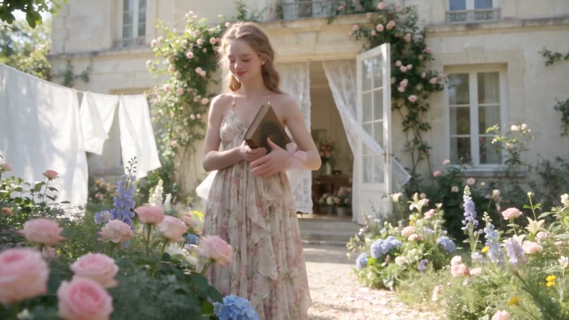</a>

▶ **[播放有声视频原片](https://awesome.raphael.app/materials/0b3445d5-9078-4c49-b3e8-b0f6189f23b3.mp4)**

<details><summary><strong>展开完整原始提示词（2636 字）</strong></summary>

```text
【影像设定与风格锁定】
法式古典极繁浪漫电影炫技长镜头，融合《傲慢与偏见》灵动调度与索菲亚·科波拉《绝代艳后》马卡龙洛可可美学。总时长 30 秒，16:9 横屏，35mm 柯达胶片配 1/4 黑柔滤镜实拍质感，高调清透的奶油暖白晨光与梦幻高光柔晕。全程采用 28mm 自然广角视感与斯坦尼康复合运镜（穿花抬升、弧线环绕、脱靶俯拍、穿门横摇），全片严格保持单一连续的一镜到底长镜头，绝不切镜。

【素材分工与角色/场景锁定】
严格按以下 4 张参考图分工锁定主角色与三段连续空间，全程不得换脸、换装或漂移画风：
- 女主角（严格参考图片 1）：将图片 1 右侧人像头部与全身服装自然融合为真实立体的完整人物（严禁无头残缺或灰底排版）。约 20 岁绝美法式少女，极度细腻白皙的瓷感公主肌与自然柔粉面颊，清澈浅灰绿眼眸，披散及腰的浅茶棕色长波浪大卷发；身穿珍珠串珠细挂脖的奶油白底粉玫瑰碎花多层荷叶边雪纺长裙，左手腕系淡粉色薄纱蝴蝶结，脚穿米白短袜与复古黑色玛丽珍皮鞋。
- 伴奏配角（仅在空间 3 出现，避免与女主混淆）：一名身穿素雅浅天蓝色复古棉布长裙、盘起金棕色低发髻的年轻姐妹，仅以侧影坐在左侧立式钢琴前弹琴。
- 空间 1（室外起点，严格参考图片 2）：沐浴灿烂晨光的法式鲜花碎石花园小径，左侧挂着透光发亮的白色亚麻床单，花径两侧盛开粉玫瑰、蓝绣球与飞燕草，正前方是攀满粉蔷薇的奶油白老宅与完全敞开的法式双开落地玻璃门，雪白提花蕾丝长纱帘被晨风吹向室外。
- 空间 2（室内中段，严格参考图片 3）：穿过敞开大门即进入的鲜花白蕾丝复古闺房，左为透光白蕾丝落地窗，中左靠墙为胡桃木五斗柜（微开抽屉探满粉玫瑰、蓝绣球与黄野花，柜顶白蕾丝台布盛放蓝绣球与紫藤），中央白铁艺床头攀满粉玫瑰、碎花棉被上放着椭圆形复古鎏金小托盘镜，右侧是一扇完全敞开的奶油白法式双开雕花大门。
- 空间 3（室内收尾，严格参考图片 4）：穿过闺房右侧双开雕花门即进入的《绝代艳后》极繁阳光沙龙，左侧是垂满紫藤粉玫瑰的旧木立式钢琴（乐谱摊开），中央白蕾丝大圆桌摆满马卡龙甜点塔、水晶香槟杯与鎏金茶具托盘，正前方三扇高大落地窗垂挂飘动白蕾丝纱帘，丁达尔光束斜洒满室，顶悬璀璨水晶吊灯。

【空间连贯与物理铁律】
三个空间按“图片 2 花园 → 穿白蕾丝敞门 → 图片 3 鲜花闺房 → 穿右侧敞开双开雕花门 → 图片 4 极繁阳光沙龙”单向贯通，绝不穿墙、绝不跨床。
人体步态铁律：人物始终面朝前进方向正常向前迈步，脚尖与身体朝向移动方向一致，严禁出现面向镜头倒退行走或滑步。镜头升降与弧线变速缓入缓出，充分展现前景花丛、飘纱、门框与圆桌甜点塔的强烈 3D 空间视差。

【30 秒复杂一镜到底时间轴（复合运镜 + 连贯事件 + 物理因果）】
0–5 秒｜【低机位穿花抬升 + 弧线右移｜蝴蝶掠书与折花】以图片 2 构图起步。摄影机从前景密集虚化的粉玫瑰与蓝绣球花丛低处缓慢垂直抬升并向右平滑摇移，穿过透光花瓣露出女主角（图片 1）：她安稳站在碎石花径中段偏左，呈四分之三侧正面站定不动，双手捧着翻开的复古旧书低头阅读。第 2 秒一只白色蝴蝶轻巧飞掠书页上方，她随蝶影抬眸浅笑，顺手将旧书夹在左臂下，右手轻快从身旁花丛折下一枝含苞粉玫瑰（左手腕淡粉蝴蝶结随动作轻晃），左侧阳光下的白亚麻床单被晨风鼓起。
5–10 秒｜【转身正向轻跑 + 俯冲跟拍穿纱帘】第 5 秒女主角自然转过身完全面向正前方的敞开老宅大门（优雅背影与侧背影朝向屋门），脚尖朝前正常轻快小跑跨上石阶、步入敞开的法式落地玻璃门，多层粉玫瑰碎花长裙摆随轻跑向后扬起。摄影机略微加速平滑俯冲紧贴她侧后方跟进；第 9 秒雪白提花蕾丝长纱帘被风掀起，柔美大面积掠过镜头前景边缘，借飘纱动势丝滑滑入室内。
10–17 秒｜【闺房脱靶绕床低俯 + 抽屉插花 + 鎏金镜倒影】镜头无缝滑入图片 3 鲜花闺房。女主角沿五斗柜与白铁艺床间的过道向前轻步走过：第 11 秒顺手将旧书合上轻放在碎花棉被一侧，再把刚才室外折下的那枝粉玫瑰自然插进胡桃木五斗柜微开抽屉的花簇中；第 13 秒摄影机主动脱离她背影，沿床侧做一次流畅低俯弧线滑行——女主角微微俯身望向床面那只椭圆形复古鎏金小托盘镜，指尖轻撩耳畔一缕茶棕卷发，鎏金镜面清晰闪过她的柔美眉眼倒影与晨光反光。第 15 秒镜头顺势抬升接回她身后，跟她轻提裙摆步向右侧敞开的奶油白双开雕花大门。
17–23 秒｜【穿门横摇揭示钢琴互动 + 白猫跃过 + 花瓣光束】摄影机加速平滑笔直穿过双开雕花门洞滑入图片 4 的极繁阳光沙龙，随即向左柔和横摇：左侧垂满紫藤的立式钢琴前，身穿浅天蓝裙的年轻姐妹正投入弹奏，手指在琴键上灵动起落；女主角微笑走过琴旁，伸手轻拍姐妹肩头互动，袖风带落琴顶几片粉玫瑰花瓣在斜射丁达尔光束中缓缓旋转飘落。与此同时，一只雪白长毛波斯猫从蕾丝圆桌布下轻巧跃过洒满阳光的木地板，自然引导视线转向中央大圆桌。
23–30 秒｜【贴桌 120° 大弧度强视差环绕 → 逆光香槟马卡龙定格】摄影机压低高度、紧贴白蕾丝圆桌边缘做一次极具电影感的 120° 大弧度平滑环绕推进——前景缤纷马卡龙甜点塔、晶莹折射日光的水晶香槟杯与粉玫瑰高速横向掠过镜头，拉出极致 3D 视差。女主角沿圆桌后侧轻盈绕至三扇发亮的白纱落地窗前停步，左手轻端起一只泛着细腻气泡的淡金香槟杯微晃，右手从塔顶拈起一颗淡粉色马卡龙轻举至唇边，缓缓转头正对摄影机微微歪头、俏皮眨眼温柔浅笑；强烈温暖的窗前逆光将她浅茶棕色大波浪发丝打透成天使金边，身后雪白蕾丝纱帘随风轻舞，摄影机平稳减速微仰停稳在中近景，定格于奢华梦幻的法式电影余韵中。

【声音基线与全局限制】
无对白，无旁白。纯自然立体声场层次递进：室外清脆鸟鸣、微风拂动亚麻床单与白纱帘沙沙声、轻快碎石脚步声；进入闺房后，书本轻放棉被声、枝叶轻擦抽屉声与隔壁隐约传来的清脆钢琴声；穿过雕花门瞬间，明快优雅的法式立式钢琴小步舞曲骤然清亮立体，伴随柔和弦乐渐强、猫爪轻踏木地板微响与水晶香槟杯轻微清脆声。
严格限制：全程严格保持单一连续一镜到底，绝不切镜、绝不穿墙、绝不跨床；严禁人物面向镜头倒退行走或滑步；严禁出现无头残缺、灰底排版、人物换脸、丢失珍珠挂脖或左手腕粉蝴蝶结；女主始终为奶油粉玫瑰碎花长裙，弹琴姐妹始终为浅天蓝裙不互换；严禁现代电器与穿帮物品；全片无字幕、无水印。
```

</details>

| 参数 | 配置 |
| --- | --- |
| 模型 | MAGI-2 (flagship) |
| 任务类型 | omni-ref |
| 时长 / 帧率 | 30.2s · 25 fps |
| 分辨率 / 比例 | 1080p · 16:9 |
| 音频模式 | mixed (audio=True) |

**多素材参考输入**

1. `image` · [作者公开的 4 张角色与三段连续空间参考素材表](https://qcnr07d9fz2l.feishu.cn/base/FOvXbgaSfahB0Esvt2VchQ2knFc)

[原始来源](https://x.com/nanyuan0412/status/2125730423171097031) · 作者: [@nanyuan0412](https://x.com/nanyuan0412) · 2026-11-25

> 作者标注为 Renoise 平台 MAGI-2 30 秒定稿，使用 4 张参考图锁定人物与三空间（原帖案例 01）。

[案例详情页](cases/rococo-garden-three-room-oner/README.zh-CN.md) · **[在 Raphael 上生成同类视频 →](https://raphael.app/ai-video-generator?utm_source=github&utm_medium=repository&utm_campaign=magi_2_launch&utm_content=case_rococo-garden-three-room-oner&utm_term=zh-CN)**

---

<a id="featured-asics-gel-nimbus-ugc-ad"></a>

#### 3. ASICS Gel Nimbus 跑鞋竖屏 UGC 广告

**来源类型**: `community` · **任务**: `T2V` · **音画**: `Yes` · **状态**: `来源收录`

4 幕 30 秒 9:16 竖屏跑鞋口播广告，含门廊开场、上脚特写、公园慢跑旁白与收尾推荐，英文对白与口型同步。

<a href="https://awesome.raphael.app/materials/e21e0ccd-1aae-4cfd-9424-6b85fe352192.mp4">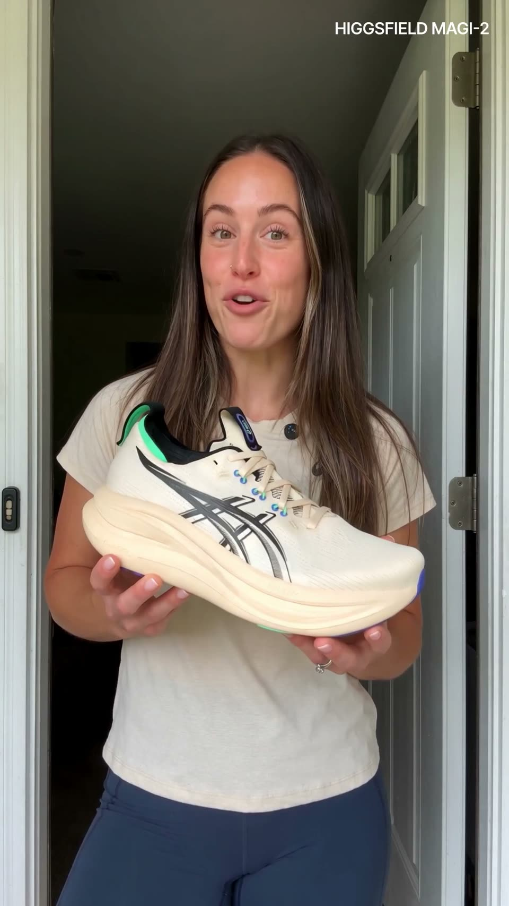</a>

▶ **[播放有声视频原片](https://awesome.raphael.app/materials/e21e0ccd-1aae-4cfd-9424-6b85fe352192.mp4)**

<details><summary><strong>展开完整原始提示词（2299 字）</strong></summary>

```text
Create a polished, highly realistic 30-second UGC-style advertisement for ASICS Gel Nimbus running shoes.

A young, attractive woman named Maya is the presenter. She should look and sound like a real lifestyle content creator recording a genuine product recommendation, not a professional actress reading a script.

Scene 1: Doorway hook (0–6 sec)

Maya stands at her apartment doorway, holding her ASICS Gel Nimbus shoes. She looks directly into the camera with an excited but natural expression.

Dialogue:

“Okay, I think I just found my new favourite running shoes. Look at these!”

She brings the teal ASICS Gel Nimbus close to the camera, showing the design.

Scene 2: First impressions (6–14 sec)

Cut to Maya sitting down and putting on the shoes. Show close-up shots of the teal upper, cushioning, ASICS logo, and sole.

Dialogue:

“These are the ASICS Gel Nimbus, and first of all, they’re so comfortable. I love how they feel on my feet.”

Scene 3: Lifestyle montage (14–23 sec)

Maya walks out onto the sidewalk, followed by shots of her jogging through a beautiful green park. Capture natural movement, shoe close-ups, and a few candid moments.

Voiceover:

“They feel soft, supportive, and honestly, I love how they look too. Perfect for my everyday walks and running sessions.”

Scene 4: Final recommendation (23–30 sec)

Maya stops on a park pathway, looks into the camera, and smiles.

Dialogue:

“If you’re looking for a pair that feels as good as it looks, definitely check these out.”

End with a premium close-up hero shot of the teal ASICS Gel Nimbus and the ASICS logo.

Production requirements:

Natural female voice with conversational delivery.
Accurate lip synchronization.
Authentic UGC filming style mixed with premium commercial shots.
Consistent Maya appearance and identical shoes throughout.
Teal ASICS Gel Nimbus prominently visible.
Realistic outdoor lighting and natural skin textures.
Soft upbeat background music mixed below the dialogue.
Natural ambient sounds during the outdoor montage.
No robotic voice, exaggerated expressions, or artificial-looking movements.
Vertical 9:16 format, 30 seconds.

Finished ad direction: A genuine creator-style product recommendation with a strong opening hook, natural praise, lifestyle footage, and a clear product reveal.
```

</details>

| 参数 | 配置 |
| --- | --- |
| 模型 | MAGI-2 (flagship) |
| 任务类型 | t2v |
| 时长 / 帧率 | 30.2s · 30 fps |
| 分辨率 / 比例 | 1080p · 9:16 |
| 音频模式 | mixed (audio=True) |

[原始来源](https://x.com/Sheldon056/status/2125445425520083116) · 作者: [@Sheldon056](https://x.com/Sheldon056) · 2026-11-25

> 作者标注 Higgsfield 合作生成；完整提示词见原回复 https://x.com/Sheldon056/status/2125445430725226653。

[案例详情页](cases/asics-gel-nimbus-ugc-ad/README.zh-CN.md) · **[在 Raphael 上生成同类视频 →](https://raphael.app/ai-video-generator?utm_source=github&utm_medium=repository&utm_campaign=magi_2_launch&utm_content=case_asics-gel-nimbus-ugc-ad&utm_term=zh-CN)**

---

<a id="featured-red-paper-kite-five-styles"></a>

#### 4. 红纸风筝穿过五种画风

**来源类型**: `community` · **任务**: `T2V` · **音画**: `Yes` · **状态**: `来源收录`

30 秒一镜到底，跟随同一只红纸风筝每 6 秒无缝穿越炭笔素描、水彩、彩绘玻璃、70 年代胶片与实景天台黄昏。

<a href="https://awesome.raphael.app/materials/32b60448-840a-4f10-9ec9-1c6a1d8ac5ba.mp4">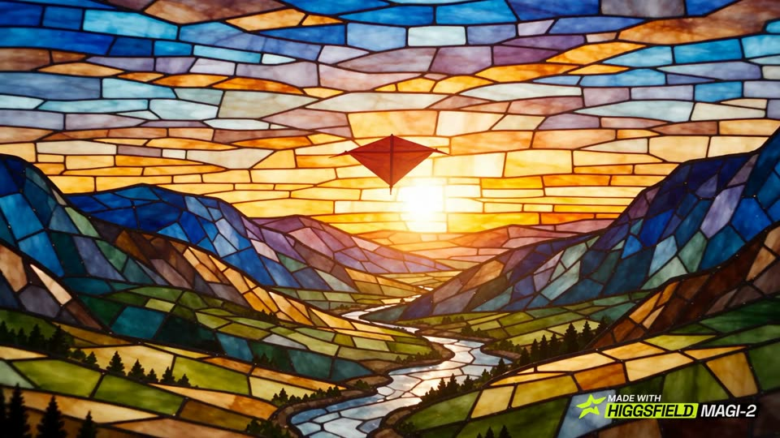</a>

▶ **[播放有声视频原片](https://awesome.raphael.app/materials/32b60448-840a-4f10-9ec9-1c6a1d8ac5ba.mp4)**

<details><summary><strong>展开完整原始提示词（1035 字）</strong></summary>

```text
One continuous 30-second take, no cuts. The camera glides forward at a steady, unhurried pace behind a small red paper kite drifting on the wind, keeping it in the upper third of frame. The world around the kite transforms seamlessly every six seconds while the kite itself never changes.

0-6s: a hand-drawn charcoal sketch of rolling hills on textured off-white paper, smudged graphite clouds.

6-12s: the lines bleed into loose watercolor washes, a valley of soft blue and ochre, pigment blooming at the edges.

12-18s: the valley hardens into a stained-glass mosaic landscape, bold dark outlines, sunlight glowing through colored glass panes.

18-24s: the glass melts into a warm 1970s 35mm film-stock coastal road, visible grain, halation, faded teal and orange.

24-30s: dusk over a modern photoreal city rooftop, unbranded window lights flickering on, the kite settling gently into the hands of a child standing on the roof.
Audio: steady soft wind throughout and a single gentle solo piano melody that slowly builds. No voices.
```

</details>

| 参数 | 配置 |
| --- | --- |
| 模型 | MAGI-2 (flagship) |
| 任务类型 | t2v |
| 时长 / 帧率 | 30.2s · 25 fps |
| 分辨率 / 比例 | 1080p · 16:9 |
| 音频模式 | mixed (audio=True) |

[原始来源](https://x.com/Dheepanratnam/status/2125658296052813844) · 作者: [@Dheepanratnam](https://x.com/Dheepanratnam) · 2026-11-25

> 作者标注通过 Higgsfield 使用 MAGI-2 生成；完整提示词见原回复 https://x.com/Dheepanratnam/status/2125658298460570035。

[案例详情页](cases/red-paper-kite-five-styles/README.zh-CN.md) · **[在 Raphael 上生成同类视频 →](https://raphael.app/ai-video-generator?utm_source=github&utm_medium=repository&utm_campaign=magi_2_launch&utm_content=case_red-paper-kite-five-styles&utm_term=zh-CN)**

---

<a id="featured-neon-night-run-edm"></a>

#### 5. 霓虹夜奔约会（128 BPM 电子乐）

**来源类型**: `community` · **任务**: `T2V` · **音画**: `Yes` · **状态**: `来源收录`

精简一段式英文提示词，生成 30 秒 16mm 手持霓虹夜景音乐短片，全程对齐 128 BPM 电子音乐节拍与落点。

<a href="https://awesome.raphael.app/materials/53df4174-2cc7-4d5f-9862-5dfce6bacb32.mp4">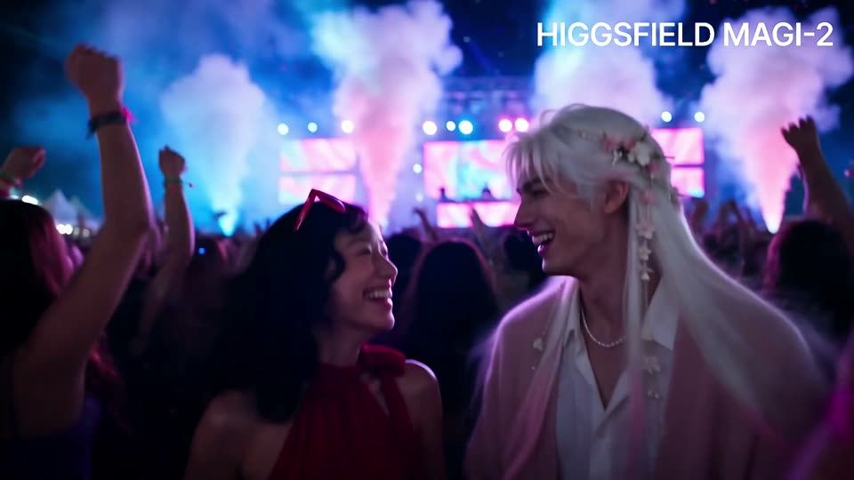</a>

▶ **[播放有声视频原片](https://awesome.raphael.app/materials/53df4174-2cc7-4d5f-9862-5dfce6bacb32.mp4)**

**提示词**

```text
Generate with full audio: a loud continuous EDM music soundtrack must play from the first second to the last. live-action music video, young couple madly in love running through one night: open-air concert → night market past a ferris wheel (piggyback ride) → glass spiral stairs → rooftop → hotel lobby spin → retro-modern corridor → freestyle dance and hug at a neon window. Raw handheld camera chasing them, vivid neon colors, 16mm grain, loud 128 BPM EDM with drops synced to the scenes.
```

| 参数 | 配置 |
| --- | --- |
| 模型 | MAGI-2 (flagship) |
| 任务类型 | t2v |
| 时长 / 帧率 | 30.2s · 30 fps |
| 分辨率 / 比例 | 1080p · 16:9 |
| 音频模式 | music (audio=True) |

[原始来源](https://x.com/NyaiiBubu/status/2125730219499962783) · 作者: [@NyaiiBubu](https://x.com/NyaiiBubu) · 2026-11-25

> 作者标注通过 Higgsfield 使用 MAGI-2 生成；提示词见原回复 https://x.com/NyaiiBubu/status/2125732070181978319。

[案例详情页](cases/neon-night-run-edm/README.zh-CN.md) · **[在 Raphael 上生成同类视频 →](https://raphael.app/ai-video-generator?utm_source=github&utm_medium=repository&utm_campaign=magi_2_launch&utm_content=case_neon-night-run-edm&utm_term=zh-CN)**

---

<a id="featured-tiny-2d-girl-in-nyc"></a>

#### 6. 迷你动画女孩闯入纽约实景

**来源类型**: `community` · **任务**: `T2V` · **音画**: `Yes` · **状态**: `来源收录`

6 幕二维手绘小人闯入超写实纽约街头的实景混合动画，保持角色比例、穿搭与物理光影交互一致，配纯都市拟音。

<a href="https://awesome.raphael.app/materials/a8d7cc8d-69ed-4500-8658-86e7c85b8182.mp4">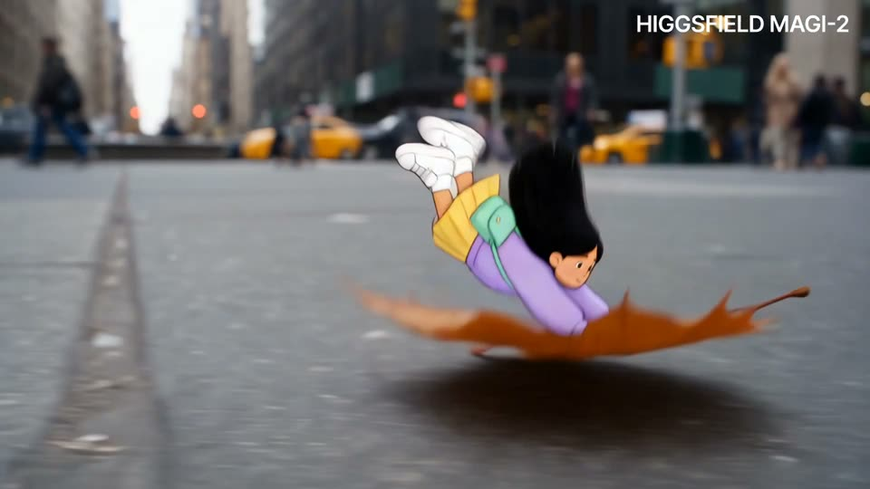</a>

▶ **[播放有声视频原片](https://awesome.raphael.app/materials/a8d7cc8d-69ed-4500-8658-86e7c85b8182.mp4)**

<details><summary><strong>展开完整原始提示词（3189 字）</strong></summary>

```text
Create a whimsical mixed-reality animated short featuring a tiny hand-drawn 2D young woman with long black hair, an oversized lavender sweatshirt, a yellow pleated skirt, chunky white sneakers, and a small mint-green crossbody bag. She is only a few inches tall, navigating an enormous, ultra-photorealistic New York City environment.

SCENE SEQUENCE:

1. The Unexpected Journey: She emerges from a crack between giant sidewalk tiles and finds herself in the middle of a busy city plaza. A huge gust from a subway ventilation grate sends her flying backward, and she desperately grabs onto a loose leaf to avoid being swept away.

2. The Pigeon Encounter: She discovers a giant discarded pretzel near a park bench and tries to climb it. Suddenly, an enormous city pigeon lands beside her, shaking the ground with its wings. She hides inside the pretzel's central hole as the bird curiously pecks around her.

3. The Fountain Adventure: She reaches a gigantic public fountain. A sudden burst of water launches her onto a floating flower petal. She uses a tiny twig as a paddle, navigating between enormous splashing water jets before getting soaked by a final unexpected splash.

4. The Subway Escape: She finds an abandoned metro ticket near a station entrance and uses it as a makeshift skateboard. It slides down a sloping pavement, narrowly avoiding enormous shoes, rolling coins, and a dropped set of keys.

5. The Unexpected Flight: A passing cyclist creates a powerful wind tunnel. Her sweatshirt inflates like a balloon, lifting her above the pavement. She grabs onto a dangling ribbon attached to a giant shopping bag, swinging through the air like a miniature trapeze artist.

6. The Final Surprise: She lands safely inside the open top of an enormous takeaway coffee cup sitting on an outdoor café table. Relieved, she stretches out and celebrates her survival. Suddenly, a human hand picks up the cup. Her eyes widen as the cup begins moving toward someone's mouth. She desperately waves both arms, ending on a hilarious freeze-frame of pure disbelief.

VISUAL STYLE & PRODUCTION:

Premium mixed-media animation combining expressive, hand-drawn 2D character animation with highly realistic live-action city environments. Maintain a consistent character appearance, proportions, clothing, hairstyle, and hand-drawn outlines throughout.

Use exaggerated differences in scale, believable environmental interactions, playful physics, detailed macro photography, cinematic depth of field, dynamic tracking shots, smooth camera movements, and seamless compositing. The tiny character should feel genuinely present in the real world, casting subtle shadows and interacting naturally with objects.

AUDIO: No dialogue and no narration. Use immersive New York street ambience, distant traffic, subway rumbling, pigeon wings, fountain splashes, bicycle sounds, footsteps, café ambience, and perfectly timed whimsical comedic sound effects.

16:9 cinematic widescreen, fluid animation, crisp details, expressive character acting, vibrant but natural colors, polished commercial-quality finish. Every scene should introduce a new visual surprise, with a funny and memorable final punchline.
```

</details>

| 参数 | 配置 |
| --- | --- |
| 模型 | MAGI-2 (flagship) |
| 任务类型 | t2v |
| 时长 / 帧率 | 30.3s · 30 fps |
| 分辨率 / 比例 | 1080p · 16:9 |
| 音频模式 | sfx (audio=True) |

[原始来源](https://x.com/john_my07/status/2125654313825628182) · 作者: [@john_my07](https://x.com/john_my07) · 2026-11-25

> 作者标注 Higgsfield 合作生成；完整提示词来自原帖。

[案例详情页](cases/tiny-2d-girl-in-nyc/README.zh-CN.md) · **[在 Raphael 上生成同类视频 →](https://raphael.app/ai-video-generator?utm_source=github&utm_medium=repository&utm_campaign=magi_2_launch&utm_content=case_tiny-2d-girl-in-nyc&utm_term=zh-CN)**

---

<a id="all-cases"></a>

## 📋 全部案例

<a id="category-dialogue-lip-sync"></a>

### 对白与口型同步

<a id="case-cms-fbd168f7"></a>

#### 1. 两位宋代女子闲游汴河

**来源类型**: `community` · **任务**: `T2V` · **音画**: `Yes` · **状态**: `来源收录`

社区 MAGI-2 视频案例（@PixelAigc）：两位宋代女子闲游汴河。

<a href="https://awesome.raphael.app/materials/bbab4e06-f997-4900-bb25-efedca0abb18.mp4"></a>

▶ **[播放有声视频原片](https://awesome.raphael.app/materials/bbab4e06-f997-4900-bb25-efedca0abb18.mp4)**

<details><summary><strong>展开完整原始提示词（1076 字）</strong></summary>

```text
总基调：宋式美学，低饱和青灰、月白、浅赭、茶褐、荷青、柳绿，大量留白构图，温润含蓄。场景连贯：荷塘柳岸、汴河画舫、清明上河图风格汴河市井，连片荷叶荷花、垂柳垂拂，拱桥、酒肆、茶幡、摊贩、行舟、往来行人，繁华但不喧嚣。两位宋代女子形象全程统一，服饰素雅、淡妆，气质松弛从容，对话简短克制，是好友随性闲游。镜头包含航拍、俯拍、环绕、快速横移、镜头对切，快慢节奏搭配，意境清雅，无字幕无水印，口型对齐。 人物： 女子 A：月白襦裙，低梳垂鬟，素玉簪，沉静温婉 女子 B：浅青褙子，素雅发髻，细银钗，灵动松弛
00:00-00:04｜镜头 1｜航拍大场景｜慢推 航拍俯瞰汴河水岸，满池荷花荷叶，垂柳依依，远处拱桥隐约，二人沿着柳荫缓步走向荷塘木桥。镜头缓慢推进。 B：荷开得正好。 音效：微风拂柳、水波轻响、远处橹声
00:04-00:07｜镜头 2｜双人中景｜快速横移 木桥上，A 扶栏杆望湖面，B 把素面团扇递给 A。镜头从荷叶快速横移至二人面部。 A：风很舒服。 音效：扇面轻响、衣料摩擦声
00:07-00:10｜镜头 3｜俯拍｜缓慢下移 俯拍桥面与荷塘，二人并肩凭栏，B 抬手指向汴河方向。镜头缓缓向下。 （无台词，安静观景） 音效：水波汩汩声

00:10-00:13｜镜头 4｜特写｜快速跟随 镜头低贴水面，跟着摇曳的荷花快速划过，A 浅浅含笑。 （无台词） 音效：花叶轻擦水面声
00:13-00:17｜镜头 5｜全景｜环绕 二人坐入画舫，A 在案前备茶，B 撩开竹帘，窗外荷塘垂柳缓缓后退，镜头围绕画舫平稳环绕。 B：前面便是街市了。 音效：船桨划水声、茶盏轻碰
00:17-00:21｜镜头 6｜大场景｜较快前推 画舫驶入汴河主河道，铺开清明上河图式河岸街景，酒旗招展、摊贩林立、行人舟船穿梭。二人探身望向岸边。 （无台词，静静观赏烟火） 音效：轻柔市井人声、叫卖底音
00:21-00:25｜镜头 7｜中近景｜双人对切 二人登岸慢行于街市，B 抬眼看向 A，镜头在两人之间对切。 A：我们去桥上看看。 音效：布幌飘动、行人脚步声

00:25-00:30｜镜头 8｜远景航拍｜慢镜拉高后拉 二人立于拱桥顶端，脚下汴河街市，一侧垂柳荷塘绵延远方，二人相视浅笑。航拍慢慢拉高后拉，宋画全景收尾。 （无台词） 音效：古琴箫声缓缓升起，市井声慢慢淡去
硬性约束：低饱和色调，拒绝浓艳花哨；街景还原北宋质感，繁而不乱；人物脸型、服饰全程稳定统一；镜头快慢交错，兼顾宏大航拍场景与细腻情绪，整体氛围松弛随性，是自在优雅的宋人闲游，台词少而淡，留白多。
```

</details>

| 参数 | 配置 |
| --- | --- |
| 模型 | MAGI-2 (flagship) |
| 任务类型 | t2v |
| 时长 / 帧率 | 30.2s · 25 fps |
| 分辨率 / 比例 | 1080p · 16:9 |
| 音频模式 | mixed (audio=True) |

[原始来源](https://x.com/PixelAigc/status/2125940739293216834) · 作者: [@PixelAigc](https://x.com/PixelAigc) · 2026-11-26

> 模型 MAGI-2 为作者自述，未经独立核实。 提示词来自同一作者的原帖回复 https://x.com/PixelAigc/status/2125940742518681943

[案例详情页](cases/cms-fbd168f7/README.zh-CN.md) · **[在 Raphael 上生成同类视频 →](https://raphael.app/ai-video-generator?utm_source=github&utm_medium=repository&utm_campaign=magi_2_launch&utm_content=case_cms-fbd168f7&utm_term=zh-CN)**

---

<a id="case-cms-0c9e2e90"></a>

#### 2. 古镇早市的婚期笑谈

**来源类型**: `community` · **任务**: `T2V` · **音画**: `Yes` · **状态**: `来源收录`

社区 MAGI-2 视频案例（@abulu8）：古镇早市的婚期笑谈。

<a href="https://awesome.raphael.app/materials/3bf7b3ae-d38f-4696-afdc-09c08d164658.mp4">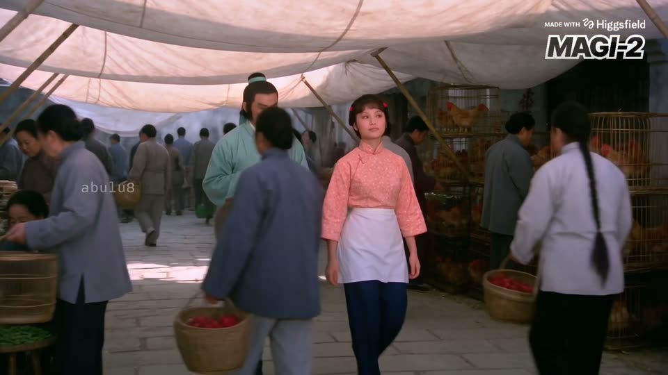</a>

▶ **[播放有声视频原片](https://awesome.raphael.app/materials/3bf7b3ae-d38f-4696-afdc-09c08d164658.mp4)**

<details><summary><strong>展开完整原始提示词（4156 字）</strong></summary>

```text
【全局前置设定：画质与质感】

1970 年代香港武侠电影中的生活喜剧段落质感。Techniscope 2.35:1 宽银幕，褪色偏暖的 Eastmancolor 胶片色调，厚重的胶片颗粒，轻微的片门抖动与边缘暗角。

那个年代的外景拍法：明亮的清晨阳光，饱满的暖黄色调，人物脸上有油彩妆感与清晰的轮廓光。摄影棚搭建的古镇街市布景，色彩鲜亮热闹。

全片没有任何打斗、没有兵器出鞘、没有特效。

声音：轻快俏皮的笛子与锣鼓配乐，市集里此起彼伏的吆喝声与讨价还价声（听不清具体内容）、鸡鸭叫声、扁担吱呀声、车轮声。对白是那个年代的国语配音质感，清晰、略带回响。

【韩子墨·书生剑客】

成年东亚男性，约二十六岁，身高 5 英尺 10 寸，身形修长匀称，比例正常的成年男性体型。黑色头发在头顶束成发髻，用一根青色发带系住；一双认真的眼睛，眉毛一急就皱起来，脸上有那个年代的油彩妆感。身穿浅青色长衫，腰系白色腰带，黑色布鞋。手里提着一只空的竹编菜篮。

他稳重、老实、心急。他已经求过亲，她也答应了，现在他只想快点把日子定下来。被她逗的时候，他会皱眉、撇嘴、耳朵发红。

【柳莺莺·俏姑娘】

成年东亚女性，约二十二岁，身高 5 英尺 3 寸，身形娇小轻快，比例正常的成年女性体型。黑色长发编成一条长辫垂在肩前，辫梢系着一条红头绳，额前留着齐眉的刘海；一双灵动的大眼睛，笑起来两个酒窝，脸上有那个年代的油彩妆感与淡淡的胭脂。身穿桃红色的碎花短袄，配一条靛蓝色长裤，腰系一条白色围裙，黑色布鞋。

她心里比谁都想嫁他，但她就是喜欢看他着急。她逗他的时候总是在挑菜——眼睛盯着菜，嘴角却在偷笑，时不时用眼角瞟他一眼。

【体型比例·必须严格遵守】

韩子墨 5 英尺 10 寸，柳莺莺 5 英尺 3 寸。两人并肩走时，她的头顶到他的肩膀。全程严格保持。

【人体完整性·防变形·必须严格遵守】

韩子墨与柳莺莺每人始终是两条手臂、两条腿、一个头，每只手五根手指。两人的面孔在任何角度下都保持稳定，五官不得拉伸、融化或互换。

所有蔬菜保持原本的形状与颜色，不得变形、融化、变成别的东西。菜篮里的菜只会越来越多，不会凭空消失。

【场景：清晨的古镇菜市】

一条热闹的古镇街市，清晨。

青石板路两旁挤满了菜摊：竹筐里堆着翠绿的白菜、红艳艳的番茄、白胖的萝卜、一串串红辣椒、一捆捆青葱、紫亮的茄子、金黄的玉米。头顶撑着一顶顶灰白色的布棚，棚下挂着成串的干辣椒与大蒜。

一个卖鸡鸭的摊子上，几只鸡在竹笼里咕咕叫。一个卖豆腐的担子冒着热气。路边有一辆装满南瓜的木板车。

街两侧是白墙黑瓦的店铺，招牌旗子在晨风中飘。阳光从街口斜射进来，穿过布棚的缝隙，在石板路上投下一道道明暗交错的光斑。

【市集里的人·背景层·必须严格遵守】

街市里有来来往往的赶集百姓与守着摊子的菜贩，他们是热闹的背景：挑着担子走过的、提着篮子讨价还价的、坐在小凳上剥豆子的。

他们始终在背景与中景，比两名主角更远、更小，绝不进入两人的近景，绝不挡住两人的脸，不给单独的特写，不说可听清的台词。菜贩始终站在自己的摊子后面。

只有一个例外：26 秒番茄滚落时，旁边番茄摊的胖大婶会出现在中景，捂着嘴笑。

所有背景人物的面孔与身体同样保持稳定，不得变形、融合、复制。

【刚性空间锚点】青石板街的走向、两侧菜摊的排列、装满南瓜的木板车、街口的阳光方向，全片绝不漂移。

【对白规则·必须严格遵守】

本片共有九句台词，全部在下方时间码中以「」标出。只有「」内的中文是被说出来的。其余所有文字——动作描述、表情描述、运镜说明——全部是画面说明，绝对不得念出、不得配音、不得作为旁白。

全片主角台词不得超过九句。背景人群只有听不清的嘈杂声，不得出现清晰的台词。不得出现旁白、内心独白。

韩子墨为年轻男声，认真、心急、越说越委屈。柳莺莺为年轻女声，清脆、俏皮、漫不经心，最后一句压低了声音，又软又甜。唇形自然同步。

【运镜·七十年代生活段落语法】

以两人并肩行走时的横移跟拍为主，镜头始终与他们同速，保持两人在画面中央；两人之间的过肩正反打；每一次她拿起一样菜时，一次快速的变焦推近到那样菜。镜头稳定，绝不晃动。

【表演的铁律】

两人一直在走、在挑菜、在把菜往篮子里放。每一句台词之前与之后都有一个具体的动作。不得出现两个人站着不动念台词的画面。

━━━━━━━━━━━━━━━━━━

【0.0—4.0 秒｜赶集】

缓慢横移的广角：清晨热闹的街市，阳光穿过布棚洒在青石板上，菜摊上的蔬菜颜色鲜亮，赶集的人来来往往，鸡在笼子里咕咕叫。

镜头穿过人群，找到并肩走着的两人：柳莺莺走在前面半步，一边走一边东张西望地看菜；韩子墨跟在旁边，提着空菜篮，眼睛一直看着她。

韩子墨清了清嗓子，凑近她一点。

韩子墨：「莺莺，我们早点成亲吧。」

运镜：横移跟拍，与两人同速，他开口时稳定在两人的中景。

【4.0—8.0 秒｜挑白菜】

柳莺莺在一个菜摊前停下，拿起一棵大白菜，翻来覆去地看，捏捏菜帮子，又凑近闻了闻。

运镜：快速变焦推近白菜，再拉回。

柳莺莺：「急什么？我还没挑好呢。」

她眼睛盯着白菜，嘴角却偷偷往上翘，用眼角瞟了他一眼。说完，她把白菜往他的菜篮里一放。

反打近景：韩子墨低头看看篮子里的白菜，又抬头看她，

... [truncated in root README; open standalone case page for full prompt]
```

[前往独立案例页查看完整 4156 字提示词 →](cases/cms-0c9e2e90/README.zh-CN.md)

</details>

| 参数 | 配置 |
| --- | --- |
| 模型 | MAGI-2 (flagship) |
| 任务类型 | t2v |
| 时长 / 帧率 | 30.3s · 30 fps |
| 分辨率 / 比例 | 1080p · 16:9 |
| 音频模式 | mixed (audio=True) |

[原始来源](https://x.com/abulu8/status/2125929153639936164) · 作者: [@abulu8](https://x.com/abulu8) · 2026-11-26

> 作者在 X 原帖中称使用 MAGI-2，模型未经独立核实。

[案例详情页](cases/cms-0c9e2e90/README.zh-CN.md) · **[在 Raphael 上生成同类视频 →](https://raphael.app/ai-video-generator?utm_source=github&utm_medium=repository&utm_campaign=magi_2_launch&utm_content=case_cms-0c9e2e90&utm_term=zh-CN)**

---

<a id="case-rainy-cafe-boarding-pass"></a>

#### 3. 雨夜咖啡馆的登机牌

**来源类型**: `community` · **任务**: `T2V` · **音画**: `Yes` · **状态**: `来源收录`

深夜雨中咖啡馆双人情感对白，含严格中文口型同步与第 7 秒、第 14 秒两次精准硬切。

<a href="https://awesome.raphael.app/materials/74ab8314-1821-4d7e-bd69-c39b4e840ba8.mp4"></a>

▶ **[播放有声视频原片](https://awesome.raphael.app/materials/74ab8314-1821-4d7e-bd69-c39b4e840ba8.mp4)**

<details><summary><strong>展开完整原始提示词（2312 字）</strong></summary>

```text
MAGI-2 DIRECTOR PROMPT
Duration: 20秒
Aspect ratio: 16:9
Reference: 程远＝一名三十二岁上下的东亚男性，短黑发微乱，穿深灰羊毛大衣配黑色高领毛衣；林夏＝一名三十岁上下的东亚女性，低马尾，穿米白风衣；全片两人面部、发型、体型与穿着完全一致。
Audio: 深夜咖啡馆低沉的冰箱嗡鸣、窗外淅沥雨声、陶瓷杯轻碰碟子的脆响、衣料摩擦声；现场中文对白（台词见节拍内），口型与台词严格同步；无旁白、无音乐、无字幕
Overall style: 8K IMAX 超写实电影，Lubezki×Deakins 摄影，只用场景内实际光源，毛孔级皮肤，180°快门运动模糊，物理重量真实，拒绝游戏CG感

GLOBAL CONTINUITY
Setting:
深夜临街小咖啡馆靠窗卡座，深胡桃木桌面有两只白瓷咖啡杯与一张折成两半的登机牌；左侧是挂满雨珠的整面落地玻璃窗，窗外是模糊的城市湿漉街景与暖黄路灯。
Main subject:
程远与林夏为双主角，身份、面部与服装全程一致。
Props:
白色纸质登机牌折成两半，平放在深胡桃木桌面正中央，距程远右手约 15 厘米。
Blocking:
程远坐画左面朝画右，林夏坐画右面朝画左，两人隔着宽约 0.9 米的木桌正对而坐，互不遮挡。
Lighting:
室内主灯关闭，仅靠桌面正上方一盏低垂暖钨丝吊灯（2800K）照亮桌面与两人半侧脸，窗外街灯冷蓝反光轻擦两人肩背。摄影机始终在人物阴影侧，无任何外部补光。
Color:
60:30:10——深棕暗影 / 暖钨丝琥珀 / 窗外冷蓝反光点缀

CAMERA CONTINUITY
全片严格只有 2 次硬切，分别在第 7.0 秒和第 14.0 秒，无过渡、无淡入淡出。前两段采用极轻的手持呼吸感 (Subtle handheld shake)，最后一段切为几乎察觉不到的缓慢推近 (Slow push-in / Dolly in)。

PERFORMANCE ENGINE
程远｜目的：把登机牌推回给林夏劝她别走 障碍：说出口就等于承认自己输了 隐藏的恐惧：她真的会头也不回 保护策略：用故作轻松的慢动作掩盖手抖
林夏｜目的：等程远亲口说一句留下来 障碍：尊严不允许先低头 隐藏的恐惧：他只是客套 保护策略：压低视线盯住杯口不接话
情绪曲线：控制 → 加压 → 裂缝 → 暴露 → 残留

0.0–7.0秒｜推牌试探
镜头开场即在运动中，程远右手食指和中指压在桌面登机牌边缘，把登机牌顺着木纹慢慢往林夏那边推过 10 厘米后手指停住；林夏左手握着白瓷杯柄，拇指在杯沿轻轻摩挲半圈，眼睛盯着桌面没抬头。
7.0–14.0秒｜硬切对峙与开口
第 7.0 秒动量匹配硬切 (Match cut) 至林夏半身胸像 (Medium close-up / Bust shot)。林夏听见纸张摩擦桌面的声音停下，先轻吸一口气，才慢慢抬眼直视画左的程远，嘴角先扯出一丝极淡的苦笑，随后笑意从眼里退掉，开口说出台词。
14.0–20.0秒｜反打破防与残留
第 14.0 秒同轴反打硬切 (Cut on axis) 至程远面部特写 (Close-up)。程远原本紧绷的下颌微微一松，喉结上下滚动一次，眼眶迅速泛湿泛光但不落泪，右手手指无意识把登机牌边角轻轻压平，低声接上一句台词，说完没有移开视线，停在沉默呼吸里。

Performance:
①（7.0–14.0秒）触发：登机牌停在杯边 → 面部：眉毛内侧极轻微抬起，下唇抿一下再松开 → 目光：从杯口缓缓抬至画左锁死对方 → 呼吸：轻吸气后平稳吐字 → 结束状态：眼神发亮但嘴角归于平直。
台词：「你每次都这样，把选择推给我。」（朝画左程远说，语速偏慢、声音轻而克制，在“这样”后停顿 0.5 秒，嘴型必须和“你-每-次-都-这-样-把-选-择-推-给-我”每个字的发音完全对上）
②（14.0–20.0秒）触发：听完林夏的话 → 面部：咬肌松开、眼皮微颤、眼球泛水光但眼泪不得早于第 20.0 秒落下 → 呼吸：鼻腔短促吸气一次 → 结束状态：嘴唇闭合，胸口缓慢起伏。
台词：「这次是我不敢留你。」（朝画右林夏说，音量压低、尾音略带气声，嘴型必须和“这-次-是-我-不-敢-留-你”每个字的发音完全对上）

Environment:
窗外雨滴沿玻璃缓慢滑落，远处偶尔有一辆车尾灯的红光在湿漉玻璃上拉出模糊光斑，咖啡馆内其余座位空无一人。
Camera:
0.0–7.0秒 35mm 双人侧景 (Two-shot) 手持呼吸感极缓横移 → 7.0秒硬切 50mm 林夏过肩半身胸像 (Medium close-up / Bust shot) 稳住焦平面 → 14.0秒硬切 85mm F1.4 程远面部特写 (Close-up) 极缓慢推近 (Slow push-in / Dolly in) 约 6 厘米。
Constraints:
登机牌始终留在桌面两人之间，不得凭空消失或变成其他纸张；两人的左右站位轴线全程锁死；口型与台词逐字严格同步，说完立刻闭唇。

---
Negative:
改变程远和林夏人物造型，重新设计服装，服装漂移，面部漂移，人物替换
多余切镜，机位瞬移，越轴，场景跳变，变焦推拉
静止发呆开场，表情一步到位，开场就崩溃，提前流泪，夸张肢体动作
登机牌消失，咖啡杯位置跳变，多手多指，口型与中文台词错位
动漫渲染，游戏CG，塑料皮肤，过度磨皮，正面补光，反光板，柔光箱
字幕，屏幕文字，水印，品牌标志，旁白，额外对白，背景音乐
```

</details>

| 参数 | 配置 |
| --- | --- |
| 模型 | MAGI-2 (flagship) |
| 任务类型 | t2v |
| 时长 / 帧率 | 20.3s · 25 fps |
| 分辨率 / 比例 | 1080p · 16:9 |
| 音频模式 | dialogue (audio=True) |

[原始来源](https://x.com/johnAGI168/status/2125480417847353448) · 作者: [@johnAGI168](https://x.com/johnAGI168) · 2026-11-25

> 作者标注为文生视频测试，完整提示词见原回复 https://x.com/johnAGI168/status/2125480454518133081；视频规格由存档 MP4 实测。

[案例详情页](cases/rainy-cafe-boarding-pass/README.zh-CN.md) · **[在 Raphael 上生成同类视频 →](https://raphael.app/ai-video-generator?utm_source=github&utm_medium=repository&utm_campaign=magi_2_launch&utm_content=case_rainy-cafe-boarding-pass&utm_term=zh-CN)**

---

<a id="case-hedgehog-pip-3d-comedy"></a>

#### 4. 刺猬 Pip 的 3D 萌宠短剧

**来源类型**: `community` · **任务**: `OMNI-REF` · **音画**: `Yes` · **状态**: `来源收录`

双角色设定图驱动的 30 秒 1440p 3D 萌宠喜剧短片，含美式英语口型对白、刺猬拟音、配乐变化与第 14 秒精准匹配剪辑。

<a href="https://awesome.raphael.app/materials/60bfd130-6d8c-477d-b2d3-72839e63c7e6.mp4"></a>

▶ **[播放有声视频原片](https://awesome.raphael.app/materials/60bfd130-6d8c-477d-b2d3-72839e63c7e6.mp4)**

<details><summary><strong>展开完整原始提示词（4897 字）</strong></summary>

```text
30-second 3D animated slice-of-life comedy, 16:9, one pass with natural shot changes and exactly one match cut at 14s. Only Maya and Pip appear. No on-screen text, subtitles, captions, labels, logos or watermarks.

STYLE (every frame): premium feature-animation 3D with warm family-film appeal; soft global illumination, subsurface skin, dense groomed quills and face fur, tactile fabric folds, gentle depth of field. Mostly medium shots and medium close-ups from a diagonal front angle so both faces, hands, tiny feet and contact points stay readable. 
Cushions and fabric compress under weight. Sensation effects are stylized cartoon overlays kept clear of eyes and mouths; nothing burns, tears or breaks. Pip's eyes lead, then head; ears, lids and weight respond together. Comfort eye-closing only after real contact. Maya's emotions show in brows, eyes, mouth and shoulders at once.
CAST:

@[Image 1](image_1) is Maya — wavy black bob with bangs, light-tan skin; white T-shirt, then the sheet's cream wool sweater after the cut. Full-preserve face, hair, build and outfit. Do not take the charcoal backdrop, panel layout or isolated studies.

@[Image 1](image_1) is Pip — round hedgehog, brown-and-cream banded quills, cream face, black bead eyes. Full-preserve face, body mass, coloring and eye color. Do not take the cream backdrop or multi-view layout. Exactly one hedgehog.

SET: one cozy living room, deep green velvet armchair, small wooden side table with a folded fleece blanket and a bowl of blueberries, tall window behind the chair. Pip on screen left, Maya in the armchair right of center; layout never changes.

PALETTE: before the cut — bright sunny afternoon, warm yellow light, Maya in a thin white T-shirt. After the cut — rainy autumn evening, amber lamp glow, rain streaks on the window.

STORY: Maya keeps dodging Pip's pointy cuddles, until an unreachable sweater itch makes his quills the perfect back-scratcher.

0-5s | Sunny afternoon. Maya reads in the armchair in her white T-shirt. Pip climbs up her arm and snuggles against her neck. At contact tiny pink cartoon starbursts pop where the quills touch. Maya jolts, eyes wide, shoulders hunched, teeth clenched: {Ow! Pip

... [truncated in root README; open standalone case page for full prompt]
```

[前往独立案例页查看完整 4897 字提示词 →](cases/hedgehog-pip-3d-comedy/README.zh-CN.md)

</details>

| 参数 | 配置 |
| --- | --- |
| 模型 | MAGI-2 (flagship) |
| 任务类型 | omni-ref |
| 时长 / 帧率 | 30.2s · 25 fps |
| 分辨率 / 比例 | 1440p · 16:9 |
| 音频模式 | mixed (audio=True) |

**多素材参考输入**

1. `image` · [角色参考设定图 1（作者公开原链）](https://pbs.twimg.com/media/HYACs_OXEAAsxmq.jpg?name=orig)
2. `image` · [角色参考设定图 2（作者公开原链）](https://pbs.twimg.com/media/HYACuJZWcAAHmAl.jpg?name=orig)

[原始来源](https://x.com/Dheepanratnam/status/2125701889702457524) · 作者: [@Dheepanratnam](https://x.com/Dheepanratnam) · 2026-11-25

> 作者标注通过 Higgsfield 使用 MAGI-2 并附两张角色参考图；完整提示词见原回复 https://x.com/Dheepanratnam/status/2125702385561424127。

[案例详情页](cases/hedgehog-pip-3d-comedy/README.zh-CN.md) · **[在 Raphael 上生成同类视频 →](https://raphael.app/ai-video-generator?utm_source=github&utm_medium=repository&utm_campaign=magi_2_launch&utm_content=case_hedgehog-pip-3d-comedy&utm_term=zh-CN)**

---

<a id="category-multi-shot-storytelling"></a>

### 多镜头时间轴叙事

<a id="case-cms-414dc90a"></a>

#### 5. 收市前的巷战

**来源类型**: `community` · **任务**: `T2V` · **音画**: `Yes` · **状态**: `来源收录`

社区 MAGI-2 视频案例（@studio_oneroom）：收市前的巷战。

<a href="https://awesome.raphael.app/materials/30c81c10-0cc9-499b-9cbb-ab3d903a7a43.mp4">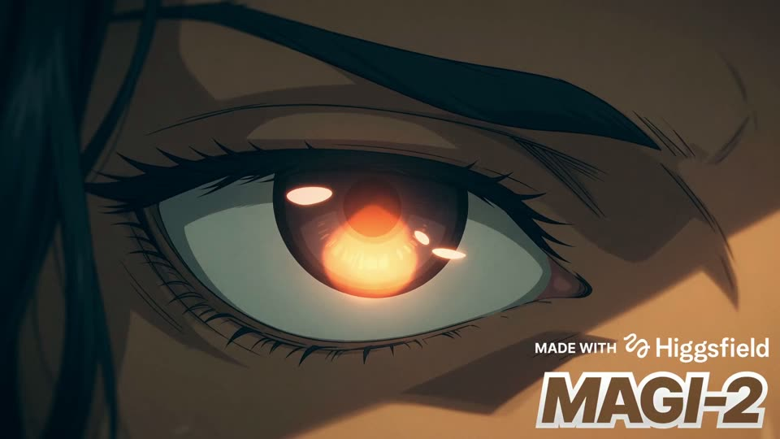</a>

▶ **[播放有声视频原片](https://awesome.raphael.app/materials/30c81c10-0cc9-499b-9cbb-ab3d903a7a43.mp4)**

<details><summary><strong>展开完整原始提示词（2607 字）</strong></summary>

```text
劇場アニメスタイルの高密度アクション。
色調:緑がかった冷たいティールを基調としたカラーグレーディング。
彩度と明度は全体的に抑え、純色を排する。
暗部は黒に潰さず、緑がかったグレーに沈める。
彩度を持つのは屋台の琥珀色のむき出しの電球と、破壊の瞬間に散る火花のみ。
曇天の拡散光、湿った空気感。
BGMなし、セリフなし、環境音あり。
フルサイズ換算24mm F1.4の広角レンズのような画角感。

# 制約
すべてのカットで画角・アングル・焦点距離・カメラの高さを変えて単調にしない。
カットの長さに緩急をつけること。「一瞬のインサート」と書かれたカットは極端に短く。
画面内に文字・字幕・ロゴを表示しないこと。
路面は濡れており、光を反射していること。
フェードアウトは使用しないこと。
映像は常に画面の四隅まで完全に満たし、円形の黒枠や暗い縁取りを描かないこと。
店主たちは常に戦いから離れた物陰におり、戦闘には一切関わらないこと。

# 方向指定（最重要・全カット共通）
左右配置：キャラAが画面左、キャラBが画面右。
向き：キャラAは常に右向き。キャラBは常に左向き。
カメラは常に二人を結ぶ線の同じ側から撮り、全カットでこの左右関係を絶対に維持すること。
いかなるカットでも左右を入れ替えないこと。

# 登場人物
## キャラA
@Image1

## キャラB
@Image2

## 店主たち
市場の年配の店主が2〜3人。エプロン姿。戦いから離れた物陰にいる。

# 情景
アジアの古い下町市場の狭い通路。閉店間際で客はいない。
様々な店が両側に密集している：
プラスチック桶や鍋や箒が積まれた雑貨屋、
干し肉とソーセージが吊るされた精肉店、
湯気を上げるスープの寸胴鍋が並ぶ小さな食堂、
果物と野菜を山積みにした青果店、氷の詰まった発泡箱の魚屋。
防水シートの庇が頭上を覆う。
照明：頭上に吊るされたむき出しの電球の琥珀色。濡れた路面がその光を反射する。
奥行き構成：前景に吊るされた干し肉と雑貨、中景に両者、遠景に市場の通路が奥へ続く。

# シーン
閉店間際の市場に立つキャラAの元へ、キャラBが歩いて詰めてくる。
店主たちが物陰に隠れて見守る中、二人の戦いが様々な店を次々と壊していき、
キャラAは食堂の湯気で流れを断ち、屋根の上へ展開して逆転する。

cut1:
85mmの望遠圧縮。手前にキャラA（右向き）の肩と後頭部が大きくボケて画面左を占め、
その肩越しに、精肉店の吊るされた干し肉の列の奥から
キャラB（左向き）がゆっくり歩いて詰めてくる。
通路脇では雑貨屋の店主が一人、様子を察して静かに台の陰へ身を低くする。
環境音：濡れた足音だけが近づく。

cut2:
一瞬のインサート。マクロ。キャラA（右向き）の目元。
琥珀色の光が瞳をかすめ、瞳孔がすっと細くなる。

cut3:
一瞬のインサート。マクロ。キャラAの靴底が濡れた路面を噛み、
氷の欠片を踏み砕く。
効果音：氷が砕ける短い音。

cut4:
16mmの超広角、地面スレスレの超ローポジション。
キャラA（右向き、画面左から右へ）が爆発的に踏み込み、通路を一直線に駆ける。
風圧で雑貨屋のプラスチック桶と箒の山が崩れ、
店主が慌てず素早く台の下へ潜り込む。水しぶきがレンズ前を横切る。
効果音：踏み込みの轟音、桶が転がる音。

cut5:
ミディアムショット。キャラA（画面左、右向き）の初撃を
キャラB（画面右、左向き）が片腕で受け流し、
返しの一撃がキャラAを青果店の棚へ叩きつける。
棚が半壊して果物が転がり落ち、山積みの野菜が崩れて路面に散らばる。
効果音：打撃音、棚が砕ける音、果物が転がる音。

cut6:
一瞬のインサート。台の陰から顔半分だけ覗かせた青果店の店主が、
崩れていく自分の店の棚を呆然と見つめる。
環境音：果物が落ち続ける音。

cut7:
キャラAのPOV。目の前に迫るキャラB（左向き）の連打。視界が左右に揺さぶられ、
防いだ腕の隙間から相手の冷たい眼が見える。
効果音：腕に当たる連続した打撃音。

cut8:
一瞬のインサート。マクロ。キャラAの視線の先、
すぐ横の食堂の厨房で湯気を上げ続けるスープの寸胴鍋。

cut9:
キャラA（画面左、右向き）が食堂の寸胴鍋を蹴り倒す。
白い湯気とスープの飛沫が爆発的に通路に噴き上がり、
キャラB（画面右）の視界を白く塗り潰す。画面全体が湯気に覆われる。
効果音：金属が倒れる音、蒸気の轟音。

cut10:
一瞬のインサート。ダッチアングルのクローズアップ。湯気の中、
激しく揺れる電球の明滅がキャラB（左向き）の顔を照らし、
腕で湯気を払うその表情から余裕が消える。そこにキャラAの姿はない。
効果音：電球コードが軋む音、蒸気の音。

cut11:
ローアングル。湯気の天井を突き破って、
キャラA（右向き）が精肉店の庇の支柱を蹴って屋根の上へ跳び上がるシルエット。
吊るされたソーセージの列が反動で大きく揺れる。
効果音：支柱を蹴る音、吊り物が揺れる音。

cut12:
ローアングル、キャラB（画面右、左向き）の視点側から見上げる。
屋根の上のキャラA（画面左上）が逆光のシルエットになり、
背後の曇天を切り取って頭上から飛びかかってくる。
効果音：シートを蹴る音、風切り音。

cut13:
【時間が引き伸ばされるスローモーション】落下しながら体を捻るキャラA（画面左上）と、
見上げて迎え撃とうとするキャラB（画面右下、左向き）。
二人の間で、揺れる電球が一つ、コードから千切れて宙に浮かぶ。
琥珀色の光がゆっくり回転する。カメラは二人の間を斜めに滑り込む。
効果音：低くうなる持続音。

cut14:
時間が戻る。落下の全体重を乗せたキャラAの一撃が
キャラB（画面右）を路面へ叩きつける。
衝撃で周囲の店が同心円状に崩れ、雑貨と果物と氷が波のように押し寄せ、
千切れた電球が路面で弾けて火花を散らす。
飛沫が静まる中、台の陰から店主たちがそっと顔を出し、
瓦礫と化した自分たちの店を見回す。
フォロースルーの姿勢のキャラA（画面左、右向き）だけが通路に立っている。
環境音：着弾の轟音、崩落の連鎖音のあと、水滴だけが戻る。
```

</details>

| 参数 | 配置 |
| --- | --- |
| 模型 | MAGI-2 (flagship) |
| 任务类型 | t2v |
| 时长 / 帧率 | 15.2s · 25 fps |
| 分辨率 / 比例 | 1080p · 16:9 |
| 音频模式 | mixed (audio=True) |

[原始来源](https://x.com/studio_oneroom/status/2125812181040242977) · 作者: [@studio_oneroom](https://x.com/studio_oneroom) · 2026-11-26

> 模型 MAGI-2 为作者自述，未经独立核实。

[案例详情页](cases/cms-414dc90a/README.zh-CN.md) · **[在 Raphael 上生成同类视频 →](https://raphael.app/ai-video-generator?utm_source=github&utm_medium=repository&utm_campaign=magi_2_launch&utm_content=case_cms-414dc90a&utm_term=zh-CN)**

---

<a id="case-cms-17ddf808"></a>

#### 6. 在森林里煮杯面

**来源类型**: `community` · **任务**: `T2V` · **音画**: `Yes` · **状态**: `来源收录`

社区 MAGI-2 视频案例（@studio_oneroom）：在森林里煮杯面。

<a href="https://awesome.raphael.app/materials/f636be3f-1c51-4b36-b745-c79d2ac35345.mp4">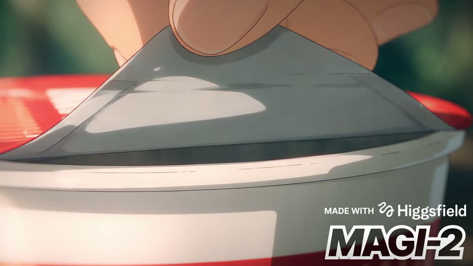</a>

▶ **[播放有声视频原片](https://awesome.raphael.app/materials/f636be3f-1c51-4b36-b745-c79d2ac35345.mp4)**

<details><summary><strong>展开完整原始提示词（1429 字）</strong></summary>

```text
添付の画像の人物がカップラーメンを作る動画 ファーストフレームに添付の画像を使わない

セリフは全て日本語、環境音あり。

# スタイル 日本のフルカラーアニメ、映画のような重厚なカラーグレーディング

# 制約 すべてのカットで画角やアングルを変えて単調にしない。

# 情景 場所：深い針葉樹の森の中。日中。木漏れ日が地面に斑に差し込む。 太い切り株の上に腰を下ろしている。 足元に小型ガスバーナーと金属製マグカップ。 カップ麺は赤いカップに白い文字で「NIPPON」のロゴ。

# シーン ひとり森の中でNIPPONのカップ麺を作って食べるまでの一連の所作。 細かい手元の動きをテンポよく見せる。

cut1: マクロショット、真横から。 地面にNIPPONカップだけが置かれている。 木漏れ日が斑にカップを照らす。 環境音：風、鳥の声。

cut2: エクストリームクローズアップ。 親指の爪がカップの蓋の端に引っかかり、ペリペリと剥がし始める。 環境音：蓋を剥がす音。

cut3: マクロショット。 手が小型ガスバーナーを地面に展開する。 環境音：金属の展開音。

cut4: エクストリームクローズアップ。 親指がライターを擦る。一度空振り。 環境音：シャッという空振り音。

cut5: エクストリームクローズアップ。 二度目で青い炎が点く。 【スピードランプ：スロー→着火で加速】 環境音：着火音、炎のボッという音。

cut6: エクストリームクローズアップ。 青い炎がゆっくりゆらめく。 環境音：炎の音。

cut7: マクロショット。 金属マグカップをバーナーの上に乗せる。 環境音：金属が置かれる音。

cut8: エクストリームクローズアップ、真上から俯瞰。 水面に最初の気泡が現れ、ゆっくりと沸騰が始まる。 環境音：水が沸騰していく音。

cut9: エクストリームクローズアップ。 指先がマグカップの縁に一瞬触れ、熱さで素早く引っ込む。 環境音：指が触れる微かな音。

cut10: ワイドショット。 木漏れ日が地面をゆっくり動いている。誰もいない静かな森。 環境音：風が木の葉を揺らす音、鳥の声。長い間。

cut11: マクロショット、斜め横から。 両手がマグカップからNIPPONカップへ湯をゆっくり注ぐ。 白い湯気が木漏れ日をキラキラと照らしながら立ち上る。 環境音：注ぐ音、湯気が立つ音。

cut12: マクロショット。 手が蓋を折り曲げて閉じ、マグカップを蓋の上に重りとして置く。 環境音：蓋を折る音。

cut13: マクロショット。 湯気がNIPPONカップの隙間から立ち上り、風でふわっと消える。 環境音：風。静寂。

cut14: マクロショット。 両手が割り箸を袋から取り出し、パキッと割る。 環境音：パキッという音。

cut15: マクロショット、真上から俯瞰。 手がNIPPONカップの蓋を開け、箸でかき混ぜる。 湯気が一気に広がる。 環境音：箸がカップに当たる音、湯気の音。

cut16: マクロショット、斜め横から。 横顔。箸でラーメンを一口すする。 環境音：すする音。

cut17: バストショット、斜め横から。 ふうっと息を吐いて遠くの木立をぼんやり見る。 目が細くなる。カメラがゆっくり横顔に寄っていく。 環境音：息を吐く音、風。シーン終わりへ向けて環境音がゆっくりフェードアウト。
```

</details>

| 参数 | 配置 |
| --- | --- |
| 模型 | MAGI-2 (flagship) |
| 任务类型 | t2v |
| 时长 / 帧率 | 17.1s · 25 fps |
| 分辨率 / 比例 | 1080p · 16:9 |
| 音频模式 | mixed (audio=True) |

[原始来源](https://x.com/studio_oneroom/status/2125917531743695064) · 作者: [@studio_oneroom](https://x.com/studio_oneroom) · 2026-11-26

> 模型 MAGI-2 为作者自述，未经独立核实。

[案例详情页](cases/cms-17ddf808/README.zh-CN.md) · **[在 Raphael 上生成同类视频 →](https://raphael.app/ai-video-generator?utm_source=github&utm_medium=repository&utm_campaign=magi_2_launch&utm_content=case_cms-17ddf808&utm_term=zh-CN)**

---

<a id="case-red-paper-kite-five-styles"></a>

#### 7. 红纸风筝穿过五种画风

**来源类型**: `community` · **任务**: `T2V` · **音画**: `Yes` · **状态**: `来源收录`

30 秒一镜到底，跟随同一只红纸风筝每 6 秒无缝穿越炭笔素描、水彩、彩绘玻璃、70 年代胶片与实景天台黄昏。

<a href="https://awesome.raphael.app/materials/32b60448-840a-4f10-9ec9-1c6a1d8ac5ba.mp4"></a>

▶ **[播放有声视频原片](https://awesome.raphael.app/materials/32b60448-840a-4f10-9ec9-1c6a1d8ac5ba.mp4)**

<details><summary><strong>展开完整原始提示词（1035 字）</strong></summary>

```text
One continuous 30-second take, no cuts. The camera glides forward at a steady, unhurried pace behind a small red paper kite drifting on the wind, keeping it in the upper third of frame. The world around the kite transforms seamlessly every six seconds while the kite itself never changes.

0-6s: a hand-drawn charcoal sketch of rolling hills on textured off-white paper, smudged graphite clouds.

6-12s: the lines bleed into loose watercolor washes, a valley of soft blue and ochre, pigment blooming at the edges.

12-18s: the valley hardens into a stained-glass mosaic landscape, bold dark outlines, sunlight glowing through colored glass panes.

18-24s: the glass melts into a warm 1970s 35mm film-stock coastal road, visible grain, halation, faded teal and orange.

24-30s: dusk over a modern photoreal city rooftop, unbranded window lights flickering on, the kite settling gently into the hands of a child standing on the roof.
Audio: steady soft wind throughout and a single gentle solo piano melody that slowly builds. No voices.
```

</details>

| 参数 | 配置 |
| --- | --- |
| 模型 | MAGI-2 (flagship) |
| 任务类型 | t2v |
| 时长 / 帧率 | 30.2s · 25 fps |
| 分辨率 / 比例 | 1080p · 16:9 |
| 音频模式 | mixed (audio=True) |

[原始来源](https://x.com/Dheepanratnam/status/2125658296052813844) · 作者: [@Dheepanratnam](https://x.com/Dheepanratnam) · 2026-11-25

> 作者标注通过 Higgsfield 使用 MAGI-2 生成；完整提示词见原回复 https://x.com/Dheepanratnam/status/2125658298460570035。

[案例详情页](cases/red-paper-kite-five-styles/README.zh-CN.md) · **[在 Raphael 上生成同类视频 →](https://raphael.app/ai-video-generator?utm_source=github&utm_medium=repository&utm_campaign=magi_2_launch&utm_content=case_red-paper-kite-five-styles&utm_term=zh-CN)**

---

<a id="case-library-note-youth-short"></a>

#### 8. 图书馆纸条里的青春暗号

**来源类型**: `community` · **任务**: `T2V` · **音画**: `Yes` · **状态**: `来源收录`

7 镜头 30 秒中国高中图书馆无对白实拍短片，围绕纸条改字、推书与桌下鞋尖轻触展开叙事，纯环境与动作拟音。

<a href="https://awesome.raphael.app/materials/8b4ed9b9-5c66-4c49-b40c-a011d18ab44f.mp4"></a>

▶ **[播放有声视频原片](https://awesome.raphael.app/materials/8b4ed9b9-5c66-4c49-b40c-a011d18ab44f.mp4)**

<details><summary><strong>展开完整原始提示词（5411 字）</strong></summary>

```text
【影片类型与时长】 制作一支30秒、16:9横屏、真人实拍质感的青春校园短片。故事发生在初夏午后的中国高中图书馆，男女主均为18岁的高三学生。环境、校服、书本和生活细节明确属于中国校园，影像采用清透、略带暗沉青绿色调的日式青春电影质感。全片围绕一张夹在书里的小纸条展开：女生偷偷递出邀请，男生故意停顿，让她误以为被拒绝，最后把“明天见”改成“每天见”。两个人没有表白，也没有说话，只通过一次推书、一瞬触碰、一张纸条和桌下悄悄靠近的鞋尖，让暧昧自然发生。 整体情绪从女生的紧张试探，经过男生故意逗她的小小悬念，发展到心意被回应后的羞涩与默契。最后停留在两人已经知道彼此心意，却仍装作认真读书的瞬间。没有产品展示、没有品牌标识、没有广告文案，也不出现片尾抒情字幕。
【整体视觉风格】 真实人物、真实摄影、自然表演。画面细腻、含蓄，有午后自习时压低声音的安静感，也有青春期藏不住的小动作。镜头认真观察眼睛、手指、纸张和两人之间的距离，情绪通过动作发生，不依赖大幅度表情与频繁慢镜头。 整体色彩由柔和灰白、低饱和青绿、旧木色和校服藏青组成。图书馆深处的阴影轻微偏青绿，白色窗帘和白色校服保留柔软的灰白层次，人物皮肤呈自然浅暖色，与冷一些的环境形成细微分离。曝光略微压低，但面部仍然干净通透，不能灰暗发脏。黑色头发保留发丝层次，木桌不偏浓烈橙黄，绿色窗外景色不鲜艳刺眼。 自然光从画面侧后方的大窗进入，先经过薄白窗帘，再柔和地照到书页、手指和脸颊。少量午后阳光落在桌面上，形成边缘模糊的光斑，随着树叶与窗帘轻轻变化。高光带极轻微的柔化，避免整片泛白、过曝、强烈炫光或浓重柔焦。画面保持清晰、低噪点，不添加明显胶片颗粒、复古划痕和过度锐化。 镜头运动缓慢而克制，近景中两人的眼睛清楚，背景书架与窗外树叶适度虚化。只有指尖接近、纸条翻回来的瞬间稍作停顿，其余动作保持真实速度，让30秒内的叙事自然流动。
【场景与中国校园氛围】 主要场景为中国普通高中的图书馆阅览区，初夏下午最后一节自主阅读课。图书馆安静、整洁，带有使用多年的生活痕迹。浅米白墙面，深绿色或灰绿色金属窗框，窗下有普通暖气片，薄白窗帘被半开的窗户吹得轻轻鼓起。窗外能看到香樟树、教学楼走廊与操场边缘，远处偶尔有穿校服的学生经过。 阅览区摆放长条形浅棕木桌，桌面有细小划痕与自然磨损，搭配木面金属脚靠背椅。书架上是不同厚度的中文书籍，书脊带常见的索书标签，不出现日文书名或日式校园装饰。远处墙面可以有一块小而朴素的“保持安静”提示牌，文字只作为环境细节，不占据主要画面。 男女主并肩坐在同一张桌子靠窗的一侧，女生位于画面左侧，男生位于画面右侧，肩膀之间起初隔着约二十厘米。镜头主要从桌子对面拍摄，因此能看到两人的正面与上半身。女生左侧靠窗，男生右侧靠过道，空间方向全片保持一致。 桌面物品有限且位置清楚：女生面前一本摊开的中文散文集，一支深蓝色中性笔，一本浅色笔记本；男生面前一本打开的书和一支黑色中性笔。两人之间留出足够推书的空间。桌面没有饮料广告、食品包装或品牌露出。后景只保留两三个安静读书的学生，始终虚化，不参与男女主的互动。
【女主外貌与服装】 女主为18岁中国高中女生，脸型柔和，略带自然的青春饱满感。黑色眼睛清楚明亮，眼尾柔和，眉毛自然平直，鼻子比例适中，嘴唇是未经明显修饰的淡粉色。脸上保留真实细腻的皮肤纹理，不使用浓妆、修容、假睫毛或明显唇釉。她的美感来自干净的眼神、安静的神情和表情中藏不住的小紧张。 黑色头发在脑后扎成低马尾，额前是稀疏自然的碎刘海，耳边有一两缕没有扎进去的短发。发型具有真实上学时的随意感，不做精致卷发。她紧张时会下意识抿住嘴唇，视线短暂落向桌面；开心时先是眼睛松下来，随后嘴角才慢慢扬起。 服装为中国高中常见的夏季运动校服，脚穿普通白色帆布鞋，鞋边有轻微使用痕迹。整体是朴素的中国学生穿搭。 她不是一味害羞。她会主动写下纸条，也会在误会男生拒绝时，带一点不服气地想把书收回来。最后发现男生回应，她先看他一眼，再低头忍笑，保留自己的小骄傲。
【男主外貌与服装】 男主为18岁中国高中男生，身形修长，肩背自然舒展，清瘦但不单薄。脸型略长，轮廓干净，眉毛稍浓，黑色眼睛带一点慵懒与顽皮。嘴角习惯轻微偏向一侧，笑容有一点故作镇定的坏，但不能显得油滑或成熟世故。 黑色短发自然蓬松，额前碎发轻轻垂落，没有发胶塑造的尖刺，也没有遮住眼睛的长刘海。面部无胡须，皮肤自然，鼻梁与眼下有柔和阴影。他的吸引力来自轻松的姿态、看穿女生小心思后又忍不住回应的眼神，以及自己其实也紧张，却装得很镇定的反差。 男生穿与女生同校同款的短袖校服，普通灰白色运动鞋。坐姿起初比女生松一点，一只前臂搭在桌上，另一只手压着书页，但不翘椅子、不把脚架到桌上。 他不会做“邪魅一笑”、挑下巴或故意贴脸之类夸张动作。暧昧主要表现为：明明注意到女生在写纸条，却不立刻看她；读到邀请后故意停一拍；改完字又装作继续读书；最后悄悄把自己的椅子往她那边挪近一点。
【核心道具与纸条文字】 纸条是一张从普通横线笔记本上取下来的小纸，约手掌一半大小，纸张浅白，边缘略有撕开的不齐。不要使用爱心形信纸、粉色信封、贴纸或精致礼物，让它像真实学生临时写下的一句话。 女生写在纸条上的内容为： “明天，还坐这里吗？” 使用清楚、自然、略显认真但并不花哨的中文手写体。男生的回应

... [truncated in root README; open standalone case page for full prompt]
```

[前往独立案例页查看完整 5411 字提示词 →](cases/library-note-youth-short/README.zh-CN.md)

</details>

| 参数 | 配置 |
| --- | --- |
| 模型 | MAGI-2 (flagship) |
| 任务类型 | t2v |
| 时长 / 帧率 | 29.8s · 30 fps |
| 分辨率 / 比例 | 1080p · 16:9 |
| 音频模式 | sfx (audio=True) |

[原始来源](https://x.com/TanLuAI/status/2125607851343409220) · 作者: [@TanLuAI](https://x.com/TanLuAI) · 2026-11-25

> 作者标注全片为文生视频生成；完整提示词见原回复 https://x.com/TanLuAI/status/2125607857148301811。

[案例详情页](cases/library-note-youth-short/README.zh-CN.md) · **[在 Raphael 上生成同类视频 →](https://raphael.app/ai-video-generator?utm_source=github&utm_medium=repository&utm_campaign=magi_2_launch&utm_content=case_library-note-youth-short&utm_term=zh-CN)**

---

<a id="category-omni-reference"></a>

### 全能多素材一致性

<a id="case-cms-ea3e77d5"></a>

#### 9. 暴风雪后的雪板追逐

**来源类型**: `community` · **任务**: `OMNI-REF` · **音画**: `Yes` · **状态**: `来源收录`

社区 MAGI-2 视频案例（@magiai_hq）：暴风雪后的雪板追逐。

<a href="https://awesome.raphael.app/materials/d2f9eab6-8225-4012-92dd-5086d9596091.mp4">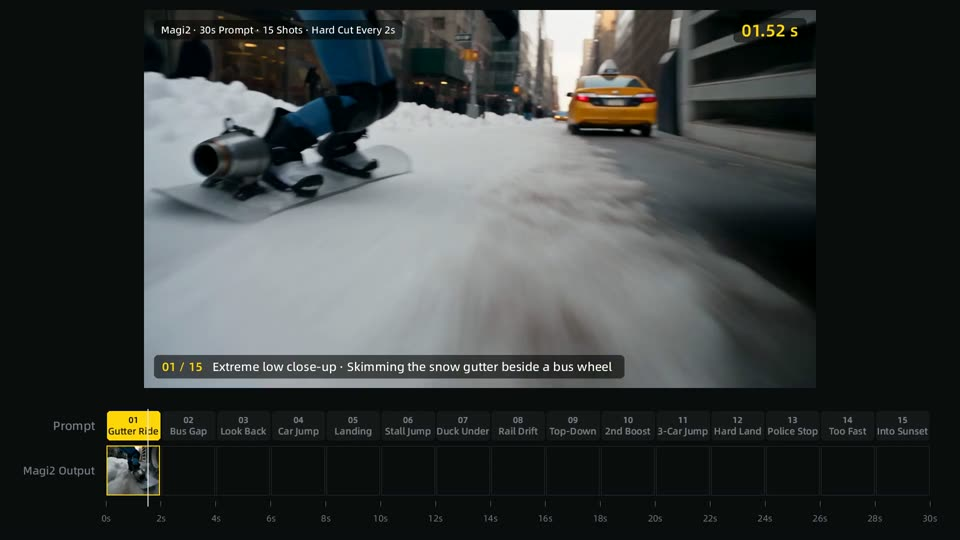</a>

▶ **[播放有声视频原片](https://awesome.raphael.app/materials/d2f9eab6-8225-4012-92dd-5086d9596091.mp4)**

<details><summary><strong>展开完整原始提示词（24841 字）</strong></summary>

```text
Reference Material Notes
@Image 1: The female protagonist's identity reference. Strictly use the same adult woman's face shape, facial proportions, skin tone, age appearance, hairline, hair color, and hairstyle as in the reference image. In frontal, side, looking-back, bent-over, airborne, and distant views she is always the same person; do not redesign the face.

The reference image is used only to lock the character's identity, hair, and body proportions. Clothing, gear, scene, lighting, and actions are regenerated according to the prompt below.

Core Concept
A strictly 30-second, hyper-realistic winter city chase with a strong sense of speed and pressure: the woman from the reference image rides a modified snowboard with twin rocket boosters mounted at the tail, continuously threading through moving traffic gaps, vehicles, market stalls, and low obstacles in a busy downtown after a blizzard, relying on real carving, skidding, snow-slope jumps, and short rocket boosts to shake off two police cars.

The action is tight, danger keeps closing in, and the woman always observes ahead, judges quickly, and actively chooses her route. The environment changes at the same time: foreground objects sweep past at high speed, the midground carries the action, and the background continuously advances the pursuit. Do not let vehicles and pedestrians stand still waiting for the woman to pass.

The final officer says in English: "She's too fast." Then cut back to the woman still carving at high speed, ending as she slips into a streetscape under the setting sun.

Timing and Editing Rules
Landscape 16:9, 4K HDR, 24fps, total duration strictly 30 seconds, 720 frames in total. Fixed 15 shots, each strictly 2 seconds / 48 frames.

All cuts between shots are clean hard cuts; no dissolves, flash-whites, black frames, or morph transitions. Cut points fixed at 02, 04, 06, 08, 10, 12, 14, 16, 18, 20, 22, 24, 26, 28 seconds.

Hard cuts must carry the action across:
If the previous shot is mid-carve, the next continues the same carve; if the previous shot is airborne, the next continues the same flight phase; if the previous shot is landing, the next absorbs the impact. After a cut, motio

... [truncated in root README; open standalone case page for full prompt]
```

[前往独立案例页查看完整 24841 字提示词 →](cases/cms-ea3e77d5/README.zh-CN.md)

</details>

| 参数 | 配置 |
| --- | --- |
| 模型 | MAGI-2 (flagship) |
| 任务类型 | omni-ref |
| 时长 / 帧率 | 29.9s · 25 fps |
| 分辨率 / 比例 | 1080p · 16:9 |
| 音频模式 | dialogue (audio=True) |

[原始来源](https://x.com/magiai_hq/status/2125811625198522612) · 作者: [@magiai_hq](https://x.com/magiai_hq) · 2026-11-26

> 模型 MAGI-2 为作者自述，未经独立核实。 作者在同一串帖中标注模型：https://x.com/magiai_hq/status/2125811617145528821

[案例详情页](cases/cms-ea3e77d5/README.zh-CN.md) · **[在 Raphael 上生成同类视频 →](https://raphael.app/ai-video-generator?utm_source=github&utm_medium=repository&utm_campaign=magi_2_launch&utm_content=case_cms-ea3e77d5&utm_term=zh-CN)**

---

<a id="case-cms-b0f22c2e"></a>

#### 10. 粉色睡衣的夜间自拍视频

**来源类型**: `community` · **任务**: `OMNI-REF` · **音画**: `Yes` · **状态**: `来源收录`

社区 MAGI-2 视频案例（@ai_japan_muse）：粉色睡衣的夜间自拍视频。

<a href="https://awesome.raphael.app/materials/0ead5ed0-9c2b-4816-a34a-b3f7984cdcaa.mp4"></a>

▶ **[播放有声视频原片](https://awesome.raphael.app/materials/0ead5ed0-9c2b-4816-a34a-b3f7984cdcaa.mp4)**

<details><summary><strong>展开完整原始提示词（3046 字）</strong></summary>

```text
Create an exactly 30-second, vertical 9:16, ultra-photorealistic smartphone video. Use the provided reference image as the primary visual reference for the woman's facial identity, hairstyle, fluffy pink-and-white pajamas, and bedroom environment. Maintain exactly the same woman and consistent facial features throughout the entire video.

SCENE:
A cute Japanese woman in her early 20s is relaxing on a soft light-pink cushion in her cozy bedroom late at night. She wears adorable, fluffy, warm-looking pajamas. Her bedroom is filled with charming pastel-pink decorations, soft plush toys, cute cushions, warm bedside lighting, and cozy details. The atmosphere is intimate, peaceful, and comforting.

CAMERA:
A natural handheld smartphone camera positioned at her eye level, as if a close friend is talking with her before bedtime. Slight natural handheld movement, realistic autofocus, authentic smartphone video quality. One continuous take with no cuts.

TIMELINE:

0-5 seconds:
She looks directly into the camera with a bright, refreshing smile. She slightly tilts her head and gently waves one hand.
She says in natural, cheerful Japanese:
「こんばんは！今日も一日お疲れさま！」

5-11 seconds:
She relaxes her shoulders, gently hugs a soft cushion, and looks into the camera with a friendly expression.
She says:
「今日はどんな一日だった？楽しいことあった？」

11-17 seconds:
She gives a small playful smile, tilts her head slightly, and briefly looks upward as if thinking.
She then looks back at the camera and says:
「私はね、こうしてみんなとお話しできるのが楽しみなんだ♪」

17-23 seconds:
She gently adjusts her fluffy pajama sleeves, leans comfortably toward the camera, and smiles warmly.
She says in a softer, affectionate voice:
「そろそろ寝る時間かな？あんまり夜更かししちゃダメだよ？」

23-27 seconds:
She moves a little closer to the camera, maintaining warm eye contact. Her expression becomes tender and slightly bashful. She gives a small, gentle smile and says:
「明日もまた会おうね。」

27-30 seconds:
She slowly brings her face close to the smartphone camera until her face fills most of the frame. She looks directly into the lens with a lovely, intimate smile, gives a tiny goodnight wave, and softly whispers:
「おやすみなさい♡」

At the final moment, she gently closes her eyes and smiles.

AUDIO:
Natural, clear Japanese female voice, youthful and sweet, with authentic conversational intonation. Accurate Japanese lip synchronization for every spoken line. Soft, gentle bedtime background music with delicate piano and music-box tones, kept quiet beneath the dialogue. No narration, no additional voices.

VISUAL QUALITY:
Extremely realistic human appearance, natural skin texture, realistic eye movements, subtle facial expressions, believable body movements, soft nighttime lighting, warm pastel color grading.

IMPORTANT:
Preserve the exact same facial identity throughout. No face morphing, no character changes, no anime, no illustrations, no CGI appearance, no artificial beauty filters, no sudden scene transitions, no subtitles, no captions, no logos, no watermarks. The final close-up must feel natural and emotionally intimate.
```

</details>

| 参数 | 配置 |
| --- | --- |
| 模型 | MAGI-2 (flagship) |
| 任务类型 | omni-ref |
| 时长 / 帧率 | 30.2s · 25 fps |
| 分辨率 / 比例 | 1080p · 9:16 |
| 音频模式 | dialogue (audio=True) |

[原始来源](https://x.com/ai_japan_muse/status/2125961035328921722) · 作者: [@ai_japan_muse](https://x.com/ai_japan_muse) · 2026-11-26

> 模型 MAGI-2 为作者自述，未经独立核实。

[案例详情页](cases/cms-b0f22c2e/README.zh-CN.md) · **[在 Raphael 上生成同类视频 →](https://raphael.app/ai-video-generator?utm_source=github&utm_medium=repository&utm_campaign=magi_2_launch&utm_content=case_cms-b0f22c2e&utm_term=zh-CN)**

---

<a id="case-cms-fdda6fe4"></a>

#### 11. 雨中巴黎的冷面喜剧

**来源类型**: `community` · **任务**: `OMNI-REF` · **音画**: `Yes` · **状态**: `来源收录`

社区 MAGI-2 视频案例（@Ciri_ai）：雨中巴黎的冷面喜剧。

<a href="https://awesome.raphael.app/materials/6b1fee73-b1e4-4c82-9a5a-18cdda5c2128.mp4">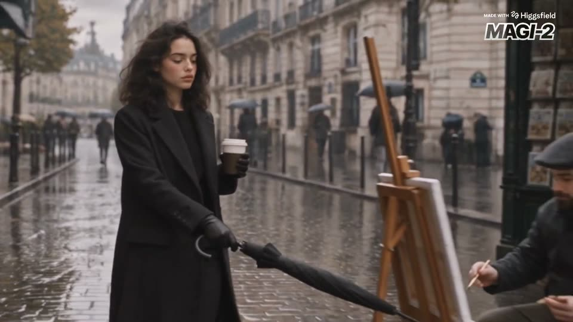</a>

▶ **[播放有声视频原片](https://awesome.raphael.app/materials/6b1fee73-b1e4-4c82-9a5a-18cdda5c2128.mp4)**

<details><summary><strong>展开完整原始提示词（1537 字）</strong></summary>

```text
THE GENTLEWOMAN 02 — THE ART OF NOT CARING. CLIP 2: THE CITY BOWS DOWN. Create the second 15-second cinematic deadpan physical-comedy sequence in the same rainy Paris morning, visually continuous with clip 1. Use the character-sheet image as the strict identity, face, hair, wardrobe and prop reference; same woman, same charcoal-black long coat, dark outfit and boots. Coffee cup stays in her LEFT hand; CLOSED matte-black umbrella stays in her RIGHT hand at all times and never opens. In five elegant, fast, readable vignettes: 1) she rescues a street artist's easel from tipping by nudging its support back into place with the closed umbrella; 2) a paper bag of birdseed slips, scattering pigeons; she calmly rights the bag and guides it back to the owner; 3) a waiter struggles with a wobbling silver serving tray; she catches and steadies the edge using the umbrella handle without taking the tray; 4) at a grand Paris hotel entrance, a suitcase wheel is stuck in a cobblestone gap; she uses the umbrella tip to free it with one precise movement; 5) close-up as she continues walking, finally allowing the faintest satisfied smile, then returns to her perfectly neutral expression. Finish with a doorman giving her a small respectful nod as she passes. Understated visual comedy, believable physics, soft overcast light, wet reflective Paris streets, refined European fashion-film cinematography, smooth tracking and clean cuts. No dialogue, no captions, no text, no hand switching, no umbrella opening, no extra props in her hands.
```

</details>

| 参数 | 配置 |
| --- | --- |
| 模型 | MAGI-2 (flagship) |
| 任务类型 | omni-ref |
| 时长 / 帧率 | 22.6s · 30 fps |
| 分辨率 / 比例 | 1080p · 16:9 |
| 音频模式 | mixed (audio=True) |

[原始来源](https://x.com/Ciri_ai/status/2125795679201304780) · 作者: [@Ciri_ai](https://x.com/Ciri_ai) · 2026-11-26

> 作者自述使用 MAGI-2，未经独立核实。

[案例详情页](cases/cms-fdda6fe4/README.zh-CN.md) · **[在 Raphael 上生成同类视频 →](https://raphael.app/ai-video-generator?utm_source=github&utm_medium=repository&utm_campaign=magi_2_launch&utm_content=case_cms-fdda6fe4&utm_term=zh-CN)**

---

<a id="case-cms-de6cd92d"></a>

#### 12. ONE HIT 时装换装广告

**来源类型**: `community` · **任务**: `T2V` · **音画**: `Yes` · **状态**: `来源收录`

社区 MAGI-2 视频案例（@joshesye）：ONE HIT 时装换装广告。

<a href="https://awesome.raphael.app/materials/d2ef3d5b-4cc2-4ec9-8745-cf9097f4b48b.mp4">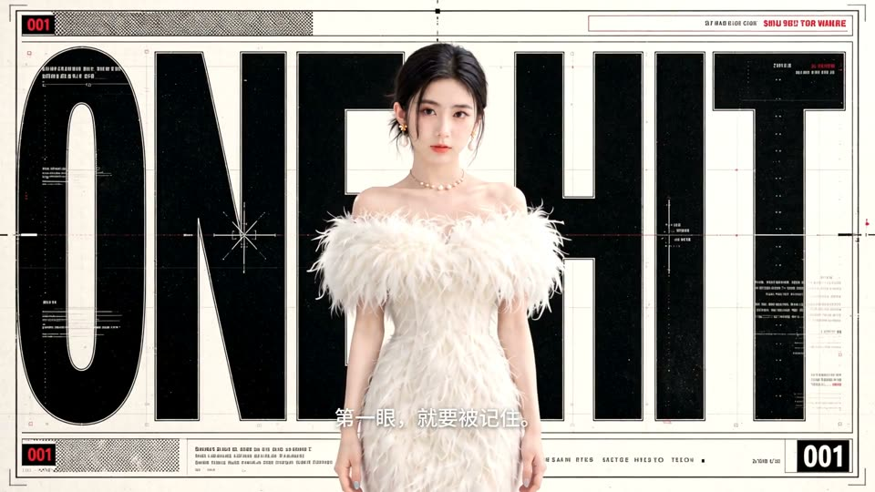</a>

▶ **[播放有声视频原片](https://awesome.raphael.app/materials/d2ef3d5b-4cc2-4ec9-8745-cf9097f4b48b.mp4)**

<details><summary><strong>展开完整原始提示词（3779 字）</strong></summary>

```text
Create a 15-second 16:9 fashion lookbook MV combining rapid outfit changes, magazine editorial graphics, and beat-synced transitions.
The video is not narrative-driven. Core structure:
Locked camera → Typography reveal → Close-up → Rapid Look switches → Hero Ending
Keep the same female character centered in frame throughout the video. Preserve facial identity, body proportions, skin tone, and overall appearance across every outfit.
0.0–1.5s
Pure white studio, girl standing naturally in the center.
Camera locked.
Huge black typography “ONE HIT” rapidly expands behind her.
Magazine elements appear on the beat:
barcode, scan lines, crosshair, numbers, thin borders, grid graphics.
The clean studio instantly becomes a bold fashion magazine poster.
1.5–3.0s
Fast camera push-in to a close-up.
The girl gently turns toward camera, hair moving naturally, direct eye contact, calm and confident expression.
Black-and-white editorial background with subtle film grain.
3.0–4.5s
Look 01.
Instant outfit change on the beat.
Character stays centered and makes a natural fashion pose.
Background switches to a completely new magazine layout with oversized headline, barcode and numbering.
4.5–6.0s
Look 02.
New outfit.
Medium shot. Girl takes one confident step forward.
Background typography rapidly changes.
Black and white remain dominant with stronger red accents.
6.0–7.5s
Look 03.
New outfit.
Girl makes a gentle half-turn, hair swinging naturally.
Background changes to red-and-white editorial graphics with huge English typography, numbers, coordinates, scan lines and borders.
7.5–9.0s
Look 04.
Sporty fashion outfit.
Girl leans slightly forward with a relaxed confident smile.
Subtle low-angle camera.
Large red magazine typography slides into frame on the beat.
9.0–10.5s
Look 05.
New outfit.
Girl moves into a stylish crouching pose.
Quick camera push-in.
Background layout completely rearranges, creating a new visual impact.
10.5–12.0s
Look 06.
Girl stands again.
Camera pulls back to medium shot.
Bold yellow fashion uniform with long blue hair styling.
Background returns to black-and-white editorial design with large headline and barcode elements.
12.0–13.5s
Look 07.
Sharp tailored suit.
Girl walks confidently toward camera.
Background switches to red-and-black magazine design.
New headline, number codes, scan lines and graphic grids appear rapidly.
Pacing becomes faster.
13.5–15.0s
Final Hero Shot.
Girl wears a minimal black fashion look.
Arms crossed, standing confidently in the center.
Camera settles into a clean medium shot.
Background gradually simplifies, leaving only a few premium magazine graphics.
Final logo or visual mark appears naturally.
Freeze on the final beat.
Overall Style
Premium Korean fashion lookbook, editorial fashion photography, Y2K magazine design, high-end commercial photography.
Black and white base with red accents.
Oversized English typography, barcode, scan lines, crosshair, coordinates, numbering, grids, thin borders, subtle film grain.
Switch to a new outfit or visual layout every 1–1.5 seconds, synchronized closely with the music beat.
Keep the camera relatively controlled. Use quick push-ins, subtle pull-backs, pose changes, graphic transitions, and layout swaps.
Character must always remain near the center of frame.
Maintain realistic hair movement, fabric physics, natural poses, clean studio lighting, and high-contrast premium photography.
Avoid
No face drift, character replacement, body morphing, extra limbs, distorted hands, unstable proportions, messy typography, chaotic camera movement, random backgrounds, cartoon style, low-quality CGI, watermark, or unwanted subtitles.
Final result should feel like a high-end Korean fashion campaign mixed with a Y2K magazine cover and beat-synced music video.
```

</details>

| 参数 | 配置 |
| --- | --- |
| 模型 | MAGI-2 (flagship) |
| 任务类型 | t2v |
| 时长 / 帧率 | 14.8s · 30 fps |
| 分辨率 / 比例 | 1080p · 16:9 |
| 音频模式 | music (audio=True) |

[原始来源](https://x.com/joshesye/status/2125557298135245012) · 作者: [@joshesye](https://x.com/joshesye) · 2026-11-25

> 作者在 X 原帖中称使用 MAGI-2，模型未经独立核实。完整提示词来自同一作者的回复：https://x.com/joshesye/status/2125557476208570465

[案例详情页](cases/cms-de6cd92d/README.zh-CN.md) · **[在 Raphael 上生成同类视频 →](https://raphael.app/ai-video-generator?utm_source=github&utm_medium=repository&utm_campaign=magi_2_launch&utm_content=case_cms-de6cd92d&utm_term=zh-CN)**

---

<a id="case-cms-bd4ae1e1"></a>

#### 13. 无底洞里走回来的鞋

**来源类型**: `community` · **任务**: `OMNI-REF` · **音画**: `Yes` · **状态**: `来源收录`

社区 MAGI-2 视频案例（@john87445528）：无底洞里走回来的鞋。

<a href="https://awesome.raphael.app/materials/3cb8ab95-e891-4b12-9f62-afb844947ae3.mp4">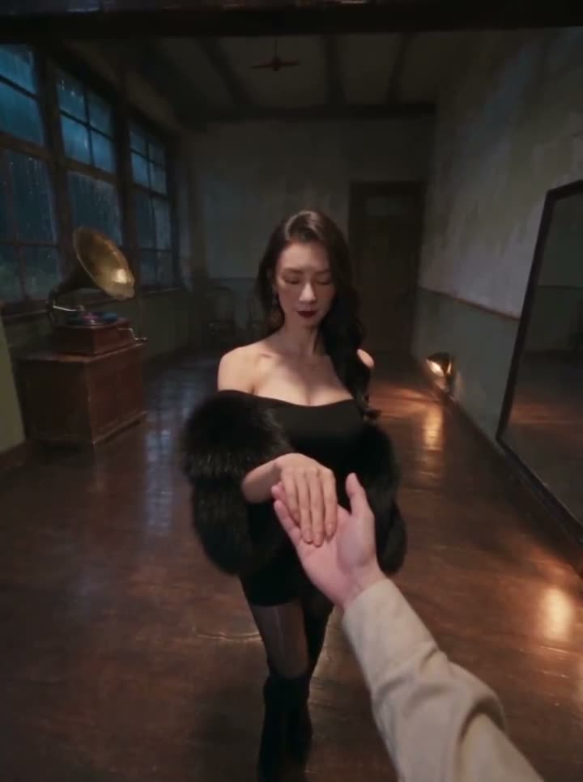</a>

▶ **[播放有声视频原片](https://awesome.raphael.app/materials/3cb8ab95-e891-4b12-9f62-afb844947ae3.mp4)**

<details><summary><strong>展开完整原始提示词（2105 字）</strong></summary>

```text
【参考图】

@图1@3c698b39-7c86-468b-8c6a-7d02f34cac25锁定女子的面容、眉眼和栗黑色高盘发。她约28岁，鬓边有两缕碎发，戴短铜坠耳环。

本次上传的服装图@3b12acd3-8eab-4e6e-9212-9ea460dd7c73锁定黑金豹纹挂颈短裙。古铜金底、黑色斑纹、细碎亮片、挂颈深V、前襟窄横带、收腰，裙摆落在大腿上段。油灯移动时，转到光里的几片亮片依次亮起来。

@图3@@7a831d83-2028-49b7-9804-ac0d89e6f27c锁定淡藕粉色薄丝袜，细密袜面有柔和珠光，大腿处可见浅粉花纹袜口。@图6锁定女子在正片中的完整造型和比例，鞋为黑漆皮尖头细高跟，鞋底朱红。右鞋前掌外缘磨掉一弯红漆，露出浅色月牙，左鞋底完整。

@图4@c5333246-e095-45e6-a8d9-e7f467768b4d仅供唐三藏、孙悟空、猪八戒、沙僧的面容、体格、衣物与道具参考。@图5锁定洞内地形。女子开场时左脚穿鞋，空的右鞋斜搁在井沿。定装照里的双脚着鞋状态只在右脚归位后出现。

【摄影、布景与站位】

1974年意大利电影的35毫米Techniscope胶片质感，按竖幅构图。褪色Eastmancolor、粗颗粒、柔和老镜头、零星尘点与细划痕。唐代志怪电影的实体洞窟布景，湿石暗灰偏青。左后方洞口漏进一线阴天散光。沙僧右手提油灯，暖光只照到近处人脸、井沿和井口以下约一米。沙僧一收手，照在井壁上的光就跟着退回来。

我站在石台中央，左侧是悟空、八戒，沙僧紧跟在我左后肩。女子侧坐在我右前方的矮石上，左脚着地，右膝在坐石背面，右小腿被石头和井沿挡住。她右手撑在石沿上，空鞋就在她手边。开场同一眼能看清她的脸、落地的左鞋、井沿上空着的右鞋。实拍视野约28毫米。风吹动我的袈裟，只有我挪脚、低头、失去平衡时，视线才跟着晃。

【00—06秒｜她手边有一只空鞋】

我进洞停步。女子坐在矮石上，左脚往回收了一点，细鞋跟在石上轻轻一响。沙僧的灯从我肩后送过来。我顺着声音看过去，先看见黑鞋口里淡粉色的袜踝，再看见旁边那只斜躺的右鞋。鞋口朝我，里面空着。鞋底翘起的一边露出朱红色，前掌那弯磨白的月牙正好迎光。

女子向我伸出左手。等我从鞋上移开目光，她才轻声说：“长老，扶我一下。”

【06—11秒｜她刚站起来，鞋就掉了】

我递出右手。她握住我的手腕，左脚踩实，右手撑石起身。石面潮湿，她撑着的手掌往外滑了一寸，手背碰上空鞋的细跟。鞋在井沿上晃了半圈。

我怕她跟着跌下去，赶紧托住她腰侧。她的重量落进我掌心，左手顺势覆在我的手背上。她抬脸看我，右耳的铜坠轻碰我胸前的袈裟搭扣。就在这声轻响后面，空鞋终于翻下去。红底朝上闪了一下，消失。 她仍靠着我，目光却已经落在井口，像在等人上来。

【11—18秒｜等来的是一个人的脚步】

八戒弯腰想捞。悟空横过金箍棒，轻轻拦住他胸口。几个人一起听。先留半拍风声和滴水。

井下响起一声清脆的“嗒”。我以为是鞋跟撞了石头。紧接着，黑暗里传来前掌把水压开的湿响。隔一拍，又是鞋跟落下、前掌踩实，这一步离我们近多了。

沙僧把灯往井口探。我低头，一只黑色尖头鞋正沿竖壁向上迈步。它抬脚时，朱红鞋底翻进灯光，外缘是刚才那道浅色月牙。脚再落下，这次我看清了鞋口：刚才看得见鞋垫的地方，现在紧紧裹着一只淡粉袜脚。 石壁上的水还在往下淌。它踩住水痕，一步一步往上走。

【18—24秒｜她终于把重量从我手上移开】

我沿着井沿俯低一点。左边，女子的左鞋还在原处，那只细跟牢牢抵着石面；右边，井里的右鞋已经翻过井唇。两只鞋第一次同时出现在我眼前。

右鞋落在她身边，本该穿鞋的人却还没站到它上面。灯光擦过它后方：连着脚踝的淡粉袜腿仍有长长一截垂在井壁外，越过石唇，在坐石背后连回她屈着的右膝。她把右膝慢慢伸直。那一截过长的小腿贴着湿石往回收，水珠被袜面一路带上井沿。最后，膝盖、脚踝、鞋跟落到同一条承重线上。右鞋跟轻响一下。

我掌心里忽然轻了。 她已经能用双脚站稳，我便想把手抽回来。她却在这一刻收拢手指，扣住了我的右腕。

【24—30秒｜原来她要我扶她下去】

“长老，扶稳。”她靠近我耳边，语气和刚才一样，“底下的路长着呢。”

话说到一半，她已经侧过身。右脚踩上竖直的内壁，细跟先点石，前掌随后压实。左脚离开石台，跟着走下去。她与我错身时，铜坠第二次碰响袈裟搭扣，这次声音由胸前往下掠过。我的布鞋尖擦到井沿，视线被她牵得向黑处一沉。

背后袈裟猛地绷紧。沙僧用空着的左手攥住我，提灯的右手也随身体后撤。暖光滑回石台。女子的手指这才从我腕上松开。

最后一眼，我的僧袖悬在井沿外。人已经走出灯光，下面却听得清清楚楚：右跟一声，左跟一声，她穿齐了那双鞋，正从容地往下走。 第二声的回音刚起，画面截断。

【声音】 全片只用洞风、滴水、衣料、两次铜坠碰扣、细鞋跟点石与湿鞋底受力的声音。女子只说两句。第一次井下鞋跟响起时，把它拍成空鞋撞石也能发出的寻常动静；直到紧随其后的前掌踩实声，观众才意识到底下有一只脚。无旁白、无字幕、无配乐。
```

</details>

| 参数 | 配置 |
| --- | --- |
| 模型 | MAGI-2 (flagship) |
| 任务类型 | omni-ref |
| 时长 / 帧率 | 60.1s · 30 fps |
| 分辨率 / 比例 | 720p · 3:4 |
| 音频模式 | mixed (audio=True) |

[原始来源](https://x.com/john87445528/status/2125760471340839051) · 作者: [@john87445528](https://x.com/john87445528) · 2026-11-26

> MAGI-2 为作者自述，未经独立核实。

[案例详情页](cases/cms-bd4ae1e1/README.zh-CN.md) · **[在 Raphael 上生成同类视频 →](https://raphael.app/ai-video-generator?utm_source=github&utm_medium=repository&utm_campaign=magi_2_launch&utm_content=case_cms-bd4ae1e1&utm_term=zh-CN)**

---

<a id="case-rococo-garden-three-room-oner"></a>

#### 14. 洛可可花园三场景一镜到底

**来源类型**: `community` · **任务**: `OMNI-REF` · **音画**: `Yes` · **状态**: `来源收录`

4 张参考图锁定女主角与三段连续空间，30 秒无缝一镜到底穿行花园、闺房与阳光沙龙，配层次化自然环境音与钢琴声。

<a href="https://awesome.raphael.app/materials/0b3445d5-9078-4c49-b3e8-b0f6189f23b3.mp4"></a>

▶ **[播放有声视频原片](https://awesome.raphael.app/materials/0b3445d5-9078-4c49-b3e8-b0f6189f23b3.mp4)**

<details><summary><strong>展开完整原始提示词（2636 字）</strong></summary>

```text
【影像设定与风格锁定】
法式古典极繁浪漫电影炫技长镜头，融合《傲慢与偏见》灵动调度与索菲亚·科波拉《绝代艳后》马卡龙洛可可美学。总时长 30 秒，16:9 横屏，35mm 柯达胶片配 1/4 黑柔滤镜实拍质感，高调清透的奶油暖白晨光与梦幻高光柔晕。全程采用 28mm 自然广角视感与斯坦尼康复合运镜（穿花抬升、弧线环绕、脱靶俯拍、穿门横摇），全片严格保持单一连续的一镜到底长镜头，绝不切镜。

【素材分工与角色/场景锁定】
严格按以下 4 张参考图分工锁定主角色与三段连续空间，全程不得换脸、换装或漂移画风：
- 女主角（严格参考图片 1）：将图片 1 右侧人像头部与全身服装自然融合为真实立体的完整人物（严禁无头残缺或灰底排版）。约 20 岁绝美法式少女，极度细腻白皙的瓷感公主肌与自然柔粉面颊，清澈浅灰绿眼眸，披散及腰的浅茶棕色长波浪大卷发；身穿珍珠串珠细挂脖的奶油白底粉玫瑰碎花多层荷叶边雪纺长裙，左手腕系淡粉色薄纱蝴蝶结，脚穿米白短袜与复古黑色玛丽珍皮鞋。
- 伴奏配角（仅在空间 3 出现，避免与女主混淆）：一名身穿素雅浅天蓝色复古棉布长裙、盘起金棕色低发髻的年轻姐妹，仅以侧影坐在左侧立式钢琴前弹琴。
- 空间 1（室外起点，严格参考图片 2）：沐浴灿烂晨光的法式鲜花碎石花园小径，左侧挂着透光发亮的白色亚麻床单，花径两侧盛开粉玫瑰、蓝绣球与飞燕草，正前方是攀满粉蔷薇的奶油白老宅与完全敞开的法式双开落地玻璃门，雪白提花蕾丝长纱帘被晨风吹向室外。
- 空间 2（室内中段，严格参考图片 3）：穿过敞开大门即进入的鲜花白蕾丝复古闺房，左为透光白蕾丝落地窗，中左靠墙为胡桃木五斗柜（微开抽屉探满粉玫瑰、蓝绣球与黄野花，柜顶白蕾丝台布盛放蓝绣球与紫藤），中央白铁艺床头攀满粉玫瑰、碎花棉被上放着椭圆形复古鎏金小托盘镜，右侧是一扇完全敞开的奶油白法式双开雕花大门。
- 空间 3（室内收尾，严格参考图片 4）：穿过闺房右侧双开雕花门即进入的《绝代艳后》极繁阳光沙龙，左侧是垂满紫藤粉玫瑰的旧木立式钢琴（乐谱摊开），中央白蕾丝大圆桌摆满马卡龙甜点塔、水晶香槟杯与鎏金茶具托盘，正前方三扇高大落地窗垂挂飘动白蕾丝纱帘，丁达尔光束斜洒满室，顶悬璀璨水晶吊灯。

【空间连贯与物理铁律】
三个空间按“图片 2 花园 → 穿白蕾丝敞门 → 图片 3 鲜花闺房 → 穿右侧敞开双开雕花门 → 图片 4 极繁阳光沙龙”单向贯通，绝不穿墙、绝不跨床。
人体步态铁律：人物始终面朝前进方向正常向前迈步，脚尖与身体朝向移动方向一致，严禁出现面向镜头倒退行走或滑步。镜头升降与弧线变速缓入缓出，充分展现前景花丛、飘纱、门框与圆桌甜点塔的强烈 3D 空间视差。

【30 秒复杂一镜到底时间轴（复合运镜 + 连贯事件 + 物理因果）】
0–5 秒｜【低机位穿花抬升 + 弧线右移｜蝴蝶掠书与折花】以图片 2 构图起步。摄影机从前景密集虚化的粉玫瑰与蓝绣球花丛低处缓慢垂直抬升并向右平滑摇移，穿过透光花瓣露出女主角（图片 1）：她安稳站在碎石花径中段偏左，呈四分之三侧正面站定不动，双手捧着翻开的复古旧书低头阅读。第 2 秒一只白色蝴蝶轻巧飞掠书页上方，她随蝶影抬眸浅笑，顺手将旧书夹在左臂下，右手轻快从身旁花丛折下一枝含苞粉玫瑰（左手腕淡粉蝴蝶结随动作轻晃），左侧阳光下的白亚麻床单被晨风鼓起。
5–10 秒｜【转身正向轻跑 + 俯冲跟拍穿纱帘】第 5 秒女主角自然转过身完全面向正前方的敞开老宅大门（优雅背影与侧背影朝向屋门），脚尖朝前正常轻快小跑跨上石阶、步入敞开的法式落地玻璃门，多层粉玫瑰碎花长裙摆随轻跑向后扬起。摄影机略微加速平滑俯冲紧贴她侧后方跟进；第 9 秒雪白提花蕾丝长纱帘被风掀起，柔美大面积掠过镜头前景边缘，借飘纱动势丝滑滑入室内。
10–17 秒｜【闺房脱靶绕床低俯 + 抽屉插花 + 鎏金镜倒影】镜头无缝滑入图片 3 鲜花闺房。女主角沿五斗柜与白铁艺床间的过道向前轻步走过：第 11 秒顺手将旧书合上轻放在碎花棉被一侧，再把刚才室外折下的那枝粉玫瑰自然插进胡桃木五斗柜微开抽屉的花簇中；第 13 秒摄影机主动脱离她背影，沿床侧做一次流畅低俯弧线滑行——女主角微微俯身望向床面那只椭圆形复古鎏金小托盘镜，指尖轻撩耳畔一缕茶棕卷发，鎏金镜面清晰闪过她的柔美眉眼倒影与晨光反光。第 15 秒镜头顺势抬升接回她身后，跟她轻提裙摆步向右侧敞开的奶油白双开雕花大门。
17–23 秒｜【穿门横摇揭示钢琴互动 + 白猫跃过 + 花瓣光束】摄影机加速平滑笔直穿过双开雕花门洞滑入图片 4 的极繁阳光沙龙，随即向左柔和横摇：左侧垂满紫藤的立式钢琴前，身穿浅天蓝裙的年轻姐妹正投入弹奏，手指在琴键上灵动起落；女主角微笑走过琴旁，伸手轻拍姐妹肩头互动，袖风带落琴顶几片粉玫瑰花瓣在斜射丁达尔光束中缓缓旋转飘落。与此同时，一只雪白长毛波斯猫从蕾丝圆桌布下轻巧跃过洒满阳光的木地板，自然引导视线转向中央大圆桌。
23–30 秒｜【贴桌 120° 大弧度强视差环绕 → 逆光香槟马卡龙定格】摄影机压低高度、紧贴白蕾丝圆桌边缘做一次极具电影感的 120° 大弧度平滑环绕推进——前景缤纷马卡龙甜点塔、晶莹折射日光的水晶香槟杯与粉玫瑰高速横向掠过镜头，拉出极致 3D 视差。女主角沿圆桌后侧轻盈绕至三扇发亮的白纱落地窗前停步，左手轻端起一只泛着细腻气泡的淡金香槟杯微晃，右手从塔顶拈起一颗淡粉色马卡龙轻举至唇边，缓缓转头正对摄影机微微歪头、俏皮眨眼温柔浅笑；强烈温暖的窗前逆光将她浅茶棕色大波浪发丝打透成天使金边，身后雪白蕾丝纱帘随风轻舞，摄影机平稳减速微仰停稳在中近景，定格于奢华梦幻的法式电影余韵中。

【声音基线与全局限制】
无对白，无旁白。纯自然立体声场层次递进：室外清脆鸟鸣、微风拂动亚麻床单与白纱帘沙沙声、轻快碎石脚步声；进入闺房后，书本轻放棉被声、枝叶轻擦抽屉声与隔壁隐约传来的清脆钢琴声；穿过雕花门瞬间，明快优雅的法式立式钢琴小步舞曲骤然清亮立体，伴随柔和弦乐渐强、猫爪轻踏木地板微响与水晶香槟杯轻微清脆声。
严格限制：全程严格保持单一连续一镜到底，绝不切镜、绝不穿墙、绝不跨床；严禁人物面向镜头倒退行走或滑步；严禁出现无头残缺、灰底排版、人物换脸、丢失珍珠挂脖或左手腕粉蝴蝶结；女主始终为奶油粉玫瑰碎花长裙，弹琴姐妹始终为浅天蓝裙不互换；严禁现代电器与穿帮物品；全片无字幕、无水印。
```

</details>

| 参数 | 配置 |
| --- | --- |
| 模型 | MAGI-2 (flagship) |
| 任务类型 | omni-ref |
| 时长 / 帧率 | 30.2s · 25 fps |
| 分辨率 / 比例 | 1080p · 16:9 |
| 音频模式 | mixed (audio=True) |

**多素材参考输入**

1. `image` · [作者公开的 4 张角色与三段连续空间参考素材表](https://qcnr07d9fz2l.feishu.cn/base/FOvXbgaSfahB0Esvt2VchQ2knFc)

[原始来源](https://x.com/nanyuan0412/status/2125730423171097031) · 作者: [@nanyuan0412](https://x.com/nanyuan0412) · 2026-11-25

> 作者标注为 Renoise 平台 MAGI-2 30 秒定稿，使用 4 张参考图锁定人物与三空间（原帖案例 01）。

[案例详情页](cases/rococo-garden-three-room-oner/README.zh-CN.md) · **[在 Raphael 上生成同类视频 →](https://raphael.app/ai-video-generator?utm_source=github&utm_medium=repository&utm_campaign=magi_2_launch&utm_content=case_rococo-garden-three-room-oner&utm_term=zh-CN)**

---

<a id="case-bangkok-night-market-cel-anime"></a>

#### 15. 曼谷夜市摊档的手绘动画（13 镜头）

**来源类型**: `community` · **任务**: `OMNI-REF` · **音画**: `Yes` · **状态**: `来源收录`

基于 @Image1 角色锁定的 13 镜头日式手绘赛璐璐动画，以 24mm F1.4 浅景深呈现曼谷夜市烹制过程与纯环境拟音。

<a href="https://awesome.raphael.app/materials/797d2fec-1e8b-4747-a5bd-296e631221e9.mp4">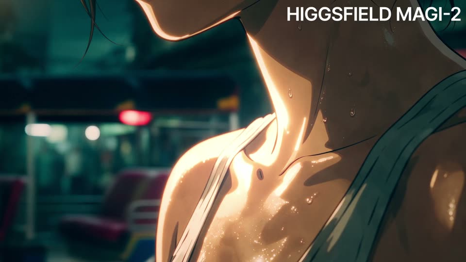</a>

▶ **[播放有声视频原片](https://awesome.raphael.app/materials/797d2fec-1e8b-4747-a5bd-296e631221e9.mp4)**

<details><summary><strong>展开完整原始提示词（2518 字）</strong></summary>

```text
東南アジアの夜の屋台街を舞台にした青年向けアニメ映画の傑作。
手描きセルアニメ、シャープで精密な線、彩度を抑えたティール＆グレーのカラーグレーディング、深いシャドウ、細かいフィルムグレイン。
BGMなし、セリフなし、環境音あり。
フルサイズ換算24mm F1.4の広角レンズで撮ったような浅い被写界深度とボケ感。手前の前ボケは大きく柔らかく、背景は自然に溶ける。
# 制約
すべてのカットで画角・アングル・焦点距離を変えて単調にしない。
画質が粗い場合はリファレンスとして画像を一から作り直すこと。
汗は常に微細な小さい粒。大きな雫は描かない代わりに、肌全体が薄い艶の膜をまとって光る。
# 登場人物
## 店主の女性 
@Image1
20代前半のタイ人女性。褐色の日焼けした肌、黒髪を低い位置でお団子にまとめ後れ毛が頬にかかる。落ち着いた集中した表情。薄いグレーのタンクトップ一枚だけを素肌に着ており、屋台の熱気の汗で湿った薄い布が体の自然な線に素直に沿っている。下はデニムのショートパンツ。エプロンはしていない。引き締まった腕、微細な汗で薄く光る首筋と鎖骨。
# 情景
夜のバンコクの屋台街。露店が軒を連ね、それぞれの裸電球が暖色の光の玉を作り、湯気が立ちのぼる。彼女のカオマンガイ屋台のガラスケースには黄金色の茹で鶏が鉄フックで吊られ、大鍋からは常に湯気が立つ。カウンターの下には食材の入ったカゴが並ぶ下段の棚がある。周囲には古びたショップハウス、絡み合う電線、ネオン看板、人波。
位置関係：カメラは基本的に通り側から屋台を見る。彼女はカウンターの奥。屋台の正面の通りを人とトゥクトゥクが行き交う。
料理の定義：カオマンガイの皿に載るのは、艶のあるライス、骨のない鶏むね肉の薄いスライス、きゅうりの薄切り、仕上げに飾るパクチーの葉一枝だけ。タレは親指ほどの小さな容器ひとつで別添え。
照明：主光源は屋台の裸電球ひとつ。暖色の光が彼女の肌と手元を照らし、周囲の街は冷たいティールブルーの夜に沈む。
奥行き構成：前景・中景・遠景を明確に分離すること。前景に通行人・湯気・ガラスケースの縁、中景に彼女と屋台、遠景に街のネオンのボケ。
# シーン
夜市の熱気の中で働く女性の肌の質感と、一皿のカオマンガイができるまでの調理を交互に描く。しゃがんで取ったパクチーが、最後に完成した皿に飾られる。
cut1:
Bロール。夜の屋台街の情景。軒を連ねる露店の裸電球が暖色の光の列を作り、あちこちの鍋から湯気が立ちのぼる。手前を通行人のシルエットが大きくボケて横切り、奥のネオンと電線が夜に沈む。
環境音：屋台街全体のざわめき、遠い調理の音。
cut2:
バストショット、斜め横から。彼女が手の甲で額を軽く拭う。微細な汗が肌に薄い艶の膜として光り、タンクトップの胸元と鎖骨のラインに電球の光が落ちる。湯気が肌の前を薄く流れる。
環境音：屋台の喧騒、油と湯気の音。
cut3:
首筋から鎖骨のエクストリームクローズアップ。カメラと彼女の間、屋台の正面の通りをトゥクトゥクが右から左へ走り抜け、ヘッドライトの光が一閃、首筋と鎖骨に散った無数の微細な汗の粒をきらめかせて通り過ぎる。
環境音：甲高いエンジン音が迫って抜ける。
cut4:
ガラスケース越しの手元クローズアップ。手前に吊るされた黄金色の茹で鶏が大きくボケて画面の右1/3を占め、その隙間の奥にシャープなフォーカスで、包丁が骨のない鶏むね肉をトントンと一定のリズムで薄切りにしていく。
環境音：包丁がまな板を叩くリズミカルな音。
cut5:
超ローポジション、地面スレスレのインサート。夜市の濡れた路面、屋台の灯りが反射する中を、サンダルの足元が前カットの包丁と同じリズムで次々と画面を横切っていく。奥にはボケた屋台の光の列。
環境音：ぺたぺたと刻まれる足音、雑踏。
cut6:
真上からの俯瞰、手元。前カットと同じリズムで、包丁がきゅうりを斜めの薄切りにスッスッと刻む。瑞々しい緑の断面がまな板に扇状に広がっていく。
環境音：きゅうりを切る軽快な音。
cut7:
通り側の低いカメラ位置、額縁構図。彼女がカウンターの奥でしゃがみ込むと、カウンター下の棚の隙間越しに、俯いた顔と汗ばんだ胸元がのぞく。下段のカゴからパクチーの束を掴む。手前の棚の縁が画面を額縁のように区切る。
環境音：カゴが擦れる音、くぐもった雑踏。
cut8:
ローアングル。パクチーの束を手に立ち上がる彼女を、カメラが下からティルトアップで追う。ショートパンツの太ももから腰、湿ったタンクトップ、微細な汗で光る鎖骨、そして顔へと順に光が移っていく。
環境音：屋台の喧騒が戻る。
cut9:
ローアングルのバストショット、やや逆光。背景は夜空と絡み合う電線、頭上の裸電球。彼女が金属のコップの氷水をぐっと呷る。喉が動き、電球の光が顎から首筋のラインを縁取る。コップの結露が指を濡らす。
環境音：氷がコップの中で鳴る音。
cut10:
Bロール。ローアングルの屋台街の情景。連なる露店の庇と裸電球の列を見上げる構図。電球の光の中を湯気が横切り、その上に絡み合う電線とネオン看板、ティールブルーの夜空。
環境音：ざわめき、どこかの鍋の煮立つ音。
cut11:
真上からの俯瞰。白い平皿に盛られた艶のあるライスの上に、骨のない鶏むね肉の薄いスライスだけが扇状に並べられていく。皿の上にはライスとスライスした鶏のみ。
環境音：鶏をライスに載せる微かな音。
cut12:
手元のクローズアップ。皿の縁に沿ってきゅうりの薄切りを並べ、親指ほどの小さなタレの容器をひとつだけ横に添え、最後にパクチーの葉を一枝そっと載せる。
環境音：小さな容器が皿に触れる音。
cut13:
仕上げのミディアムショット。湯気がレンズ前を大きく横切り、その向こうで彼女が完成した皿をカウンターにそっと置く。裸電球の光が皿の湯気と、彼女の首筋から鎖骨のラインを縁取る。背景に電線とネオンの夜がボケて広がる。
環境音：皿がカウンターに置かれる音、街のざわめき。
```

</details>

| 参数 | 配置 |
| --- | --- |
| 模型 | MAGI-2 (flagship) |
| 任务类型 | omni-ref |
| 时长 / 帧率 | 15.2s · 25 fps |
| 分辨率 / 比例 | 1080p · 16:9 |
| 音频模式 | sfx (audio=True) |

**多素材参考输入**

1. `image` · [@Image1 夜市摊档女主角色参考图（见原帖）](https://x.com/studio_oneroom/status/2125779677528863023)

[原始来源](https://x.com/studio_oneroom/status/2125779677528863023) · 作者: [@studio_oneroom](https://x.com/studio_oneroom) · 2026-11-26

> 作者标注通过 Higgsfield 使用 MAGI-2 生成，采用日语 13 镜头分镜提示词配合 @Image1 角色锁定。

[案例详情页](cases/bangkok-night-market-cel-anime/README.zh-CN.md) · **[在 Raphael 上生成同类视频 →](https://raphael.app/ai-video-generator?utm_source=github&utm_medium=repository&utm_campaign=magi_2_launch&utm_content=case_bangkok-night-market-cel-anime&utm_term=zh-CN)**

---

<a id="category-product-commercials"></a>

### 产品与商业广告

<a id="case-cms-fa134f7b"></a>

#### 16. 三人偶像团的赛博说唱

**来源类型**: `community` · **任务**: `T2V` · **音画**: `Yes` · **状态**: `来源收录`

社区 MAGI-2 视频案例（@poruru_ai）：三人偶像团的赛博说唱。

<a href="https://awesome.raphael.app/materials/8e1c5317-ed6c-4e32-9a04-696581d585d8.mp4">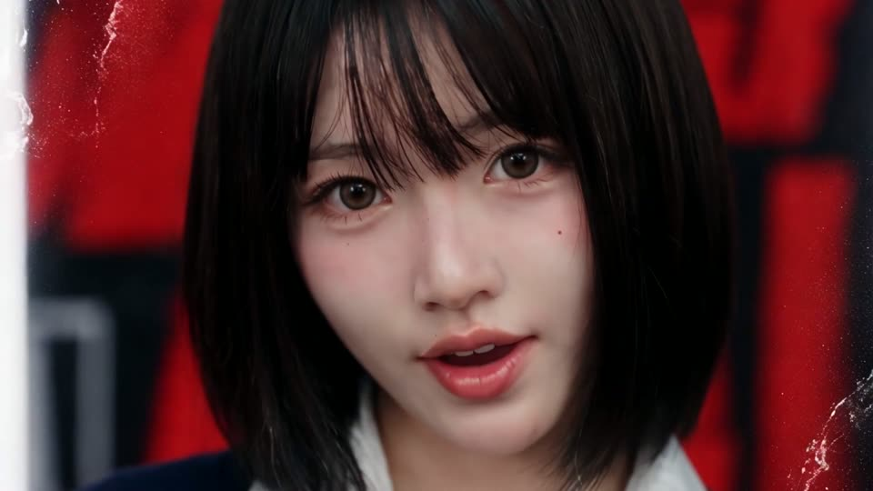</a>

▶ **[播放有声视频原片](https://awesome.raphael.app/materials/8e1c5317-ed6c-4e32-9a04-696581d585d8.mp4)**

<details><summary><strong>展开完整原始提示词（3195 字）</strong></summary>

```text
15-second photoreal cyber-grunge rap music video, 16:9, original three-member idol group performance, all performers adults aged 20+.

Reference mapping in attached order:

Image 1 = Performer A, long straight black hair with parted wispy fringe and red/navy striped tie.

Image 2 = Performer B, very long straight black hair with full fringe and navy/white striped tie.

Image 3 = typography and visual style reference ONLY, not a person.

Image 4 = Performer C, short dark bob with wispy bangs and navy/white striped tie.

Keep each distinct facial identity, hairstyle, navy cardigan, white shirt, striped tie and neat uniform-inspired outfit consistent.

Do not copy the selfie poses or original backgrounds.

No start frame; all four images are references.

Cohesive trio on an original black/red studio stage, white rim lights, moving graphic panels.

Dark-pop cyber-grunge rap editorial energy, photoreal high-fashion polish, late-1990s/early-2000s underground zine collage, scanned magazine textures, coarse grain, halftone, distressed print edges, subtle scan misregistration.

High contrast red/black/white.

Typography inspired by Image 3, including brief readable MAGI-2 / Made with MAGI-2 on @Higgsfield graphic fragments integrated into performance, never a static title card.

Immediate physical movement from first frame, rapid hard cuts every 1.5–3s, no fades or dissolves, no static poses or frozen beauty shots.

Prioritize faces and upper-body close-ups, intercut medium-close trio shots.

Every shot has visible subject and camera motion.

Audio: original energetic rap beat, punchy bass, syncopated drums, crisp female group rap vocals, clear rhythmic lip sync; no existing song or artist imitation.

0–2s:

Rapid extreme close-ups A/B/C, each lifts chin, direct eye contact, sharp head tilt and rhythmic mouth movement, fast handheld push-ins.

2–4s:

Tight three-quarter shots, A turns toward camera with shoulder roll, B steps confidently and adjusts tie, C angles toward camera with shoulder accent; lateral camera track and brief trio shot.

4–6s:

Medium-close trio walks two synchronized strong steps toward camera, one points toward lens, one sweeps hand downward, one accents shoulder; camera dollies backward.

6–8s:

Rotating close-ups A snaps head left then center, B half-turns shoulders, C locks eyes with lens; quick mini-orbit, beat-synced grunge typography.

8–10s:

Tight side profiles, trio strides past camera in staggered rhythm, each looks back toward lens; camera pans and catches glances.

10–12s:

Alternating close-ups, each leans in and raps a punchy line, sharp hand gestures near face, shoulder drops and weight shifts; brief tight trio framing.

12–15s:

Synchronized step forward, sharp head snaps, direct gaze, decisive hand gesture, final powerful group formation with aggressive camera push-in.

Keep motion until final frame.

Natural hair and fabric movement, realistic weight transfer, hand anatomy, neck and shoulder mechanics, natural facial expression and lip sync.

Maintain distinct identities and recurring trio coverage throughout; never duplicate, swap or morph faces.

Stylish kinetic moving underground fashion magazine spread.
```

</details>

| 参数 | 配置 |
| --- | --- |
| 模型 | MAGI-2 (flagship) |
| 任务类型 | t2v |
| 时长 / 帧率 | 15.2s · 25 fps |
| 分辨率 / 比例 | 1080p · 16:9 |
| 音频模式 | music (audio=True) |

[原始来源](https://x.com/poruru_ai/status/2125942688122028532) · 作者: [@poruru_ai](https://x.com/poruru_ai) · 2026-11-26

> 模型 MAGI-2 为作者自述，未经独立核实。 仅收录原帖附带的 MAGI-2 视频。

[案例详情页](cases/cms-fa134f7b/README.zh-CN.md) · **[在 Raphael 上生成同类视频 →](https://raphael.app/ai-video-generator?utm_source=github&utm_medium=repository&utm_campaign=magi_2_launch&utm_content=case_cms-fa134f7b&utm_term=zh-CN)**

---

<a id="case-cms-e5251a4a"></a>

#### 17. 雨伞与咖啡的无声喜剧

**来源类型**: `community` · **任务**: `T2V` · **音画**: `Yes` · **状态**: `来源收录`

社区 MAGI-2 视频案例（@Mayz1169）：雨伞与咖啡的无声喜剧。

<a href="https://awesome.raphael.app/materials/a769dfcd-bc5e-4ee1-b5cd-eae7f9a1f0a4.mp4">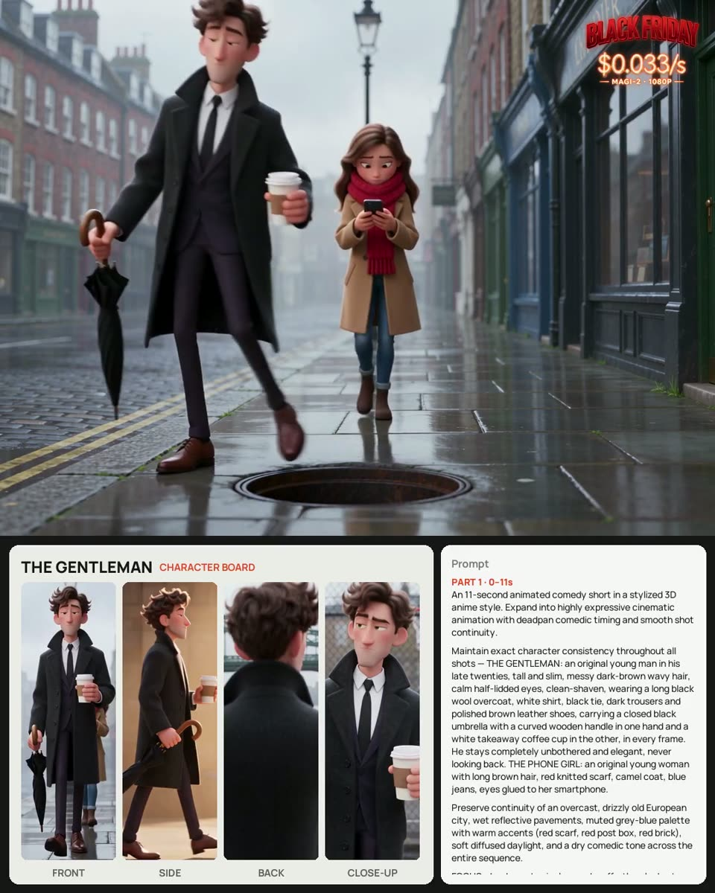</a>

▶ **[播放有声视频原片](https://awesome.raphael.app/materials/a769dfcd-bc5e-4ee1-b5cd-eae7f9a1f0a4.mp4)**

<details><summary><strong>展开完整原始提示词（5635 字）</strong></summary>

```text
A 41-second animated comedy short in a stylized 3D anime style. Expand into highly expressive cinematic animation with deadpan comedic timing and smooth shot continuity.

Maintain exact character consistency throughout all shots — THE GENTLEMAN: an original young man in his late twenties, tall and slim, messy dark-brown wavy hair, calm half-lidded eyes, clean-shaven, long black wool overcoat, white shirt, black tie, dark trousers, polished brown leather shoes, a closed black umbrella with a curved wooden handle in one hand and a white takeaway coffee cup in the other, in every frame. He stays completely unbothered and elegant, never looking back. THE PHONE GIRL: an original young woman with long brown hair, red knitted scarf, camel coat, blue jeans, eyes glued to her smartphone.

Preserve continuity of an overcast, drizzly old European city, wet reflective pavements, muted grey-blue palette with warm accents (red scarf, red post box, red brick, red coat, orange fruit), soft diffused daylight, and a dry comedic tone across the entire sequence.

FOCUS: deadpan physical comedy, effortless luck, chaos happening around a calm gentleman, perfect comedic timing.

[0s – 4s] SHOT 1 — THE MANHOLE. Wide street shot. An open manhole lies on the wet pavement. The gentleman strolls toward it, glances down for a split second and smoothly side-steps around it without breaking stride. Behind him the phone girl walks the same line staring at her phone and drops straight down into the manhole with a comic yelp. SFX: rain patter, footsteps, a cartoonish "whoop" and a hollow thud. Camera: static wide shot, eye level.
[4s – 8s] SHOT 2 — THE FALLING SHEET. Narrow brick alley, a cat sits on the wall. A neighbour above shakes a white bedsheet out of a window and it slips, fluttering down. Without looking up, the gentleman raises his closed umbrella overhead; the sheet lands perfectly draped on the umbrella tip. He lowers it and lets the sheet slide off into a puddle, walking on spotless. SFX: cloth flapping, soft splash, cat meow. Camera: slow backward dolly, then a low ground-level angle.
[8s – 11s] SHOT 3 — THE RAT. Grand old station entrance. A plump rat drags a slice of pizza across

... [truncated in root README; open standalone case page for full prompt]
```

[前往独立案例页查看完整 5635 字提示词 →](cases/cms-e5251a4a/README.zh-CN.md)

</details>

| 参数 | 配置 |
| --- | --- |
| 模型 | MAGI-2 (flagship) |
| 任务类型 | t2v |
| 时长 / 帧率 | 41.2s · 25 fps |
| 分辨率 / 比例 | 1080p · 3:4 |
| 音频模式 | sfx (audio=True) |

[原始来源](https://x.com/Mayz1169/status/2126346676583780818) · 作者: [@Mayz1169](https://x.com/Mayz1169) · 2026-11-27

> MAGI-2 为作者自述，未经独立核实。 提示词来自作者回复 https://x.com/Mayz1169/status/2126347637020676128

[案例详情页](cases/cms-e5251a4a/README.zh-CN.md) · **[在 Raphael 上生成同类视频 →](https://raphael.app/ai-video-generator?utm_source=github&utm_medium=repository&utm_campaign=magi_2_launch&utm_content=case_cms-e5251a4a&utm_term=zh-CN)**

---

<a id="case-cms-df2a04e9"></a>

#### 18. 微型运动员的体育商店冒险

**来源类型**: `community` · **任务**: `T2V` · **音画**: `Yes` · **状态**: `来源收录`

社区 MAGI-2 视频案例（@AIwithkhan）：微型运动员的体育商店冒险。

<a href="https://awesome.raphael.app/materials/119185ea-a847-43f2-9d48-dc07286c75ca.mp4">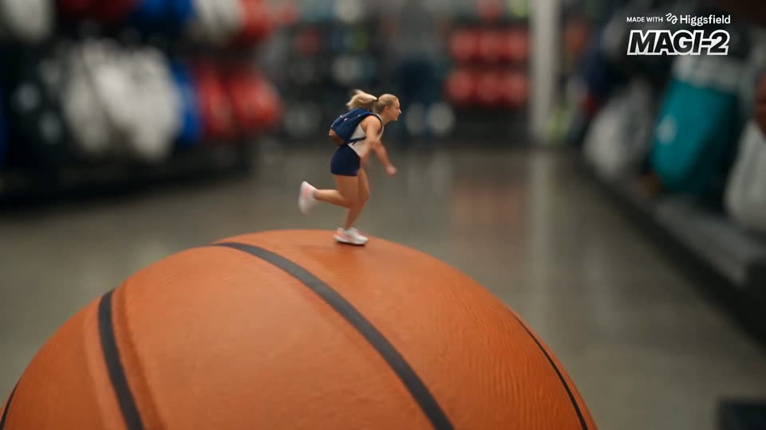</a>

▶ **[播放有声视频原片](https://awesome.raphael.app/materials/119185ea-a847-43f2-9d48-dc07286c75ca.mp4)**

<details><summary><strong>展开完整原始提示词（3052 字）</strong></summary>

```text
STYLE: Photorealistic live-action miniature-person VFX, cinematic macro photography, ultra-shallow depth of field, authentic modern sports equipment store, dynamic handheld camera, dramatic practical lighting, realistic physics, detailed material textures, premium viral commercial aesthetic, 4K.

Create a 30-second cinematic adventure featuring one athletic miniature woman at approximately 1:5 scale inside a massive sports shop. Maintain her exact face, hairstyle, outfit, body proportions, sneakers, backpack, and miniature scale consistently throughout the entire video.

She begins by sprinting across a giant basketball, jumping onto another basketball as it rolls across the shop floor. She leaps onto a towering display of footballs, running across their curved surfaces like stepping stones.

Next, she slides down the handle of an enormous cricket bat and lands on a pile of cricket balls. A giant cricket ball suddenly rolls toward her, and she narrowly escapes by jumping onto the blade of another cricket bat.

She climbs a gigantic tennis racket, runs across its strings, and jumps onto a moving display of tennis balls. She grabs the edge of a hanging sports jersey and swings across the aisle before landing on an enormous pair of running shoes.

Suddenly, a giant dumbbell rolls toward her. She dodges it, climbs its handle, and jumps onto a towering stack of colorful gym weights. She then slides down a massive boxing glove and narrowly avoids a giant football being kicked across the store.

For the next sequence, she races across oversized skateboards, jumps over giant water bottles, and uses a hanging basketball net as a swing. She lands on the rim of a giant basketball hoop, balances for a moment, and performs an incredible jump onto a massive pile of sports balls.

For the final sequence, she climbs a towering display of sports equipment and reaches the top shelf. She stands proudly beside a giant football while the camera slowly pulls back, revealing the entire sports shop, endless shelves of equipment, and customers shopping in the background. The final wide shot emphasizes how incredibly tiny she is in this enormous world.

CAMERA & VISUALS: Dynamic macro tracking shots, dramatic low angles, smooth aerial-style camera movements, strong foreground parallax, realistic reflections and shadows, shallow depth of field, detailed rubber, leather and fabric textures, natural human movement, believable physics, seamless transitions, cinematic lighting.

ENDING TITLE: “SMALL ATHLETE. GIANT ADVENTURE.” followed by “THE GAME IS BIGGER THAN YOU THINK.”

SFX: Tiny footsteps, basketball bouncing, football rolling, cricket bat impacts, tennis ball bouncing, dumbbell clanking, shoes squeaking, jersey fluttering, skateboard rolling, basketball hoop rattling, shop ambience, rushing air and cinematic impact sounds.

NEGATIVE: No cartoon, anime, toy-like appearance, animation, duplicated character, face or outfit changes, distorted anatomy, floating, inconsistent scale, unrealistic physics, narration or subtitles.
```

</details>

| 参数 | 配置 |
| --- | --- |
| 模型 | MAGI-2 (flagship) |
| 任务类型 | t2v |
| 时长 / 帧率 | 30.3s · 30 fps |
| 分辨率 / 比例 | 1080p · 16:9 |
| 音频模式 | mixed (audio=True) |

[原始来源](https://x.com/AIwithkhan/status/2125869765927596471) · 作者: [@AIwithkhan](https://x.com/AIwithkhan) · 2026-11-26

> MAGI-2 为作者自述，未经独立核实。

[案例详情页](cases/cms-df2a04e9/README.zh-CN.md) · **[在 Raphael 上生成同类视频 →](https://raphael.app/ai-video-generator?utm_source=github&utm_medium=repository&utm_campaign=magi_2_launch&utm_content=case_cms-df2a04e9&utm_term=zh-CN)**

---

<a id="case-cms-92e103f1"></a>

#### 19. 蒸汽朋克城市的循环镜头

**来源类型**: `community` · **任务**: `T2V` · **音画**: `Yes` · **状态**: `来源收录`

社区 MAGI-2 视频案例（@minuitIA）：蒸汽朋克城市的循环镜头。

<a href="https://awesome.raphael.app/materials/07610e4c-664b-4c49-921b-2fd5c07da7c1.mp4">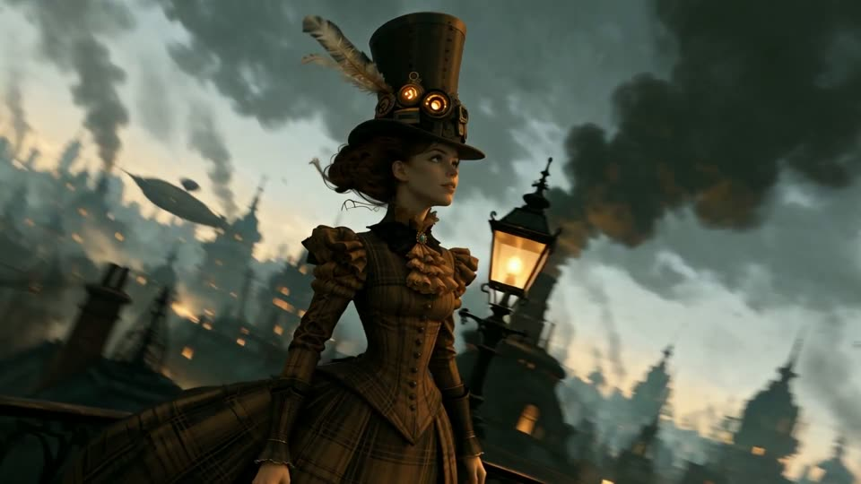</a>

▶ **[播放有声视频原片](https://awesome.raphael.app/materials/07610e4c-664b-4c49-921b-2fd5c07da7c1.mp4)**

<details><summary><strong>展开完整原始提示词（4314 字）</strong></summary>

```text
30 seconds, 16:9, single continuous shot, designed as a perfect seamless loop. Use <<<image_1>>> as the opening frame and strict visual style reference.
Create a high-energy premium 2D animated sequence with a hand-painted steampunk aesthetic. Everything must remain clearly 2D: painted backgrounds, frame-by-frame character animation, multiplane depth, redrawn perspective shifts, layered parallax, stylized motion smears, foreground wipes, and dynamic 2D camera choreography. Never feel like 3D CGI.
The elegant Victorian woman stands in the foreground admiring the city, but nothing is calm or static. From frame one, she is alive: breathing, blinking, slight head turn, shifting gaze, hair moving, feather whipping, dress rippling in the wind. The entire city is in constant motion: smoke drifting, steam bursting, birds circling, airships moving, propellers spinning, pedestrians crossing bridges, gears rotating, clock hands advancing, lights flickering, fabrics fluttering, distant silhouettes moving in windows.
[0–4s] Start instantly with a bold, unexpected movement: the camera whips from behind a passing foreground smoke plume into a fast curved slingshot orbit around the woman, creating strong multiplane parallax and a sense of acceleration. She turns her head with wonder as the city opens behind her.
[4–8s] Without slowing down, the camera snaps over her shoulder and gets pulled forward into the city in a diagonal descending rush. Use aggressive 2D parallax and hand-painted perspective redraws. Foreground rooftops, cables, chimneys and bridge elements slash across frame with energetic motion.
[8–13s] The camera dives between tall painted buildings in a fast S-curve path, banking left then right, skimming close to glowing windows, iron balconies, moving gears and steam vents. Add stylized 2D motion smears and rapid foreground occlusions to make the movement feel visceral and original.
[13–18s] The camera shoots under a suspended bridge crowded with moving pedestrians, then gets visually “kicked” upward by a blast of steam into a sudden rising arc. It passes beside a moving carriage and through a flock of birds, with layered 2D depth constantly shifting.
[18–22s] A gi

... [truncated in root README; open standalone case page for full prompt]
```

[前往独立案例页查看完整 4314 字提示词 →](cases/cms-92e103f1/README.zh-CN.md)

</details>

| 参数 | 配置 |
| --- | --- |
| 模型 | MAGI-2 (flagship) |
| 任务类型 | t2v |
| 时长 / 帧率 | 30.2s · 60 fps |
| 分辨率 / 比例 | 1080p · 16:9 |
| 音频模式 | mixed (audio=True) |

[原始来源](https://x.com/minuitIA/status/2126392321587720222) · 作者: [@minuitIA](https://x.com/minuitIA) · 2026-11-27

> MAGI-2 为作者自述，未经独立核实。 提示词来自作者回复 https://x.com/minuitIA/status/2126392473895272572

[案例详情页](cases/cms-92e103f1/README.zh-CN.md) · **[在 Raphael 上生成同类视频 →](https://raphael.app/ai-video-generator?utm_source=github&utm_medium=repository&utm_campaign=magi_2_launch&utm_content=case_cms-92e103f1&utm_term=zh-CN)**

---

<a id="case-cms-9011c6c1"></a>

#### 20. 木精灵女王唤醒森林

**来源类型**: `community` · **任务**: `T2V` · **音画**: `Yes` · **状态**: `来源收录`

社区 MAGI-2 视频案例（@maxescu）：木精灵女王唤醒森林。

<a href="https://awesome.raphael.app/materials/64f5da66-fd1d-4da4-9aef-568f998ec493.mp4">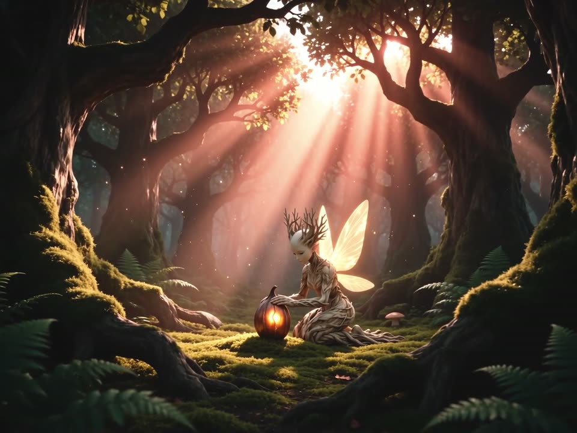</a>

▶ **[播放有声视频原片](https://awesome.raphael.app/materials/64f5da66-fd1d-4da4-9aef-568f998ec493.mp4)**

<details><summary><strong>展开完整原始提示词（11078 字）</strong></summary>

```text
[Generation Goal]
Dawn in an ancient forest glade: the Wooden Faerie Queen kneels beside a glowing seed pod, helps a tiny newborn sapling sprite out into the world, steadies its first wobbling steps, and then guides it to press its feet into the earth beside hers, until roots grow from both of them into the ground and golden light runs out through the soil, waking the whole glade: the youngling has become one with the mother land. A premium 3D animated feature fantasy in ten shots, cutting between intimate close-ups and the glade awakening around them, played for wonder, gentleness and a bond between guide and newborn.

[Characters]
[image1] as QUEEN ASHWEN's complete design: the supplied model sheet shows the same single character from the front, the side, the back and in a face close-up; every view is Queen Ashwen, and every detail is copied from it one to one. Queen Ashwen is a tall, slender faerie whose body is grown from wood. Her head is smooth, pale ivory and porcelain-like, completely hairless and doll-smooth, with small pointed elfin ears, large almond-shaped deep-black eyes, a small fine nose and a small calm mouth; her expression is serene and ancient. From the top of her head rise two wide clusters of pale, bleached, many-forked branches like driftwood antlers. Her neck, shoulders, arms and whole figure are made of countless twisting strands of pale grey-beige driftwood and root, wound together like muscle and flowing into a long, close-fitting gown of twisting wood that flares at the floor into a spreading base of roots. Her arms are long and slender with long wooden fingers. Four translucent wings rise from her back, two large and two small, pale gold and veined, glowing warmly at their edges. Original English voice: a soft, deep, airy alto, like wind in old timber.

THE YOUNGLING, a newborn sapling sprite without a sheet, designed in the same 3D style and clearly different from the Queen: tiny, only as tall as her knee, with a round head and a smooth face of warm acorn-brown bark, two big round amber eyes with long lashes, a little button nose, and a single bright-green leaf curling up from the top of its head. Its small body is made of soft, tend

... [truncated in root README; open standalone case page for full prompt]
```

[前往独立案例页查看完整 11078 字提示词 →](cases/cms-9011c6c1/README.zh-CN.md)

</details>

| 参数 | 配置 |
| --- | --- |
| 模型 | MAGI-2 (flagship) |
| 任务类型 | t2v |
| 时长 / 帧率 | 30.3s · 25 fps |
| 分辨率 / 比例 | 1080p · 4:3 |
| 音频模式 | mixed (audio=True) |

[原始来源](https://x.com/maxescu/status/2125709346759929957) · 作者: [@maxescu](https://x.com/maxescu) · 2026-11-25

> MAGI-2 为作者自述，未经独立核实。 提示词来自作者回复 https://x.com/maxescu/status/2125709351713190191

[案例详情页](cases/cms-9011c6c1/README.zh-CN.md) · **[在 Raphael 上生成同类视频 →](https://raphael.app/ai-video-generator?utm_source=github&utm_medium=repository&utm_campaign=magi_2_launch&utm_content=case_cms-9011c6c1&utm_term=zh-CN)**

---

<a id="case-cms-889ad968"></a>

#### 21. 终点线上的毫秒之争

**来源类型**: `community` · **任务**: `T2V` · **音画**: `Yes` · **状态**: `来源收录`

社区 MAGI-2 视频案例（@Hope_Ai01）：终点线上的毫秒之争。

<a href="https://awesome.raphael.app/materials/43790e28-1714-4625-a5c2-b302ac4ce321.mp4">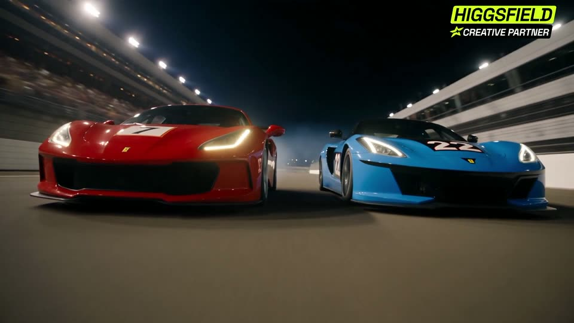</a>

▶ **[播放有声视频原片](https://awesome.raphael.app/materials/43790e28-1714-4625-a5c2-b302ac4ce321.mp4)**

<details><summary><strong>展开完整原始提示词（2499 字）</strong></summary>

```text
GENRE: Cinematic racing sports drama
DURATION: Exactly 30 seconds, 16:9, photorealistic live-action film look

STYLE: Shot like a real racing movie. Natural real-time motion at normal speed, NO slow motion, NO time-lapse. Fast tracking shots, low-angle car shots, in-car cockpit cameras, shallow depth of field, realistic skin texture, floodlit night track, warm orange and cool blue color grade, subtle film grain, realistic motion blur.

CHARACTERS (keep identical in every shot):
- Mina: 27-year-old Korean woman, black hair in a low ponytail, red and white racing suit, red helmet with visor, determined expression. Drives a red sports car with number 7.
- Chloe: 29-year-old woman, blonde hair in a braid, blue and black racing suit, blue helmet. Drives a blue sports car with number 22.
(Generic fictional race cars, no real brand logos.)

SETTING: A professional circuit at night, bright floodlights, grandstands with a cheering crowd, a checkered finish line, light tire smoke.

SHOT 1 (0-6s): Wide low-angle tracking shot. The red car and blue car race side by side on the final lap, engines roaring. Cut to a cockpit view of Mina gripping the steering wheel, eyes locked ahead.

SHOT 2 (6-13s): Cockpit close-up of Chloe glancing sideways at Mina, then smiling confidently. Exterior shot: Chloe's blue car takes the inside line at the final corner and pulls ahead by half a car length. Tires squeal.

SHOT 3 (13-20s): Mina's cockpit, close-up of her eyes in the helmet visor. She says through the radio: "Not yet." She shifts gear and hits the accelerator. Exterior side shot: the red car swings wide on the outside line, wheels gripping hard, engine screaming.

SHOT 4 (20-26s): Front-facing tracking shot of both cars charging down the final straight toward the checkered finish line, crowd blurred on both sides, the cars neck and neck.

SHOT 5 (26-30s): Wide shot at the finish line: the red car crosses first by a tiny margin. Close-up of Mina's gloved hand raised in victory, Chloe's blue car slowing beside her, Chloe nodding with a respectful smile. Cut to black. White text on screen: "PHOTO FINISH".

AUDIO: Roaring engines, tire squeals, gear shifts, crowd cheering, wind rush, radio crackle, driving high-energy cinematic score. English dialogue with natural voice, no music lyrics.

AVOID: Slow motion, crashes, fire, blood, real car brand logos, cartoon look, slideshow effect, static images, face or outfit changes between shots, cars changing color or number between shots.
```

</details>

| 参数 | 配置 |
| --- | --- |
| 模型 | MAGI-2 (flagship) |
| 任务类型 | t2v |
| 时长 / 帧率 | 30.2s · 60 fps |
| 分辨率 / 比例 | 1080p · 16:9 |
| 音频模式 | mixed (audio=True) |

[原始来源](https://x.com/Hope_Ai01/status/2126045556946731324) · 作者: [@Hope_Ai01](https://x.com/Hope_Ai01) · 2026-11-26

> MAGI-2 为作者自述，未经独立核实。

[案例详情页](cases/cms-889ad968/README.zh-CN.md) · **[在 Raphael 上生成同类视频 →](https://raphael.app/ai-video-generator?utm_source=github&utm_medium=repository&utm_campaign=magi_2_launch&utm_content=case_cms-889ad968&utm_term=zh-CN)**

---

<a id="case-cms-6f1b1086"></a>

#### 22. 放下弓的重逢

**来源类型**: `community` · **任务**: `T2V` · **音画**: `Yes` · **状态**: `来源收录`

社区 MAGI-2 视频案例（@AIwithkhan）：放下弓的重逢。

<a href="https://awesome.raphael.app/materials/0a94138a-ce7f-4a86-b5d6-55ae3b7c7dc0.mp4">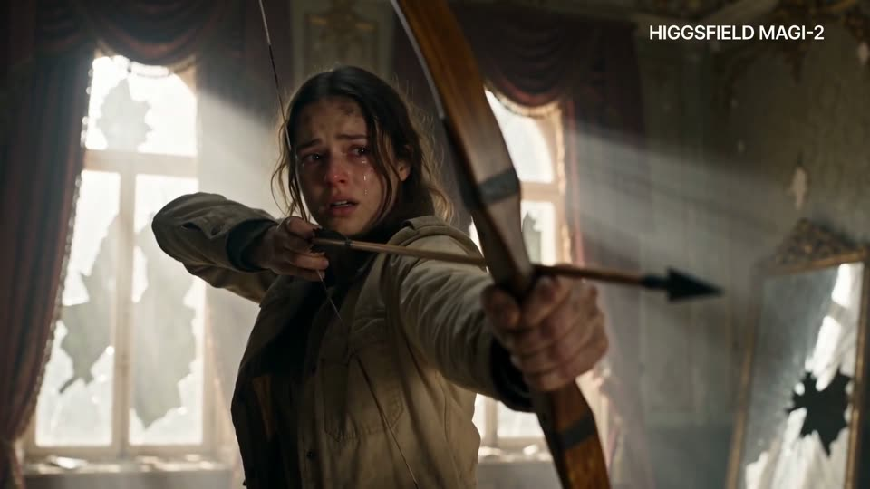</a>

▶ **[播放有声视频原片](https://awesome.raphael.app/materials/0a94138a-ce7f-4a86-b5d6-55ae3b7c7dc0.mp4)**

<details><summary><strong>展开完整原始提示词（3677 字）</strong></summary>

```text
Create an ultra-realistic, emotional, cinematic multi-shot sequence with hard cuts between shots. Maintain perfect character consistency throughout. No background music or score — only natural diegetic sound.

SHOT 1

A young woman in her mid-20s, with messy dark brown hair, warm brown eyes, a dusty beige jacket, dark trousers and worn boots, stands inside an abandoned ornate mansion. She holds a traditional wooden bow with an arrow drawn, aiming toward someone standing in the shadows. Her face is exhausted, covered in dirt and tears. Her hands tremble. Just as she prepares to release the arrow, she notices something and slowly lowers her bow, visibly shocked and heartbroken.

SHOT 2

Over her shoulder, a wounded young man in his late 20s sits against a broken marble pillar on the debris-covered floor. His clothes are torn, his face is bruised, and blood stains his shirt. He looks weak and barely conscious. Their eyes meet. He tries to smile despite his injuries.

SHOT 3

She slowly approaches him, places the bow and arrow on the floor, kneels beside him and gently touches his face. Tears roll down her cheeks. He raises his trembling hand and wipes one of her tears. She smiles through her sadness and embraces him tightly.

SHOT 4

Extreme close-up of their hands holding each other on the dusty marble floor. A single tear falls onto their joined hands. Hold for a moment before a hard cut.

HARD CUT / TRANSFORMATION

SHOT 5

Same camera angle and composition, but now inside a beautiful sunlit garden surrounded by flowering trees. The man's hand is now healthy, clean and gently holding hers. Both are wearing elegant, clean casual outfits. Warm afternoon sunlight illuminates their hands.

SHOT 6

Wide shot of the peaceful garden. The same couple walks slowly along a flower-lined pathway, smiling and looking into each other's eyes. The woman gently rests her head against his shoulder. He wraps his arm around her.

SHOT 7

Close-up of their faces. They stop walking, look into each other's eyes, smile emotionally and slowly lean toward each other.

SHOT 8 — FINAL KISS

A beautiful cinematic medium close-up as the couple gently kisses. She places both hands on his cheeks while he wraps his arms around her waist. Their kiss feels intimate, emotional and genuine. The camera slowly moves around them as sunlight filters through the trees. End with them embracing, smiling and resting their foreheads together.

CHARACTER CONSISTENCY

Same woman throughout: dark brown messy hair in the mansion, warm brown eyes, beige jacket, dark trousers and brown boots. Same facial features and body proportions after transformation.

Same man throughout: late 20s, short dark hair, light stubble, warm brown eyes and identical facial features. Injured and exhausted in the mansion, completely healthy after transformation.

MANSION ENVIRONMENT

Abandoned ornate mansion, tall arched windows, torn dark-red curtains, peeling wallpaper, shattered mirrors, broken furniture, marble pillars, dust particles and dramatic sunlight beams.

GARDEN ENVIRONMENT

Beautiful romantic garden, flowering trees, lush green grass, stone pathway, soft golden sunlight, gentle breeze and warm late-afternoon atmosphere.

VISUAL STYLE

Ultra-realistic, photorealistic, natural human movement, realistic facial expressions, emotional storytelling, handheld camera, shallow depth of field, ARRI Alexa 35 cinematic look, warm cinematic colour grading, subtle film grain.

AUDIO

ONLY natural breathing, footsteps, clothing movement, wind, birds chirping and subtle environmental sounds. Include realistic kissing and embrace sounds. ABSOLUTELY NO BACKGROUND MUSIC OR MUSICAL SCORE.
```

</details>

| 参数 | 配置 |
| --- | --- |
| 模型 | MAGI-2 (flagship) |
| 任务类型 | t2v |
| 时长 / 帧率 | 30.3s · 30 fps |
| 分辨率 / 比例 | 1080p · 16:9 |
| 音频模式 | music (audio=True) |

[原始来源](https://x.com/AIwithkhan/status/2125640284830835088) · 作者: [@AIwithkhan](https://x.com/AIwithkhan) · 2026-11-25

> 模型 MAGI-2 为作者自述，未经独立核实。

[案例详情页](cases/cms-6f1b1086/README.zh-CN.md) · **[在 Raphael 上生成同类视频 →](https://raphael.app/ai-video-generator?utm_source=github&utm_medium=repository&utm_campaign=magi_2_launch&utm_content=case_cms-6f1b1086&utm_term=zh-CN)**

---

<a id="case-cms-4497bbed"></a>

#### 23. 霓虹赛道上的赛车广告

**来源类型**: `community` · **任务**: `T2V` · **音画**: `Yes` · **状态**: `来源收录`

社区 MAGI-2 视频案例（@magiai_hq）：霓虹赛道上的赛车广告。

<a href="https://awesome.raphael.app/materials/134ed5d9-5dea-49e5-ad49-8f745f94087f.mp4"></a>

▶ **[播放有声视频原片](https://awesome.raphael.app/materials/134ed5d9-5dea-49e5-ad49-8f745f94087f.mp4)**

<details><summary><strong>展开完整原始提示词（8260 字）</strong></summary>

```text
Subject Mapping
The "race car" is the car from @Image 1.
The "driver" is the driver from @Image 2.

Use only the fixed names "race car" and "driver" throughout; no synonym substitution. Image 1 locks only the race car's ivory white, vermilion red, and deep purple color scheme, plus its body, suspension, wheels, and front/rear wing structure; Image 2 locks only the driver's racing suit, helmet, gold visor, gloves, and racing shoes. All shots keep the subjects consistent; the original film's car or driver never appears.

Script Overview
Total duration: 30.0s.
Shot count: 24.
Style: Photorealistic 3D racing commercial; black low-key lighting; cyber neon tunnel; red-green complementary lighting; volumetric fog; wet-ground reflections; ray tracing; long-exposure light trails; radial motion blur; chromatic aberration and glitch flash frames.

Scenes: Dark studio, wet-floor pit garage, neon high-speed tunnel.

Camera shake: Whenever cutting to high-speed driving scenes, the frame must shake intensely. Never allow small camera movement while objects are moving at high speed.

Asset Image Prompts
Subject "race car":
Use Image 1 directly; strictly preserve its ivory white, vermilion red, and deep purple livery, mechanical suspension, brake discs, bronze calipers, center-lock wheels, cooling vents, and carbon-fiber front/rear wings and diffuser.

Subject "driver":
Use Image 2 directly; strictly preserve the ivory white, vermilion red, and deep purple racing suit, gold-visor full-face helmet, gloves, and racing shoes.

Scenes:
A black infinity studio; a pit garage with overhead lights, red signal lights, and a wet reflective floor; a futuristic high-speed tunnel filled with red, green, purple, and white neon light walls and volumetric fog. No people, no temporary props; photorealistic 8K 3D rendering.

Video Prompt
Subjects: Race car, driver
Scenes: Dark studio, wet-floor pit garage, neon high-speed tunnel
Music: Generate a BGM that grows progressively tenser with the on-screen rhythm, with matching sound effects

Shot 1 | 0.000-2.333s
Dark studio, symmetrical top-down view from front-above, 50-70mm. The camera slowly pulls back and rises; the race car sits centered and sti

... [truncated in root README; open standalone case page for full prompt]
```

[前往独立案例页查看完整 8260 字提示词 →](cases/cms-4497bbed/README.zh-CN.md)

</details>

| 参数 | 配置 |
| --- | --- |
| 模型 | MAGI-2 (flagship) |
| 任务类型 | t2v |
| 时长 / 帧率 | 29.9s · 25 fps |
| 分辨率 / 比例 | 1080p · 16:9 |
| 音频模式 | mixed (audio=True) |

[原始来源](https://x.com/magiai_hq/status/2125811630210777235) · 作者: [@magiai_hq](https://x.com/magiai_hq) · 2026-11-26

> 模型 MAGI-2 为作者自述，未经独立核实。 作者在同一串帖中标注模型：https://x.com/magiai_hq/status/2125811617145528821

[案例详情页](cases/cms-4497bbed/README.zh-CN.md) · **[在 Raphael 上生成同类视频 →](https://raphael.app/ai-video-generator?utm_source=github&utm_medium=repository&utm_campaign=magi_2_launch&utm_content=case_cms-4497bbed&utm_term=zh-CN)**

---

<a id="case-cms-2b0ce4a1"></a>

#### 24. 穿过屏幕隧道的动画街景

**来源类型**: `community` · **任务**: `T2V` · **音画**: `Yes` · **状态**: `来源收录`

社区 MAGI-2 视频案例（@magiai_hq）：穿过屏幕隧道的动画街景。

<a href="https://awesome.raphael.app/materials/c1d7adb7-80ad-4fb1-804a-29340dc3f1e8.mp4">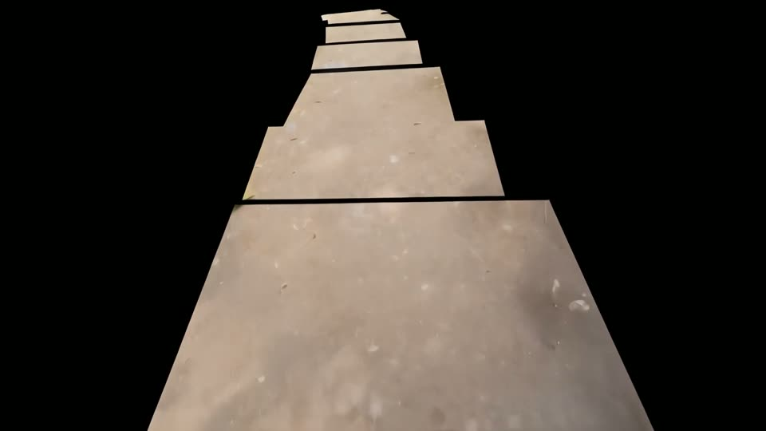</a>

▶ **[播放有声视频原片](https://awesome.raphael.app/materials/c1d7adb7-80ad-4fb1-804a-29340dc3f1e8.mp4)**

<details><summary><strong>展开完整原始提示词（4405 字）</strong></summary>

```text
Overall Requirements
Create an 18-second, 16:9, 1080p anime-style city video, using the uploaded original as the motion reference for the first half's screen assembly and turn-forward push.

The corrected version's most important requirements: after the bloom transition, the camera must always remain at ground-level walking perspective, and the city must contain clearly visible people with feet on the ground.

No camera rising into the sky, flying, aerial shots, or rooftop overviews; no floating people.

Scene
A lived-in modern Japanese city street. Warm golden late-afternoon sun, blue sky with white clouds; streetfront shops, cafe terraces, residential buildings, roadside trees, street lamps, benches, bicycle racks, curbs, and sidewalks.

Refined anime hand-painted backgrounds with clean linework and color blocks, soft cel shading.

The street holds a moderate number of adults walking, chatting, waiting to cross, plus a few slow-moving vehicles — full and orderly. No empty streets, no empty plazas.

People
Once the full streetscape appears, 2–3 adult pedestrians are clearly visible in near-to-mid shots, walking normally on the paved sidewalk, with about 6–10 more passersby active naturally to the sides and in the distance.

Figures follow street perspective; the weight-bearing foot plants truly on the sidewalk or crosswalk surface with no gap between sole and ground, a stable contact shadow underfoot, and natural stepping, weight shifts, and body bounce.

People may scatter naturally — not lined up in a row, no cloned figures, no foot-sliding or floating, no spawning mid-air or dropping from the sky.

The people belong to the scene: some pedestrians are already visible in the earlier city screens; after the transition they still walk naturally in the same ground space.

Timeline
0–0.3s
Pure black space.

0.3–2s
The trapezoid screens of the city sidewalk appear from near to far, keeping the reference's block-by-block assembly rhythm.

2–4.7s
Rectangular city screens appear one after another on both sides, showing shops, trees, curbs, and walking pedestrians. The camera pushes forward along the curve.

4.7–6.9s
The upper screens gradually enclose into an incomple

... [truncated in root README; open standalone case page for full prompt]
```

[前往独立案例页查看完整 4405 字提示词 →](cases/cms-2b0ce4a1/README.zh-CN.md)

</details>

| 参数 | 配置 |
| --- | --- |
| 模型 | MAGI-2 (flagship) |
| 任务类型 | t2v |
| 时长 / 帧率 | 18.0s · 25 fps |
| 分辨率 / 比例 | 1080p · 16:9 |
| 音频模式 | mixed (audio=True) |

[原始来源](https://x.com/magiai_hq/status/2125811634476306885) · 作者: [@magiai_hq](https://x.com/magiai_hq) · 2026-11-26

> 模型 MAGI-2 为作者自述，未经独立核实。 作者在同一串帖中标注模型：https://x.com/magiai_hq/status/2125811617145528821

[案例详情页](cases/cms-2b0ce4a1/README.zh-CN.md) · **[在 Raphael 上生成同类视频 →](https://raphael.app/ai-video-generator?utm_source=github&utm_medium=repository&utm_campaign=magi_2_launch&utm_content=case_cms-2b0ce4a1&utm_term=zh-CN)**

---

<a id="case-cms-f7ba0d44"></a>

#### 25. 感恩节晚餐体育直播

**来源类型**: `community` · **任务**: `T2V` · **音画**: `Yes` · **状态**: `来源收录`

社区 MAGI-2 视频案例（@airina_xyz）：感恩节晚餐体育直播。

<a href="https://awesome.raphael.app/materials/da51272a-4353-45c9-a5f7-847568fb7575.mp4"></a>

▶ **[播放有声视频原片](https://awesome.raphael.app/materials/da51272a-4353-45c9-a5f7-847568fb7575.mp4)**

<details><summary><strong>展开完整原始提示词（1473 字）</strong></summary>

```text
20-second absurdist Thanksgiving comedy filmed like a professional live sports broadcast. An original enthusiastic sports commentator wearing a navy blazer and a large headset provides dramatic commentary on an ordinary family passing dishes around the Thanksgiving dinner table. The family remains completely oblivious to the seriousness of the coverage.
- 00:00–00:02: Extreme close-up of the commentator shouting, "Here comes the opening pass!"
- 00:02–00:04: Slow-motion tracking shot of a grandmother passing a bowl of mashed potatoes across the table.
- 00:04–00:06: Overhead shot following the bowl's trajectory between two relatives.
- 00:06–00:08: The commentator excitedly announces, "Beautiful technique!"
- 00:08–00:10: Macro shot of a guest catching a sliding breadbasket.
- 00:10–00:12: A young adult reaches dramatically across the table for the gravy.
- 00:12–00:14: Slow-motion replay of the gravy boat being intercepted by another relative.
- 00:14–00:17: Close-up of the commentator shouting, "An incredible interception!"
- 00:17–00:20: Wide reveal of the commentator sitting at the dinner table, talking into a spoon. His wife quietly says, "Please stop."
Maintain consistent family members, table geography, dish trajectories and natural reactions. Authentic sports-broadcast framing, dramatic slow-motion replay and accurate lip-sync. No broadcaster logos or graphics. SFX: cutlery, dishes sliding, energetic commentary and awkward silence. No music.
```

</details>

| 参数 | 配置 |
| --- | --- |
| 模型 | MAGI-2 (flagship) |
| 任务类型 | t2v |
| 时长 / 帧率 | 20.3s · 30 fps |
| 分辨率 / 比例 | 1080p · 16:9 |
| 音频模式 | mixed (audio=True) |

[原始来源](https://x.com/airina_xyz/status/2125907956541849634) · 作者: [@airina_xyz](https://x.com/airina_xyz) · 2026-11-26

> MAGI-2 为作者自述，未经独立核实。

[案例详情页](cases/cms-f7ba0d44/README.zh-CN.md) · **[在 Raphael 上生成同类视频 →](https://raphael.app/ai-video-generator?utm_source=github&utm_medium=repository&utm_campaign=magi_2_launch&utm_content=case_cms-f7ba0d44&utm_term=zh-CN)**

---

<a id="case-cms-eeb1c07c"></a>

#### 26. 摩天楼玻璃上的圣诞雪花

**来源类型**: `community` · **任务**: `T2V` · **音画**: `Yes` · **状态**: `来源收录`

社区 MAGI-2 视频案例（@airina_xyz）：摩天楼玻璃上的圣诞雪花。

<a href="https://awesome.raphael.app/materials/85f58f1e-57d9-4c58-b70c-23419b78e0db.mp4">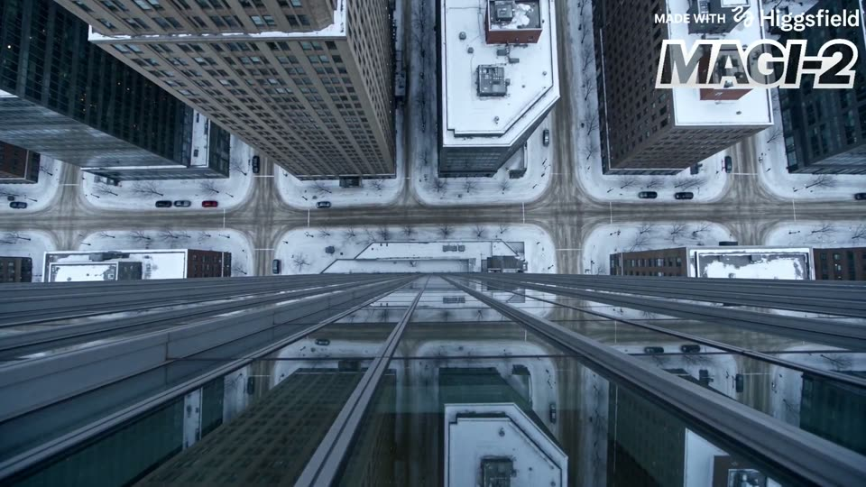</a>

▶ **[播放有声视频原片](https://awesome.raphael.app/materials/85f58f1e-57d9-4c58-b70c-23419b78e0db.mp4)**

<details><summary><strong>展开完整原始提示词（1596 字）</strong></summary>

```text
No music. 20-second spectacular urban Christmas film following two professional window cleaners on a securely suspended maintenance platform outside a modern skyscraper. One wears a navy waterproof jacket and the other a red jacket. They decide to surprise the office employees by drawing a gigantic festive snowflake using removable white window-cleaning foam. Beautiful winter cityscape, dramatic perspective and realistic glass architecture.
00:00–00:02: Extreme downward-looking shot revealing the dizzying height above a snowy city street.
00:02–00:04: Wide aerial shot of the maintenance platform suspended outside the skyscraper.
00:04–00:06: Close-up of a gloved hand drawing a long white foam line on the glass.
00:06–00:08: Interior office shot of curious employees looking toward the window.
00:08–00:10: Exterior side shot as both window cleaners rapidly add symmetrical branches to their design.
00:10–00:12: Macro shot of delicate foam bubbles against the reflective glass.
00:12–00:14: Interior reaction shot as the employees realize what the workers are drawing.
00:14–00:17: Sweeping aerial pullback revealing the enormous completed snowflake covering several window panels.
00:17–00:20: The two workers wave from their platform as the employees applaud through the glass.
Maintain consistent skyscraper geometry, platform construction, safety equipment and snowflake design. Realistic glass reflections, foam texture, atmospheric perspective and coherent interior-exterior spatial relationships. SFX: wind, squeaking squeegees, platform machinery and muffled applause. No music.
```

</details>

| 参数 | 配置 |
| --- | --- |
| 模型 | MAGI-2 (flagship) |
| 任务类型 | t2v |
| 时长 / 帧率 | 20.3s · 30 fps |
| 分辨率 / 比例 | 1080p · 16:9 |
| 音频模式 | music (audio=True) |

[原始来源](https://x.com/airina_xyz/status/2125953505529823573) · 作者: [@airina_xyz](https://x.com/airina_xyz) · 2026-11-26

> 模型 MAGI-2 为作者自述，未经独立核实。

[案例详情页](cases/cms-eeb1c07c/README.zh-CN.md) · **[在 Raphael 上生成同类视频 →](https://raphael.app/ai-video-generator?utm_source=github&utm_medium=repository&utm_campaign=magi_2_launch&utm_content=case_cms-eeb1c07c&utm_term=zh-CN)**

---

<a id="case-cms-eaba3dd3"></a>

#### 27. 迷你厨师做巨型早餐

**来源类型**: `community` · **任务**: `T2V` · **音画**: `Yes` · **状态**: `来源收录`

社区 MAGI-2 视频案例（@RuzainaMeer）：迷你厨师做巨型早餐。

<a href="https://awesome.raphael.app/materials/6984e195-375f-4798-9164-3b90a112edbf.mp4"></a>

▶ **[播放有声视频原片](https://awesome.raphael.app/materials/6984e195-375f-4798-9164-3b90a112edbf.mp4)**

<details><summary><strong>展开完整原始提示词（2624 字）</strong></summary>

```text
Create a 30-second ultra-realistic cinematic video in 16:9 widescreen, 4K, 24fps, featuring 8–10 tiny human chefs cooking a giant breakfast in a modern real-life kitchen. The tiny chefs should look like realistic miniature humans, not cartoons or toys. Maintain consistent faces, clothing, body proportions, and kitchen layout throughout the video.

SCENE 1 (0–6 seconds): Start with a cinematic macro wide shot of a kitchen countertop. Tiny chefs arrive carrying miniature cooking equipment. In front of them are a gigantic egg, a huge tomato, a massive slice of bread, and a large block of butter. The head chef points toward the ingredients, directing the team.

SCENE 2 (6–12 seconds): Two chefs climb a small ladder to crack the giant egg into a frying pan. Other chefs carefully slice a tomato using tiny knives. Another chef struggles to push a huge piece of butter across the countertop. Show realistic teamwork and physical effort.

SCENE 3 (12–18 seconds): The chefs begin cooking on a miniature stove. The egg mixture sizzles naturally in the frying pan. One chef uses a tiny spatula to flip the enormous omelette while another carefully sprinkles seasoning. Realistic steam rises from the pan.

SCENE 4 (18–24 seconds): The team works together to lift a gigantic cheese slice onto the omelette. One chef briefly slips on a tiny drop of oil, but another quickly catches him. The other chefs continue working. Keep every action physically believable.

SCENE 5 (24–30 seconds): Reveal the finished giant golden omelette with melted cheese and tomato slices, served beside toasted bread. The tiny chefs proudly gather around the plate. One chef climbs onto the edge of the plate, raises both arms in celebration, and the camera smoothly pulls back to reveal the entire miniature cooking operation.

VISUAL STYLE: Photorealistic macro cinematography, realistic miniature human anatomy, detailed skin and facial expressions, natural food textures, accurate cooking physics, realistic steam and oil, cinematic lighting, shallow depth of field, smooth connected camera movements, consistent character appearances, and believable scale.

AUDIO: Realistic chopping, sizzling eggs, footsteps, utensils clinking, subtle kitchen ambience, and cheerful reactions from the tiny chefs. No narration, no subtitles, no background music.

IMPORTANT: Every scene must connect naturally to the next. Avoid sudden cuts, inconsistent characters, floating objects, exaggerated movements, cartoon visuals, distorted hands, or artificial-looking food. The final result must look like a professionally filmed miniature cooking documentary.
```

</details>

| 参数 | 配置 |
| --- | --- |
| 模型 | MAGI-2 (flagship) |
| 任务类型 | t2v |
| 时长 / 帧率 | 30.2s · 30 fps |
| 分辨率 / 比例 | 1080p · 16:9 |
| 音频模式 | mixed (audio=True) |

[原始来源](https://x.com/RuzainaMeer/status/2125832298574590127) · 作者: [@RuzainaMeer](https://x.com/RuzainaMeer) · 2026-11-26

> MAGI-2 为作者自述，未经独立核实。

[案例详情页](cases/cms-eaba3dd3/README.zh-CN.md) · **[在 Raphael 上生成同类视频 →](https://raphael.app/ai-video-generator?utm_source=github&utm_medium=repository&utm_campaign=magi_2_launch&utm_content=case_cms-eaba3dd3&utm_term=zh-CN)**

---

<a id="case-cms-d53ca8bf"></a>

#### 28. 雨天伦敦的连环闹剧

**来源类型**: `community` · **任务**: `T2V` · **音画**: `Yes` · **状态**: `来源收录`

社区 MAGI-2 视频案例（@AIwithkhan）：雨天伦敦的连环闹剧。

<a href="https://awesome.raphael.app/materials/546f50eb-d41b-49d0-bbd2-e39f87347641.mp4">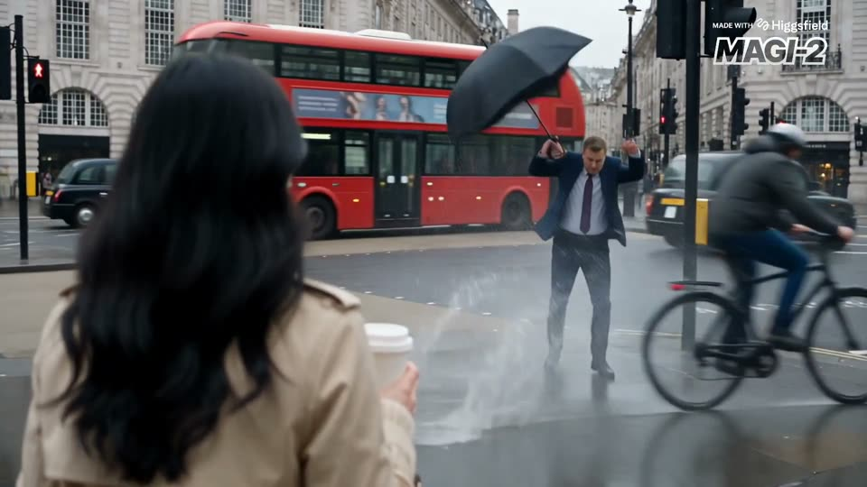</a>

▶ **[播放有声视频原片](https://awesome.raphael.app/materials/546f50eb-d41b-49d0-bbd2-e39f87347641.mp4)**

<details><summary><strong>展开完整原始提示词（958 字）</strong></summary>

```text
Create one 30-second ultra-photorealistic live-action British comedy short in 16:9 landscape, 60 fps. a stylish young woman spending an ordinary rainy day exploring central London. She is enjoying her coffee, admiring the city and casually going about her day. However, everywhere she goes, a ridiculous chain of unexpected accidents unfolds around her. Sometimes she accidentally causes the chaos; sometimes she becomes its unfortunate victim.

The comedy should feel like a high-budget British comedy film, featuring perfectly timed visual gags, believable slapstick, realistic physics, natural human reactions and unexpected comedic payoffs.

Make this short, cinematic and entertaining, with seven fast-paced London sequences, each lasting approximately 4 seconds. Maintain perfect character consistency throughout. Use seamless scene continuity within each location and hard cuts between locations. No dialogue, narration, subtitles or background music.
```

</details>

| 参数 | 配置 |
| --- | --- |
| 模型 | MAGI-2 (flagship) |
| 任务类型 | t2v |
| 时长 / 帧率 | 30.3s · 30 fps |
| 分辨率 / 比例 | 1080p · 16:9 |
| 音频模式 | mixed (audio=True) |

[原始来源](https://x.com/AIwithkhan/status/2125945816229859418) · 作者: [@AIwithkhan](https://x.com/AIwithkhan) · 2026-11-26

> 作者自述使用 MAGI-2，未经独立核实。

[案例详情页](cases/cms-d53ca8bf/README.zh-CN.md) · **[在 Raphael 上生成同类视频 →](https://raphael.app/ai-video-generator?utm_source=github&utm_medium=repository&utm_campaign=magi_2_launch&utm_content=case_cms-d53ca8bf&utm_term=zh-CN)**

---

<a id="case-cms-ca066ab7"></a>

#### 29. 海滨小城的意外英雄

**来源类型**: `community` · **任务**: `T2V` · **音画**: `Yes` · **状态**: `来源收录`

社区 MAGI-2 视频案例（@AIwithkhan）：海滨小城的意外英雄。

<a href="https://awesome.raphael.app/materials/ea40562e-5864-491b-ac79-b8dd61105de8.mp4">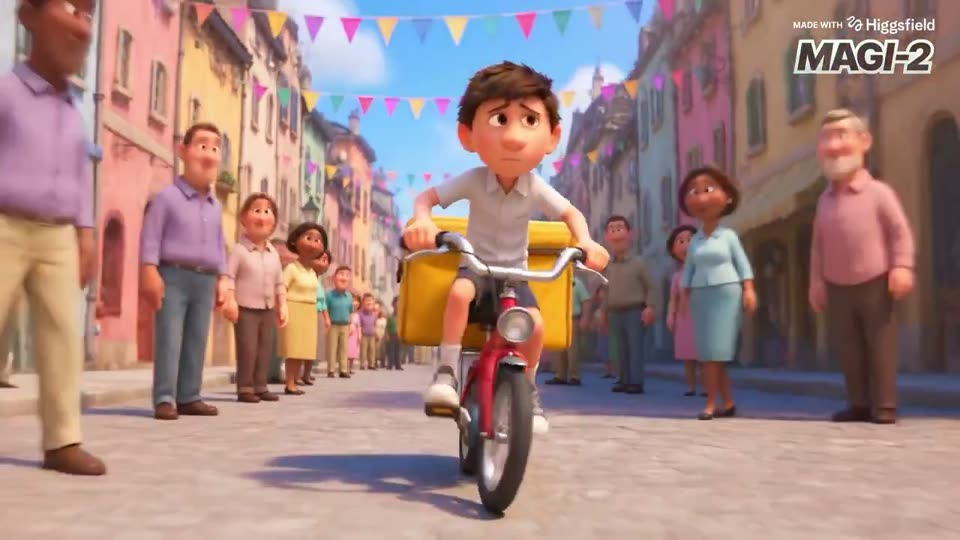</a>

▶ **[播放有声视频原片](https://awesome.raphael.app/materials/ea40562e-5864-491b-ac79-b8dd61105de8.mp4)**

<details><summary><strong>展开完整原始提示词（2189 字）</strong></summary>

```text
Create a Pixar-inspired 3D animated comedy short set in a colorful seaside city on a beautiful sunny morning.

A clumsy young delivery boy riding a small bicycle accidentally crashes into a street magician's performance. His delivery bag flies into the air, scattering dozens of colorful balloons. One balloon gets tangled around a wealthy man's wrist, pulling him away just as a giant runaway wedding cake rolls down the street.

The delivery boy panics and jumps onto his bicycle, chasing the runaway cake. In the chaos, he accidentally saves a little girl standing in its path. The crowd gasps, then cheers.

But the adventure is far from over.

The runaway cake crashes into a fruit stall, sending hundreds of watermelons bouncing across the street. The delivery boy slips on one, flies into the air, and lands perfectly inside a passing parade float shaped like a giant golden eagle.

The float suddenly takes off down the main street. The boy grabs its wings, accidentally steering it through a spectacular parade. The audience believes he is performing an incredible stunt. Cameras flash, people cheer, and the crowd starts chanting his name.

Finally, the float stops directly in front of the city's mayor. The mayor, completely impressed, presents the terrified delivery boy with a giant golden medal for bravery.

Just as everyone celebrates, the little girl he saved runs forward and gives him a warm hug. His worried mother arrives, sees the medal, and bursts into tears of happiness.

Final scene: The boy rides his tiny bicycle home proudly, wearing his oversized golden medal. His delivery bag is still empty, but his face is glowing with happiness. A little puppy runs alongside him as golden sunlight fills the street.

On-screen text appears:

"Sometimes, you don't need a plan to become someone's hero." ❤️

Visual style: High-end Pixar-inspired 3D animation, expressive facial expressions, hilarious slapstick comedy, exaggerated physics, colorful environments, cinematic tracking shots, dynamic camera movements, seamless scene transitions, emotional storytelling, playful orchestral music, beautiful lighting, polished animated short-film quality, 16: 9 aspect ratio.
```

</details>

| 参数 | 配置 |
| --- | --- |
| 模型 | MAGI-2 (flagship) |
| 任务类型 | t2v |
| 时长 / 帧率 | 30.1s · 30 fps |
| 分辨率 / 比例 | 720p · 16:9 |
| 音频模式 | mixed (audio=True) |

[原始来源](https://x.com/AIwithkhan/status/2125811678889791810) · 作者: [@AIwithkhan](https://x.com/AIwithkhan) · 2026-11-26

> MAGI-2 为作者自述，未经独立核实。

[案例详情页](cases/cms-ca066ab7/README.zh-CN.md) · **[在 Raphael 上生成同类视频 →](https://raphael.app/ai-video-generator?utm_source=github&utm_medium=repository&utm_campaign=magi_2_launch&utm_content=case_cms-ca066ab7&utm_term=zh-CN)**

---

<a id="case-cms-be9dc2dd"></a>

#### 30. 奶奶的感恩节秘方

**来源类型**: `community` · **任务**: `T2V` · **音画**: `Yes` · **状态**: `来源收录`

社区 MAGI-2 视频案例（@airina_xyz）：奶奶的感恩节秘方。

<a href="https://awesome.raphael.app/materials/f3fa8da0-42b8-4857-aca7-75d7a9565f67.mp4"></a>

▶ **[播放有声视频原片](https://awesome.raphael.app/materials/f3fa8da0-42b8-4857-aca7-75d7a9565f67.mp4)**

<details><summary><strong>展开完整原始提示词（1256 字）</strong></summary>

```text
20-second cinematic espionage comedy. An original elderly grandmother with silver hair, oversized spectacles and a burgundy cardigan treats her secret Thanksgiving stuffing recipe as a highly classified document. Cozy vintage kitchen, dramatic shadows, warm autumn colors and intensely serious acting.
00:00–00:02: Extreme close-up of a small brass key turning inside a locked kitchen drawer.
00:02–00:04: Grandma cautiously examines the hallway before opening the drawer.
00:04–00:06: Macro shot of her removing a weathered handwritten recipe card.
00:06–00:08: Low-angle shot of her suspiciously closing the kitchen curtains.
00:08–00:10: Overhead shot of her measuring a secret combination of herbs.
00:10–00:12: Close-up of her granddaughter quietly approaching the kitchen doorway.
00:12–00:14: Grandma immediately hides the recipe card beneath her apron.
00:14–00:17: The granddaughter asks, "Can I have the recipe?"
00:17–00:20: Grandma leans closer and whispers, "Nice try."
Maintain consistent characters, recipe-card appearance and kitchen layout. Dramatic spy-thriller lighting, subtle facial acting, precise hand movements and sharp reaction cuts. SFX: key turning, drawer opening, footsteps, rustling paper and synchronized dialogue. No music.
```

</details>

| 参数 | 配置 |
| --- | --- |
| 模型 | MAGI-2 (flagship) |
| 任务类型 | t2v |
| 时长 / 帧率 | 20.3s · 30 fps |
| 分辨率 / 比例 | 1080p · 16:9 |
| 音频模式 | mixed (audio=True) |

[原始来源](https://x.com/airina_xyz/status/2125756210079318458) · 作者: [@airina_xyz](https://x.com/airina_xyz) · 2026-11-26

> MAGI-2 为作者自述，未经独立核实。

[案例详情页](cases/cms-be9dc2dd/README.zh-CN.md) · **[在 Raphael 上生成同类视频 →](https://raphael.app/ai-video-generator?utm_source=github&utm_medium=repository&utm_campaign=magi_2_launch&utm_content=case_cms-be9dc2dd&utm_term=zh-CN)**

---

<a id="case-cms-ba7672e8"></a>

#### 31. 日式精致料理广告

**来源类型**: `community` · **任务**: `T2V` · **音画**: `Yes` · **状态**: `来源收录`

社区 MAGI-2 视频案例（@ChillaiKalan__）：日式精致料理广告。

<a href="https://awesome.raphael.app/materials/93c720b4-adec-485f-bcd5-0f5ec06d7df9.mp4">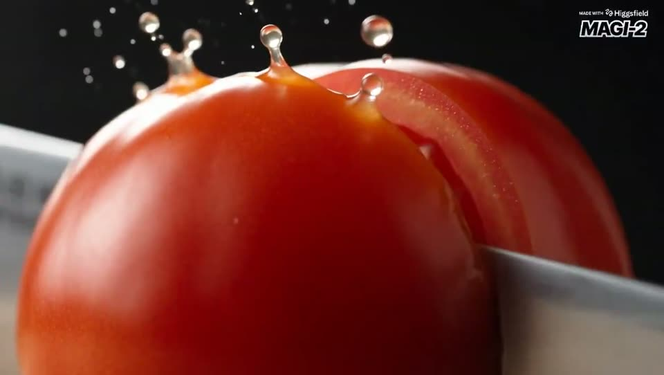</a>

▶ **[播放有声视频原片](https://awesome.raphael.app/materials/93c720b4-adec-485f-bcd5-0f5ec06d7df9.mp4)**

<details><summary><strong>展开完整原始提示词（974 字）</strong></summary>

```text
Create a 15-second premium cinematic food commercial featuring an experienced Japanese master chef preparing an extraordinary fine-dining dish. The chef wears a perfectly clean white uniform and a dark apron.
SHOT 01 | 0–3s: Extreme macro shot of a razor-sharp Japanese knife slicing a fresh red tomato. Juice droplets hang in the air.
SHOT 02 | 3–6s: Rapid close-ups of vegetables being chopped, flames rising from a pan and ingredients falling in slow motion.
SHOT 03 | 6–9s: The chef tosses ingredients into a pan. A beautiful flame briefly illuminates his focused face.
SHOT 04 | 9–12s: Delicate sauce is poured onto a handmade ceramic plate. Every ingredient is positioned with surgical precision.
SHOT 05 | 12–15s: The completed dish rotates slowly under dramatic restaurant lighting. Steam rises as the camera pushes into the final presentation.
BGM: Sophisticated jazz mixed with rhythmic kitchen sounds, knife impacts, sizzling butter and subtle orchestral accents.
```

</details>

| 参数 | 配置 |
| --- | --- |
| 模型 | MAGI-2 (flagship) |
| 任务类型 | t2v |
| 时长 / 帧率 | 15.2s · 60 fps |
| 分辨率 / 比例 | 720p · 16:9 |
| 音频模式 | mixed (audio=True) |

[原始来源](https://x.com/ChillaiKalan__/status/2125853960187888050) · 作者: [@ChillaiKalan__](https://x.com/ChillaiKalan__) · 2026-11-26

> MAGI-2 为作者自述，未经独立核实。

[案例详情页](cases/cms-ba7672e8/README.zh-CN.md) · **[在 Raphael 上生成同类视频 →](https://raphael.app/ai-video-generator?utm_source=github&utm_medium=repository&utm_campaign=magi_2_launch&utm_content=case_cms-ba7672e8&utm_term=zh-CN)**

---

<a id="case-cms-b52d2b0b"></a>

#### 32. 电梯里的第十三层

**来源类型**: `community` · **任务**: `T2V` · **音画**: `Yes` · **状态**: `来源收录`

社区 MAGI-2 视频案例（@Hope_Ai01）：电梯里的第十三层。

<a href="https://awesome.raphael.app/materials/9f405e26-08c6-4cff-8412-826fef20f0f7.mp4">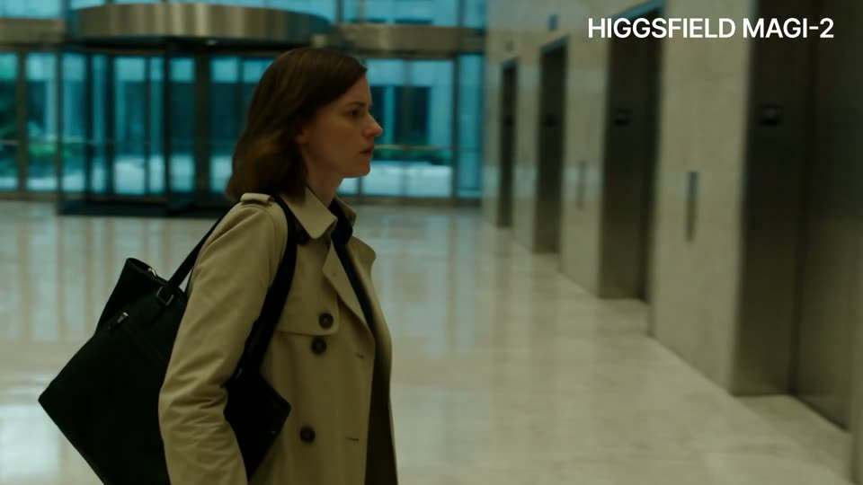</a>

▶ **[播放有声视频原片](https://awesome.raphael.app/materials/9f405e26-08c6-4cff-8412-826fef20f0f7.mp4)**

<details><summary><strong>展开完整原始提示词（2257 字）</strong></summary>

```text
GENRE: Cinematic mystery thriller
DURATION: Exactly 30 seconds, 16:9, photorealistic live-action film look

STYLE: Shot like a real feature film. Natural real-time motion at normal speed, NO slow motion, NO time-lapse. Handheld-steady cinematography, shallow depth of field, realistic skin texture, cold fluorescent lighting, subtle film grain. Moody teal and green color grade.

CHARACTER (keep identical in every shot):
Emma, 30-year-old woman, shoulder-length brown hair, beige trench coat, black work bag on her shoulder, tired but alert expression.

SETTING: A modern 12-floor office building, late at night, empty and quiet.

SHOT 1 (0-6s): Medium tracking shot. Emma walks quickly across the empty lobby, heels clicking on marble. She presses the elevator button, the doors open, she steps in and checks her phone. Natural walking speed.

SHOT 2 (6-13s): Inside the elevator, close-up on the button panel: floors 1 to 12, and above them an extra glowing button labeled "13". Emma notices it, frowns, and says quietly: "This building only has twelve floors." She presses "Lobby". The elevator starts moving UP instead, the floor display counting 10... 11... 12... 13.

SHOT 3 (13-20s): The elevator dings and stops. Doors open slowly at normal speed to a dim corridor with flickering lights. Emma hesitates, then steps out. Camera follows from behind as she walks down the hallway. Her footsteps echo. The elevator doors close behind her.

SHOT 4 (20-26s): The corridor opens into an office floor that is an exact copy of her own workplace: same desks, same posters, same coffee mug. On the last desk, her own desk, a phone starts ringing. Emma approaches, looks at the phone screen. Close-up of her face reflecting the glow of the screen.

SHOT 5 (26-30s): Close-up on the phone screen: caller ID reads "EMMA". Emma whispers: "That's... my number." Sudden cut to black. White text on screen: "THE 13TH FLOOR".

AUDIO: Empty building ambience, fluorescent light hum, elevator ding, echoing footsteps, ringing phone, low tense cinematic score building slowly. English dialogue with natural voice, no music lyrics.

AVOID: Slow motion, horror, ghosts, monsters, blood, cartoon look, slideshow effect, static images, face or outfit changes between shots.
```

</details>

| 参数 | 配置 |
| --- | --- |
| 模型 | MAGI-2 (flagship) |
| 任务类型 | t2v |
| 时长 / 帧率 | 30.2s · 60 fps |
| 分辨率 / 比例 | 1080p · 16:9 |
| 音频模式 | mixed (audio=True) |

[原始来源](https://x.com/Hope_Ai01/status/2125920173903184107) · 作者: [@Hope_Ai01](https://x.com/Hope_Ai01) · 2026-11-26

> 模型 MAGI-2 为作者自述，未经独立核实。

[案例详情页](cases/cms-b52d2b0b/README.zh-CN.md) · **[在 Raphael 上生成同类视频 →](https://raphael.app/ai-video-generator?utm_source=github&utm_medium=repository&utm_campaign=magi_2_launch&utm_content=case_cms-b52d2b0b&utm_term=zh-CN)**

---

<a id="case-cms-a1baa303"></a>

#### 33. 烛光餐厅的三场约会

**来源类型**: `community` · **任务**: `T2V` · **音画**: `Yes` · **状态**: `来源收录`

社区 MAGI-2 视频案例（@ivanka_humeniuk）：烛光餐厅的三场约会。

<a href="https://awesome.raphael.app/materials/db161e86-3512-492a-a5d9-e53e49e012dc.mp4">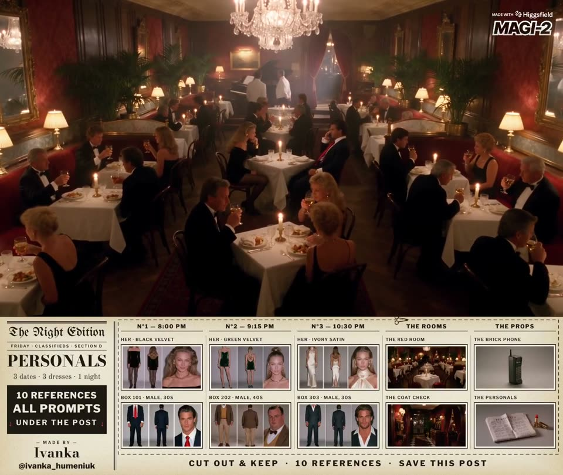</a>

▶ **[播放有声视频原片](https://awesome.raphael.app/materials/db161e86-3512-492a-a5d9-e53e49e012dc.mp4)**

<details><summary><strong>展开完整原始提示词（31520 字）</strong></summary>

```text
📌 PROMPT ( Video Episode 1):

STRICT RULE: Absolutely no music, only diegetic sounds.
Realism cinematic, real skin with pores and small marks, natural eyes, people and set lit only by this place's named sources: the tall candle burning on every table, lighting each face softly from below and in front, the far corners of the room and the gaps between the tables left dark; 1990 Kodak 35mm colour-negative film grade with softly faded shadows, soft halation around every flame and clearly visible organic film grain; still air with a faint haze.
Framed on the rule of thirds, with a light anamorphic lens character: softly oval out-of-focus highlights in the background, and a fine 35mm film grain.
Image reference 1 (location Restaurant Dining Room): the Restaurant Dining Room 100% as in the reference.
Image reference 2 (character Stella): Stella, face, hair, body and clothes 100% as in the reference.
Image reference 3 (character Brad): Brad, face, hair, body and clothes 100% as in the reference.
Image reference 4 (character Tony): Tony, face, hair, body and clothes 100% as in the reference.
Image reference 5 (prop Brick Phone): the Brick Phone 100% as in the reference.
Image reference 6 (prop Newspaper): the Newspaper 100% as in the reference.
Continuity: Stella is clean and unchanged from the reference, with no stain, mark or damage; Brad is clean and unchanged from the reference, with no stain, mark or damage; Tony is clean and unchanged from the reference, with no stain, mark or damage.
In frame only: Stella, Brad, Tony and the background diners. Every other table is taken by elegant diners in 1990 evening wear who eat, talk and raise glasses, the whole room filled with their soft, wordless murmur and the clink of glasses and cutlery, and two waiters in white jackets pass far behind, always soft and out of focus, never near the leads; the grand piano closed. Stella and Brad sit face to face at the small candlelit table for two in the middle of the room, Stella screen left, Brad screen right, an arm's length apart across the table. Tony works the room behind them and comes to the table in S4 and S6. The brick phone stays at Brad's right ear the whole clip. The newspap

... [truncated in root README; open standalone case page for full prompt]
```

[前往独立案例页查看完整 31520 字提示词 →](cases/cms-a1baa303/README.zh-CN.md)

</details>

| 参数 | 配置 |
| --- | --- |
| 模型 | MAGI-2 (flagship) |
| 任务类型 | t2v |
| 时长 / 帧率 | 83.9s · 30 fps |
| 分辨率 / 比例 | 1080p · 32:27 |
| 音频模式 | music (audio=True) |

[原始来源](https://x.com/ivanka_humeniuk/status/2125805598239269190) · 作者: [@ivanka_humeniuk](https://x.com/ivanka_humeniuk) · 2026-11-26

> 作者自述使用 MAGI-2，未经独立核实。原帖视频为四段合辑。第一段提示词见原帖，第二至四段提示词见同一作者回复 https://x.com/ivanka_humeniuk/status/2125805606736953683。

[案例详情页](cases/cms-a1baa303/README.zh-CN.md) · **[在 Raphael 上生成同类视频 →](https://raphael.app/ai-video-generator?utm_source=github&utm_medium=repository&utm_campaign=magi_2_launch&utm_content=case_cms-a1baa303&utm_term=zh-CN)**

---

<a id="case-cms-9f948804"></a>

#### 34. 迷你工人的可口可乐工厂

**来源类型**: `community` · **任务**: `T2V` · **音画**: `Yes` · **状态**: `来源收录`

社区 MAGI-2 视频案例（@AIwithSynthia）：迷你工人的可口可乐工厂。

<a href="https://awesome.raphael.app/materials/9535425e-b48d-49fa-83b6-ca268cda5787.mp4">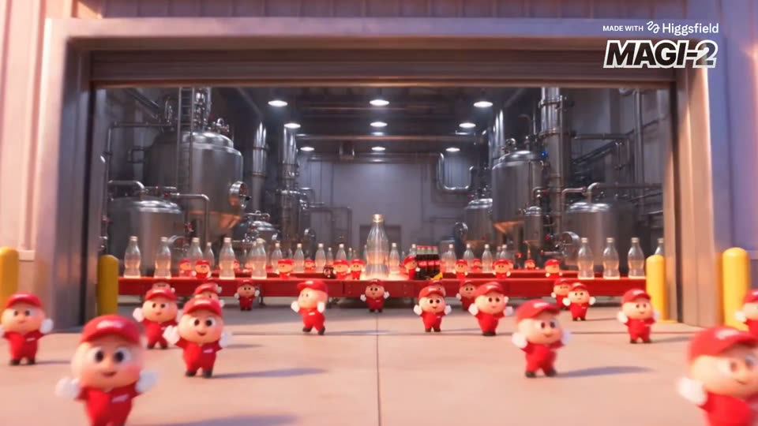</a>

▶ **[播放有声视频原片](https://awesome.raphael.app/materials/9535425e-b48d-49fa-83b6-ca268cda5787.mp4)**

<details><summary><strong>展开完整原始提示词（3504 字）</strong></summary>

```text
Create a heartwarming, ultra-cute 3D chibi animated commercial inside a massive, magical soft drink factory operated entirely by tiny chibi workers. The factory is bright, spotless, colorful, and beautifully organized, featuring enormous stainless-steel machines, sparkling glass bottles, glowing red conveyor belts, and warm cinematic lighting. Every worker has oversized sparkling eyes, rosy cheeks, tiny proportions, expressive faces, and adorable waddling movements. All workers wear miniature red uniforms, little white gloves, and matching caps.

SCENE 1 – THE GRAND FACTORY ENTRANCE

The video opens with a spectacular cinematic fly-through entering the enormous beverage factory. Hundreds of adorable miniature workers enthusiastically run around, waving to each other and preparing for the day's production. Giant empty glass bottles travel along conveyor belts while tiny workers guide them into position. Some workers operate miniature forklifts carrying stacks of bottles, while others proudly inspect the production lines.

SCENE 2 – THE MAGICAL BEVERAGE PRODUCTION

The camera glides alongside enormous industrial mixing tanks filled with a rich, dark fizzy beverage. Tiny workers in protective uniforms carefully monitor the machines, turn miniature control wheels, and inspect the flowing liquid. One adorable worker stands on a tiny ladder, checking a pressure gauge while another gives an enthusiastic thumbs-up. Bubbles rise through transparent pipes, creating a mesmerizing visual spectacle.

SCENE 3 – BOTTLE FILLING STATION

Transition into a spectacular automated bottling station. Rows of sparkling glass bottles move beneath giant filling machines as the dark fizzy drink pours into each bottle with perfect precision. Tiny workers carefully supervise the process, enthusiastically cheering whenever a bottle gets filled. One little worker proudly holds up a perfectly filled bottle while his colleagues celebrate with tiny high-fives.

SCENE 4 – THE BUBBLE MAGIC

Capture beautiful macro close-ups of sparkling carbonation, tiny bubbles rising inside freshly filled bottles, condensation forming on chilled glass surfaces, and refreshing droplets sliding down the bottles. Miniature workers admire the finished drinks. One worker playfully tries to catch a floating bubble while another carefully polishes a bottle with an oversized cleaning cloth.

SCENE 5 – THE PACKAGING DEPARTMENT

The camera moves through a lively packaging section where hundreds of bottles are automatically capped, labeled, and packed into colorful red cartons. Tiny workers coordinate everything with incredible enthusiasm. Some carefully arrange bottles inside cartons, others seal the packages, while miniature forklifts transport finished products toward the warehouse. One tiny worker proudly stands on top of a carton, directing traffic like a factory supervisor.

SCENE 6 – THE GRAND FINALE

The entire factory becomes a celebration. Hundreds of adorable workers gather around a giant beautifully presented chilled bottle surrounded by sparkling droplets and refreshing ice cubes. They cheer, clap, wave their tiny hands, and perform adorable victory dances. One little worker proudly raises a miniature bottle toward the camera as everyone celebrates another successful production day.

The camera slowly pulls backward and rises above the factory floor, revealing the enormous, beautifully illuminated production facility filled with busy miniature workers and endless rows of finished bottles.
```

</details>

| 参数 | 配置 |
| --- | --- |
| 模型 | MAGI-2 (flagship) |
| 任务类型 | t2v |
| 时长 / 帧率 | 30.3s · 30 fps |
| 分辨率 / 比例 | 1080p · 16:9 |
| 音频模式 | mixed (audio=True) |

[原始来源](https://x.com/AIwithSynthia/status/2125821453266546701) · 作者: [@AIwithSynthia](https://x.com/AIwithSynthia) · 2026-11-26

> MAGI-2 为作者自述，未经独立核实。

[案例详情页](cases/cms-9f948804/README.zh-CN.md) · **[在 Raphael 上生成同类视频 →](https://raphael.app/ai-video-generator?utm_source=github&utm_medium=repository&utm_campaign=magi_2_launch&utm_content=case_cms-9f948804&utm_term=zh-CN)**

---

<a id="case-cms-8868357e"></a>

#### 35. 迷你女孩闯进体育用品店

**来源类型**: `community` · **任务**: `T2V` · **音画**: `Yes` · **状态**: `来源收录`

社区 MAGI-2 视频案例（@john_my07）：迷你女孩闯进体育用品店。

<a href="https://awesome.raphael.app/materials/43165285-b728-4af8-aaf4-76e2513e275d.mp4">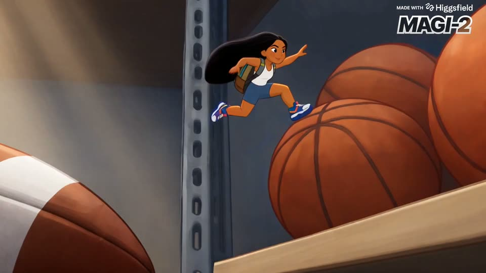</a>

▶ **[播放有声视频原片](https://awesome.raphael.app/materials/43165285-b728-4af8-aaf4-76e2513e275d.mp4)**

<details><summary><strong>展开完整原始提示词（3462 字）</strong></summary>

```text
High-quality 2D animated adventure film, expressive hand-drawn characters, beautifully illustrated environments, rich colors, detailed backgrounds, fluid character animation, cinematic lighting, layered parallax, dynamic camera movements, polished animation with a premium feature-film aesthetic. Playful, energetic and full of visual surprises. 16:9 widescreen, 4K.

CHARACTER CONSISTENCY

One athletic young miniature woman, approximately 1:5 scale, with consistent facial features, hairstyle, outfit, sneakers, backpack and body proportions throughout the entire sequence. She must remain visibly tiny compared to the enormous sports equipment.

STORY – THE MINIATURE SPORTS CHALLENGE

Create a 30-second fast-paced animated adventure inside a gigantic sports equipment store.

The adventure begins when the miniature woman runs across a massive football display. She jumps onto a basketball rolling off a shelf and rides it like a moving platform, balancing with her arms stretched out. The ball suddenly bounces, launching her onto a towering pile of colorful volleyballs.

She spots an enormous cricket bat leaning against a display. Using its handle as a climbing rope, she reaches the top, slides down its curved body and lands inside a basket of oversized tennis balls. One ball suddenly launches from a nearby tennis machine, sending her flying onto a giant racket.

Next, she discovers a row of enormous running shoes. She jumps between their laces, climbs over a sneaker tongue and slides down the side of a shoe. A giant football rolls toward her, forcing her to dive through the opening of a nearby sports bag.

Emerging from the other side, she encounters a gigantic gym section. She climbs a vertical rack of dumbbells, swings from a resistance band and leaps onto a giant boxing glove. The glove compresses under her weight and springs her into the air.

She lands on a skateboard moving across the shop floor. Racing along its surface, she dodges oversized water bottles before grabbing a dangling basketball net. She swings through the air and lands on the edge of a giant basketball hoop.

FINAL SEQUENCE

She makes one final daring jump onto a towering display of colorful sports balls. After climbing to the very top, she stands triumphantly with her hands on her hips.

The camera gradually pulls back, revealing the enormous sports store, towering equipment displays, bright aisles and ordinary-sized shoppers moving around in the background. Her tiny size becomes the final visual surprise.

ENDING TITLE

"BIG DREAMS. LITTLE ADVENTURER."

Followed by:

"EVERY GAME IS A GIANT ADVENTURE."

CAMERA & ANIMATION

Dynamic 2D tracking shots, dramatic perspective shifts, expressive poses, exaggerated but believable cartoon physics, smooth squash-and-stretch, layered background movement, cinematic transitions, energetic close-ups, wide establishing shots and strong foreground parallax. Maintain consistent character design and scale in every shot.

SOUND DESIGN

Energetic adventure music, bouncing balls, squeaking sneakers, skateboard wheels, fabric movement, springy impacts, equipment clattering, rushing air and playful environmental sound effects.

NEGATIVE PROMPT

No 3D rendering, photorealism, live-action, CGI, anime styling, character duplication, inconsistent character design, outfit changes, distorted anatomy, random scene changes, floating objects, inconsistent miniature scale, static compositions, narration or subtitles.
```

</details>

| 参数 | 配置 |
| --- | --- |
| 模型 | MAGI-2 (flagship) |
| 任务类型 | t2v |
| 时长 / 帧率 | 30.3s · 30 fps |
| 分辨率 / 比例 | 1080p · 16:9 |
| 音频模式 | mixed (audio=True) |

[原始来源](https://x.com/john_my07/status/2125940546598293935) · 作者: [@john_my07](https://x.com/john_my07) · 2026-11-26

> 模型 MAGI-2 为作者自述，未经独立核实。

[案例详情页](cases/cms-8868357e/README.zh-CN.md) · **[在 Raphael 上生成同类视频 →](https://raphael.app/ai-video-generator?utm_source=github&utm_medium=repository&utm_campaign=magi_2_launch&utm_content=case_cms-8868357e&utm_term=zh-CN)**

---

<a id="case-cms-31031581"></a>

#### 36. 给爸爸做松饼

**来源类型**: `community` · **任务**: `T2V` · **音画**: `Yes` · **状态**: `来源收录`

社区 MAGI-2 视频案例（@AIwithkhan）：给爸爸做松饼。

<a href="https://awesome.raphael.app/materials/c42d1bde-2c1d-4e9a-87b9-d3b5cfe6cb7e.mp4">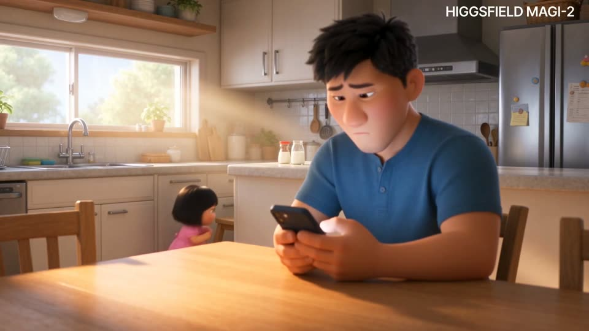</a>

▶ **[播放有声视频原片](https://awesome.raphael.app/materials/c42d1bde-2c1d-4e9a-87b9-d3b5cfe6cb7e.mp4)**

<details><summary><strong>展开完整原始提示词（1365 字）</strong></summary>

```text
Create a heartwarming, hilarious, ultra-realistic Japanese-style 3D animated family comedy in vertical 16:9 format.

A cute 3-year-old Japanese girl with short black bobbed hair, chubby cheeks, sparkling eyes, and pink pajamas decides to surprise her father with breakfast.

Wearing an oversized chef hat, she struggles to prepare pancakes in the kitchen. She accidentally spills flour everywhere, gets chocolate on her face, and finally serves her father a funny-looking, slightly burnt pancake.

🎙️ Girl: "Papa! I made this for you!"

Her father takes a bite, struggles to hide his reaction, and says, "Delicious!"

The little girl notices his watery eyes and innocently asks, "Papa, are you crying because it's so yummy?"

The mother walks in, tastes the pancake, and bursts into laughter. The father hugs his little daughter and kisses her forehead.

Final Shot: The little girl proudly poses like a professional chef while her parents laugh.

Style: High-end Japanese 3D animation, adorable characters, expressive faces, realistic movements, warm lighting, cinematic camera angles, funny sound effects, natural Japanese dialogue, and heartwarming family moments.

Consistency: Maintain identical characters, clothing, facial features, and kitchen throughout.

Negative: No distorted faces, extra fingers, flickering, scene jumps, subtitles, text, or watermark.
```

</details>

| 参数 | 配置 |
| --- | --- |
| 模型 | MAGI-2 (flagship) |
| 任务类型 | t2v |
| 时长 / 帧率 | 30.3s · 30 fps |
| 分辨率 / 比例 | 1080p · 16:9 |
| 音频模式 | dialogue (audio=True) |

[原始来源](https://x.com/AIwithkhan/status/2125522773258952776) · 作者: [@AIwithkhan](https://x.com/AIwithkhan) · 2026-11-25

> MAGI-2 为作者自述，未经独立核实。

[案例详情页](cases/cms-31031581/README.zh-CN.md) · **[在 Raphael 上生成同类视频 →](https://raphael.app/ai-video-generator?utm_source=github&utm_medium=repository&utm_campaign=magi_2_launch&utm_content=case_cms-31031581&utm_term=zh-CN)**

---

<a id="case-asics-gel-nimbus-ugc-ad"></a>

#### 37. ASICS Gel Nimbus 跑鞋竖屏 UGC 广告

**来源类型**: `community` · **任务**: `T2V` · **音画**: `Yes` · **状态**: `来源收录`

4 幕 30 秒 9:16 竖屏跑鞋口播广告，含门廊开场、上脚特写、公园慢跑旁白与收尾推荐，英文对白与口型同步。

<a href="https://awesome.raphael.app/materials/e21e0ccd-1aae-4cfd-9424-6b85fe352192.mp4"></a>

▶ **[播放有声视频原片](https://awesome.raphael.app/materials/e21e0ccd-1aae-4cfd-9424-6b85fe352192.mp4)**

<details><summary><strong>展开完整原始提示词（2299 字）</strong></summary>

```text
Create a polished, highly realistic 30-second UGC-style advertisement for ASICS Gel Nimbus running shoes.

A young, attractive woman named Maya is the presenter. She should look and sound like a real lifestyle content creator recording a genuine product recommendation, not a professional actress reading a script.

Scene 1: Doorway hook (0–6 sec)

Maya stands at her apartment doorway, holding her ASICS Gel Nimbus shoes. She looks directly into the camera with an excited but natural expression.

Dialogue:

“Okay, I think I just found my new favourite running shoes. Look at these!”

She brings the teal ASICS Gel Nimbus close to the camera, showing the design.

Scene 2: First impressions (6–14 sec)

Cut to Maya sitting down and putting on the shoes. Show close-up shots of the teal upper, cushioning, ASICS logo, and sole.

Dialogue:

“These are the ASICS Gel Nimbus, and first of all, they’re so comfortable. I love how they feel on my feet.”

Scene 3: Lifestyle montage (14–23 sec)

Maya walks out onto the sidewalk, followed by shots of her jogging through a beautiful green park. Capture natural movement, shoe close-ups, and a few candid moments.

Voiceover:

“They feel soft, supportive, and honestly, I love how they look too. Perfect for my everyday walks and running sessions.”

Scene 4: Final recommendation (23–30 sec)

Maya stops on a park pathway, looks into the camera, and smiles.

Dialogue:

“If you’re looking for a pair that feels as good as it looks, definitely check these out.”

End with a premium close-up hero shot of the teal ASICS Gel Nimbus and the ASICS logo.

Production requirements:

Natural female voice with conversational delivery.
Accurate lip synchronization.
Authentic UGC filming style mixed with premium commercial shots.
Consistent Maya appearance and identical shoes throughout.
Teal ASICS Gel Nimbus prominently visible.
Realistic outdoor lighting and natural skin textures.
Soft upbeat background music mixed below the dialogue.
Natural ambient sounds during the outdoor montage.
No robotic voice, exaggerated expressions, or artificial-looking movements.
Vertical 9:16 format, 30 seconds.

Finished ad direction: A genuine creator-style product recommendation with a strong opening hook, natural praise, lifestyle footage, and a clear product reveal.
```

</details>

| 参数 | 配置 |
| --- | --- |
| 模型 | MAGI-2 (flagship) |
| 任务类型 | t2v |
| 时长 / 帧率 | 30.2s · 30 fps |
| 分辨率 / 比例 | 1080p · 9:16 |
| 音频模式 | mixed (audio=True) |

[原始来源](https://x.com/Sheldon056/status/2125445425520083116) · 作者: [@Sheldon056](https://x.com/Sheldon056) · 2026-11-25

> 作者标注 Higgsfield 合作生成；完整提示词见原回复 https://x.com/Sheldon056/status/2125445430725226653。

[案例详情页](cases/asics-gel-nimbus-ugc-ad/README.zh-CN.md) · **[在 Raphael 上生成同类视频 →](https://raphael.app/ai-video-generator?utm_source=github&utm_medium=repository&utm_campaign=magi_2_launch&utm_content=case_asics-gel-nimbus-ugc-ad&utm_term=zh-CN)**

---

<a id="category-sfx-ambience"></a>

### 音效、配乐与环境音

<a id="case-cms-b6a12ce7"></a>

#### 38. 醉仙翁大战三兄弟

**来源类型**: `community` · **任务**: `T2V` · **音画**: `Yes` · **状态**: `来源收录`

社区 MAGI-2 视频案例（@abulu8）：醉仙翁大战三兄弟。

<a href="https://awesome.raphael.app/materials/f49b589b-fa4a-4401-b97f-7f4b5b1e3235.mp4">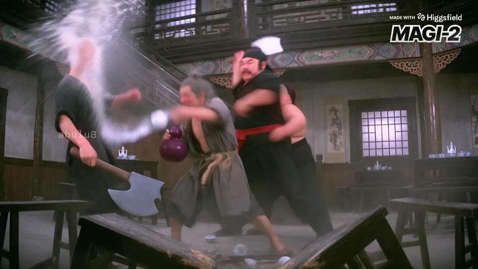</a>

▶ **[播放有声视频原片](https://awesome.raphael.app/materials/f49b589b-fa4a-4401-b97f-7f4b5b1e3235.mp4)**

<details><summary><strong>展开完整原始提示词（5292 字）</strong></summary>

```text
【全局前置设定：画质与质感】

1970 年代香港武侠电影质感。Techniscope 2.35:1 宽银幕，褪色偏暖的 Eastmancolor 胶片色调，厚重的胶片颗粒，轻微的片门抖动与画面边缘暗角，偶尔出现细小的划痕与灰尘斑点。

布景是那个年代的摄影棚质感：两层木结构茶楼内景，彩绘的木梁，油灯与灯笼的暖黄光，硬光、强轮廓光、人物脸上有明显的油彩妆感。空气中漂浮着茶水的热气与扬起的灰尘。

所有特效都是实拍物理效果：吊威亚的腾跃、真实碎裂的木器与瓷器、斧刃撞击的火星、扬尘、泼溅的茶水与酒。全片绝对没有能量光效、气功光或数字特效。

声音是那个年代的后期配音质感：拳脚声、器物碎裂声略微过响、过干净；每一次重击配一记鼓点或锣声；一段轻快俏皮的笛子与锣鼓配乐从第一帧贯穿到最后一帧。

【醉仙翁·醉拳老头】

成年东亚男性，约六十岁，身高 5 英尺 4 寸，身形精瘦干巴，看起来弱不禁风。乱糟糟的花白头发在头顶扎成一个歪斜的小髻，稀疏的山羊胡，红通通的酒糟鼻，两颊醉红，眯缝着一双醉眼，常常咧嘴傻笑露出缺了一颗的门牙。身穿洗得发白的灰褐色破旧长衫，衣襟敞着，袖子一长一短，腰上系一根草绳，草绳上挂着一只紫红色的大酒葫芦。脚上一双磨破的草鞋。

他打的是醉拳：身体永远东倒西歪，脚步踉跄打晃，好像随时要摔倒——但每一次"摔"都恰好躲开攻击，每一次"晃"都恰好打中对方。他边打边喝酒，酒葫芦从不离手，既是酒壶也是兵器。他全程笑嘻嘻的，从不认真，从不生气。

【斧头三兄弟】

三兄弟穿同样的黑色短打，腰系红布带，手持同样的短柄宽刃板斧，但体型完全不同，必须一眼区分：

老大·铁牛：身高 6 英尺 3 寸，最高最壮，方脸，满脸横肉，粗黑八字胡，头戴黑色布头巾。双手各持一把板斧。动作最重最猛。

老二·瘦猴：身高 5 英尺 10 寸，又高又瘦，长脸尖下巴，光头，两颗龅牙。单手持一把板斧。动作最快最滑。

老三·肥狗：身高 5 英尺 6 寸，又矮又胖，圆脸大肚子，脑后拖一根细长辫子。单手持一把板斧。动作最笨，总是被自己人撞到。

三人全程是三个人，绝不增减，外貌绝不互换。

【体型比例·必须严格遵守】

醉仙翁 5 英尺 4 寸，全场最矮。铁牛 6 英尺 3 寸，比醉仙翁高出一个多头。瘦猴 5 英尺 10 寸。肥狗 5 英尺 6 寸，宽度是醉仙翁的两倍。全程严格保持。

【场景：醉仙楼·两层茶楼】

一座两层木结构的老茶楼内堂。一楼摆着十几张八仙桌与长条板凳，桌上有茶壶、茶碗、碟子、酒坛。一侧是一道宽木楼梯通往二楼，楼梯扶手是长长的光滑木栏。二楼是一圈环形回廊，木栏杆围着天井，可以俯瞰一楼。天井正上方从横梁上吊下一盏巨大的圆形红灯笼。墙上挂着字画与鸟笼。柜台后面是一排酒坛架子。窗户是木格纸窗。

【可破坏结构】八仙桌、板凳、茶壶茶碗、酒坛、楼梯扶手、二楼栏杆、纸窗、鸟笼、字画、柜台、酒坛架子、吊灯笼——全部可以被砸碎、劈开、踢飞、撞穿。已损坏处永久保持。

【刚性空间锚点】楼梯的位置、二楼回廊、天井上方的大灯笼、柜台与酒坛架，全片绝不漂移、消失或改变数量。

【全片从第一帧到最后一帧都是恶斗·必须严格遵守】

第 0 帧已经在打。没有开场对峙、没有亮相、没有介绍人物。

第 0 秒到第 30 秒，攻防一刻不停，任何一秒都不允许出现没有攻防的画面。最后一帧依然处在高速运动中。

绝对禁止：对峙、凝视、站着不动、单独的表情镜头、单独的反应镜头、僵持、蓄力、摆架势、慢动作、停顿、结尾的静止画面、定格。

变焦急推只作为 0.3 秒的插入，插完立刻回到打斗。

每一招都有起手、轨迹、目标、接触反馈与收势；每一次移动交代从哪里到哪里。

【醉拳的物理·必须严格遵守】

醉仙翁的每一个躲闪都必须看起来像是意外：脚下一滑、身子一歪、打个酒嗝、弯腰去捡掉下的东西——恰好让斧头擦身而过。他的每一次反击都必须看起来像是顺势：倒下时一脚踢出、晃过去时一肘撞上、举起葫芦喝酒时葫芦底正好砸中对方的下巴。

他的身体软得像没有骨头，但每一次接触都结结实实，对手被打得真实地踉跄、倒飞、撞碎家具。

【密度】全片每秒 6—8 次清晰的攻防状态变化，下方每段写明了交击次数，必须全部打出来。速度快至巅峰，但不是快进，不用模糊残影掩盖动作。

【伤害等级 0】无血、无伤口。斧刃从不砍中身体，只砍中家具与器物。狼狈只体现为：被打得踉跄倒飞、撞翻桌子、被茶水泼一脸、摔个四脚朝天、衣服被撕破。

【胜负】醉仙翁赢，三兄弟全部倒下。

【对白规则】本片没有任何台词、对白、旁白或内心独白。所有文字都是画面说明，绝对不得念出、不得配音。醉仙翁的酒嗝与笑声是声音，不是台词。

【运镜·七十年代武侠语法】

不使用现代手持晃动与 FPV。使用：横移跟拍跟随追打；腾跃时低角度仰拍；固定广角交代走位；从二楼俯拍一楼的天井视角；0.3 秒的变焦急推插入作为节奏重音。

近景与广角交替：每一段贴身快打之后立即切回广角让观众看清四个人的走位。

━━━━━━━━━━━━━━━━━━

【0.0—3.0 秒｜开打·十次交击】

第 0 帧：固定低角度广角，一楼正中，铁牛的双斧正当头劈下——醉仙翁打了个酒嗝，身子往后一仰，双斧劈进他刚坐的八仙桌，桌子从中间裂成两半，茶碗飞起。

紧接着：瘦猴从左边一斧横砍，醉

... [truncated in root README; open standalone case page for full prompt]
```

[前往独立案例页查看完整 5292 字提示词 →](cases/cms-b6a12ce7/README.zh-CN.md)

</details>

| 参数 | 配置 |
| --- | --- |
| 模型 | MAGI-2 (flagship) |
| 任务类型 | t2v |
| 时长 / 帧率 | 30.3s · 30 fps |
| 分辨率 / 比例 | 1080p · 16:9 |
| 音频模式 | music (audio=True) |

[原始来源](https://x.com/abulu8/status/2125909905882415605) · 作者: [@abulu8](https://x.com/abulu8) · 2026-11-26

> 模型 MAGI-2 为作者自述，未经独立核实。

[案例详情页](cases/cms-b6a12ce7/README.zh-CN.md) · **[在 Raphael 上生成同类视频 →](https://raphael.app/ai-video-generator?utm_source=github&utm_medium=repository&utm_campaign=magi_2_launch&utm_content=case_cms-b6a12ce7&utm_term=zh-CN)**

---

<a id="case-cms-fb4c34de"></a>

#### 39. 雨夜屋顶武侠短片

**来源类型**: `community` · **任务**: `T2V` · **音画**: `Yes` · **状态**: `来源收录`

社区 MAGI-2 视频案例（@abulu8）：雨夜屋顶武侠短片。

<a href="https://awesome.raphael.app/materials/9c81bb45-bca0-4b76-aabb-3812af843d74.mp4">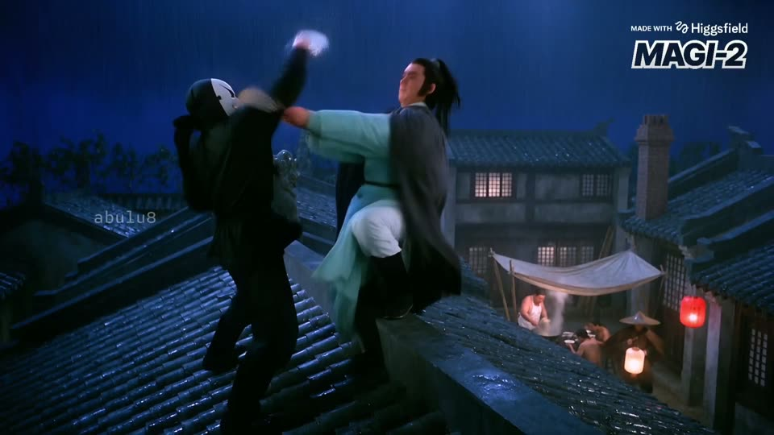</a>

▶ **[播放有声视频原片](https://awesome.raphael.app/materials/9c81bb45-bca0-4b76-aabb-3812af843d74.mp4)**

<details><summary><strong>展开完整原始提示词（6115 字）</strong></summary>

```text
【全局前置设定：画质与质感】

1970 年代香港武侠电影质感。Techniscope 2.35:1 宽银幕，褪色的 Eastmancolor 胶片色调，厚重的胶片颗粒，轻微的片门抖动与画面边缘暗角，偶尔出现细小的划痕与灰尘斑点。

夜景是那个年代的摄影棚做法：深蓝色滤光的夜色，雨塔浇下的人造大雨，雨丝在逆光中呈亮白色的斜线；巷子里的灯笼与面摊的炉火提供暖橙色的点光源，与冷蓝的夜色形成强烈对比。硬光、强轮廓光，人物脸上有明显的油彩妆感，被雨水打湿后泛着光。

所有特效都是实拍物理效果：吊威亚的腾跃与跨屋顶飞跃、真实碎裂飞溅的瓦片、兵器撞击的火星、溅起的水花。全片绝对没有能量光效、气功光或数字特效。

声音是那个年代的后期配音质感：兵器碰撞声、瓦片碎裂声略微过响、过干净；每一次重击配一记鼓点；哗哗的雨声、巷子里面锅的咕嘟声与紧张急促的古筝配乐从第一帧贯穿到最后一帧。

【沈孤鸿·铁扇书生】

成年东亚男性，约二十八岁，身高 5 英尺 11 寸，身形修长匀称，肩背挺直，比例正常的成年男性体型。黑色长发在脑后束成一束，额前两缕湿发贴着脸颊；剑眉星目，神情沉静。淡青色书生长衫，外罩深灰色薄披风，黑色细腰带，被雨淋透后贴在身上。黑色布靴。

兵器是一把铁骨折扇：十二根乌黑精铁扇骨，扇面白底黑字书法，展开时扇沿锋利。合拢时是一根短棍，展开时是一面扇形的盾。

他冷静、优雅、干净利落。

【鬼面·夜行刺客】

成年东亚男性，身高 6 英尺 1 寸，身形精瘦修长，四肢细长，比例正常的成年男性体型。全身黑色紧身夜行衣，束袖，黑腰带。脸上戴一张白色鬼脸面具：惨白底色，两道上挑的黑色眉眼描线，嘴部一道咧开的红色裂口。面具后露出几缕凌乱的黑发。

兵器是一对钢制双钩：每把钩长约三尺，钩头弯曲如月牙，护手处一片月牙形的刃。

他快、诡、阴，专从刁钻角度勾、拉、劈。

【体型比例·必须严格遵守】

沈孤鸿 5 英尺 11 寸，鬼面 6 英尺 1 寸。鬼面略高、更瘦长。全程严格保持。

【人体与兵器完整性·防变形·必须严格遵守】

画面中每个人始终是两条手臂、两条腿、一个头，每只手五根手指，关节只在正常的方向弯曲。

所有人的面孔在任何速度、任何角度下都保持稳定，五官不得拉伸、融化、错位或互换。鬼面的面具始终是一张完整的硬质面具，形状与图案不得变形，直到 27 秒被劈开。

兵器是刚性的：折扇的十二根扇骨始终笔直、数量不变；双钩始终是两把，钩身不得弯曲、拉长、融化或变成别的形状。兵器始终握在手里，不得与手掌融合、不得穿过身体。

两名打斗者的肢体不得缠绕在一起。每一次接触都是清晰的一击——出手、接触、分开，两个身体的轮廓在每一帧都清楚可辨。

每个动作是一道干净的单一弧线，有明确的起点与终点。快，但每一帧都是一个完整、清晰、结构正确的身体。

【场景：雨夜古镇屋顶】

一座古镇的屋顶群，夜晚，大雨。

层层叠叠的深灰色瓦片屋顶，坡度陡峭，雨水顺着瓦槽流下，屋檐边缘挂着水帘。屋脊上有翘起的檐角与陶制脊兽。屋顶之间有窄窄的巷子间隙。几处屋顶上立着砖砌烟囱。两座屋顶之间横拉着一根粗麻绳，挂着一排被雨淋湿的布幡。屋顶下方是狭窄的石板巷子，挂着红色纸灯笼，灯光从下方照上来，在湿瓦上反出一片片橙光。屋顶群的尽头是一座三层木结构钟楼，顶层挂着一口巨大的铜钟。

【可破坏结构】瓦片、脊兽、檐角、烟囱、麻绳与布幡、钟楼木栏——全部可以被踩碎、劈飞、割断、撞穿。被踩碎的瓦片会滑落掉进巷子里。已损坏处永久保持。

【刚性空间锚点】屋顶群的排列、两屋之间的麻绳、钟楼的位置、巷子里的灯笼与面摊，全片绝不漂移、消失或改变数量。

【环境中的人·背景层·必须严格遵守】

屋顶下方的巷子与周围的窗户里有几个过夜生活的镇上百姓，他们只存在于背景与中景，是环境的一部分：

巷子里，一个面摊撑着油布雨棚，矮胖的老板系着白围裙在热气腾腾的锅前用长筷子捞面，两个穿粗布短衫的客人坐在矮凳上端碗吃面；一个瘦小的打更人戴斗笠、披蓑衣，提着灯笼、敲着竹梆子在巷子里走着；对面二楼一扇木格窗里亮着灯，一个白发老妇人坐在窗边纳鞋底。

他们一开始各做各的事。随着瓦片从屋顶滑落砸进巷子、打斗声越来越响，他们陆续抬头往上看，反应写在下方的时间段里。

人数固定：面摊老板一人、吃面客人两人、打更人一人、窗边老妇人一人，共五人，全片绝不增减。

他们全程待在巷子里与窗户后，绝不上屋顶、绝不靠近两名打斗者、绝不加入打斗、绝不被兵器碰到。他们在画面中始终比打斗者小、离镜头更远，只在广角与俯拍镜头中出现，不给单独的特写。

【全片从第一帧到最后一帧都是恶斗·必须严格遵守】

第 0 帧已经在打。没有开场对峙、没有亮相。

第 0 秒到第 30 秒，攻防与追逐一刻不停，任何一秒都不允许出现没有攻防或没有高速移动的画面。背景百姓的反应只在打斗的同一画面中发生，绝不打断打斗。最后一帧依然处在高速运动中。

绝对禁止：对峙、凝视、站着不动、单独的表情镜头、僵持、蓄力、摆架势、慢动作、停顿、结尾的静止画面、定格。

变焦急推只作为 0.3 秒的插入，插完立刻回到打斗。

【屋顶的物理】湿瓦是滑的：急停与落脚时脚下有真实的打滑、瓦片碎裂、碎瓦顺坡滑落、水花溅起。每次跨越屋顶间隙都是一次真实的腾空飞跃，有起跳、滞空与落地冲击。扇子

... [truncated in root README; open standalone case page for full prompt]
```

[前往独立案例页查看完整 6115 字提示词 →](cases/cms-fb4c34de/README.zh-CN.md)

</details>

| 参数 | 配置 |
| --- | --- |
| 模型 | MAGI-2 (flagship) |
| 任务类型 | t2v |
| 时长 / 帧率 | 30.3s · 30 fps |
| 分辨率 / 比例 | 1080p · 16:9 |
| 音频模式 | music (audio=True) |

[原始来源](https://x.com/abulu8/status/2125950604694667400) · 作者: [@abulu8](https://x.com/abulu8) · 2026-11-26

> 作者在 X 原帖中称使用 MAGI-2，模型未经独立核实。

[案例详情页](cases/cms-fb4c34de/README.zh-CN.md) · **[在 Raphael 上生成同类视频 →](https://raphael.app/ai-video-generator?utm_source=github&utm_medium=repository&utm_campaign=magi_2_launch&utm_content=case_cms-fb4c34de&utm_term=zh-CN)**

---

<a id="case-cms-5378ef28"></a>

#### 40. 红帽女孩的冬日录像

**来源类型**: `community` · **任务**: `T2V` · **音画**: `Yes` · **状态**: `来源收录`

社区 MAGI-2 视频案例（@Ciri_ai）：红帽女孩的冬日录像。

<a href="https://awesome.raphael.app/materials/494b4521-bbc3-494d-94f6-ac360d8b7c70.mp4">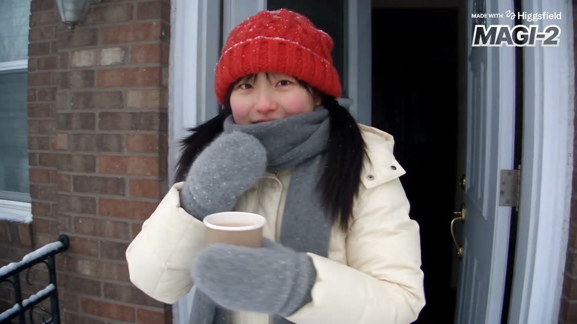</a>

▶ **[播放有声视频原片](https://awesome.raphael.app/materials/494b4521-bbc3-494d-94f6-ac360d8b7c70.mp4)**

<details><summary><strong>展开完整原始提示词（2412 字）</strong></summary>

```text
Create a 30-second, 1080p ultra-realistic personal home-video of a naturally pretty young Korean woman in her early 20s, with straight black hair in two loose low pigtails, wearing a thick red knit beanie, a cream puffer jacket, a gray wool scarf, dark jeans, and brown winter boots. She carries a paper cup of hot cocoa.

Start immediately with her stepping out of her front door into fresh snowfall. She pulls her scarf up, turns to the camera, smiles, and says, "It snowed overnight!" She walks down a quiet residential street, boots crunching in untouched snow. Partway down, she glances at the person holding the camera, laughs, and says, "Stop filming me, it's so early!" She holds her cocoa toward the lens like a toast.

She stops at a parked car, wipes snow off the side mirror with her glove, and writes a small heart on the frosted window. Then she pauses. For about three seconds she stands still, looking up at the falling snow, breath steaming, a soft smile on her face, with only quiet ambience. The camera lingers on her.

She scoops a handful of snow, packs it into a ball, and tosses it at a bare tree. It misses, and she pouts at the camera. She tries again and hits the trunk, and a clump of snow drops from a branch onto her head. She shrieks, shakes it off, laughs, and says, "Okay, I deserved that!"

As she turns back toward home, she notices a single small red mitten sitting on a fence post. She picks it up, looks at it, then at the camera, and says, "Wait... whose is this?" She sets it back carefully on the post.

Finally, at her gate, she turns to the camera with red cheeks and a runny nose, sniffs, waves, and says, "Okay, see you! Bye!" She goes inside, and the recording abruptly cuts to black.

**Visual style:** Raw early-2000s handheld DV camcorder footage, soft overcast winter morning light, slightly overexposed snow, imperfect framing, camera shake, autofocus hunting on falling snowflakes, faded cool-toned colors, mild digital noise, a brief fogged lens when she steps outside, and realistic movements.

**Audio:** Muffled snowy neighborhood ambience, soft wind, crunching footsteps, a distant dog barking, a faint camera-holder chuckle off-screen, and perfectly synchronized casual English dialogue. No background music.

Maintain identical facial features, clothing, hairstyle, and body proportions throughout. Keep every interaction and object physically realistic.
```

</details>

| 参数 | 配置 |
| --- | --- |
| 模型 | MAGI-2 (flagship) |
| 任务类型 | t2v |
| 时长 / 帧率 | 30.2s · 60 fps |
| 分辨率 / 比例 | 1080p · 16:9 |
| 音频模式 | mixed (audio=True) |

[原始来源](https://x.com/Ciri_ai/status/2125844812167569730) · 作者: [@Ciri_ai](https://x.com/Ciri_ai) · 2026-11-26

> 作者自述使用 MAGI-2，未经独立核实。

[案例详情页](cases/cms-5378ef28/README.zh-CN.md) · **[在 Raphael 上生成同类视频 →](https://raphael.app/ai-video-generator?utm_source=github&utm_medium=repository&utm_campaign=magi_2_launch&utm_content=case_cms-5378ef28&utm_term=zh-CN)**

---

<a id="case-neon-night-run-edm"></a>

#### 41. 霓虹夜奔约会（128 BPM 电子乐）

**来源类型**: `community` · **任务**: `T2V` · **音画**: `Yes` · **状态**: `来源收录`

精简一段式英文提示词，生成 30 秒 16mm 手持霓虹夜景音乐短片，全程对齐 128 BPM 电子音乐节拍与落点。

<a href="https://awesome.raphael.app/materials/53df4174-2cc7-4d5f-9862-5dfce6bacb32.mp4"></a>

▶ **[播放有声视频原片](https://awesome.raphael.app/materials/53df4174-2cc7-4d5f-9862-5dfce6bacb32.mp4)**

**提示词**

```text
Generate with full audio: a loud continuous EDM music soundtrack must play from the first second to the last. live-action music video, young couple madly in love running through one night: open-air concert → night market past a ferris wheel (piggyback ride) → glass spiral stairs → rooftop → hotel lobby spin → retro-modern corridor → freestyle dance and hug at a neon window. Raw handheld camera chasing them, vivid neon colors, 16mm grain, loud 128 BPM EDM with drops synced to the scenes.
```

| 参数 | 配置 |
| --- | --- |
| 模型 | MAGI-2 (flagship) |
| 任务类型 | t2v |
| 时长 / 帧率 | 30.2s · 30 fps |
| 分辨率 / 比例 | 1080p · 16:9 |
| 音频模式 | music (audio=True) |

[原始来源](https://x.com/NyaiiBubu/status/2125730219499962783) · 作者: [@NyaiiBubu](https://x.com/NyaiiBubu) · 2026-11-25

> 作者标注通过 Higgsfield 使用 MAGI-2 生成；提示词见原回复 https://x.com/NyaiiBubu/status/2125732070181978319。

[案例详情页](cases/neon-night-run-edm/README.zh-CN.md) · **[在 Raphael 上生成同类视频 →](https://raphael.app/ai-video-generator?utm_source=github&utm_medium=repository&utm_campaign=magi_2_launch&utm_content=case_neon-night-run-edm&utm_term=zh-CN)**

---

<a id="category-cinematic-animation"></a>

### 电影感与动画风格

<a id="case-cms-71c121de"></a>

#### 42. 新东京高架上的摩托追逐

**来源类型**: `community` · **任务**: `T2V` · **音画**: `Yes` · **状态**: `来源收录`

社区 MAGI-2 视频案例（@yachimat_manga）：新东京高架上的摩托追逐。

<a href="https://awesome.raphael.app/materials/deef9581-1583-452f-b7cb-8a78085e6372.mp4">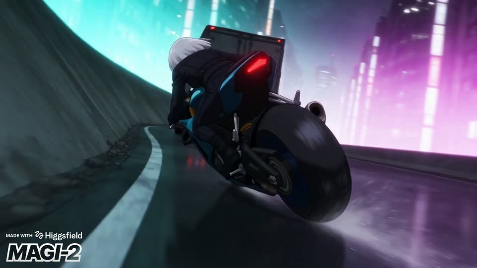</a>

▶ **[播放有声视频原片](https://awesome.raphael.app/materials/deef9581-1583-452f-b7cb-8a78085e6372.mp4)**

<details><summary><strong>展开完整原始提示词（3254 字）</strong></summary>

```text
Keep the exact art style, line art, colours, muted sepia-and-lavender palette and lighting of the start frame; same character, same outfit, same world. Beautiful anime compositing: soft diffusion bloom on the highlights, thin light rays, drifting dust and tiny sparkles catching the light, shallow depth of field with round bokeh, a slight handheld drift. Flat hand-drawn 2D anime, not 3D, not photoreal. No text, no logo, no watermark, no extra people.。

参考<画像1>は主人公の人物設定。成人女性、銀白色の短いボブ、長い前髪が右目の一部へ自然に重なる。左右とも灰緑色の瞳が前髪の隙間から見え、目元は素肌と銀髪だけで構成する。黒いハイネックのライディングウェア、暗い下衣、黒い脚衣とブーツを全鏡頭で保つ。画像内のベージュ背景、設定画レイアウト、複数の人物像、立ちポーズは映像へ持ち込まない。

参考<画像2>はバイクと舞台の設定。青黒色の重いスポーツバイク、太いタイヤ、一体型カウル、濡れたネオ東京高架高速道路、シアンとマゼンタのネオン、低い後方視点を使用する。バイク形状と色を全鏡頭で保つ。

全体の運動ルール：主人公は同じ東向き高架高速道路を止まらず走り続ける。前の動作の反動と姿勢回復が、そのまま次の動作の準備になる。バイクは横へ瞬間移動しない。スロットル、制動荷重、カウンターステア、リーン、タイヤの接地、サスペンションの沈みと反発を順番に描く。シアンの高層ビルは進行方向の左、マゼンタの縦看板は右、中央高架は正面に保ち、背景と車線を途中でリセットしない。

鏡頭1、約0.0〜2.6秒：路面40センチ、後輪の約2.5メートル後方からの低いFPV追跡。配送バンが前方で左から右へ横滑りする。主人公はスロットルを戻して前ブレーキを徐々にかけ、フォークが沈み、上体が前へ移る。バンの後方に一度だけ生まれた左側の隙間へカウンターステアし、滑らかな一つの円弧で回避する。回避の出口では反対方向へ振り返さず、車体を直立へ戻しながら加速する。カメラは後輪との距離を保って同じ円弧を追う。

鏡頭2、約2.6〜4.6秒：低い左側面の平行追跡。前の回避から車体を戻す途中で、低く折れた標識梁と散らばった小さなコンクリート片へ入る。主人公は肘を曲げ、頭部と上体をタンクに沿わせて低くする。両輪は接地したまま梁の下を通る。瓦礫を踏むたびにタイヤが潰れ、フォークが短く沈み、上体と銀髪が一拍遅れて上下する。カメラは路面と平行に走り、跳躍や浮遊を見せない。

鏡頭3、約4.6〜6.6秒：旋回外側からの斜め後方FPV追跡。ジャックナイフした大型車両の手前で主人公は小さく加速し、後輪サスペンションが沈む。左側の傾斜約20度の保守用道路へ現実的なカウンターステアから中程度のリーンで入り、両輪を斜面へ接地させたまま一つの長い円弧で大型車両を回避する。道路へ戻る際、車体の傾きと水平線が慣性を残して半拍遅れて水平へ戻る。左右へ蛇行しない。

鏡頭4、約6.6〜10.1秒：高い斜め後方の広角FPV追跡から始める。前方左のガラス張り超高層ビルが重力で道路側へ回転し、下端の巨大な鉄骨梁と路面の隙間がバイク三台分から一台分へ連続して狭くなる。カメラは倒壊全体を一瞬だけ見せた後、主人公の後方へ高度を落とし、縮む隙間へ一直線に追随する。主人公は左右へ振らず、両輪を接地させたままスロットルを開け、上体をタンクへ伏せて最小シルエットになる。

間一髪の成功を必ず時間順に描く。前輪、風防、主人公、後輪の順に梁の下を一度だけ通過する。通過中の全フレームで、銀髪・背中・バイク上端と梁の下端の間に、細く途切れないシアンの光の線を明確に残す。人物とバイクの輪郭を梁から完全に分離し、接触、擦過、火花を起こさない。後輪まで抜け切り、バイク全体が梁より前方へ完全に出て、梁との間にバイク二台分の水平距離が生まれる。そこで約0.35秒、明るく開けたネオン道路へ飛び出す姿を見せ、主人公の上体が少し起き、サスペンションが伸び、銀髪が後方へ解放される。観客が「抜けた」と確認した後、四〜六フレーム遅れて梁が主人公の背後の路面へ激突する。火花は梁と路面の衝突点だけから出る。粉塵と圧力波が背後から追い、カメラは衝撃に同期して一度だけ強く上下へ揺れる。粉塵が画面を覆った瞬間にハードカットする。同じ通過を繰り返さない。

鏡頭5、約10.1〜10.8秒：主人公の顔の短い特写。銀白色の前髪が風で後ろへ流れ、左右の灰緑色の瞳が見える。主人公は前方の停止地点を認識し、瞳を絞り、息を止め、顎を締めたあと、左肩越しにカメラへ冷たい視線を返す。カメラは顔との距離を固定し、眼差しだけを主役にする。

鏡頭6、約10.8〜15.0秒：道路中心線上、路面60センチの低い正面カメラ。カメラは主人公より前方にいて、一定速度で後退しながら、バイクが画面奥方向へ進む姿を正面から捉える。主人公が急ブレーキを開始すると、フロントフォークが深く沈み、タイヤが潰れ、上体と銀髪が遅れて前へ流れる。バイクは前進慣性を残したまま90度だけ鋭くヨーし、画面左向きの完全な側面姿勢へ入る。車体上部をカメラ側へ約40度深く傾ける。左脚は膝を伸ばし切って路面へ接地し、左ブーツが削れる。両輪はロックするが、バイクは横向きのまま画面奥へ約1.7秒滑り続ける。二本のタイヤと左ブーツから三本の独立した白煙、水煙、火花の軌跡が画面手前へ伸びる。主人公は左肩越しにカメラを見続ける。

画面中央の中距離で停止する。停止の瞬間は、タイヤ変形、フォークの底付き、車体の前下方への沈み、上体の遅れ、銀髪の遅れ、強い一回の反発、小さな収束の順に見せる。停止後も車体をすぐ直立させず、約0.55秒だけ深い傾きと視線を保持する。白煙が手前へ流れ、火花と破片が遅れて止まり、速度の余韻だけが残る。

画面：現代日本の劇場版フルカラー2Dアクションアニメ。精密な顔、銀白色のボブ、シャープな線画、深い黒、三段階のセル影、硬いシアンのリムライト、濡れた路面の反射。高速ピークだけ一〜二枚の不透明な黒・コバルト色の荒い作画スメアを使い、直後に精密な原画へ戻す。半透明の残像にしない。

音：台詞とBGMなし。電動エンジン、濡れたタイヤ、風切り音、ドローンの空気抵抗、瓦礫の接触、ビル倒壊、長いロックタイヤ音。カメラの揺れは画面内の物理衝撃と同期させる。

制約：参照するのは<画像1>と<画像2>だけ。動画の動き、動画のカメラ、動画の構図を参照しない。左右の灰緑色の瞳と自然な目元を維持し、目元へ装飾品や覆いを追加しない。主人公一人、バイク一台を維持する。バイク形状を変えない。実写、写実、3D、ゲームCG、水彩、紙質にしない。瞬間的な横移動、単調な左右反復、アーケードドリフト、垂直ウォールライド、大ジャンプ、浮遊、空中旋回をしない。背景をリセットしない。ランドマークの左右を交換しない。カメラを瞬間移動させない。ビルを静止したトンネルにしない。梁と人物・バイクを接触させない。成功確認より先に梁を路面へ落とさない。同じ通過を繰り返さない。最後を正面接近、横追跡、旋回、直立停止にしない。人物やバイクの複製、余分な手足や車輪、字幕、文字、ロゴ、水印を生成しない。
```

</details>

| 参数 | 配置 |
| --- | --- |
| 模型 | MAGI-2 (flagship) |
| 任务类型 | t2v |
| 时长 / 帧率 | 25.6s · 30 fps |
| 分辨率 / 比例 | 1080p · 16:9 |
| 音频模式 | mixed (audio=True) |

[原始来源](https://x.com/yachimat_manga/status/2126084218660827582) · 作者: [@yachimat_manga](https://x.com/yachimat_manga) · 2026-11-26

> MAGI-2 为作者自述，未经独立核实。

[案例详情页](cases/cms-71c121de/README.zh-CN.md) · **[在 Raphael 上生成同类视频 →](https://raphael.app/ai-video-generator?utm_source=github&utm_medium=repository&utm_campaign=magi_2_launch&utm_content=case_cms-71c121de&utm_term=zh-CN)**

---

<a id="case-tiny-2d-girl-in-nyc"></a>

#### 43. 迷你动画女孩闯入纽约实景

**来源类型**: `community` · **任务**: `T2V` · **音画**: `Yes` · **状态**: `来源收录`

6 幕二维手绘小人闯入超写实纽约街头的实景混合动画，保持角色比例、穿搭与物理光影交互一致，配纯都市拟音。

<a href="https://awesome.raphael.app/materials/a8d7cc8d-69ed-4500-8658-86e7c85b8182.mp4"></a>

▶ **[播放有声视频原片](https://awesome.raphael.app/materials/a8d7cc8d-69ed-4500-8658-86e7c85b8182.mp4)**

<details><summary><strong>展开完整原始提示词（3189 字）</strong></summary>

```text
Create a whimsical mixed-reality animated short featuring a tiny hand-drawn 2D young woman with long black hair, an oversized lavender sweatshirt, a yellow pleated skirt, chunky white sneakers, and a small mint-green crossbody bag. She is only a few inches tall, navigating an enormous, ultra-photorealistic New York City environment.

SCENE SEQUENCE:

1. The Unexpected Journey: She emerges from a crack between giant sidewalk tiles and finds herself in the middle of a busy city plaza. A huge gust from a subway ventilation grate sends her flying backward, and she desperately grabs onto a loose leaf to avoid being swept away.

2. The Pigeon Encounter: She discovers a giant discarded pretzel near a park bench and tries to climb it. Suddenly, an enormous city pigeon lands beside her, shaking the ground with its wings. She hides inside the pretzel's central hole as the bird curiously pecks around her.

3. The Fountain Adventure: She reaches a gigantic public fountain. A sudden burst of water launches her onto a floating flower petal. She uses a tiny twig as a paddle, navigating between enormous splashing water jets before getting soaked by a final unexpected splash.

4. The Subway Escape: She finds an abandoned metro ticket near a station entrance and uses it as a makeshift skateboard. It slides down a sloping pavement, narrowly avoiding enormous shoes, rolling coins, and a dropped set of keys.

5. The Unexpected Flight: A passing cyclist creates a powerful wind tunnel. Her sweatshirt inflates like a balloon, lifting her above the pavement. She grabs onto a dangling ribbon attached to a giant shopping bag, swinging through the air like a miniature trapeze artist.

6. The Final Surprise: She lands safely inside the open top of an enormous takeaway coffee cup sitting on an outdoor café table. Relieved, she stretches out and celebrates her survival. Suddenly, a human hand picks up the cup. Her eyes widen as the cup begins moving toward someone's mouth. She desperately waves both arms, ending on a hilarious freeze-frame of pure disbelief.

VISUAL STYLE & PRODUCTION:

Premium mixed-media animation combining expressive, hand-drawn 2D character animation with highly realistic live-action city environments. Maintain a consistent character appearance, proportions, clothing, hairstyle, and hand-drawn outlines throughout.

Use exaggerated differences in scale, believable environmental interactions, playful physics, detailed macro photography, cinematic depth of field, dynamic tracking shots, smooth camera movements, and seamless compositing. The tiny character should feel genuinely present in the real world, casting subtle shadows and interacting naturally with objects.

AUDIO: No dialogue and no narration. Use immersive New York street ambience, distant traffic, subway rumbling, pigeon wings, fountain splashes, bicycle sounds, footsteps, café ambience, and perfectly timed whimsical comedic sound effects.

16:9 cinematic widescreen, fluid animation, crisp details, expressive character acting, vibrant but natural colors, polished commercial-quality finish. Every scene should introduce a new visual surprise, with a funny and memorable final punchline.
```

</details>

| 参数 | 配置 |
| --- | --- |
| 模型 | MAGI-2 (flagship) |
| 任务类型 | t2v |
| 时长 / 帧率 | 30.3s · 30 fps |
| 分辨率 / 比例 | 1080p · 16:9 |
| 音频模式 | sfx (audio=True) |

[原始来源](https://x.com/john_my07/status/2125654313825628182) · 作者: [@john_my07](https://x.com/john_my07) · 2026-11-25

> 作者标注 Higgsfield 合作生成；完整提示词来自原帖。

[案例详情页](cases/tiny-2d-girl-in-nyc/README.zh-CN.md) · **[在 Raphael 上生成同类视频 →](https://raphael.app/ai-video-generator?utm_source=github&utm_medium=repository&utm_campaign=magi_2_launch&utm_content=case_tiny-2d-girl-in-nyc&utm_term=zh-CN)**

---

<a id="case-the-door-in-the-sky"></a>

#### 44. 天空之门（奇幻短片）

**来源类型**: `community` · **任务**: `T2V` · **音画**: `Yes` · **状态**: `来源收录`

15 秒四段式魔幻写实短片时间轴：暮色迷雾森林中浮现空中金门并化作星光花海，配情绪管弦配乐。

<a href="https://awesome.raphael.app/materials/f8df786e-2c54-4c4b-b8ed-14bdbdb1904e.mp4">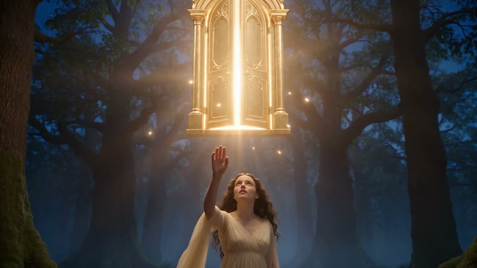</a>

▶ **[播放有声视频原片](https://awesome.raphael.app/materials/f8df786e-2c54-4c4b-b8ed-14bdbdb1904e.mp4)**

<details><summary><strong>展开完整原始提示词（1134 字）</strong></summary>

```text
Create a breathtaking 15-second cinematic fantasy short film titled “THE DOOR IN THE SKY”. Aspect ratio16:9, one coherent protagonist and consistent appearance throughout, premium fantasy movie cinematography, photorealistic magical realism, atmospheric fog, volumetric lighting, elegant camera movement, emotional orchestral score, polished cinematic colour grading.

0–4 seconds: Wide establishing shot of a beautiful young woman in an elegant flowing ivory dress walking alone through a mysterious misty forest at twilight. Gentle wind moves her hair and dress.
4–8 seconds: Tiny golden lights begin appearing and circling her. The camera slowly pushes in as she notices an enormous glowing golden door floating above the trees.
8–12 seconds: She reaches upward; the door opens with a soft burst of brilliant golden light. Thousands of sparkling stars and luminous particles pour out into the night.
12–15 seconds: The forest transforms into a breathtaking galaxy garden with glowing flowers, floating stars and celestial light. She smiles in wonder as the camera pulls back to an epic wide shot. End on a magical cinematic reveal.
```

</details>

| 参数 | 配置 |
| --- | --- |
| 模型 | MAGI-2 (flagship) |
| 任务类型 | t2v |
| 时长 / 帧率 | 15.2s · 25 fps |
| 分辨率 / 比例 | 1080p · 16:9 |
| 音频模式 | music (audio=True) |

[原始来源](https://x.com/Naiknelofar788/status/2125650981350428965) · 作者: [@Naiknelofar788](https://x.com/Naiknelofar788) · 2026-11-25

> 作者标注通过 Higgsfield 使用 MAGI-2 生成；完整四段式提示词来自原帖。

[案例详情页](cases/the-door-in-the-sky/README.zh-CN.md) · **[在 Raphael 上生成同类视频 →](https://raphael.app/ai-video-generator?utm_source=github&utm_medium=repository&utm_campaign=magi_2_launch&utm_content=case_the-door-in-the-sky&utm_term=zh-CN)**

---

<a id="using"></a>

## 📚 如何使用

1. 按场景分类或任务类型（`T2V` / `I2V` / `Omni-Reference`）挑选案例。
2. 快速试跑可直接复制 `short_prompt`；需要稳定镜头与口型/音效对齐时请使用 `structured_prompt`（PE 时间轴）。
3. 建议先点击外部有声 MP4 确认节奏与音效表现，再在本地 8× Hopper 或云端生成平台复现。

<a id="contribute"></a>

## 🤝 如何贡献

请按 `templates/prompt.json` 格式向 `content/prompts.json` 补充条目；视频一律外链填 `video_url`，仓库仅存 `<= 500 KB` 预览图，并在提 PR 前运行生成与校验脚本。

[贡献指南](CONTRIBUTING.md) · [案例录入规范](templates/PROMPT_CARD.md) · [通过表单提交案例](https://github.com/RaphaelAI-OpenLab/awesome-magi-2-prompts/issues/new?template=submit-prompt.yml)

<a id="license"></a>

## 📄 许可证与署名

仓库代码、模板、`SKILL.md` 与原创 SVG 图形采用 MIT 协议；第三方提示词与视频保留原作者权利与逐项条款；README 版式结构参考 YouMind OpenLab（CC BY 4.0）。

[MIT 许可证](LICENSE) · [署名与许可范围](docs/ATTRIBUTION.md)

---

[↑ 返回顶部](#top) · [在 GitHub 点 Star](https://github.com/RaphaelAI-OpenLab/awesome-magi-2-prompts) · [由 Raphael 维护](https://raphael.app/?utm_source=github&utm_medium=repository&utm_campaign=magi_2_launch&utm_content=footer&utm_term=zh-CN)
