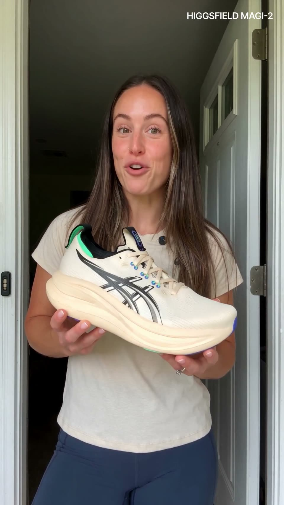

<!-- Generated by scripts/build_readme.py. Edit site.config.json, content/prompts.json, and generator scripts. -->

<a id="case-asics-gel-nimbus-ugc-ad"></a>

# ASICS Gel Nimbus Vertical UGC Ad (9:16)

[← Back to collection](../../README.md)

**Origin**: `community` · **Task**: `T2V` · **Audio**: `Yes` · **Status**: `Source-linked`

4-scene 30-second vertical 9:16 creator-style running shoe commercial with lip-synced English dialogue, voiceover montage, and soft background music.

<a href="https://raphael-assets.colorepistle.com/materials/e21e0ccd-1aae-4cfd-9424-6b85fe352192.mp4"></a>

▶ **[Watch audio-enabled MP4](https://raphael-assets.colorepistle.com/materials/e21e0ccd-1aae-4cfd-9424-6b85fe352192.mp4)**

**Full Prompt**

```text
Create a polished, highly realistic 30-second UGC-style advertisement for ASICS Gel Nimbus running shoes.

A young, attractive woman named Maya is the presenter. She should look and sound like a real lifestyle content creator recording a genuine product recommendation, not a professional actress reading a script.

Scene 1: Doorway hook (0–6 sec)

Maya stands at her apartment doorway, holding her ASICS Gel Nimbus shoes. She looks directly into the camera with an excited but natural expression.

Dialogue:

“Okay, I think I just found my new favourite running shoes. Look at these!”

She brings the teal ASICS Gel Nimbus close to the camera, showing the design.

Scene 2: First impressions (6–14 sec)

Cut to Maya sitting down and putting on the shoes. Show close-up shots of the teal upper, cushioning, ASICS logo, and sole.

Dialogue:

“These are the ASICS Gel Nimbus, and first of all, they’re so comfortable. I love how they feel on my feet.”

Scene 3: Lifestyle montage (14–23 sec)

Maya walks out onto the sidewalk, followed by shots of her jogging through a beautiful green park. Capture natural movement, shoe close-ups, and a few candid moments.

Voiceover:

“They feel soft, supportive, and honestly, I love how they look too. Perfect for my everyday walks and running sessions.”

Scene 4: Final recommendation (23–30 sec)

Maya stops on a park pathway, looks into the camera, and smiles.

Dialogue:

“If you’re looking for a pair that feels as good as it looks, definitely check these out.”

End with a premium close-up hero shot of the teal ASICS Gel Nimbus and the ASICS logo.

Production requirements:

Natural female voice with conversational delivery.
Accurate lip synchronization.
Authentic UGC filming style mixed with premium commercial shots.
Consistent Maya appearance and identical shoes throughout.
Teal ASICS Gel Nimbus prominently visible.
Realistic outdoor lighting and natural skin textures.
Soft upbeat background music mixed below the dialogue.
Natural ambient sounds during the outdoor montage.
No robotic voice, exaggerated expressions, or artificial-looking movements.
Vertical 9:16 format, 30 seconds.

Finished ad direction: A genuine creator-style product recommendation with a strong opening hook, natural praise, lifestyle footage, and a clear product reveal.
```

| Parameter | Value |
| --- | --- |
| Model | MAGI-2 (flagship) |
| Task type | t2v |
| Duration / FPS | 30.2s · 30 fps |
| Resolution / Ratio | 1080p · 9:16 |
| Audio mode | mixed (audio=True) |

[Original source](https://x.com/Sheldon056/status/2125445425520083116) · Creator: [@Sheldon056](https://x.com/Sheldon056) · 2026-11-25

> Creator reported Higgsfield collaboration; prompt posted at https://x.com/Sheldon056/status/2125445430725226653.

**[Generate similar on Raphael →](https://raphael.app/ai-video-generator?utm_source=github&utm_medium=repository&utm_campaign=magi_2_launch&utm_content=case_asics-gel-nimbus-ugc-ad&utm_term=en)**
