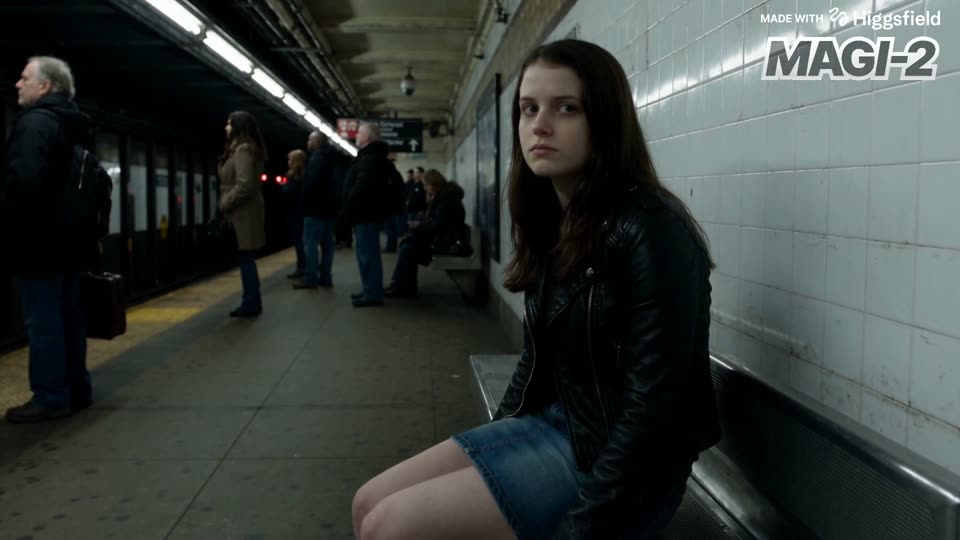

<!-- Generated by scripts/build_readme.py. Edit site.config.json, content/prompts.json, and generator scripts. -->

<a id="case-cms-014fb4e5"></a>

# 纽约深夜地铁惊魂

[← Back to collection](../../README.md)

**Origin**: `community` · **Task**: `T2V` · **Audio**: `Yes` · **Status**: `Source-linked`

A young American woman wearing a black leather jacket, a denim skirt, and black boots waits alone on a nearly empty New York City…

<a href="https://awesome.raphael.app/materials/b6eb47e2-575c-45b6-894d-71c4eb559773.mp4"></a>

▶ **[Watch audio-enabled MP4](https://awesome.raphael.app/materials/b6eb47e2-575c-45b6-894d-71c4eb559773.mp4)**

**Full Prompt**

```text
A young American woman wearing a black leather jacket, a denim skirt, and black boots waits alone on a nearly empty New York City subway platform late at night. The station has a gritty American urban atmosphere, with old tiled walls, metal benches, flickering fluorescent lights, and a few American commuters scattered across the platform.

Suddenly, her eyes turn completely milky white, dark veins spread across her face, and she begins laughing uncontrollably. Her expression becomes increasingly disturbing. As a subway train approaches, she suddenly drops to all fours and crawls unnaturally toward terrified American passengers. People scream and desperately run away. One male commuter escapes into a narrow maintenance corridor, but she suddenly appears directly behind him, moving unnaturally while dragging her fingers along the walls. He turns around in terror as the station lights begin flickering violently. The lights completely go out as the last train pulls away. In the darkness, her two pale white eyes slowly appear inside the train's final rear window, staring directly into the camera.

STYLE: Photorealistic American zombie horror, authentic New York City subway environment, cinematic 4K, realistic American-looking characters and passengers, handheld documentary-style camera, natural human movements, terrifying facial expressions, creepy uncontrollable laughter, flickering fluorescent lights, atmospheric shadows, realistic film grain, intense suspense and immersive horror sound design.

NEGATIVE: Cartoon, anime, obvious CGI, excessive gore, unrealistic movements, inconsistent character appearances, changing outfits, distorted faces, subtitles, text, logos, or watermark. No background music, no narration.
```

| Parameter | Value |
| --- | --- |
| Model | MAGI-2 (flagship) |
| Task type | t2v |
| Duration / FPS | 30.3s · 30 fps |
| Resolution / Ratio | 1080p · 16:9 |
| Audio mode | sfx (audio=True) |

[Original source](https://x.com/john_my07/status/2125795305920880995) · Creator: [@john_my07](https://x.com/john_my07) · 2026-11-26

> MAGI-2 为作者自述，未经独立核实。

**[Generate similar on Raphael →](https://raphael.app/ai-video-generator?utm_source=github&utm_medium=repository&utm_campaign=magi_2_launch&utm_content=case_cms-014fb4e5&utm_term=en)**
