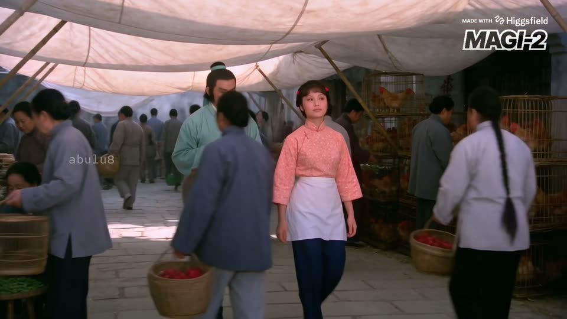

<!-- Generated by scripts/build_readme.py. Edit site.config.json, content/prompts.json, and generator scripts. -->

<a id="case-cms-0c9e2e90"></a>

# 古镇早市的婚期笑谈

[← Back to collection](../../README.md)

**Origin**: `community` · **Task**: `T2V` · **Audio**: `Yes` · **Status**: `Source-linked`

Community MAGI-2 video case (@abulu8): 古镇早市的婚期笑谈.

<a href="https://awesome.raphael.app/materials/3bf7b3ae-d38f-4696-afdc-09c08d164658.mp4"></a>

▶ **[Watch audio-enabled MP4](https://awesome.raphael.app/materials/3bf7b3ae-d38f-4696-afdc-09c08d164658.mp4)**

**Full Prompt**

```text
【全局前置设定：画质与质感】

1970 年代香港武侠电影中的生活喜剧段落质感。Techniscope 2.35:1 宽银幕，褪色偏暖的 Eastmancolor 胶片色调，厚重的胶片颗粒，轻微的片门抖动与边缘暗角。

那个年代的外景拍法：明亮的清晨阳光，饱满的暖黄色调，人物脸上有油彩妆感与清晰的轮廓光。摄影棚搭建的古镇街市布景，色彩鲜亮热闹。

全片没有任何打斗、没有兵器出鞘、没有特效。

声音：轻快俏皮的笛子与锣鼓配乐，市集里此起彼伏的吆喝声与讨价还价声（听不清具体内容）、鸡鸭叫声、扁担吱呀声、车轮声。对白是那个年代的国语配音质感，清晰、略带回响。

【韩子墨·书生剑客】

成年东亚男性，约二十六岁，身高 5 英尺 10 寸，身形修长匀称，比例正常的成年男性体型。黑色头发在头顶束成发髻，用一根青色发带系住；一双认真的眼睛，眉毛一急就皱起来，脸上有那个年代的油彩妆感。身穿浅青色长衫，腰系白色腰带，黑色布鞋。手里提着一只空的竹编菜篮。

他稳重、老实、心急。他已经求过亲，她也答应了，现在他只想快点把日子定下来。被她逗的时候，他会皱眉、撇嘴、耳朵发红。

【柳莺莺·俏姑娘】

成年东亚女性，约二十二岁，身高 5 英尺 3 寸，身形娇小轻快，比例正常的成年女性体型。黑色长发编成一条长辫垂在肩前，辫梢系着一条红头绳，额前留着齐眉的刘海；一双灵动的大眼睛，笑起来两个酒窝，脸上有那个年代的油彩妆感与淡淡的胭脂。身穿桃红色的碎花短袄，配一条靛蓝色长裤，腰系一条白色围裙，黑色布鞋。

她心里比谁都想嫁他，但她就是喜欢看他着急。她逗他的时候总是在挑菜——眼睛盯着菜，嘴角却在偷笑，时不时用眼角瞟他一眼。

【体型比例·必须严格遵守】

韩子墨 5 英尺 10 寸，柳莺莺 5 英尺 3 寸。两人并肩走时，她的头顶到他的肩膀。全程严格保持。

【人体完整性·防变形·必须严格遵守】

韩子墨与柳莺莺每人始终是两条手臂、两条腿、一个头，每只手五根手指。两人的面孔在任何角度下都保持稳定，五官不得拉伸、融化或互换。

所有蔬菜保持原本的形状与颜色，不得变形、融化、变成别的东西。菜篮里的菜只会越来越多，不会凭空消失。

【场景：清晨的古镇菜市】

一条热闹的古镇街市，清晨。

青石板路两旁挤满了菜摊：竹筐里堆着翠绿的白菜、红艳艳的番茄、白胖的萝卜、一串串红辣椒、一捆捆青葱、紫亮的茄子、金黄的玉米。头顶撑着一顶顶灰白色的布棚，棚下挂着成串的干辣椒与大蒜。

一个卖鸡鸭的摊子上，几只鸡在竹笼里咕咕叫。一个卖豆腐的担子冒着热气。路边有一辆装满南瓜的木板车。

街两侧是白墙黑瓦的店铺，招牌旗子在晨风中飘。阳光从街口斜射进来，穿过布棚的缝隙，在石板路上投下一道道明暗交错的光斑。

【市集里的人·背景层·必须严格遵守】

街市里有来来往往的赶集百姓与守着摊子的菜贩，他们是热闹的背景：挑着担子走过的、提着篮子讨价还价的、坐在小凳上剥豆子的。

他们始终在背景与中景，比两名主角更远、更小，绝不进入两人的近景，绝不挡住两人的脸，不给单独的特写，不说可听清的台词。菜贩始终站在自己的摊子后面。

只有一个例外：26 秒番茄滚落时，旁边番茄摊的胖大婶会出现在中景，捂着嘴笑。

所有背景人物的面孔与身体同样保持稳定，不得变形、融合、复制。

【刚性空间锚点】青石板街的走向、两侧菜摊的排列、装满南瓜的木板车、街口的阳光方向，全片绝不漂移。

【对白规则·必须严格遵守】

本片共有九句台词，全部在下方时间码中以「」标出。只有「」内的中文是被说出来的。其余所有文字——动作描述、表情描述、运镜说明——全部是画面说明，绝对不得念出、不得配音、不得作为旁白。

全片主角台词不得超过九句。背景人群只有听不清的嘈杂声，不得出现清晰的台词。不得出现旁白、内心独白。

韩子墨为年轻男声，认真、心急、越说越委屈。柳莺莺为年轻女声，清脆、俏皮、漫不经心，最后一句压低了声音，又软又甜。唇形自然同步。

【运镜·七十年代生活段落语法】

以两人并肩行走时的横移跟拍为主，镜头始终与他们同速，保持两人在画面中央；两人之间的过肩正反打；每一次她拿起一样菜时，一次快速的变焦推近到那样菜。镜头稳定，绝不晃动。

【表演的铁律】

两人一直在走、在挑菜、在把菜往篮子里放。每一句台词之前与之后都有一个具体的动作。不得出现两个人站着不动念台词的画面。

━━━━━━━━━━━━━━━━━━

【0.0—4.0 秒｜赶集】

缓慢横移的广角：清晨热闹的街市，阳光穿过布棚洒在青石板上，菜摊上的蔬菜颜色鲜亮，赶集的人来来往往，鸡在笼子里咕咕叫。

镜头穿过人群，找到并肩走着的两人：柳莺莺走在前面半步，一边走一边东张西望地看菜；韩子墨跟在旁边，提着空菜篮，眼睛一直看着她。

韩子墨清了清嗓子，凑近她一点。

韩子墨：「莺莺，我们早点成亲吧。」

运镜：横移跟拍，与两人同速，他开口时稳定在两人的中景。

【4.0—8.0 秒｜挑白菜】

柳莺莺在一个菜摊前停下，拿起一棵大白菜，翻来覆去地看，捏捏菜帮子，又凑近闻了闻。

运镜：快速变焦推近白菜，再拉回。

柳莺莺：「急什么？我还没挑好呢。」

她眼睛盯着白菜，嘴角却偷偷往上翘，用眼角瞟了他一眼。说完，她把白菜往他的菜篮里一放。

反打近景：韩子墨低头看看篮子里的白菜，又抬头看她，眉头皱了起来——他不确定她说的是白菜还是他。

【8.0—12.0 秒｜考虑考虑】

两人继续往前走。韩子墨快走两步追上她，跟她并肩。

韩子墨：「你都已经答应我了。」

柳莺莺走到番茄摊前，拿起一个红番茄对着阳光照了照，又放下，换了一个更红的。

柳莺莺：「我答应的是，考虑考虑。」

她把番茄放进他的篮子，自己背着手往前走了，辫梢的红头绳一甩一甩。

反打近景：韩子墨站在原地张着嘴，愣了一秒，赶紧提着篮子追上去。

【12.0—16.5 秒｜初八】

横移跟拍，两人走过挂满干辣椒的布棚下。

韩子墨从袖子里掏出一张折好的红纸，展开给她看，上面写着一个日子。他指着那个日子，满脸认真。

韩子墨：「我算过了，下个月初八，是好日子。」

柳莺莺看都没看那张红纸，从旁边摊子上抓起一根又白又胖的大萝卜，举到他面前晃了晃。

运镜：快速变焦推近萝卜，再拉回到她一本正经的脸。

柳莺莺：「下个月初八，我要来买萝卜。」

她把萝卜塞进他的篮子里。篮子已经满了一半，沉甸甸地往下坠。

【16.5—21.0 秒｜他生气了】

韩子墨停住了脚步。

他把红纸攥回手里，嘴唇抿成一条线，耳朵根红了。他低头看看那一篮子菜，又看看她，眉头紧锁，把脸扭到一边，像个赌气的孩子。

韩子墨：「那你就跟萝卜过日子吧。」

他把菜篮往她手里一塞，转身就要往回走。

运镜：近景跟着他转身，他的背影在热闹的人群前显得有点委屈。

柳莺莺抱着沉甸甸的菜篮，看着他的背影，愣了一下——然后忍不住"噗"地笑出声来，两个酒窝都露了出来。

【21.0—26.0 秒｜几个孩子】

柳莺莺把菜篮往旁边的南瓜车上一搁，小跑两步追上他，一把挽住他的胳膊，把他拉住。

他别着脸不看她。她踮起脚，凑到他的耳边，声音压得很低、很软，眼睛亮晶晶地看着他的侧脸。

柳莺莺：「那你说……想要几个孩子？」

运镜：缓慢推近两人的侧脸，她贴着他耳边说话，他的耳朵在阳光里红透了。

韩子墨整个人僵住了。他慢慢转过头来看着她，眼睛越睁越大，嘴巴半张着，脸从耳根一路红到脖子。他的嘴角一点一点地咧开，抬起一只手，手指张开又合上，好像在数数。

韩子墨：「三……不，五个！」

【26.0—30.0 秒｜回家】

柳莺莺笑得弯下了腰，两个酒窝深深的。她直起身，拉起他的手。

柳莺莺：「那还不快回家准备彩礼！」

她拉着他就往街口跑。韩子墨被拉得一个踉跄，回头一把抓起南瓜车上的菜篮——篮子一歪，几个红番茄骨碌碌滚了出来，滚过青石板路，一路滚到番茄摊前。番茄摊后面的胖大婶捂着嘴笑。

两人手拉着手，在热闹的街市里一路小跑，韩子墨一只手被她拉着，另一只手抱着菜篮，篮子里的白菜叶子一颠一颠；柳莺莺的长辫子在身后甩着，红头绳在阳光里一闪一闪。

最后一帧：阳光洒满的街市，两人手拉着手跑向明亮的街口，背影越来越小，身后是滚了一地的红番茄、笑着的胖大婶与热闹的人群。运镜：横移跟拍随两人奔跑，随后缓慢升起拉远，把整条街市与两人的背影一同纳入画面，画面在运动中自然收束。

━━━━━━━━━━━━━━━━━━

【全局约束】

masterpiece, highest quality，1970 年代香港武侠片生活段落质感。

韩子墨始终是浅青长衫白腰带青发带；柳莺莺始终是桃红碎花短袄靛蓝长裤白围裙、单辫红头绳。

全片共九句主角台词，绝不增减。柳莺莺每一次逗他时，她的眼睛或嘴角必须泄露她在笑。

菜篮里的菜依次增加：白菜、番茄、萝卜，只增不减，直到 26 秒几个番茄滚出。

两名主角的面孔与肢体全程结构稳定，绝不变形。背景人群始终在远处，绝不进入两人的近景。

【负面提示词】

主角台词超过九句，背景人物说出清晰台词，旁白，内心独白，念出动作描述文字，念出运镜说明，字幕，人名字幕，Logo，水印，英文对白；

柳莺莺真的冷淡，柳莺莺真的拒绝，柳莺莺逗他时面无表情，柳莺莺生气，韩子墨发怒吼叫，争吵，悲伤，哭泣；

两人站着不动念台词，表情僵硬，蜡像脸，空洞的凝视；

面部变形，五官错位，换脸，肢体变形，多手，多指，身体融合，手臂穿过身体；

背景人物进入近景，背景人物挡住主角的脸，背景人物特写，背景人物面部变形，背景人物融合，背景人物复制，人群拥挤遮挡主角，菜贩离开摊子，路人加入对话；

蔬菜变形，蔬菜变色，蔬菜变成别的东西，菜篮里的菜凭空消失，菜篮消失；

打斗，兵器，亲吻，过度亲密；

体型差消失，柳莺莺比韩子墨高；

夜景，雨天，冬天，现代市场，超市，现代建筑，街市消失，光照突变；

能量光效，数字特效，CGI 质感，现代数字摄影质感，饱和鲜艳的现代调色，手持晃动，快速剪辑，定格帧，结尾静止，低清晰度，卡顿，卡通渲染，动漫风格，3D 渲染。
```

| Parameter | Value |
| --- | --- |
| Model | MAGI-2 (flagship) |
| Task type | t2v |
| Duration / FPS | 30.3s · 30 fps |
| Resolution / Ratio | 1080p · 16:9 |
| Audio mode | mixed (audio=True) |

[Original source](https://x.com/abulu8/status/2125929153639936164) · Creator: [@abulu8](https://x.com/abulu8) · 2026-11-26

> 作者在 X 原帖中称使用 MAGI-2，模型未经独立核实。

**[Generate similar on Raphael →](https://raphael.app/ai-video-generator?utm_source=github&utm_medium=repository&utm_campaign=magi_2_launch&utm_content=case_cms-0c9e2e90&utm_term=en)**
