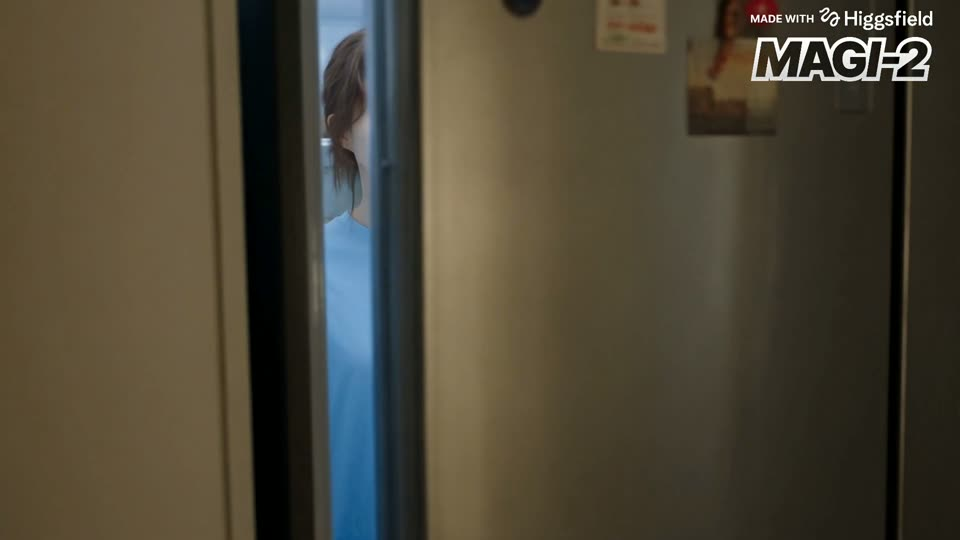

<!-- Generated by scripts/build_readme.py. Edit site.config.json, content/prompts.json, and generator scripts. -->

<a id="case-cms-104c29a3"></a>

# 忙碌清晨的家庭录像

[← 返回合集](../../README.zh-CN.md)

**来源类型**: `community` · **任务**: `T2V` · **音画**: `Yes` · **状态**: `来源收录`

社区 MAGI-2 视频案例（@john_my07）：忙碌清晨的家庭录像。

<a href="https://awesome.raphael.app/materials/400ea659-b3b5-46ba-b365-f9efdfe534c1.mp4"></a>

▶ **[播放有声视频原片](https://awesome.raphael.app/materials/400ea659-b3b5-46ba-b365-f9efdfe534c1.mp4)**

**完整原始提示词**

```text
Create a 30-second, 12-shot montage of candid, realistic home-video footage. Every shot must use a different angle or framing, with natural handheld movement, imperfect composition, subtle camera shake, delayed autofocus and gentle exposure changes. Authentic documentary feel, soft morning sunlight, realistic skin textures, warm muted colours and subtle film grain. Never look staged or overly cinematic.

Character: The same woman from <<<image_1>>>, wearing an oversized pastel-blue cotton T-shirt and cream lounge shorts, barefoot, with loosely tied messy hair. Maintain exact facial identity and outfit throughout.

Setting: A small, lived-in apartment with a connected kitchen and living room, half-open curtains, scattered cushions, unfinished tea, laundry and everyday clutter. A small playful dog wanders around.

12-SHOT SEQUENCE:

1. 0–2s: From the kitchen doorway, she stares blankly inside the open refrigerator, seemingly forgetting why she came. She slowly closes it and mutters something in Korean.

2. 2–4s: Side angle. She pours cereal into a bowl, grabs the milk carton and discovers it's empty. She shakes it and gives it an annoyed look.

3. 4–6s: Low floor-level shot. Her dog approaches carrying a sock. She tries to take it, but the dog backs away and starts a playful chase around the kitchen island.

4. 6–8s: Over-the-shoulder shot. She retrieves the sock, only to notice the dog has stolen a dish towel. She looks at it in disbelief.

5. 8–11s: Wide living-room shot. She sits folding laundry while calling the dog. It ignores her and lies on the clothes. She gives up and pets it.

6. 11–13s: Close-up of her vibrating phone on the sofa. She picks it up and answers a friend's call.

7. 13–16s: Side-profile handheld shot. Listening to her friend, she raises her eyebrows, responds in casual Korean and suddenly bursts into genuine laughter.

8. 16–19s: Elevated handheld angle. Still on the call, she takes a sip of forgotten cold tea and immediately makes a disgusted expression.

9. 19–21s: Behind-the-sofa angle. She places the cup on a crowded table, accidentally knocks a cushion over and catches it. She gives the camera an embarrassed smile.

10. 21–24s: Medium-wide shot. She starts tidying the sofa, but the dog immediately jumps onto the freshly arranged cushions and settles down. She stares at it and laughs.

11. 24–27s: Loud knocking at the apartment door. She freezes, looks at her messy clothes and untidy room, then turns toward the camera with a panicked expression. The dog barks excitedly.

12. 27–30s: She hurriedly ends the phone call and rushes toward the entrance. Before leaving, she grabs the empty milk carton and accidentally puts it back inside the refrigerator instead of throwing it away. She notices her mistake, pauses awkwardly, then rushes out. The camera stays behind as the dog looks toward the doorway.

Audio: No music. Only authentic apartment ambience, refrigerator hum, cereal pouring, milk carton rattling, dog footsteps and barking, phone vibration, faint friend conversation, natural Korean speech, genuine laughter, cup clinking, cushions rustling and loud door knocking. Accurate natural lip sync.

Consistency and quality: Preserve the woman's identity, clothing, dog appearance and apartment layout across all shots. Natural body movement, believable interactions, spontaneous expressions and realistic timing. No exaggerated acting, artificial posing, slow motion, subtitles, on-screen text, logos, watermarks or duplicate characters. Never generate a reference sheet.
```

| 参数 | 配置 |
| --- | --- |
| 模型 | MAGI-2 (flagship) |
| 任务类型 | t2v |
| 时长 / 帧率 | 30.3s · 30 fps |
| 分辨率 / 比例 | 1080p · 16:9 |
| 音频模式 | sfx (audio=True) |

[原始来源](https://x.com/john_my07/status/2125869111775461507) · 作者: [@john_my07](https://x.com/john_my07) · 2026-11-26

> MAGI-2 为作者自述，未经独立核实。

**[在 Raphael 上生成同类视频 →](https://raphael.app/ai-video-generator?utm_source=github&utm_medium=repository&utm_campaign=magi_2_launch&utm_content=case_cms-104c29a3&utm_term=zh-CN)**
