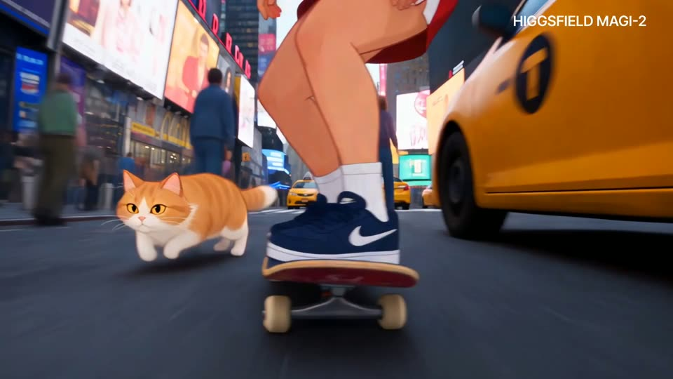

<!-- Generated by scripts/build_readme.py. Edit site.config.json, content/prompts.json, and generator scripts. -->

<a id="case-cms-14d99ace"></a>

# 女孩与猫滑过纽约

[← Back to collection](../../README.md)

**Origin**: `community` · **Task**: `T2V` · **Audio**: `Yes` · **Status**: `Source-linked`

Create a cinematic semi-realistic anime sequence using my uploaded girl reference as the exact character identity source; preserve…

<a href="https://awesome.raphael.app/materials/838f4559-6e7a-41d1-9d58-7629f8876b05.mp4"></a>

▶ **[Watch audio-enabled MP4](https://awesome.raphael.app/materials/838f4559-6e7a-41d1-9d58-7629f8876b05.mp4)**

**Full Prompt**

```text
Create a cinematic semi-realistic anime sequence using my uploaded girl reference as the exact character identity source; preserve her face, hairstyle, skin tone and body proportions throughout every shot.

She wears a sporty red-and-white skirt with integrated shorts, a fitted white top with red detailing, dark blue Nike sneakers, a beige "Cool" cap, dark blue backpack, black digital watch and headphones around her neck.

Include the same cute small ginger-and-white fluffy cat with amber eyes, maintaining realistic house-cat proportions at the girl's shin/lower-calf height. Keep both characters visually consistent throughout the sequence.

Set the entire story across a vibrant, bustling New York City, featuring Times Square, Broadway, Manhattan skyscrapers, Brooklyn Bridge, yellow NYC taxis, subway entrances, brick buildings, street vendors, traffic lights, graffiti-covered walls and crowded sidewalks.

The girl aggressively skateboards through the streets of Manhattan at extreme speed while the cat races alongside her, naturally weaving between pedestrians, taxis and street obstacles without falling behind.

Use dynamic low ground-level chase-cam cinematography, fast tracking shots, aggressive whip-pans, punchy hard cuts, wheel-level close-ups and subtle handheld micro-shake.

She races through Times Square, dodging yellow taxis and crossing pedestrians. As she passes a busy street coffee cart, she reaches out and grabs a takeaway coffee without slowing down. She takes a quick sip while maintaining perfect balance on her skateboard, then casually flicks the empty cup into a nearby trash bin as she speeds away.

The cat follows closely, jumping over a small street obstacle and landing smoothly beside her.

She suddenly spots a graffiti-covered wall near a narrow alley. Without hesitation, she accelerates, rides up the wall and performs an explosive skateboard wall jump. The cat leaps beside her in perfect synchronization. Both land together and immediately continue at full speed.

Cut seamlessly to Brooklyn Bridge. The girl races along the pedestrian-side pathway, weaving past cyclists and tourists, with the Manhattan skyline and East River visible in the background. Use dramatic sweeping camera movements and dynamic aerial tracking shots.

She launches her skateboard over a series of street obstacles, performs a stylish mid-air kickflip, lands smoothly and continues toward the waterfront.

Transition into an industrial Brooklyn area featuring elevated subway tracks, steel bridges, warehouses, construction zones, rooftop structures and graffiti-covered tunnels.

She ollies onto a low industrial rail, grinds across it, crouches beneath a steel bridge and races alongside a passing subway train. The cat keeps pace beside her, jumping over obstacles with impressive agility.

As the subway train pulls away, she accelerates toward an elevated steel platform and launches into an enormous synchronized jump with the cat.

Final shot: Both characters leap from the elevated structure into a street-level parking area, performing a spectacular synchronized mid-air trick before landing smoothly. The girl continues riding forward while the cat runs beside her. End with a dramatic low-angle tracking shot revealing the New York skyline in the distance.

Maintain premium anime-game splash-art quality, clean linework, painterly cel-shading, crisp character rendering, expressive animation, cinematic New York lighting, dynamic anime speed lines and fluid movement.

Audio: Natural New York street ambience, skateboard wheels rolling, trucks grinding against rails, passing taxis, subway rumbling, city crowds and wind rushing during jumps. No background music.
```

| Parameter | Value |
| --- | --- |
| Model | MAGI-2 (flagship) |
| Task type | t2v |
| Duration / FPS | 30.3s · 30 fps |
| Resolution / Ratio | 1080p · 16:9 |
| Audio mode | mixed (audio=True) |

[Original source](https://x.com/AIwithSynthia/status/2125650088341246435) · Creator: [@AIwithSynthia](https://x.com/AIwithSynthia) · 2026-11-25

> 视频使用 MAGI-2 为作者自述，未经独立核实。X 原视频：https://video.twimg.com/amplify_video/2125649995223445504/vid/avc1/1920x1080/UwMCb3sGTSLovz7m.mp4?tag=29

**[Generate similar on Raphael →](https://raphael.app/ai-video-generator?utm_source=github&utm_medium=repository&utm_campaign=magi_2_launch&utm_content=case_cms-14d99ace&utm_term=en)**
