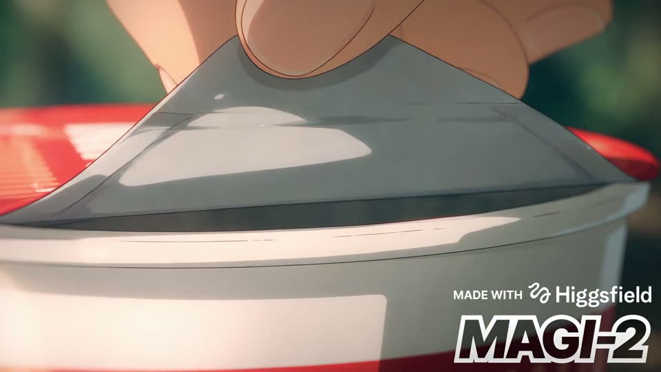

<!-- Generated by scripts/build_readme.py. Edit site.config.json, content/prompts.json, and generator scripts. -->

<a id="case-cms-17ddf808"></a>

# 在森林里煮杯面

[← Back to collection](../../README.md)

**Origin**: `community` · **Task**: `T2V` · **Audio**: `Yes` · **Status**: `Source-linked`

Community MAGI-2 video case (@studio_oneroom): 在森林里煮杯面.

<a href="https://awesome.raphael.app/materials/f636be3f-1c51-4b36-b745-c79d2ac35345.mp4"></a>

▶ **[Watch audio-enabled MP4](https://awesome.raphael.app/materials/f636be3f-1c51-4b36-b745-c79d2ac35345.mp4)**

**Full Prompt**

```text
添付の画像の人物がカップラーメンを作る動画 ファーストフレームに添付の画像を使わない

セリフは全て日本語、環境音あり。

# スタイル 日本のフルカラーアニメ、映画のような重厚なカラーグレーディング

# 制約 すべてのカットで画角やアングルを変えて単調にしない。

# 情景 場所：深い針葉樹の森の中。日中。木漏れ日が地面に斑に差し込む。 太い切り株の上に腰を下ろしている。 足元に小型ガスバーナーと金属製マグカップ。 カップ麺は赤いカップに白い文字で「NIPPON」のロゴ。

# シーン ひとり森の中でNIPPONのカップ麺を作って食べるまでの一連の所作。 細かい手元の動きをテンポよく見せる。

cut1: マクロショット、真横から。 地面にNIPPONカップだけが置かれている。 木漏れ日が斑にカップを照らす。 環境音：風、鳥の声。

cut2: エクストリームクローズアップ。 親指の爪がカップの蓋の端に引っかかり、ペリペリと剥がし始める。 環境音：蓋を剥がす音。

cut3: マクロショット。 手が小型ガスバーナーを地面に展開する。 環境音：金属の展開音。

cut4: エクストリームクローズアップ。 親指がライターを擦る。一度空振り。 環境音：シャッという空振り音。

cut5: エクストリームクローズアップ。 二度目で青い炎が点く。 【スピードランプ：スロー→着火で加速】 環境音：着火音、炎のボッという音。

cut6: エクストリームクローズアップ。 青い炎がゆっくりゆらめく。 環境音：炎の音。

cut7: マクロショット。 金属マグカップをバーナーの上に乗せる。 環境音：金属が置かれる音。

cut8: エクストリームクローズアップ、真上から俯瞰。 水面に最初の気泡が現れ、ゆっくりと沸騰が始まる。 環境音：水が沸騰していく音。

cut9: エクストリームクローズアップ。 指先がマグカップの縁に一瞬触れ、熱さで素早く引っ込む。 環境音：指が触れる微かな音。

cut10: ワイドショット。 木漏れ日が地面をゆっくり動いている。誰もいない静かな森。 環境音：風が木の葉を揺らす音、鳥の声。長い間。

cut11: マクロショット、斜め横から。 両手がマグカップからNIPPONカップへ湯をゆっくり注ぐ。 白い湯気が木漏れ日をキラキラと照らしながら立ち上る。 環境音：注ぐ音、湯気が立つ音。

cut12: マクロショット。 手が蓋を折り曲げて閉じ、マグカップを蓋の上に重りとして置く。 環境音：蓋を折る音。

cut13: マクロショット。 湯気がNIPPONカップの隙間から立ち上り、風でふわっと消える。 環境音：風。静寂。

cut14: マクロショット。 両手が割り箸を袋から取り出し、パキッと割る。 環境音：パキッという音。

cut15: マクロショット、真上から俯瞰。 手がNIPPONカップの蓋を開け、箸でかき混ぜる。 湯気が一気に広がる。 環境音：箸がカップに当たる音、湯気の音。

cut16: マクロショット、斜め横から。 横顔。箸でラーメンを一口すする。 環境音：すする音。

cut17: バストショット、斜め横から。 ふうっと息を吐いて遠くの木立をぼんやり見る。 目が細くなる。カメラがゆっくり横顔に寄っていく。 環境音：息を吐く音、風。シーン終わりへ向けて環境音がゆっくりフェードアウト。
```

| Parameter | Value |
| --- | --- |
| Model | MAGI-2 (flagship) |
| Task type | t2v |
| Duration / FPS | 17.1s · 25 fps |
| Resolution / Ratio | 1080p · 16:9 |
| Audio mode | mixed (audio=True) |

[Original source](https://x.com/studio_oneroom/status/2125917531743695064) · Creator: [@studio_oneroom](https://x.com/studio_oneroom) · 2026-11-26

> 模型 MAGI-2 为作者自述，未经独立核实。

**[Generate similar on Raphael →](https://raphael.app/ai-video-generator?utm_source=github&utm_medium=repository&utm_campaign=magi_2_launch&utm_content=case_cms-17ddf808&utm_term=en)**
