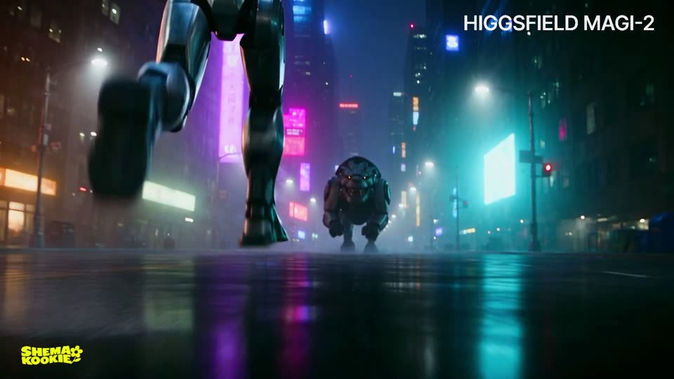

<!-- Generated by scripts/build_readme.py. Edit site.config.json, content/prompts.json, and generator scripts. -->

<a id="case-cms-2056663c"></a>

# 雨夜街头的机甲对决

[← Back to collection](../../README.md)

**Origin**: `community` · **Task**: `T2V` · **Audio**: `Yes` · **Status**: `Source-linked`

A cinematic ultra-realistic battle in a rain-soaked futuristic city at night. A sleek silver humanoid combat robot with glowing bl…

<a href="https://awesome.raphael.app/materials/45c06fe2-29ce-47a8-891d-f850b0cc7465.mp4"></a>

▶ **[Watch audio-enabled MP4](https://awesome.raphael.app/materials/45c06fe2-29ce-47a8-891d-f850b0cc7465.mp4)**

**Full Prompt**

```text
A cinematic ultra-realistic battle in a rain-soaked futuristic city at night. A sleek silver humanoid combat robot with glowing blue eyes faces a massive mechanical beast made of dark industrial metal. Heavy rain falls through neon reflections on the wet street. The two machines sprint toward each other, leap simultaneously, collide in mid-air, exchange several fast mechanical strikes, then slide across the wet pavement and rise into a dramatic final face-off. Realistic metal surfaces, detailed mechanical joints, believable weight and physics, dynamic handheld camera, low-angle tracking shots, fast cinematic cuts, dramatic rim lighting, volumetric rain, sharp reflections, intense but non-graphic action, ultra HD, 1080p, extremely sharp colors, cinematic realism, 16:9.
```

| Parameter | Value |
| --- | --- |
| Model | MAGI-2 (flagship) |
| Task type | t2v |
| Duration / FPS | 17.4s · 30 fps |
| Resolution / Ratio | 1080p · 16:9 |
| Audio mode | sfx (audio=True) |

[Original source](https://x.com/VirgowatiShema/status/2125794173051953252) · Creator: [@VirgowatiShema](https://x.com/VirgowatiShema) · 2026-11-26

> MAGI-2 为作者自述，未经独立核实。

**[Generate similar on Raphael →](https://raphael.app/ai-video-generator?utm_source=github&utm_medium=repository&utm_campaign=magi_2_launch&utm_content=case_cms-2056663c&utm_term=en)**
