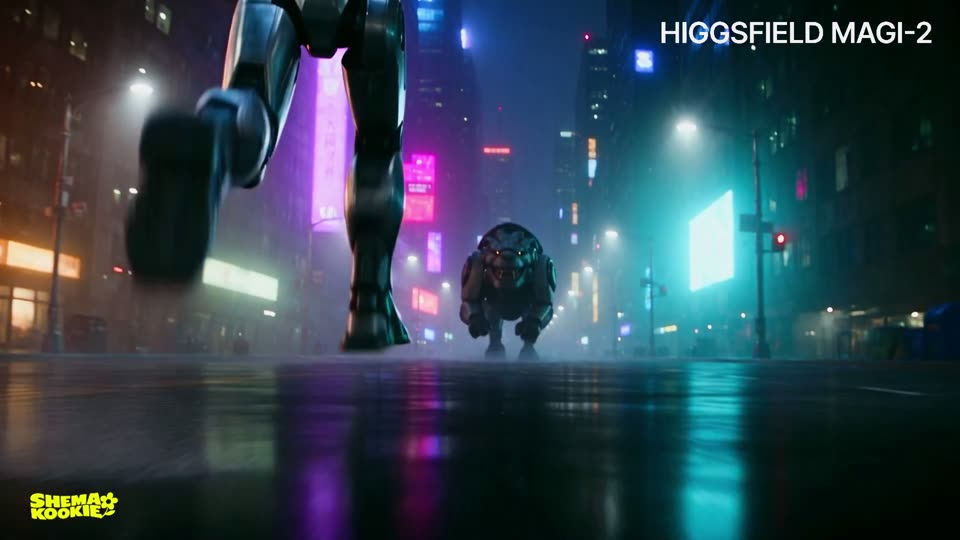

<!-- Generated by scripts/build_readme.py. Edit site.config.json, content/prompts.json, and generator scripts. -->

<a id="case-cms-2056663c"></a>

# 雨夜街头的机甲对决

[← 返回合集](../../README.zh-CN.md)

**来源类型**: `community` · **任务**: `T2V` · **音画**: `Yes` · **状态**: `来源收录`

社区 MAGI-2 视频案例（@VirgowatiShema）：雨夜街头的机甲对决。

<a href="https://awesome.raphael.app/materials/45c06fe2-29ce-47a8-891d-f850b0cc7465.mp4"></a>

▶ **[播放有声视频原片](https://awesome.raphael.app/materials/45c06fe2-29ce-47a8-891d-f850b0cc7465.mp4)**

**完整原始提示词**

```text
A cinematic ultra-realistic battle in a rain-soaked futuristic city at night. A sleek silver humanoid combat robot with glowing blue eyes faces a massive mechanical beast made of dark industrial metal. Heavy rain falls through neon reflections on the wet street. The two machines sprint toward each other, leap simultaneously, collide in mid-air, exchange several fast mechanical strikes, then slide across the wet pavement and rise into a dramatic final face-off. Realistic metal surfaces, detailed mechanical joints, believable weight and physics, dynamic handheld camera, low-angle tracking shots, fast cinematic cuts, dramatic rim lighting, volumetric rain, sharp reflections, intense but non-graphic action, ultra HD, 1080p, extremely sharp colors, cinematic realism, 16:9.
```

| 参数 | 配置 |
| --- | --- |
| 模型 | MAGI-2 (flagship) |
| 任务类型 | t2v |
| 时长 / 帧率 | 17.4s · 30 fps |
| 分辨率 / 比例 | 1080p · 16:9 |
| 音频模式 | sfx (audio=True) |

[原始来源](https://x.com/VirgowatiShema/status/2125794173051953252) · 作者: [@VirgowatiShema](https://x.com/VirgowatiShema) · 2026-11-26

> MAGI-2 为作者自述，未经独立核实。

**[在 Raphael 上生成同类视频 →](https://raphael.app/ai-video-generator?utm_source=github&utm_medium=repository&utm_campaign=magi_2_launch&utm_content=case_cms-2056663c&utm_term=zh-CN)**
