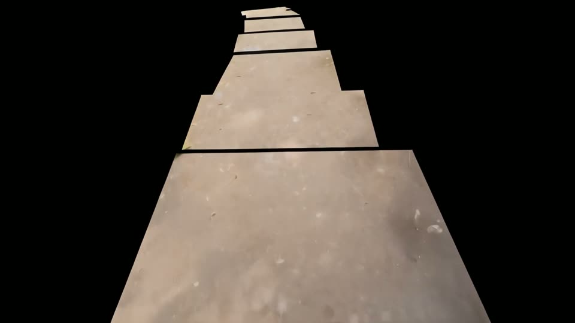

<!-- Generated by scripts/build_readme.py. Edit site.config.json, content/prompts.json, and generator scripts. -->

<a id="case-cms-2b0ce4a1"></a>

# 穿过屏幕隧道的动画街景

[← Back to collection](../../README.md)

**Origin**: `community` · **Task**: `T2V` · **Audio**: `Yes` · **Status**: `Source-linked`

Overall Requirements Create an 18-second, 16:9, 1080p anime-style city video, using the uploaded original as the motion reference…

<a href="https://awesome.raphael.app/materials/c1d7adb7-80ad-4fb1-804a-29340dc3f1e8.mp4"></a>

▶ **[Watch audio-enabled MP4](https://awesome.raphael.app/materials/c1d7adb7-80ad-4fb1-804a-29340dc3f1e8.mp4)**

**Full Prompt**

```text
Overall Requirements
Create an 18-second, 16:9, 1080p anime-style city video, using the uploaded original as the motion reference for the first half's screen assembly and turn-forward push.

The corrected version's most important requirements: after the bloom transition, the camera must always remain at ground-level walking perspective, and the city must contain clearly visible people with feet on the ground.

No camera rising into the sky, flying, aerial shots, or rooftop overviews; no floating people.

Scene
A lived-in modern Japanese city street. Warm golden late-afternoon sun, blue sky with white clouds; streetfront shops, cafe terraces, residential buildings, roadside trees, street lamps, benches, bicycle racks, curbs, and sidewalks.

Refined anime hand-painted backgrounds with clean linework and color blocks, soft cel shading.

The street holds a moderate number of adults walking, chatting, waiting to cross, plus a few slow-moving vehicles — full and orderly. No empty streets, no empty plazas.

People
Once the full streetscape appears, 2–3 adult pedestrians are clearly visible in near-to-mid shots, walking normally on the paved sidewalk, with about 6–10 more passersby active naturally to the sides and in the distance.

Figures follow street perspective; the weight-bearing foot plants truly on the sidewalk or crosswalk surface with no gap between sole and ground, a stable contact shadow underfoot, and natural stepping, weight shifts, and body bounce.

People may scatter naturally — not lined up in a row, no cloned figures, no foot-sliding or floating, no spawning mid-air or dropping from the sky.

The people belong to the scene: some pedestrians are already visible in the earlier city screens; after the transition they still walk naturally in the same ground space.

Timeline
0–0.3s
Pure black space.

0.3–2s
The trapezoid screens of the city sidewalk appear from near to far, keeping the reference's block-by-block assembly rhythm.

2–4.7s
Rectangular city screens appear one after another on both sides, showing shops, trees, curbs, and walking pedestrians. The camera pushes forward along the curve.

4.7–6.9s
The upper screens gradually enclose into an incomplete vault; black seams and grids visible.

6.9–10s
The camera keeps moving through the city-screen tunnel, keeping the original's slight turn but gradually returning to level view. The screens already hold a coherent ground-level streetscape with pedestrians — not an empty city.

10–10.9s
A soft white-gold bloom spreads along the screen borders, swallowing the black seams; the dividing frames begin to dissolve.

10.9–11.8s
As the bloom recedes, all grids, frames, tunnel shell, and the central black hole vanish completely; the screen floor seamlessly becomes a real continuous sidewalk, and the image opens into a complete, undivided city streetscape.

Keep the same street, the same people, and the same light as before the transition. No hard cut.

11.8–18s
The camera sits on the sidewalk at an average adult eye height about 1.5 m above ground, dollying forward at walking pace over the flat pavement. Fixed rig height, level lens, stable horizon.

The near pavement and crisp curb stay visible along the bottom; shops and pedestrians to both sides; extended streets and buildings in mid-to-far view.

2–3 near-to-mid pedestrians fully in frame with feet clearly grounded; other passersby walking, chatting, waiting to cross at the sides. Normal parallax between foreground pedestrians and the street; people must not suddenly enlarge or float.

Show the full streetscape for at least 6 seconds and end on a lively city at ground level — no fade to black.
Final Scene Requirements
"Complete scene" means an undivided, grid-free, continuous street space — not an aerial panorama looking down over the whole city.

The ending absolutely must not rise up, pull to rooftop height, cross over roofs, or fly out to the river or mid-air. Always at sidewalk height.

Feet-on-ground contact, stable contact shadows, and natural gait are the highest priority.

Forbidden
Forests, live-action photographic style, floating people, airborne feet, lost contact shadows, foot-sliding, limb deformation, empty uninhabited cities, huge empty lots, aerial cameras, rooftop overviews, camera rising or descending, residual black grid or tunnel after the bloom, overexposed white ending, subtitles, logos, watermarks.
```

| Parameter | Value |
| --- | --- |
| Model | MAGI-2 (flagship) |
| Task type | t2v |
| Duration / FPS | 18.0s · 25 fps |
| Resolution / Ratio | 1080p · 16:9 |
| Audio mode | mixed (audio=True) |

[Original source](https://x.com/magiai_hq/status/2125811634476306885) · Creator: [@magiai_hq](https://x.com/magiai_hq) · 2026-11-26

> 模型 MAGI-2 为作者自述，未经独立核实。 作者在同一串帖中标注模型：https://x.com/magiai_hq/status/2125811617145528821

**[Generate similar on Raphael →](https://raphael.app/ai-video-generator?utm_source=github&utm_medium=repository&utm_campaign=magi_2_launch&utm_content=case_cms-2b0ce4a1&utm_term=en)**
