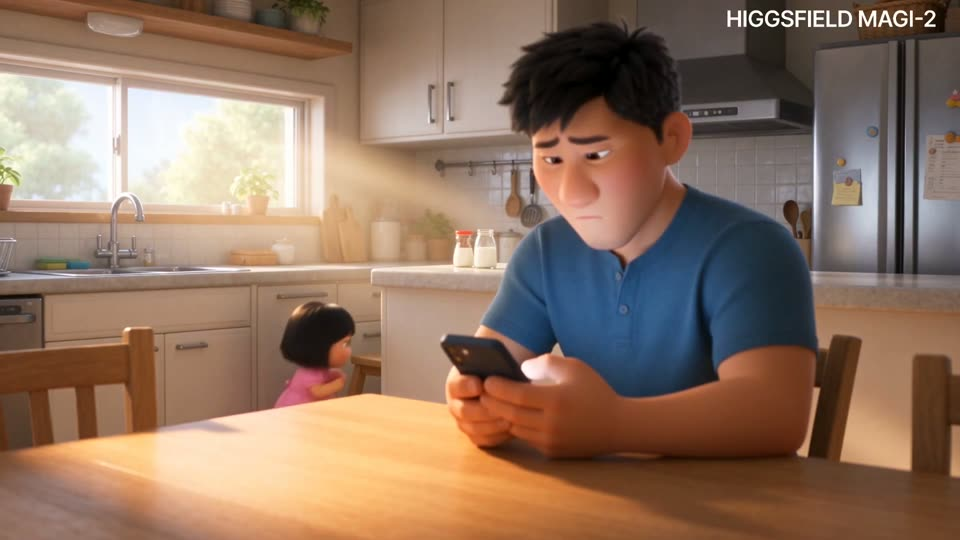

<!-- Generated by scripts/build_readme.py. Edit site.config.json, content/prompts.json, and generator scripts. -->

<a id="case-cms-31031581"></a>

# 给爸爸做松饼

[← 返回合集](../../README.zh-CN.md)

**来源类型**: `community` · **任务**: `T2V` · **音画**: `Yes` · **状态**: `来源收录`

社区 MAGI-2 视频案例（@AIwithkhan）：给爸爸做松饼。

<a href="https://awesome.raphael.app/materials/c42d1bde-2c1d-4e9a-87b9-d3b5cfe6cb7e.mp4"></a>

▶ **[播放有声视频原片](https://awesome.raphael.app/materials/c42d1bde-2c1d-4e9a-87b9-d3b5cfe6cb7e.mp4)**

**完整原始提示词**

```text
Create a heartwarming, hilarious, ultra-realistic Japanese-style 3D animated family comedy in vertical 16:9 format.

A cute 3-year-old Japanese girl with short black bobbed hair, chubby cheeks, sparkling eyes, and pink pajamas decides to surprise her father with breakfast.

Wearing an oversized chef hat, she struggles to prepare pancakes in the kitchen. She accidentally spills flour everywhere, gets chocolate on her face, and finally serves her father a funny-looking, slightly burnt pancake.

🎙️ Girl: "Papa! I made this for you!"

Her father takes a bite, struggles to hide his reaction, and says, "Delicious!"

The little girl notices his watery eyes and innocently asks, "Papa, are you crying because it's so yummy?"

The mother walks in, tastes the pancake, and bursts into laughter. The father hugs his little daughter and kisses her forehead.

Final Shot: The little girl proudly poses like a professional chef while her parents laugh.

Style: High-end Japanese 3D animation, adorable characters, expressive faces, realistic movements, warm lighting, cinematic camera angles, funny sound effects, natural Japanese dialogue, and heartwarming family moments.

Consistency: Maintain identical characters, clothing, facial features, and kitchen throughout.

Negative: No distorted faces, extra fingers, flickering, scene jumps, subtitles, text, or watermark.
```

| 参数 | 配置 |
| --- | --- |
| 模型 | MAGI-2 (flagship) |
| 任务类型 | t2v |
| 时长 / 帧率 | 30.3s · 30 fps |
| 分辨率 / 比例 | 1080p · 16:9 |
| 音频模式 | dialogue (audio=True) |

[原始来源](https://x.com/AIwithkhan/status/2125522773258952776) · 作者: [@AIwithkhan](https://x.com/AIwithkhan) · 2026-11-25

> MAGI-2 为作者自述，未经独立核实。

**[在 Raphael 上生成同类视频 →](https://raphael.app/ai-video-generator?utm_source=github&utm_medium=repository&utm_campaign=magi_2_launch&utm_content=case_cms-31031581&utm_term=zh-CN)**
