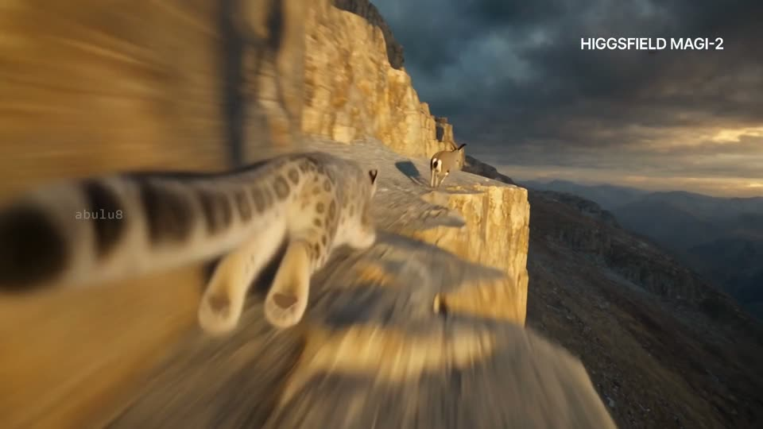

<!-- Generated by scripts/build_readme.py. Edit site.config.json, content/prompts.json, and generator scripts. -->

<a id="case-cms-3e3de801"></a>

# 猎豹冲下碎石坡

[← Back to collection](../../README.md)

**Origin**: `community` · **Task**: `T2V` · **Audio**: `Yes` · **Status**: `Source-linked`

One CONTINUOUS FPV drone shot, no cuts, one unbroken take, EXTREME real-time speed. Never reverses. NO slow motion except one half…

<a href="https://awesome.raphael.app/materials/d200690a-2486-425f-870b-30b410e31ca7.mp4"></a>

▶ **[Watch audio-enabled MP4](https://awesome.raphael.app/materials/d200690a-2486-425f-870b-30b410e31ca7.mp4)**

**Full Prompt**

```text
One CONTINUOUS FPV drone shot, no cuts, one unbroken take, EXTREME real-time speed. Never reverses. NO slow motion except one half-second beat at the reveal, then an instant snap back to full speed. Photoreal point-blank framing. DOWNHILL LOCK: the whole chase runs DOWN the mountainside, top to bottom — NOTHING rises into the sky, ever. The camera flies LOW, inches off rock and scree, and its every altitude change is a DROP, ledge after ledge down to the gully. NO ESCAPE, no fade to black.

REFERENCES: terrain and route = @Image1 (cliff ledges, scree chute, snow gully). Snow leopard = @Image4, blue sheep = @Image2, ibex = @Image3 — animals' look only, no grey backdrops, no labels.

CINEMATIC CAPTURE: real FPV drone footage — ultra-wide 14mm lens, barrel distortion, 180-degree shutter, heavy motion blur on fast pans, fine grain, lens flares, grit and snow hitting the lens. Golden-hour light under a bruised storm sky, one low gold shaft raking the cliffs. Grade: slate, ochre and snow-white, documentary contrast — BBC nature documentary from a racing drone, NOT a game engine.

The shot opens ALREADY at full speed on the golden cliff ledges, skimming rock inches behind the snow leopard as it tears along a narrow ledge, ringed tail swinging for balance. Ahead — seen ONLY from behind and flank, NEVER its face — the blue sheep bolts along the ledge and DROPS off its edge to the ledge below; the leopard drops after it and the camera DIVES with them, ledge after ledge, choughs scattering around the lens. The sheep hits the top of the scree chute and plunges straight down it; the leopard follows, and the camera tips into a VERTICAL DIVE down the chute behind them, loose stones breaking free and pouring down alongside in a growing rockslide. On the grassy slope beside the chute an ibex herd — a few big curved-horn males, females and young, close to the lens — bolts sideways away from the falling rocks, the camera swerving past their flanks and back onto the leopard's tail. The chute pours out into the snow gully. THE ENTIRE CLIMAX HAPPENS HERE, IN THE SNOW AND STREAM. THE REVEAL: half-second slow motion — the snow leopard at full stretch in its final lunge, low and flat over the snow, huge furry paws out, seen from behind — then an INSTANT SNAP back to full speed. The paws hook the sheep's flank at an angle; both crash sideways into the snow and the stream, powder and water erupting, the camera driving THROUGH the burst, orbiting tight and low as they thrash. The jaws lock at the throat; the leopard pins the sheep, the camera circling recklessly close. It plants its feet over the body, flanks heaving, breath steaming, and lets rip a RASPING SNOW LEOPARD YOWL — a harsh wail breaking into a snarl and hiss, teeth bared, NOT a lion's roar. The rockslide's tail spills into the gully around them, a bearded vulture drops past the camera, the ibex herd scrambles across the far slope, the camera arcing around the snarling leopard as the runtime runs out mid-chaos.

Sound: howling wind pitching with every drop, clattering scree, a rumbling rockslide, a driving score — dropping to one breath of near-silence at the slow-motion reveal, then a MASSIVE concussive snow-and-water impact, then sustained escalating chaos: thrashing snow and water, ragged panting, snarls, the rasping yowl, ibex hooves, vulture wings, the score building to the final frame.

Global style lock: photoreal cinematic FPV; the chase only goes DOWN, nothing rises into the sky; the climax escalates rather than resolves, no directed ending; the blue sheep NEVER turns to face the predator or camera while running; EVERY background animal REACTS and keeps moving as the chase passes; the gully persists through the climax; no lion roar, no distortion, no subtitles, no watermarks. 16:9.
```

| Parameter | Value |
| --- | --- |
| Model | MAGI-2 (flagship) |
| Task type | t2v |
| Duration / FPS | 15.3s · 30 fps |
| Resolution / Ratio | 1080p · 16:9 |
| Audio mode | music (audio=True) |

[Original source](https://x.com/abulu8/status/2125719013473014266) · Creator: [@abulu8](https://x.com/abulu8) · 2026-11-25

> MAGI-2 为作者自述，未经独立核实。

**[Generate similar on Raphael →](https://raphael.app/ai-video-generator?utm_source=github&utm_medium=repository&utm_campaign=magi_2_launch&utm_content=case_cms-3e3de801&utm_term=en)**
