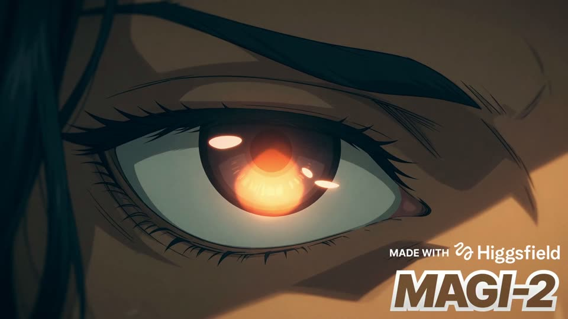

<!-- Generated by scripts/build_readme.py. Edit site.config.json, content/prompts.json, and generator scripts. -->

<a id="case-cms-414dc90a"></a>

# 收市前的巷战

[← 返回合集](../../README.zh-CN.md)

**来源类型**: `community` · **任务**: `T2V` · **音画**: `Yes` · **状态**: `来源收录`

社区 MAGI-2 视频案例（@studio_oneroom）：收市前的巷战。

<a href="https://awesome.raphael.app/materials/30c81c10-0cc9-499b-9cbb-ab3d903a7a43.mp4"></a>

▶ **[播放有声视频原片](https://awesome.raphael.app/materials/30c81c10-0cc9-499b-9cbb-ab3d903a7a43.mp4)**

**完整原始提示词**

```text
劇場アニメスタイルの高密度アクション。
色調:緑がかった冷たいティールを基調としたカラーグレーディング。
彩度と明度は全体的に抑え、純色を排する。
暗部は黒に潰さず、緑がかったグレーに沈める。
彩度を持つのは屋台の琥珀色のむき出しの電球と、破壊の瞬間に散る火花のみ。
曇天の拡散光、湿った空気感。
BGMなし、セリフなし、環境音あり。
フルサイズ換算24mm F1.4の広角レンズのような画角感。

# 制約
すべてのカットで画角・アングル・焦点距離・カメラの高さを変えて単調にしない。
カットの長さに緩急をつけること。「一瞬のインサート」と書かれたカットは極端に短く。
画面内に文字・字幕・ロゴを表示しないこと。
路面は濡れており、光を反射していること。
フェードアウトは使用しないこと。
映像は常に画面の四隅まで完全に満たし、円形の黒枠や暗い縁取りを描かないこと。
店主たちは常に戦いから離れた物陰におり、戦闘には一切関わらないこと。

# 方向指定（最重要・全カット共通）
左右配置：キャラAが画面左、キャラBが画面右。
向き：キャラAは常に右向き。キャラBは常に左向き。
カメラは常に二人を結ぶ線の同じ側から撮り、全カットでこの左右関係を絶対に維持すること。
いかなるカットでも左右を入れ替えないこと。

# 登場人物
## キャラA
@Image1

## キャラB
@Image2

## 店主たち
市場の年配の店主が2〜3人。エプロン姿。戦いから離れた物陰にいる。

# 情景
アジアの古い下町市場の狭い通路。閉店間際で客はいない。
様々な店が両側に密集している：
プラスチック桶や鍋や箒が積まれた雑貨屋、
干し肉とソーセージが吊るされた精肉店、
湯気を上げるスープの寸胴鍋が並ぶ小さな食堂、
果物と野菜を山積みにした青果店、氷の詰まった発泡箱の魚屋。
防水シートの庇が頭上を覆う。
照明：頭上に吊るされたむき出しの電球の琥珀色。濡れた路面がその光を反射する。
奥行き構成：前景に吊るされた干し肉と雑貨、中景に両者、遠景に市場の通路が奥へ続く。

# シーン
閉店間際の市場に立つキャラAの元へ、キャラBが歩いて詰めてくる。
店主たちが物陰に隠れて見守る中、二人の戦いが様々な店を次々と壊していき、
キャラAは食堂の湯気で流れを断ち、屋根の上へ展開して逆転する。

cut1:
85mmの望遠圧縮。手前にキャラA（右向き）の肩と後頭部が大きくボケて画面左を占め、
その肩越しに、精肉店の吊るされた干し肉の列の奥から
キャラB（左向き）がゆっくり歩いて詰めてくる。
通路脇では雑貨屋の店主が一人、様子を察して静かに台の陰へ身を低くする。
環境音：濡れた足音だけが近づく。

cut2:
一瞬のインサート。マクロ。キャラA（右向き）の目元。
琥珀色の光が瞳をかすめ、瞳孔がすっと細くなる。

cut3:
一瞬のインサート。マクロ。キャラAの靴底が濡れた路面を噛み、
氷の欠片を踏み砕く。
効果音：氷が砕ける短い音。

cut4:
16mmの超広角、地面スレスレの超ローポジション。
キャラA（右向き、画面左から右へ）が爆発的に踏み込み、通路を一直線に駆ける。
風圧で雑貨屋のプラスチック桶と箒の山が崩れ、
店主が慌てず素早く台の下へ潜り込む。水しぶきがレンズ前を横切る。
効果音：踏み込みの轟音、桶が転がる音。

cut5:
ミディアムショット。キャラA（画面左、右向き）の初撃を
キャラB（画面右、左向き）が片腕で受け流し、
返しの一撃がキャラAを青果店の棚へ叩きつける。
棚が半壊して果物が転がり落ち、山積みの野菜が崩れて路面に散らばる。
効果音：打撃音、棚が砕ける音、果物が転がる音。

cut6:
一瞬のインサート。台の陰から顔半分だけ覗かせた青果店の店主が、
崩れていく自分の店の棚を呆然と見つめる。
環境音：果物が落ち続ける音。

cut7:
キャラAのPOV。目の前に迫るキャラB（左向き）の連打。視界が左右に揺さぶられ、
防いだ腕の隙間から相手の冷たい眼が見える。
効果音：腕に当たる連続した打撃音。

cut8:
一瞬のインサート。マクロ。キャラAの視線の先、
すぐ横の食堂の厨房で湯気を上げ続けるスープの寸胴鍋。

cut9:
キャラA（画面左、右向き）が食堂の寸胴鍋を蹴り倒す。
白い湯気とスープの飛沫が爆発的に通路に噴き上がり、
キャラB（画面右）の視界を白く塗り潰す。画面全体が湯気に覆われる。
効果音：金属が倒れる音、蒸気の轟音。

cut10:
一瞬のインサート。ダッチアングルのクローズアップ。湯気の中、
激しく揺れる電球の明滅がキャラB（左向き）の顔を照らし、
腕で湯気を払うその表情から余裕が消える。そこにキャラAの姿はない。
効果音：電球コードが軋む音、蒸気の音。

cut11:
ローアングル。湯気の天井を突き破って、
キャラA（右向き）が精肉店の庇の支柱を蹴って屋根の上へ跳び上がるシルエット。
吊るされたソーセージの列が反動で大きく揺れる。
効果音：支柱を蹴る音、吊り物が揺れる音。

cut12:
ローアングル、キャラB（画面右、左向き）の視点側から見上げる。
屋根の上のキャラA（画面左上）が逆光のシルエットになり、
背後の曇天を切り取って頭上から飛びかかってくる。
効果音：シートを蹴る音、風切り音。

cut13:
【時間が引き伸ばされるスローモーション】落下しながら体を捻るキャラA（画面左上）と、
見上げて迎え撃とうとするキャラB（画面右下、左向き）。
二人の間で、揺れる電球が一つ、コードから千切れて宙に浮かぶ。
琥珀色の光がゆっくり回転する。カメラは二人の間を斜めに滑り込む。
効果音：低くうなる持続音。

cut14:
時間が戻る。落下の全体重を乗せたキャラAの一撃が
キャラB（画面右）を路面へ叩きつける。
衝撃で周囲の店が同心円状に崩れ、雑貨と果物と氷が波のように押し寄せ、
千切れた電球が路面で弾けて火花を散らす。
飛沫が静まる中、台の陰から店主たちがそっと顔を出し、
瓦礫と化した自分たちの店を見回す。
フォロースルーの姿勢のキャラA（画面左、右向き）だけが通路に立っている。
環境音：着弾の轟音、崩落の連鎖音のあと、水滴だけが戻る。
```

| 参数 | 配置 |
| --- | --- |
| 模型 | MAGI-2 (flagship) |
| 任务类型 | t2v |
| 时长 / 帧率 | 15.2s · 25 fps |
| 分辨率 / 比例 | 1080p · 16:9 |
| 音频模式 | mixed (audio=True) |

[原始来源](https://x.com/studio_oneroom/status/2125812181040242977) · 作者: [@studio_oneroom](https://x.com/studio_oneroom) · 2026-11-26

> 模型 MAGI-2 为作者自述，未经独立核实。

**[在 Raphael 上生成同类视频 →](https://raphael.app/ai-video-generator?utm_source=github&utm_medium=repository&utm_campaign=magi_2_launch&utm_content=case_cms-414dc90a&utm_term=zh-CN)**
