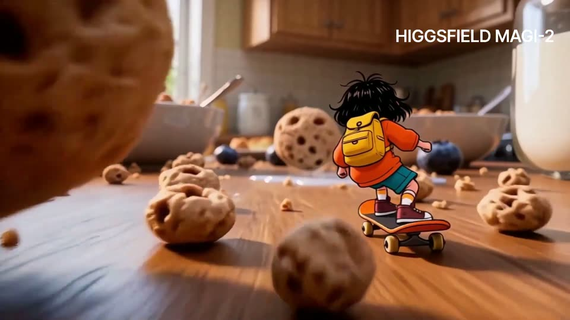

<!-- Generated by scripts/build_readme.py. Edit site.config.json, content/prompts.json, and generator scripts. -->

<a id="case-cms-42531667"></a>

# 早餐桌上的微型滑板女孩

[← Back to collection](../../README.md)

**Origin**: `community` · **Task**: `T2V` · **Audio**: `Yes` · **Status**: `Source-linked`

SUBJECT A miniature hand-drawn 2D skateboard girl with messy black hair, orange oversized shirt, teal shorts, striped socks and a…

<a href="https://awesome.raphael.app/materials/707069ee-5985-4cc7-858f-6723a6713c46.mp4"></a>

▶ **[Watch audio-enabled MP4](https://awesome.raphael.app/materials/707069ee-5985-4cc7-858f-6723a6713c46.mp4)**

**Full Prompt**

```text
SUBJECT
A miniature hand-drawn 2D skateboard girl with messy black hair, orange oversized shirt, teal shorts, striped socks and a yellow backpack, riding a tiny orange skateboard through a gigantic real-world breakfast table.

STYLE
Premium mixed-reality animation. Expressive hand-drawn 2D character integrated seamlessly into photorealistic live-action macro photography. Playful physical interaction, believable miniature scale, smooth line animation, practical tabletop lighting, cinematic stop-motion energy. Dynamic movement with fluid animation, exaggerated momentum and realistic object interaction.

CAMERA
Extreme macro photography, shallow depth of field, energetic miniature tracking camera, rapid perspective changes, physically motivated transitions, seamless movement between shots, cinematic motion blur.

**00:00–00:03 — THE BREAKFAST RACE**
Extreme low-angle macro tracking shot. She pushes hard across a wooden breakfast table while enormous cereal pieces tumble behind her like falling boulders. Tiny skateboard wheels rattle across the wood. The camera races alongside her board as she dodges scattered crumbs and a pool of spilled milk.

**00:03–00:05 — BLUEBERRY JUMP**
A gigantic rolling blueberry suddenly crosses her path. She crouches and ollies over it, the camera whip-panning upward with her. She lands perfectly on the curved handle of a silver spoon, her backpack bouncing with the impact.

00:05–00:07 — SPOON GRIND
She grinds down the spoon handle at high speed. Metallic sparks transform into tiny hand-drawn orange doodle stars. The spoon begins flexing and tipping downward like a seesaw, building momentum.

00:07–00:10 — MILK CATAPULT
The spoon CATAPULTS her into the air across a gigantic bowl of milk. Slow-motion aerial kickflip above floating cereal islands. The camera dives beneath her orange skateboard and rotates upward as she passes through droplets of milk suspended in the air.

00:10–00:12 — THE GLASS RIDE
She lands on the rim of a giant orange juice glass. She accelerates around its circular rim, hugging the curve like a miniature skatepark bowl. The camera spirals around the glass as her speed increases.

00:12–00:15 — TRANSITION TO THE NEXT WORLD**
She rockets past the camera and disappears behind the orange juice glass.

MATCH CUT: The circular orange juice glass rim transforms seamlessly into the circular door of a washing machine in a new gigantic world. A brief mechanical spin, cinematic transition hit, and the camera pushes into the next environment.

AUDIO
Tiny skateboard wheel rolling, wooden tabletop rattles, blueberry impact, sharp skateboard pop, metallic spoon grind, playful doodle spark sounds, spoon creaking, milk splash, airy slow-motion whoosh, circular glass rolling sound, rising playful percussion, and a sharp transition hit at the final match cut.
```

| Parameter | Value |
| --- | --- |
| Model | MAGI-2 (flagship) |
| Task type | t2v |
| Duration / FPS | 15.0s · 30 fps |
| Resolution / Ratio | 1080p · 16:9 |
| Audio mode | mixed (audio=True) |

[Original source](https://x.com/Gwsubsa/status/2125765192294502911) · Creator: [@Gwsubsa](https://x.com/Gwsubsa) · 2026-11-26

> 视频使用 MAGI-2 为作者自述，未经独立核实。X 原视频：https://video.twimg.com/amplify_video/2125754211283644416/vid/avc1/1920x1080/qtUsCCMN1kTKN1l_.mp4?tag=29

**[Generate similar on Raphael →](https://raphael.app/ai-video-generator?utm_source=github&utm_medium=repository&utm_campaign=magi_2_launch&utm_content=case_cms-42531667&utm_term=en)**
