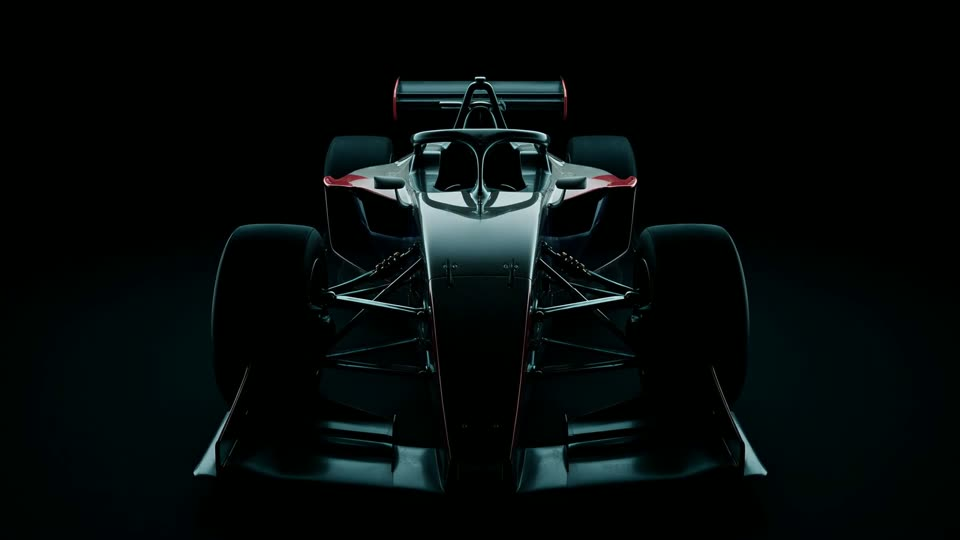

<!-- Generated by scripts/build_readme.py. Edit site.config.json, content/prompts.json, and generator scripts. -->

<a id="case-cms-4497bbed"></a>

# 霓虹赛道上的赛车广告

[← Back to collection](../../README.md)

**Origin**: `community` · **Task**: `T2V` · **Audio**: `Yes` · **Status**: `Source-linked`

Subject Mapping The "race car" is the car from @Image 1. The "driver" is the driver from @Image 2. Use only the fixed names "race…

<a href="https://awesome.raphael.app/materials/134ed5d9-5dea-49e5-ad49-8f745f94087f.mp4"></a>

▶ **[Watch audio-enabled MP4](https://awesome.raphael.app/materials/134ed5d9-5dea-49e5-ad49-8f745f94087f.mp4)**

**Full Prompt**

```text
Subject Mapping
The "race car" is the car from @Image 1.
The "driver" is the driver from @Image 2.

Use only the fixed names "race car" and "driver" throughout; no synonym substitution. Image 1 locks only the race car's ivory white, vermilion red, and deep purple color scheme, plus its body, suspension, wheels, and front/rear wing structure; Image 2 locks only the driver's racing suit, helmet, gold visor, gloves, and racing shoes. All shots keep the subjects consistent; the original film's car or driver never appears.

Script Overview
Total duration: 30.0s.
Shot count: 24.
Style: Photorealistic 3D racing commercial; black low-key lighting; cyber neon tunnel; red-green complementary lighting; volumetric fog; wet-ground reflections; ray tracing; long-exposure light trails; radial motion blur; chromatic aberration and glitch flash frames.

Scenes: Dark studio, wet-floor pit garage, neon high-speed tunnel.

Camera shake: Whenever cutting to high-speed driving scenes, the frame must shake intensely. Never allow small camera movement while objects are moving at high speed.

Asset Image Prompts
Subject "race car":
Use Image 1 directly; strictly preserve its ivory white, vermilion red, and deep purple livery, mechanical suspension, brake discs, bronze calipers, center-lock wheels, cooling vents, and carbon-fiber front/rear wings and diffuser.

Subject "driver":
Use Image 2 directly; strictly preserve the ivory white, vermilion red, and deep purple racing suit, gold-visor full-face helmet, gloves, and racing shoes.

Scenes:
A black infinity studio; a pit garage with overhead lights, red signal lights, and a wet reflective floor; a futuristic high-speed tunnel filled with red, green, purple, and white neon light walls and volumetric fog. No people, no temporary props; photorealistic 8K 3D rendering.

Video Prompt
Subjects: Race car, driver
Scenes: Dark studio, wet-floor pit garage, neon high-speed tunnel
Music: Generate a BGM that grows progressively tenser with the on-screen rhythm, with matching sound effects

Shot 1 | 0.000-2.333s
Dark studio, symmetrical top-down view from front-above, 50-70mm. The camera slowly pulls back and rises; the race car sits centered and still; cyan-white rim light gradually ignites along the nose, suspension, and front wing; the dark background stays deep.

Shot 2 | 2.333-2.700s
Near-vertical top view, 24-35mm. The camera drops fast and rotates clockwise; the car sits at a diagonal; wet grainy reflections sweep across the body; hard cut mid-action.

Shot 3 | 2.700-3.333s
Low-side macro, 85-100mm. The camera whips at high speed from the front wing to the front wheel and closes in; focus locks on the center-lock wheel, brake disc, and bronze caliper; the background blurs out rapidly.

Shot 4 | 3.333-4.333s
Directly rear, symmetrical low angle, 35-50mm. The camera slowly pulls back as the rear wing, suspension, and diffuser are revealed layer by layer; cyan-white highlights intercut with negative, overexposed, and black-frame glitch flickers.

Shot 5 | 4.333-4.667s
Neon high-speed tunnel, 24-28mm ground-level rear chase. The camera follows at high speed as the car accelerates forward; red taillights reflect on the wet road; strong motion blur on the rear; the camera shakes intensely.

Shot 6 | 4.667-5.133s
14-18mm POV; the camera rushes along the central vanishing point with slight roll; red and green beams stretch into long trails; volumetric fog parts to both sides; a light-trail match cut completes the transition; the camera shakes intensely.

Shot 7 | 5.133-6.133s
50-70mm low side view; the camera tracks parallel to the car at high speed; the car stays centered; tires spin furiously; the neon background streaks horizontally; residual color trails at the start; shake level 1.

Shot 8 | 6.133-6.300s
The car's side shows continuous red-green inversion, outline ghosting, and overexposed flash frames; the image twitches for about 5 frames; a glitch flash-cut enters the close-up.

Shot 9 | 6.300-8.333s
70-100mm body close-up; the camera slides slowly from rear to front along the sidepod and pushes in; cooling vents, service panels, rivets, and carbon-fiber texture pass in sequence; colored highlights flow across the paint; the camera shakes intensely.

Shot 10 | 8.333-8.567s
The car's silhouette, white backlight, red taillights, and dark garage flash in succession; black frames alternate with overexposed frames; a glitch flash-cut enters the pit garage.

Shot 11 | 8.567-11.567s
Wide master of the wet-floor pit garage, 28-35mm. The camera slowly pushes in and arcs right; the car sits center-left; overhead lights form a frame; red signal lights and wet-floor reflections stretch continuously.

Shot 12 | 11.567-12.033s
85-100mm close-up of the start lights; the camera pushes in slightly; two rows of red lights ignite one by one, then cut out instantly; hard cut on blackout.

Shot 13 | 12.033-12.733s
70-85mm shallow-depth close-up; the camera tracks across the driver's helmet and pushes in slowly; red, cyan, and green neon slide across the gold visor; a green flare wipes the lens to complete an occlusion cut.

Shot 14 | 12.733-14.400s
20-24mm ultra-low frontal view; the camera retreats at high speed ahead of the car; the car closes in along the central axis; front wing and tires stay symmetrical; tunnel light walls burst backward; the camera shakes intensely.

Shot 15 | 14.400-15.433s
35-50mm high rear three-quarter view; the camera tracks parallel with a slight clockwise roll; the car slashes diagonally across the frame; background light walls stretch into horizontal red-green bands.

Shot 16 | 15.433-17.967s
50-85mm tight on the car; the camera slides from the front side along the body to the cockpit and orbits to the driver's side; body reflections shift green to red to blue; the driver holds driving posture; the camera shakes intensely.

Shot 17 | 17.967-19.267s
14-18mm cockpit POV; the camera races forward with the car; the Halo forms an overhead frame; road and neon light walls rush at the lens; high-frequency chassis vibration and slight yaw; the camera shakes intensely.

Shot 18 | 19.267-20.300s
16-20mm onboard side view; the camera hugs the sidepod charging forward with a Dutch-angle roll; the car fills the lower right; light walls whip past on the left; the camera shakes intensely.

Shot 19 | 20.300-20.767s
85-100mm pedal macro; the camera pushes in slightly and rack-focuses; the driver's right foot snaps the throttle down; mechanical linkages move in sync; car vibration feeds into the frame.

Shot 20 | 20.767-21.367s
70-100mm digital dash close-up; the camera pushes up and right; speed numbers climb continuously from 260 to 323; the green frame and red alert bar tremble with the vibration.

Shot 21 | 21.367-23.200s
50-70mm high oblique-down tracking; the camera moves parallel to the car at high speed, slightly ahead; the car tears along the track; signboards and structures repeatedly sweep the foreground as continuous wipe transitions; the camera shakes intensely.

Shot 22 | 23.200-27.333s
24-35mm continuous long take; the camera pushes from the full front of the car toward the cockpit, then orbits clockwise to the right side of the driver's helmet; the car races at high speed; neon reflections rotate across the gold visor; speed and shake rise gradually from level 1 to level 2; no cut midway.

Shot 23 | 27.333-28.267s
14mm fisheye feel; the camera spins fast around the Halo and driver, whips out, and pulls back; light bands form a vortex; single black frames, overexposed white frames, and radial blur intersperse; the car's front briefly returns at the end.

Shot 24 | 28.267-30.000s
Teal particle background; the title "MAGI-2 is launching soon" appears centered; the camera pushes in slowly with a slight drift; a horizontal lens flare sweeps across the title; glow, chromatic aberration, and electronic flicker gradually converge.

Negative Prompt
Subject appearance changes, body deformation, livery color change, wheel changes, helmet changes, racing suit changes, multiple race cars, extra people, brand logos, text watermarks, wheels not spinning, floating car, uncontrolled screen flicker, background distortion, excessive blur, cartoon look, structural deformation, camera standstill.
```

| Parameter | Value |
| --- | --- |
| Model | MAGI-2 (flagship) |
| Task type | t2v |
| Duration / FPS | 29.9s · 25 fps |
| Resolution / Ratio | 1080p · 16:9 |
| Audio mode | mixed (audio=True) |

[Original source](https://x.com/magiai_hq/status/2125811630210777235) · Creator: [@magiai_hq](https://x.com/magiai_hq) · 2026-11-26

> 模型 MAGI-2 为作者自述，未经独立核实。 作者在同一串帖中标注模型：https://x.com/magiai_hq/status/2125811617145528821

**[Generate similar on Raphael →](https://raphael.app/ai-video-generator?utm_source=github&utm_medium=repository&utm_campaign=magi_2_launch&utm_content=case_cms-4497bbed&utm_term=en)**
