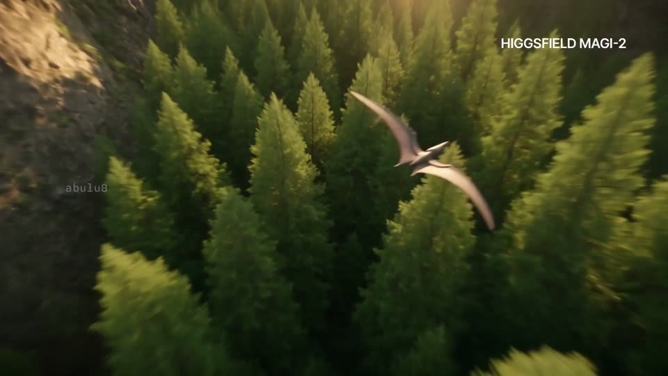

<!-- Generated by scripts/build_readme.py. Edit site.config.json, content/prompts.json, and generator scripts. -->

<a id="case-cms-4c951e7f"></a>

# 无人机飞越恐龙世界

[← Back to collection](../../README.md)

**Origin**: `community` · **Task**: `T2V` · **Audio**: `Yes` · **Status**: `Source-linked`

One single CONTINUOUS FPV drone shot, no cuts, one unbroken take. EXTREME real-time speed, relentless. Only ever moves forward in…

<a href="https://awesome.raphael.app/materials/cfcee1cd-4760-48e2-8e5d-47bf3dd7b572.mp4"></a>

▶ **[Watch audio-enabled MP4](https://awesome.raphael.app/materials/cfcee1cd-4760-48e2-8e5d-47bf3dd7b572.mp4)**

**Full Prompt**

```text
One single CONTINUOUS FPV drone shot, no cuts, one unbroken take. EXTREME real-time speed, relentless. Only ever moves forward in time — never loops or reverses. NO slow motion except one half-second beat at the reveal, then an instant snap back to full velocity. THE CLIP DOES NOT END IN AN ESCAPE OR EXIT, and there is no fade or cut to black — the take simply runs continuously until time runs out, still inside the chaos.

CINEMATIC CAPTURE: shot as real FPV drone footage on a cinema camera — ultra-wide FPV lens (12–16mm) with subtle barrel distortion at the frame edges, 180-degree shutter with natural heavy motion blur on fast pans, shallow organic depth of field close to the creatures, fine 35mm film grain, subtle chromatic aberration, real lens flares through the canopy gaps, mud flecks briefly contaminating the lens, humid haze softening the deep forest. Early golden-hour light — low sun shafting through the redwood canopy in broken beams. Cinematic color grade: rich jungle greens and warm earth tones, gold highlights only in the sun shafts, lifted blacks, documentary contrast — the texture of a BBC prehistoric-wildlife documentary shot from a racing drone, NOT a game engine, NOT animation.

The flight launches already diving steeply from high above a fern-choked prehistoric canyon at full speed — no calm start — a flight of leathery pterosaurs wheeling far below over the canopy. It punches down through the canopy in a hard vertical breach, bursting through startled flocks of small darting birds that scatter off the branches, banking a full 90° to thread between redwood trunks at ground level, dragonflies flicking through the light shafts. The forest opens into a muddy floodplain where the <<<image_2>>> Thunder-Herd erupts alongside in full charge; the camera corkscrews low between their charging bodies, skimming mud, small scurrying creatures bolting from the herd's path into the ferns. Ahead, the tree line EXPLODES as <<<image_1>>> the Tyrannosaur bursts through at a hard lateral angle, jaws opening wide toward the lens — the single slow-motion beat, teeth and saliva frozen, the herd scattering, every bird in the canopy lifting off at once in a single panicked cloud. Keep <<<image_1>>> design locked through the motion. Then a HARD snap back to full speed: the jaws SNAP SHUT on one fleeing beast from <<<image_2>>>, and the camera commits fully to the kill — whipping into a tight orbiting arc around <<<image_1>>> at point-blank range as it wrenches and thrashes its catch, mud and dust flung with every violent movement. The camera dives beneath the swinging it, arcs up and over the massive head as it rips into the carcass — pterosaurs already circling high above the kill — swoops in close on the jaws tearing and gulping, pulls back for one wide orbit showing the rest of <<<image_2>>> still stampeding past in panic on both sides, then plunges back in tight as <<<image_1>>> lifts its bloodied head and lets out a thunderous roar RIGHT AT the lens, the camera holding close and defiant in the swirling dust and debris, still shaking and whipping around the violence as the take runs out.

Sound: a layered wall of primal chaos over a living jungle bed — insect drone, layered birdsong, distant hoots — wind roaring and pitching with every dive, thundering stampede hooves, deep guttural roars building — the birdsong CUTTING to dead silence the instant before the tree line explodes — near-silence for one held breath at the reveal — then a massive concussive ROAR and bone-crunching SNAP as the jaws close, the entire canopy erupting in shrieking, scattering wingbeats, and from there SUSTAINED, ESCALATING violence: wet tearing and crunching, guttural feeding growls, panicked herd bellows, pterosaur screeches circling above, building to one final earth-shaking ROAR right as the clip ends. No wind-down.

Global style lock: cinematic photoreal FPV documentary footage, consistent creature design from the references maintained through all motion; real cinema-camera texture with film grain, lens distortion, motion blur and lens contamination, golden jungle grade; constantly shifting altitude and plane, the camera staying locked inside the kill's violence for the entire back half with no escape beat and no fade or cut to black; consistently extraordinary render quality, no distortion artifacts, no subtitles, no watermarks. Aspect ratio 16:9.
```

| Parameter | Value |
| --- | --- |
| Model | MAGI-2 (flagship) |
| Task type | t2v |
| Duration / FPS | 30.3s · 30 fps |
| Resolution / Ratio | 1080p · 16:9 |
| Audio mode | music (audio=True) |

[Original source](https://x.com/abulu8/status/2125373412910747712) · Creator: [@abulu8](https://x.com/abulu8) · 2026-11-24

> MAGI-2 为作者自述，未经独立核实。

**[Generate similar on Raphael →](https://raphael.app/ai-video-generator?utm_source=github&utm_medium=repository&utm_campaign=magi_2_launch&utm_content=case_cms-4c951e7f&utm_term=en)**
