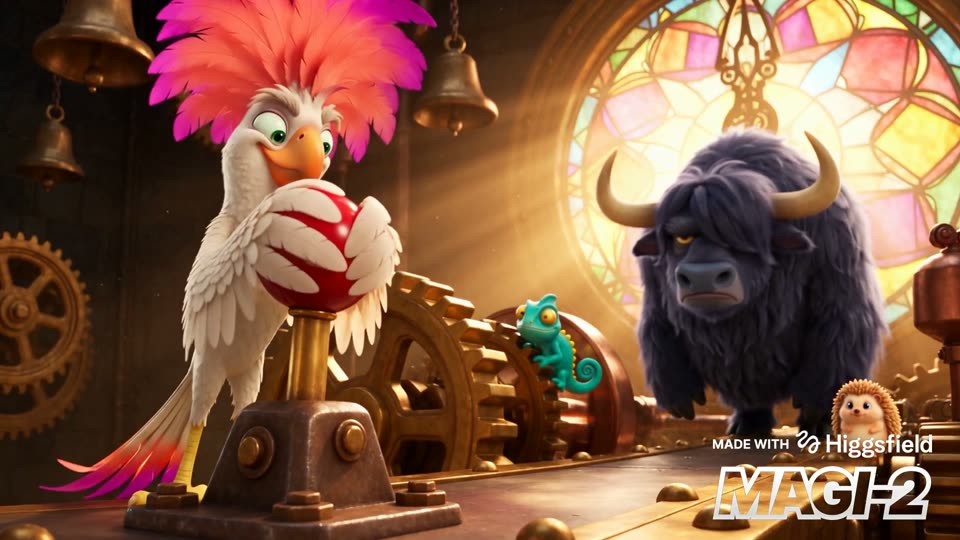

<!-- Generated by scripts/build_readme.py. Edit site.config.json, content/prompts.json, and generator scripts. -->

<a id="case-cms-4d664d0b"></a>

# 牦牛与刺猬的钟楼闹剧

[← 返回合集](../../README.zh-CN.md)

**来源类型**: `community` · **任务**: `T2V` · **音画**: `Yes` · **状态**: `来源收录`

社区 MAGI-2 视频案例（@sebatheepan）：牦牛与刺猬的钟楼闹剧。

<a href="https://awesome.raphael.app/materials/e2ae5a24-05ab-42c2-9fad-dba6bacdb0e8.mp4"></a>

▶ **[播放有声视频原片](https://awesome.raphael.app/materials/e2ae5a24-05ab-42c2-9fad-dba6bacdb0e8.mp4)**

**完整原始提示词**

```text
# global_caption

core_caption:一段时长30秒、皮克斯与照明娱乐风格的3D动画喜剧冒险视频，由4个镜头组成：珊瑚粉冲天冠翠绿眼橙嘴的高瘦白鹦鹉、弯象牙角刘海遮眼的庞大蓬松炭蓝牦牛、金橙大凸眼黄背脊卷尾的胖绿松石变色龙与蓝宝石大眼柔和肉桂尖刺的迷你奶白小刺猬，在阳光透洒的巨型卡通蒸汽朋克黄铜钟楼内引发齿轮缠绕闹剧，从拉下亮红操纵杆与巨型指针勾角升空演变为倒挂卷尾戏耍螺母，最终由小刺猬滚轨撞响金锣将全员弹落天鹅绒软垫收尾。
format_and_structure:30秒，16:9，实时自然运动。4个镜头，在7.0秒、14.0秒和22.0秒处硬切衔接。
narrative_and_emotional_design:金色钟楼平静骤然转为亢奋拉杆闹剧，加速齿轮带起黄铜指针把冷面牦牛吊上高空，变色龙在飞转齿轮间倒挂弹舌戏耍螺母，镇定小刺猬顺弧形黄铜轨滚下撞响金锣将全员安全弹回天鹅绒软垫；情绪由夸张卡通表情、挤压拉伸动作、金色光柱与奇趣发条管弦喜剧配乐传递。
visual_design:院线级3D计算机动画，细腻呈现抛光金黄铜齿轮、锻造铜铃、拉扣酒红天鹅绒、亮泽绿松石鳞片、蓬松羽毛、厚实炭蓝长毛与透光彩绘玻璃；温暖黄金蒸汽朋克色调以蜂蜜铜色和金色微尘衬托绿松石、炭蓝与猩红点缀；倾斜金色阳光穿透彩色玻璃圆钟面投下丁达尔光束、锐利暖轮廓光与柔和琥珀补光；35mm广角大景与50mm表情近景交替并保持深景深；空气中飘浮闪烁微尘与金色声波光环。
audio_design:持续黄铜钟楼内部环境音，含深沉规律滴答、温暖铜鸣、平顺齿轮运转声与远处铜铃轻颤；清脆卡通拟音涵盖厚重拉杆咔嗒、加速齿轮哗啦、弯角挂针磕碰、弹力卷尾与长舌弹响、黄铜轨顺滑滚动、金锣浑厚共鸣与天鹅绒软垫噗咚声，辅以滑稽无台词嘎叫、叹息与咯咯笑声；奇趣发条管弦喜剧配乐含钢片琴、木鱼、巴松管、拨弦提琴、钟琴与温暖铜管；无对白。

continuity_requirements:Image 1锁定ref_chameleon，Image 2锁定ref_hedgehog，Image 3锁定ref_yak，Image 4锁定ref_cockatoo，每个镜头外观一致 | 钟楼内部垂直空间地理保持连贯，从底层黄铜走道与中层齿轮群上接彩色玻璃圆钟面，再沿弧形黄铜滑轨通往悬挂金锣与天鹅绒软垫 | 角色相对体型比例严格锁定（牦牛最高最宽、鹦鹉高瘦约为牦牛身高的82%、变色龙圆胖约为牦牛身高的45%、小刺猬极迷你约为牦牛身高的20%），道具保持造型 | 彩色玻璃圆钟面、齿轮、操纵杆与金锣仅保留纯粹几何彩玻镶片与装饰辐条，无数字、无字母、无可读文字、无徽标且无人类元素 | 弯角、刘海、珊瑚羽冠、螺旋卷尾、尖刺与黄铜道具在每次动作与切镜中保持准确形态，无瞬移或替换

# reference_bank

## reference_bank1

reference_identifier:ref_chameleon
reference_type:character
label:变色龙
role:爱表现的戏剧化惹祸精，拥有弹力长粉舌和弹簧卷尾。Image 1控制面部、金橙色凸起转眼、绿松石鳞片、黄色背脊与卷曲尾巴；忽略其灰色摄影棚背景。
description:金橙大凸眼黄背脊卷尾的胖绿松石变色龙
appearance_or_design:胖乎乎的双足直立3D亮绿松石色变色龙，覆满细腻圆润亮泽鳞片与浅水蓝条纹腹甲，头顶弯曲绿松石冠，背脊排列一排明黄圆润脊突，巨大凸起的金橙色转眼配深色瞳孔，咧着得意搞怪抿嘴笑，三趾足配紧紧盘卷的螺旋绿松石尾巴，外观如Image 1所示。

## reference_bank2

reference_identifier:ref_hedgehog
reference_type:character
label:小刺猬
role:镇定无畏的迷你小萌宠，受惊时会缩成弹跳蒲公英刺球。Image 2控制面部、蓝宝石大眼、奶白桃色肚皮、肉桂金尖刺与迷你体型；忽略其灰色摄影棚背景。
description:蓝宝石大眼柔和肉桂尖刺的迷你奶白小刺猬
appearance_or_design:极其圆润如小蛋般的迷你3D小刺猬，踩着娇小桃色短脚直立，鼓鼓粉颊、口鼻与圆肚皮覆着柔和奶白桃色细毛，头背环绕蓬松柔和的肉桂金与蜂蜜棕圆头尖刺光环，超大闪亮深蓝宝石圆眼、深棕小亮圆鼻、圆润小耳与贴在胸前的桃色小爪，外观如Image 2所示。

## reference_bank3

reference_identifier:ref_yak
reference_type:character
label:高原牦牛
role:沉重冷面的愁眉苦脸担当，靠庞大体重与弯角承接所有闹剧。Image 3控制面部、遮住单眼的蓬松刘海、单只琥珀愁眉眼、弯曲象牙角与深炭蓝长毛；忽略其灰色摄影棚背景。
description:弯象牙角刘海遮眼的庞大蓬松炭蓝牦牛
appearance_or_design:高大魁梧的方正双足3D高原牦牛，全身垂落层次蓬松的深炭蓝灰色长毛，厚重斜刘海遮住左眼，浓眉下露出单只半眯不爽的金琥珀色眼睛，头顶伸出两根粗壮上翘的暖象牙白弯角，宽阔灰蓝愁眉口鼻、深色蹄掌大手、粗短蹄腿与簇毛尾巴，外观如Image 3所示。

## reference_bank4

reference_identifier:ref_cockatoo
reference_type:character
label:葵花鹦鹉
role:亢奋搞怪的混乱制造者，珊瑚粉冠羽一炸就扑腾闯祸。Image 4控制面部、珊瑚粉紫红冲天冠羽、翠绿眼睛、橙色弯嘴、洁白羽毛与高瘦体型；忽略其灰色摄影棚背景。
description:珊瑚粉冲天冠翠绿眼橙嘴的高瘦白鹦鹉
appearance_or_design:高挑瘦长的双足直立3D雪白葵花鹦鹉，全身覆满蓬松雕塑感白羽，头顶炸开夸张高耸的电光珊瑚粉与品红尖刺羽冠，瞪着狂热翠绿大眼与调皮羽眉，厚实弯翘的亮橘橙大嘴咧开搞怪大笑，灵动羽翼手臂、尾羽末端泛珊瑚品红，配明黄细长鸟腿与爪，外观如Image 4所示。

## reference_bank5

reference_identifier:ref_red_lever
reference_type:object
label:亮红黄铜操纵杆
role:总控调速拉杆，一拉即令全塔齿轮骤然加速。
description:配抛光黄铜握柄的超大亮猩红操纵杆
appearance_or_design:厚实卡通机械拉杆，顶装亮泽猩红珐琅圆球，连着弧形抛光黄铜杆臂固定在铆接青铜底座上。

## reference_bank6

reference_identifier:ref_brass_clock_hand
reference_type:object
label:巨型黄铜指针
role:扫动华丽黄铜指针，箭头尖端勾住牦牛双角平稳拉升。
description:带箭头尖端的华丽巨大金黄铜钟表指针
appearance_or_design:巨型抛光金黄铜钟表指针，长柄镂空雕花配宽阔斜切箭头尖端，在透光彩绘玻璃前平稳扫动。

## reference_bank7

reference_identifier:ref_golden_gong
reference_type:object
label:悬挂金锣与天鹅绒软垫
role:共鸣金锣与厚实软垫组合，一记声浪圆满收束闹剧。
description:垂挂于厚实酒红天鹅绒敲钟人软垫上方的巨大锻造金鸣锣
appearance_or_design:超大圆形锻造金黄铜共鸣大锣，由编织绯红绳悬吊于巨大拉扣酒红天鹅绒软垫上方，垫角缀满金色流苏。

## reference_bank8

reference_identifier:ref_clock_tower
reference_type:setting
label:巨型蒸汽朋克黄铜钟楼
role:阳光充盈的卡通蒸汽朋克机械钟楼，内含齿轮、铜铃、滑轨与彩绘玻璃钟面。
description:布满巨大咬合金色齿轮、弧形黄铜滑轨、悬挂铜铃与巨型彩色玻璃圆钟面的卡通蒸汽朋克黄铜钟楼
appearance_or_design:前景铆接黄铜走道、光亮弧形滑轨与咬合金色齿轮；中景高耸青铜轴杆、轻晃挂铃、金色微尘与天鹅绒着陆台；背景巨型彩色玻璃圆钟窗，由几何琥珀、红宝石与蓝宝石玻璃镶片与装饰黄铜辐条拼成，午后阳光倾泻其间。

# shot_timeline

## shot_timeline1

shot_identifier:shot_01_lever_gear_surge
time_range_seconds:0.0 | 7.0
scene_reference_identifier:ref_clock_tower
shot_caption:在布满巨大咬合金色齿轮、弧形黄铜滑轨、悬挂铜铃与巨型彩色玻璃圆钟面的卡通蒸汽朋克黄铜钟楼内，珊瑚粉冲天冠翠绿眼橙嘴的高瘦白鹦鹉炸开羽冠拉下配抛光黄铜握柄的超大亮猩红操纵杆；巨型齿轮伴随铜铃响动骤然加速，带箭头尖端的华丽巨大金黄铜钟表指针勾住弯象牙角刘海遮眼的庞大蓬松炭蓝牦牛双角，将其平稳吊向高空，牦牛满脸冷面难以置信，金橙大凸眼黄背脊卷尾的胖绿松石变色龙与蓝宝石大眼柔和肉桂尖刺的迷你奶白小刺猬在齿轮边注视，牦牛平稳升空直至切镜。
camera_lighting_and_composition:左前方低角度中全景，35mm焦段感配深景深；0.0秒至2.4秒平稳缓推聚焦拉杆底座，白鹦鹉居左、牦牛居右背衬发光彩色玻璃圆钟面，3.8秒至6.2秒流畅摇臂上仰追踪巨型指针将牦牛托入金色光柱，6.3秒至7.0秒稳停在50mm中景聚焦牦牛冷面愁眉；浓郁琥珀阳光逆光照亮飞舞微尘、象牙角与珊瑚羽冠。
motion_and_physical_logic:0.4秒时巨大金色齿轮在暖光柱间缓转，变色龙倚在铜辐条上，小刺猬稳坐圆铆钉观望。1.1秒时白鹦鹉兴奋炸开珊瑚粉羽冠握住猩红拉杆。2.2秒时白鹦鹉以挤压拉伸把拉杆一拉到底，所有咬合黄铜齿轮瞬间提速，头顶铜铃摇曳闪光。3.8秒时巨型黄铜指针掠过走道，箭头尖端精准卡进牦牛双只象牙弯角之间。4.6秒至6.3秒指针将沉重牦牛平稳吊离地面，牦牛抱起大蹄臂满脸冷面难以置信，6.3秒至7.0秒保持稳健上升姿态。
reference_identifiers:ref_chameleon | ref_hedgehog | ref_yak | ref_cockatoo | ref_red_lever | ref_brass_clock_hand | ref_clock_tower
audio_event_identifiers:audio_clockwork_bed | audio_score_main | audio_shot01_lever_hoist

## shot_timeline2

shot_identifier:shot_02_chameleon_tail_swing
time_range_seconds:7.0 | 14.0
scene_reference_identifier:ref_clock_tower
shot_caption:切至穿梭飞转金色齿轮间的中层全景，带箭头尖端的华丽巨大金黄铜钟表指针载着弯象牙角刘海遮眼的庞大蓬松炭蓝牦牛沿透光彩绘玻璃继续平稳升高；下方金橙大凸眼黄背脊卷尾的胖绿松石变色龙从旋转齿轮弹起，用卷尾倒挂在黄铜横轴上弹出粉舌扑抓漂浮黄铜螺母，珊瑚粉冲天冠翠绿眼橙嘴的高瘦白鹦鹉扑腾着笨拙掠过，变色龙得意倒挂定格直至切镜。
camera_lighting_and_composition:右前方平视全景穿梭在高耸咬合齿轮群中，35mm焦段感配深景深；7.0秒至12.8秒流畅斜向摇臂围绕前景中央倒挂摇摆的变色龙滑动，同时让冷面牦牛在上方发光彩绘玻璃前平稳攀升，13.3秒至14.0秒稳停在变色龙得意倒挂高点；金色光束在飞转铜齿、亮绿松石鳞片与黄铜螺母上闪耀高光。
motion_and_physical_logic:7.2秒至13.5秒巨型指针载着牦牛沿彩色玻璃光轮稳步升高，牦牛深蓝刘海微拂，单只琥珀眼无奈下望。7.7秒时变色龙蹬离疾转齿轮空翻，将螺旋绿松石尾巴牢牢绕在上方黄铜横轴上如钟摆般倒挂摇荡。9.2秒时三颗发亮六角黄铜螺母从震颤轮齿弹飞浮入金色光柱。9.6秒至11.4秒倒挂的变色龙咧嘴大笑，左右连弹长粉舌扑抓浮飞螺母。11.6秒时白鹦鹉炸着珊瑚羽冠慌乱扑翅掠过中景，推得变色龙荡出更大欢快弧线。13.3秒至14.0秒变色龙在最高点短暂悬停得意坏笑。
reference_identifiers:ref_chameleon | ref_yak | ref_cockatoo | ref_brass_clock_hand | ref_clock_tower
audio_event_identifiers:audio_clockwork_bed | audio_score_main | audio_shot02_tail_swing

## shot_timeline3

shot_identifier:shot_03_hedgehog_rail_gong
time_range_seconds:14.0 | 22.0
scene_reference_identifier:ref_clock_tower
shot_caption:切至紧贴光亮弧形黄铜滑轨的畅快低角度跟拍；蓝宝石大眼柔和肉桂尖刺的迷你奶白小刺猬蜷成弹跳刺球顺俯冲滑轨疾滚，冲出轨端正中垂挂于厚实酒红天鹅绒敲钟人软垫上方的巨大锻造金鸣锣；浑厚金色声浪在光柱中向上扩散，震松载着弯象牙角刘海遮眼的庞大蓬松炭蓝牦牛的带箭头尖端的华丽巨大金黄铜钟表指针，并震散上方倒挂的金橙大凸眼黄背脊卷尾的胖绿松石变色龙与扑腾的珊瑚粉冲天冠翠绿眼橙嘴的高瘦白鹦鹉，晶莹扩散声浪定格直至切镜。
camera_lighting_and_composition:左侧面贴近弧形黄铜轨的低角度中全景，35mm焦段感配深景深；14.2秒至20.6秒畅快俯冲跟移，紧贴翻滚刺球压过两道黄铜弯道直冲右三分之一的悬挂金锣，20.7秒至22.0秒利落微拉展现半透明金色声波光环向上席卷牦牛、变色龙与白鹦鹉；金色轮廓光勾亮旋转肉桂尖刺与弯曲黄铜轨。
motion_and_physical_logic:14.4秒时小刺猬在上层滑轨入口平静眨眼，利落蜷成圆润弹跳肉桂金刺球。15.2秒至19.0秒刺球顺抛光弧形黄铜轨丝滑疾滚，压弯掠过两道大弧弯与轻响铜摆、飞转齿轮。19.2秒时滑轨末端上扬，将刺球沿金色光束弹射向巨大锻造金鸣锣。20.4秒时小刺球正中金锣圆心，轻巧回弹并荡出一圈清晰的半透明金色声波光环穿过飞舞微尘。20.8秒至21.4秒璀璨声浪向上漫卷，轻巧震脱指针上的牦牛、松开变色龙卷尾并惊飞上空白鹦鹉，21.4秒至22.0秒金色声环稳稳悬停。
reference_identifiers:ref_chameleon | ref_hedgehog | ref_yak | ref_cockatoo | ref_brass_clock_hand | ref_golden_gong | ref_clock_tower
audio_event_identifiers:audio_clockwork_bed | audio_score_main | audio_shot03_rail_gong_wave

## shot_timeline4

shot_identifier:shot_04_velvet_cushion_landing
time_range_seconds:22.0 | 30.0
scene_reference_identifier:ref_clock_tower
shot_caption:切至聚焦垂挂于厚实酒红天鹅绒敲钟人软垫上方的巨大锻造金鸣锣的温暖金色全景，璀璨声浪将全员平稳托离带箭头尖端的华丽巨大金黄铜钟表指针并干净弹落柔软软垫；弯象牙角刘海遮眼的庞大蓬松炭蓝牦牛深陷拉扣天鹅绒中央，金橙大凸眼黄背脊卷尾的胖绿松石变色龙落在牦牛肩头用鼻尖顶稳亮黄铜螺母，珊瑚粉冲天冠翠绿眼橙嘴的高瘦白鹦鹉轻扑落稳牦牛双角之间，蓝宝石大眼柔和肉桂尖刺的迷你奶白小刺猬优雅展开落稳牦牛膝头，最后1.0秒完全静止定格。
camera_lighting_and_composition:左前方平视全景，35mm焦段感配深景深；22.0秒至26.6秒在微颤金锣正下方的拉扣酒红天鹅绒软垫前稳健构图迎接四位伙伴依次弹落就位，26.7秒至29.0秒温暖缓拉展现身后安详缓转的钟楼机械与发光彩色玻璃圆钟面，29.0秒至30.0秒完全静止；浓郁蜜金色阳光为四位伙伴镀上暖轮廓光，衬出饱满酒红天鹅绒质感。
motion_and_physical_logic:22.6秒时牦牛脱离黄铜指针稳稳落正微颤金锣下方的厚实天鹅绒软垫中央，柔软深陷并轻柔回弹，四角金流苏轻摆。23.9秒时变色龙弹落牦牛宽阔左肩，顽皮用绿松石鼻尖接稳一颗落下的亮黄铜螺母。25.0秒时白鹦鹉轻盈扑落卡进牦牛双只象牙弯角间，珊瑚羽冠开心轻晃。26.1秒时小刺猬自金锣边弹落，在半空优雅展开稳坐牦牛膝头。27.0秒至28.9秒身后巨型齿轮咔嗒恢复悠然慢速滴答，变色龙咧嘴笑，白鹦鹉咯咯轻晃，小刺猬淡定眨眼，牦牛长舒冷面叹息惬意靠进软垫，29.0秒至30.0秒温暖皮克斯合照静止定格。
reference_identifiers:ref_chameleon | ref_hedgehog | ref_yak | ref_cockatoo | ref_brass_clock_hand | ref_golden_gong | ref_clock_tower
audio_event_identifiers:audio_clockwork_bed | audio_score_main | audio_shot04_velvet_bounce

# audio_event_timeline

## audio_event_timeline1

audio_event_identifier:audio_clockwork_bed
event_type:ambient
time_range_seconds:0.0 | 30.0
source_reference_identifier:ref_clock_tower
audio_caption:巨型黄铜钟楼温暖共鸣环境音，含沉稳钟摆滴答、平顺齿轮运转声、柔和铜铃微颤与宽广木石回声。
synchronization_note:从0.0秒至30.0秒持续铺底的钟楼环境音，在shot_01_lever_gear_surge的2.2秒拉杆后提速，在shot_02_chameleon_tail_swing与shot_03_hedgehog_rail_gong保持清脆运转，并于shot_04_velvet_cushion_landing的27.0秒舒缓回安详慢滴答。

## audio_event_timeline2

audio_event_identifier:audio_score_main
event_type:music
time_range_seconds:0.0 | 30.0
audio_caption:皮克斯风格奇趣发条管弦喜剧配乐，融合晶莹钢片琴、清脆木鱼、拨弦提琴、俏皮巴松管、钟琴跑句与温暖舒心收尾和弦。
synchronization_note:从0.0秒至30.0秒紧扣喜剧节拍，2.2秒跃入倍速，7.7秒至13.5秒轻快摇摆，15.2秒至20.4秒随滚轨俯冲，并于27.0秒至30.0秒绽放温暖光辉尾声。

## audio_event_timeline3

audio_event_identifier:audio_shot01_lever_hoist
event_type:sound effect
time_range_seconds:1.1 | 6.4
source_reference_identifier:ref_red_lever
audio_caption:兴奋冠羽炸开轻噗、顽皮鹦鹉咯咯笑、厚重拉杆咔嗒巨响、齿轮骤然提速与铜铃叮当、弯角勾针清脆磕响，以及牦牛低沉冷面闷哼。
synchronization_note:在shot_01_lever_gear_surge中卡准1.1秒ref_cockatoo炸冠、2.2秒拉下ref_red_lever、2.5秒齿轮加速、3.8秒ref_brass_clock_hand勾住ref_yak双角与至6.4秒的平稳升空。

## audio_event_timeline4

audio_event_identifier:audio_shot02_tail_swing
event_type:foley
time_range_seconds:7.7 | 13.5
source_reference_identifier:ref_chameleon
audio_caption:弹力卷尾起跳啵响、尾巴缠绕铜轴嗖声、黄铜螺母清脆叮当、顽皮粉舌弹射啪响，以及慌乱白鹦鹉掠飞呼呼声。
synchronization_note:在shot_02_chameleon_tail_swing中对齐7.7秒ref_chameleon弹跳倒挂、9.2秒螺母弹跳、9.6秒至11.4秒连弹长舌与11.6秒ref_cockatoo笨拙掠飞。

## audio_event_timeline5

audio_event_identifier:audio_shot03_rail_gong_wave
event_type:sound effect
time_range_seconds:14.4 | 21.6
source_reference_identifier:ref_golden_gong
audio_caption:轻柔卷球嗖声、顺弧形黄铜轨加速滚行滑响、轨端跃起呼声、浑厚璀璨锻造金锣正中巨鸣与泛音，以及上方机械震颤声。
synchronization_note:在shot_03_hedgehog_rail_gong中对齐14.4秒ref_hedgehog卷球、15.2秒至19.0秒滚轨、19.2秒飞跃、20.4秒撞响ref_golden_gong与至21.6秒的金色声浪扩散。

## audio_event_timeline6

audio_event_identifier:audio_shot04_velvet_bounce
event_type:foley
time_range_seconds:22.6 | 29.0
source_reference_identifier:ref_golden_gong
audio_caption:牦牛落入天鹅绒软垫的蓬松噗咚弹响、变色龙落肩轻响配螺母微叮、白鹦鹉扑落弯角与咯咯笑、小刺猬惬意吱叫，以及牦牛满足的长长冷面叹息。
synchronization_note:在shot_04_velvet_cushion_landing中紧贴22.6秒ref_yak深陷软垫、23.9秒ref_chameleon落肩、25.0秒ref_cockatoo落角、26.1秒ref_hedgehog落膝与至29.0秒的惬意舒气。

generation_requirements:Image 1锁定ref_chameleon，Image 2锁定ref_hedgehog，Image 3锁定ref_yak，Image 4锁定ref_cockatoo | 剪辑次数：3，分别在7.0秒、14.0秒与22.0秒；精准时长30.0秒 | 对白台词数：0。语言：无（仅限无台词卡通动物拟声）。音乐：奇趣发条管弦喜剧配乐。画面可见文字数量：0 | 皮克斯与照明娱乐3D动画喜剧风格，金色蒸汽朋克阳光光柱，流畅挤压拉伸物理表现 | 画面外排除项：口语台词、字幕、画面文字、钟面数字、罗马数字、字母、徽标、水印、人类元素、重复角色、突兀瞬移
```

| 参数 | 配置 |
| --- | --- |
| 模型 | MAGI-2 (flagship) |
| 任务类型 | t2v |
| 时长 / 帧率 | 28.6s · 25 fps |
| 分辨率 / 比例 | 1080p · 16:9 |
| 音频模式 | mixed (audio=True) |

[原始来源](https://x.com/sebatheepan/status/2125915609288335391) · 作者: [@sebatheepan](https://x.com/sebatheepan) · 2026-11-26

> MAGI-2 为作者自述，未经独立核实。

**[在 Raphael 上生成同类视频 →](https://raphael.app/ai-video-generator?utm_source=github&utm_medium=repository&utm_campaign=magi_2_launch&utm_content=case_cms-4d664d0b&utm_term=zh-CN)**
