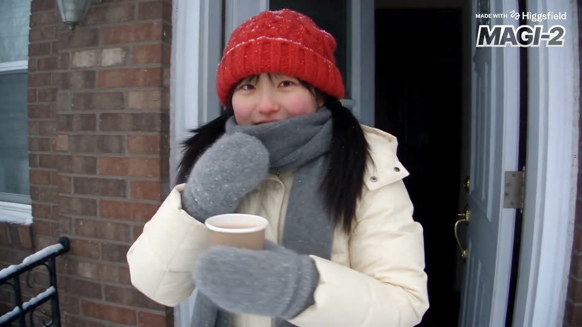

<!-- Generated by scripts/build_readme.py. Edit site.config.json, content/prompts.json, and generator scripts. -->

<a id="case-cms-5378ef28"></a>

# 红帽女孩的冬日录像

[← Back to collection](../../README.md)

**Origin**: `community` · **Task**: `T2V` · **Audio**: `Yes` · **Status**: `Source-linked`

Create a 30-second, 1080p ultra-realistic personal home-video of a naturally pretty young Korean woman in her early 20s, with stra…

<a href="https://awesome.raphael.app/materials/494b4521-bbc3-494d-94f6-ac360d8b7c70.mp4"></a>

▶ **[Watch audio-enabled MP4](https://awesome.raphael.app/materials/494b4521-bbc3-494d-94f6-ac360d8b7c70.mp4)**

**Full Prompt**

```text
Create a 30-second, 1080p ultra-realistic personal home-video of a naturally pretty young Korean woman in her early 20s, with straight black hair in two loose low pigtails, wearing a thick red knit beanie, a cream puffer jacket, a gray wool scarf, dark jeans, and brown winter boots. She carries a paper cup of hot cocoa.

Start immediately with her stepping out of her front door into fresh snowfall. She pulls her scarf up, turns to the camera, smiles, and says, "It snowed overnight!" She walks down a quiet residential street, boots crunching in untouched snow. Partway down, she glances at the person holding the camera, laughs, and says, "Stop filming me, it's so early!" She holds her cocoa toward the lens like a toast.

She stops at a parked car, wipes snow off the side mirror with her glove, and writes a small heart on the frosted window. Then she pauses. For about three seconds she stands still, looking up at the falling snow, breath steaming, a soft smile on her face, with only quiet ambience. The camera lingers on her.

She scoops a handful of snow, packs it into a ball, and tosses it at a bare tree. It misses, and she pouts at the camera. She tries again and hits the trunk, and a clump of snow drops from a branch onto her head. She shrieks, shakes it off, laughs, and says, "Okay, I deserved that!"

As she turns back toward home, she notices a single small red mitten sitting on a fence post. She picks it up, looks at it, then at the camera, and says, "Wait... whose is this?" She sets it back carefully on the post.

Finally, at her gate, she turns to the camera with red cheeks and a runny nose, sniffs, waves, and says, "Okay, see you! Bye!" She goes inside, and the recording abruptly cuts to black.

**Visual style:** Raw early-2000s handheld DV camcorder footage, soft overcast winter morning light, slightly overexposed snow, imperfect framing, camera shake, autofocus hunting on falling snowflakes, faded cool-toned colors, mild digital noise, a brief fogged lens when she steps outside, and realistic movements.

**Audio:** Muffled snowy neighborhood ambience, soft wind, crunching footsteps, a distant dog barking, a faint camera-holder chuckle off-screen, and perfectly synchronized casual English dialogue. No background music.

Maintain identical facial features, clothing, hairstyle, and body proportions throughout. Keep every interaction and object physically realistic.
```

| Parameter | Value |
| --- | --- |
| Model | MAGI-2 (flagship) |
| Task type | t2v |
| Duration / FPS | 30.2s · 60 fps |
| Resolution / Ratio | 1080p · 16:9 |
| Audio mode | mixed (audio=True) |

[Original source](https://x.com/Ciri_ai/status/2125844812167569730) · Creator: [@Ciri_ai](https://x.com/Ciri_ai) · 2026-11-26

> 作者自述使用 MAGI-2，未经独立核实。

**[Generate similar on Raphael →](https://raphael.app/ai-video-generator?utm_source=github&utm_medium=repository&utm_campaign=magi_2_launch&utm_content=case_cms-5378ef28&utm_term=en)**
