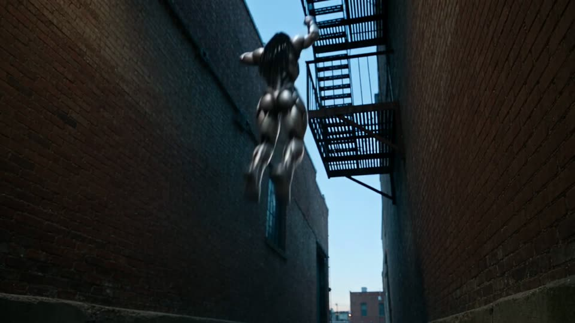

<!-- Generated by scripts/build_readme.py. Edit site.config.json, content/prompts.json, and generator scripts. -->

<a id="case-cms-6ca34618"></a>

# 蓝调时刻的城市追逐

[← 返回合集](../../README.zh-CN.md)

**来源类型**: `community` · **任务**: `T2V` · **音画**: `Yes` · **状态**: `来源收录`

社区 MAGI-2 视频案例（@TanLuAI）：蓝调时刻的城市追逐。

<a href="https://awesome.raphael.app/materials/0e541a92-2a50-4c56-aa13-cf1034f1c94d.mp4"></a>

▶ **[播放有声视频原片](https://awesome.raphael.app/materials/0e541a92-2a50-4c56-aa13-cf1034f1c94d.mp4)**

**完整原始提示词**

```text
【影片类型与时长】
制作一支30秒、16:9横屏、真人实拍质感的现代都市追逐短片。
故事发生在美国东海岸大城市的旧工业街区，时间是日落后的蓝调时刻。天边还留着最后一层微弱暖光，街道与建筑已经进入偏冷的夜色。
一名穿着中式灰绿色古装、手持传统弓的成年女子（射箭女），正在追赶一名全身银色金属装甲的成年女子（钢甲女）。钢甲女在前方奔逃，依靠装甲腿部的力量直接从街面跳上建筑高处；射箭女没有这种力量，只能射出带牵引索的箭矢，被绳索拉上高楼，继续追赶。两人在楼顶与行驶中的货运列车之间一路追逐。最后，射箭女从楼上一路跳落到街面，落地后立刻拉弓射出一箭，钢甲女在箭即将命中时猛地回头，一把将箭攥在金属手掌中。
古装弓手与银色金属装甲人物形成强烈的视觉反差，又与现代美国街区自然共处。片中不解释两人的来历，也不交代射箭女追赶钢甲女的原因。
全片有明确的速度与情绪递进：开场已经处于追逐中；钢甲女一跃上楼展示力量差距；射箭与牵引段突出动作准确和身体受力；楼顶跃向列车形成第一次高潮；射箭女从楼上跳落到街面，紧接着一箭射出，钢甲女回头空手接箭，形成最后一拍的对峙。结尾不解释接下来会发生什么，不用文字交代剧情。

【整体视觉风格】
现代美国动作惊悚电影摄影，硬朗、紧凑，有真实的重量和空间压迫感。所有人物、街道、车辆、建筑与列车均保持真人实拍质感，不出现游戏过场动画感、塑料皮肤、漫画速度线或漂浮失重的动作。钢甲女的装甲是真实可触摸的拉丝金属材质，有划痕、接缝、螺丝和使用磨损，不像CG玩具或镜面塑料。
环境色以冷钢蓝、石墨灰、深棕砖色和低饱和墨绿构成。路灯、店铺窗光与列车上的小型灯具提供局部偏脏的暖黄色，冷暖光源具有明确来源。钢甲女的银色装甲反射这些冷暖光源，在暗处只留下沿边缘的高光线条。不使用大面积鲜艳霓虹，不将整座城市处理成赛博朋克。
射箭女肤色自然，奔跑后轻微泛红，额角与颈侧的汗水只在掠过光源时短暂反光。
街面略湿，像是傍晚下过小雨，现已停雨。沥青有零碎反光，轮胎驶过带起少量水汽，不出现持续暴雨。局部通风口吐出薄蒸汽，不用浓雾遮住动作。画面清晰，暗部保留砖墙、衣物与金属纹理。
采用24fps电影运动质感，快速运动保留适度动态模糊。跟拍有经过控制的肩扛呼吸感，冲击发生时允许短促震动，但不能持续剧烈摇晃到看不清人。关键动作先交代空间，再跟随人物完成。

【城市环境与追逐路线】
场景是虚构的美国旧工业城区，融合红砖仓库、旧式公寓、钢制外置消防梯、楼顶通风设备与街边小商店。道路两侧停有轿车、厢式货车和垃圾清运车辆，街口有英文交通牌、红色消防栓、金属灯杆与褪色斑马线。
整条追逐路线在空间上连接：
两人沿街道奔跑，转入旧仓库外侧的狭窄装卸通道；仓库外墙高处有钢制检修平台，平台连接楼顶。建筑背面紧邻一条高架货运支线，列车沿楼体侧后方经过。楼顶高于列车车顶几米，落点是下方经过的封闭货车车顶，不是从摩天楼垂直坠落。
列车前方贴着另一栋三层旧公寓楼经过，公寓楼顶与车顶高度接近，楼的临街一面挂着之字形钢制外置消防梯，一直通到街面。最后的对峙发生在这栋楼前方的湿润街面上。
通过短暂宽景提前展示这些位置，让观众理解街头、检修平台、楼顶、列车、公寓楼顶与街面的关系。
铁路为无架空电线的工业货运支线，列车以适中的速度通过城区。车顶没有乘客，没有连续密集的障碍物。所有高度、间距与速度保持一致，按动作电影的虚构特技尺度呈现。

【射箭女外貌、发型与服装——以参考图射箭女.png为准】
射箭女为成年女性，面貌严格参考图片，保留眉眼结构、眼形、鼻梁、唇形与面部轮廓，颧骨附近保留参考图中一道浅浅的细小擦痕。目光锐利、专注，随追逐过程表现出判断、咬牙坚持、疲惫与最后瞄准时的冷静，不能全程保持固定表情。
保留参考图额头中央细长、低饱和灰青色的纹样。纹样位置、形状与颜色全片一致，不发光、不变化。
发型保持参考图中的古风半束长发：头顶部分束起，配小型金属发饰，其余黑色长发自然垂落，发间夹着几缕细长的浅灰色发带与细编发。不要改成现代高马尾或短发。奔跑、牵引和跳跃时，长发与发带产生连续的惯性摆动，不遮住整张脸，也不缠住弓弦和绳索。
服装严格延续参考图可见部分的样式、配色与材质：灰绿色偏深的古装交领外袍，领口与肩部具有层叠结构，内搭颜色更深的交领衣。布料为哑光、略粗粝、有厚度的织物，袖子宽松，袖口内层贴近手腕，保留深色腕部包覆。肩部、衣领和袖子都有真实的折叠、缝线与穿着痕迹。
参考图未显示的下半身，按同一服装体系延续为灰绿色长袍下摆、深色束腰、深色长裤和哑光深色布面靴。袍摆长度接近脚踝，两侧留有便于奔跑的开衩，动作中可露出内层长裤。
不将衣服改成现代机能外套、运动上衣、紧身皮衣、战术裤或现代作战服。古装轮廓从开场到结尾保持一致。布料在奔跑时被腿部带动，牵引时受风向后扬起，落地时随惯性折叠回落，具有真实重量。衣摆不无限延长、不像烟雾漂浮，也不穿过栏杆或列车车顶。

【弓箭与牵引装备】
射箭女使用参考图中的传统弓：深色弓身、古朴轮廓、局部缠绕握把，不使用现代复合弓滑轮或科幻结构。尺寸与她的身形匹配，能完成奔跑、拉弓与背负动作。
背侧固定一只窄箭袋，装着少量普通箭矢和一支尾部连着绳索的牵引箭。牵引箭尾部连接一根纤细但可辨识的深色绳索，绳索另一端连接藏在束腰侧面的紧凑收索装置，承重结构隐藏在外袍内，外部只露出必要的低调金属部件，不破坏古装整体轮廓。
牵引动作必须明确表现为：箭矢先飞向建筑高处，箭头固定，绳索由松到紧，腰部开始承重，人物随后被牵引上升。上升受力来自腰部装备，不能让绳索连接在脖子、头发或持弓手腕上。收索装置通过短促机械声与人物受力表现工作，没有喷气、魔法粒子或能量光效。
弓在攀爬与跳跃时固定于背侧，最后一幕重新取下。弓、箭袋、腰侧装置在所有镜头中保持存在，不凭空消失。最后射向钢甲女的是一支普通箭，不带绳索。

【钢甲女外貌与装甲——以参考图mage.png为准】
钢甲女为成年女性，身材高挑健硕，全身覆盖银色拉丝金属装甲：肩部是厚重的圆形肩甲，胸甲由弧形板块拼合，腰腹、手臂与腿部是分段的金属甲片，甲片之间露出深色的机械关节、液压杆与线缆；双手是分节的金属手套，脚上是厚底金属靴。装甲颜色从头到尾是同一种冷银色，不变成金色、红色或黑色。
她的头发是很多条又长又粗的黑色脏辫，从头顶贴头皮编起，一直垂到背部中段，部分脏辫上套着银色金属发环。奔跑和跳跃时，沉重的脏辫成束甩动，发环互相碰撞。
她的下半张脸戴着银色金属面罩，面罩两侧有细密的网孔，只露出眉眼：眉形锋利，眼神冷静，带着一点不耐烦和挑衅。全片不摘下面罩，不露出嘴部。
她的力量来自装甲腿部：起跳前膝部与小腿的液压杆明显压缩，蹬地时脚下的沥青或钢板被踩出凹痕，落地时发出沉重的金属撞击声。装甲上没有推进器、喷口或火焰，全片不出现任何喷火、喷气、尾焰、发光能量或飞行。她只是跳得极高极远，每一次起跳和落地都有明确的发力和重量。
她动作利落有压迫感，跑动时步伐沉重，地面有轻微震动，路边的金属物件跟着颤一下。她偶尔回头看射箭女一眼，像在确认对方还跟得上。

【摄影与声音原则】
奔跑段主要使用28mm至35mm焦段，跟随人物与环境运动；瞄准、回头与接箭使用50mm至85mm近景；钢甲女起跳、楼顶与列车的空间关系使用24mm至35mm宽景。
镜头保持连续运动方向，两人主要追逐方向在宽景中维持从画面左侧向右侧，钢甲女始终在前，射箭女始终在后。
全片无背景音乐、无旋律、无旁白、无对白。仅使用城市交通、脚步、喘息、衣料、弓弦、绳索、收索机械、金属装甲关节、金属落地撞击、列车轮轨、风声与最后接箭时金属手掌攥住箭杆的一声脆响。声音随空间距离变化，不把所有镜头铺满同样响度的轰鸣。

【00:00—00:04：已经在追逐中】
第一帧直接进入射箭女奔跑中的正面中近景，不先拍城市空镜，不给站立准备动作。
摄影机在她前方快速后退，镜头高度略低于视线。她的面部、层叠交领、灰绿色衣袖和摆动的手臂占据主要画面。她呼吸急促但有控制，目光死死锁定前方。路灯和店铺窗光从脸上掠过，半束黑色长发与浅灰发带在身后摆动。她左手握弓，弓身贴近身体一侧。
反打35mm宽景，从射箭女身后越肩看向前方：十几米外，钢甲女沉重的银色身影在湿街上奔跑，脏辫在背后甩动，每一步落地都踩出水花，金属靴底敲响沥青。她撞开一只挡路的金属垃圾桶，垃圾桶翻滚到路边。
射箭女侧身穿过停靠厢式货车与灯杆之间的空隙，右手短暂撑住车身借势转向，袍摆甩向外侧，鞋底踩过小片积水。
声音为两种截然不同的脚步：射箭女轻快的布靴声与钢甲女沉重的金属落地声，加上喘息、衣料摩擦与垃圾桶翻滚声。

【00:04—00:08：钢甲女一跃上楼，射箭女射出牵引箭】
24mm低机位宽景，钢甲女冲进旧仓库外侧的装卸通道，在墙根下猛地屈膝下蹲，腿部液压杆明显压缩，脚下的钢板被踩得一沉。她向上蹬地，整个人直接跳起五六米，一只金属手抓住高处钢制检修平台的栏杆，借力翻身落上平台，平台被她砸得一晃，掉下几片铁锈。全程没有喷火，没有推进器，只有纯粹的腿部力量。
她站在平台上低头瞥了射箭女一眼，转身走向楼顶。
射箭女追到墙根，由奔跑转为滑步停住，袍摆因惯性继续向前摆动。她抬头看平台，没有任何犹豫，从背后箭袋抽出牵引箭搭上弓。
切侧前方近景，她左臂举弓，右手拉弦，衣袖滑向前臂露出深色腕部包覆。拉弓姿态、发型和服装接近参考图，但背景是现代工业街区。她短暂停住呼吸，松弦射出，箭矢带着绳索离开画面。
切高处短近景，箭头钉进平台外沿的金属横梁，发出清脆撞击声。绳索有一瞬自然弧垂，随后绷紧。切回腰侧，隐藏在束腰旁的装置开始承重，她的腰部被向斜上方一拽，身体收紧。

【00:08—00:12：沿建筑外墙被牵引上升】
24mm至28mm低机位宽景，同时保留射箭女、牵引线和高处平台，清楚建立上升路径。
收索装置启动，射箭女离地，沿绷紧绳索向斜上方移动。腰部先受力，上身与双腿略滞后，随后屈膝收腿稳定姿态。灰绿色袍摆、长发与发带向下后方扬起，布料保持重量。
靠近外墙时，一只靴底短暂踩住砖墙，将身体推离凸出的窗沿，具有明确的压缩与反弹，不表现成在墙上无限奔跑。摄影机沿楼体向上跟随，保持全身可见，街道、消防梯与窗户向下移动，形成真实高度变化。
弓在上升初段被固定到背侧。到达平台时，她右手先抓住栏杆横梁，左手跟进支撑，抬膝越过边缘，翻入平台。脚踩稳后，绳索失去张力，她解除连接，立刻转身冲向楼顶，追着钢甲女的金属脚步声。
这一段和上一段形成对比：钢甲女一跳就上去，射箭女要靠箭和绳索费力地上去。
声音为短促机械低鸣、绳索摩擦、风吹衣料、蹬墙闷响与落在金属平台上的脚步。

【00:12—00:17：从楼顶跃向行驶的列车】
先用一秒宽景交代位置：仓库楼顶，下方偏右，一列封闭式货运列车沿高架支线驶过，车顶低于楼顶几米。钢甲女已经跑到楼沿，没有减速，双腿液压一压，直接跃出，重重落在一节车厢顶上，车顶金属板被砸出一个浅坑，她单膝跪地稳住，随即站起向列车前方走去。
35mm后侧跟拍，射箭女穿过楼顶通风设备之间的空隙，最后两步加快，盯着移动的车顶。她不在边缘停下摆姿势，在连续助跑中踏上楼沿，蹬地跃出。
摄影机从楼沿侧面跟随弧线，同一镜头保留她离开楼顶、短暂腾空与落向车顶的过程。她身体向前展开，双腿收拢，背上的弓与箭袋固定，黑色长发、浅灰发带和灰绿色袍摆向后扬起。腾空短促，不长时间悬浮，列车始终沿同一方向行驶。
落地时两脚先接触车顶，膝盖深屈，通过前臂与肩部承接惯性，完成一次紧凑的侧前滚翻，单膝着地，一手撑住金属表面，抬头看向前方几节车厢外的钢甲女。
声音为楼顶脚步、渐近列车轰鸣、迎面风声、钢甲女沉重的金属落地巨响、射箭女落地的闷响和一次受冲击后的呼气。

【00:17—00:21：列车上的追逐】
低角度侧前方跟拍，射箭女从单膝姿态站起，压低重心沿车顶向前快速移动。前方，钢甲女在车厢之间大步跨越，每一步都踩得车顶轻颤，脏辫在迎面风里成束甩向后方。
背景砖墙、桥梁与灯光平行滑过。射箭女的头发和袍摆受到迎面风力，身体随车顶振动做细小调整。
短暂宽景提前展示前方那栋三层旧公寓楼：楼顶与车顶高度接近，临街一面挂着之字形钢制消防梯，一直通到下面的湿街。
钢甲女先到，一跃落上公寓楼顶，又毫不停顿地从楼顶另一侧直接跳下，整个人消失在楼沿下方，片刻后传来一声沉重的金属落地巨响。射箭女紧随其后，踏稳、跃离车顶，落上公寓楼顶，惯性带着她向前连跑两步才稳住，列车从她身后继续驶过。

【00:21—00:25：射箭女从楼上跳到楼下】
射箭女冲到公寓楼的临街楼沿，低头往下看。50mm俯拍越肩镜头：街面上，钢甲女刚从落地的半蹲中站起，脚下的沥青被砸出一圈裂纹，她背对楼房，正大步走向街道远处。
射箭女没有犹豫。24mm侧面宽景，同一镜头里她从楼沿跳下，先落在三楼消防梯平台上屈膝缓冲，钢板一震；紧接着翻过栏杆再往下跳，落到二楼平台；最后一手抓住消防梯最下方的横杆短暂下垂，松手落到街面，屈膝落地顺势一个前滚翻卸力，袍摆和长发随滚翻扬起又落下。整个下落过程是三段真实的跳跃和缓冲，不是一次性从高处平稳飘落。
滚翻结束时，她已经单膝跪在湿街上，顺手从背后取下弓。
声音为消防梯钢板两次被踩响、栏杆的金属震颤、布料猎猎声、落地闷响与滚翻擦过湿地面的声音。

【00:25—00:30：一箭射出，钢甲女回头接住】
35mm低机位侧面镜头，射箭女单膝跪地，从箭袋抽出一支普通箭搭弦，抬弓、拉满，动作一气呵成，弓弦绷紧到发出细微的吱声。她的脸靠近弓弦，额间纹样与眼神在路灯下清晰可见，呼吸停住。
切她的50mm正面近景，眼神冷静而专注，松弦，箭矢射出。
切到钢甲女背后的中景，箭矢从画面后方飞入，直指钢甲女的后背。就在箭尖距离她只有一臂远的瞬间，钢甲女猛地回身，上身一扭，脏辫被甩起一圈，右手金属手套横着一抓，啪地一声把箭杆死死攥在掌心。箭尾的羽毛还在颤动，箭尖停在她的面罩前方不到一掌的地方。
85mm近景，钢甲女握着箭，金属手指慢慢收紧，箭杆被捏出一道细裂。面罩上方，她的眼睛微微眯起，目光越过箭杆看向远处的射箭女，眼神里带着一点意外，也带着挑衅。
最后切回宽景：湿街上，射箭女单膝跪地举弓，钢甲女站在十几米外握着那支箭，两人隔着路灯与薄蒸汽对峙，谁都没动。画面在这一刻自然结束，不定格，不揭示后续。
声音为弓弦释放的嗡响、箭矢破空声、金属手套攥住箭杆的脆响、装甲关节转动的细微机械声，以及之后几乎完全安静的街道、远处列车残响与一滴水落进水洼的声音。没有音乐，没有呐喊。

【动作与连续性约束】
射箭女全片保持参考图的面貌、额间灰青纹样、半束黑色长发、金属发饰、浅灰发带与灰绿色层叠古装。服装不变成现代装束，不突然更换颜色或材质。
钢甲女全片保持参考图的银色金属装甲、黑色长脏辫与金属发环、银色网孔面罩。装甲不变色、不变形、不发光，面罩始终戴着。
弓、箭袋与隐藏式牵引装备连续存在。射出牵引箭之后，弓固定在背侧，双手用于攀爬和落地支撑；最后一幕才重新取下弓射出普通箭。长发、衣袖、袍摆与装备之间不穿模、不缠绕。
力量差距必须清楚：钢甲女每次上下高处都是直接跳跃，射箭女上楼必须靠牵引箭，下楼靠消防梯平台分段跳落和滚翻缓冲。
钢甲女全程没有喷火、喷气、推进器、尾焰或飞行，所有跳跃都由腿部发力完成，落地有重量和冲击。
街头到检修平台、平台到楼顶、楼顶到列车、列车到公寓楼顶、公寓楼顶经消防梯到街面，均有明确空间衔接。列车在助跑、腾空、落地全过程持续行驶。
全片只有射箭女和钢甲女两个主要人物，没有其他追赶者，不分身、不复制。
无魔法光效、御剑、瞬移、游戏感、血腥伤害或性化镜头。全片以空间清晰、身体重量和现场声音制造紧张感，不添加背景音乐、旁白或字幕

补生成的提示词：
【整体】
10秒，16:9横屏，真人实拍质感的美国动作惊悚电影。美国东海岸旧工业街区，日落后的蓝调时刻，天边残留一线微弱暖光，冷钢蓝天色，红砖仓库与旧公寓，路灯与窗光是偏脏的暖黄色。24fps电影运动质感，快速运动有适度动态模糊，跟拍有受控的肩扛呼吸感，不剧烈摇晃。两人始终在画面中清晰可见、比例足够大，追逐方向保持从画面左侧向右侧，钢甲女在前，射箭女在后。全片只有这两个人物，不分身、不复制。无音乐、无对白、无字幕。

【00:00—00:03：车顶上的追逐】
低角度侧前方跟拍，一列封闭式红褐色货运列车在高架货运支线上以适中速度行驶。射箭女从单膝姿态站起，压低重心沿车顶向前快速移动，背上的弓与箭袋固定。前方几节车厢外，钢甲女在车厢之间大步跨越，每一步都踩得车顶轻颤，金属靴底重重砸在车顶钢板上，脏辫在迎面风里成束甩向后方，金属发环互相碰撞。
背景砖墙、桥梁与路灯平行向后滑过。射箭女的长发、浅灰发带和灰绿色袍摆受到迎面风力向后扬起，布料有真实重量；她的身体随车顶振动做细小调整，咬牙盯着前方的钢甲女。

【00:03—00:05：前方的公寓楼】
短暂宽景，从列车侧面提前展示前方那栋三层红砖旧公寓楼：楼体紧贴铁轨，楼顶与车顶高度接近，只隔一步宽的缝隙；楼的临街一面挂着之字形钢制外置消防梯，一层层一直通到下面湿润反光的街面。列车正载着两人驶近这栋楼。

【00:05—00:08：钢甲女先上楼、再跳下】
侧面中景跟拍，人物占画面足够大。钢甲女先到，没有减速，装甲腿部液压杆明显一压，一步跃上公寓楼顶，脚下的楼顶被踩出凹痕；落地毫不停顿，大步冲过楼顶，到达另一侧的临街楼沿，直接纵身跳下，整个人消失在楼沿下方。片刻后，楼下传来一声沉重的金属落地巨响。
钢甲女全程只靠腿部力量，没有喷火、喷气、推进器、尾焰、光效或飞行。

【00:08—00:10：射箭女紧随其后】
射箭女紧随其后，在车顶边缘踏稳，蹬地跃离车顶，跨过缝隙落上公寓楼顶，屈膝缓冲，惯性带着她向前连跑两步才稳住，一手撑住楼顶矮墙。货运列车从她身后继续驶过。她抬头看向钢甲女消失的临街楼沿，胸口起伏，眼神锐利。

【连续性约束】
动作顺序必须清楚：钢甲女先上楼、先跳下；射箭女后上楼，停在楼顶。射箭女的面容、额间纹样、发型与灰绿古装全片一致，弓与箭袋始终在背上；钢甲女的银色装甲、脏辫与面罩全片一致，面罩始终戴着。列车始终沿同一方向行驶。所有跳跃都有真实发力、腾空短促、落地有重量，不漂浮、不瞬移，无游戏感和魔法光效。

【声音】
列车轮轨轰鸣、迎面风声、射箭女急促的布靴脚步与喘息、衣料猎猎声、钢甲女沉重的金属脚步与发环碰撞声、她跳下后从楼下传来的一声金属落地巨响、射箭女落上楼顶的闷响。声音随距离变化。
```

| 参数 | 配置 |
| --- | --- |
| 模型 | MAGI-2 (flagship) |
| 任务类型 | t2v |
| 时长 / 帧率 | 29.4s · 30 fps |
| 分辨率 / 比例 | 1080p · 16:9 |
| 音频模式 | mixed (audio=True) |

[原始来源](https://x.com/TanLuAI/status/2126222812625182914) · 作者: [@TanLuAI](https://x.com/TanLuAI) · 2026-11-27

> MAGI-2 为作者自述，未经独立核实。 提示词见同一作者的回复 https://x.com/TanLuAI/status/2126222821755895903。原回复同时提供主片提示词及补生成片段提示词。

**[在 Raphael 上生成同类视频 →](https://raphael.app/ai-video-generator?utm_source=github&utm_medium=repository&utm_campaign=magi_2_launch&utm_content=case_cms-6ca34618&utm_term=zh-CN)**
