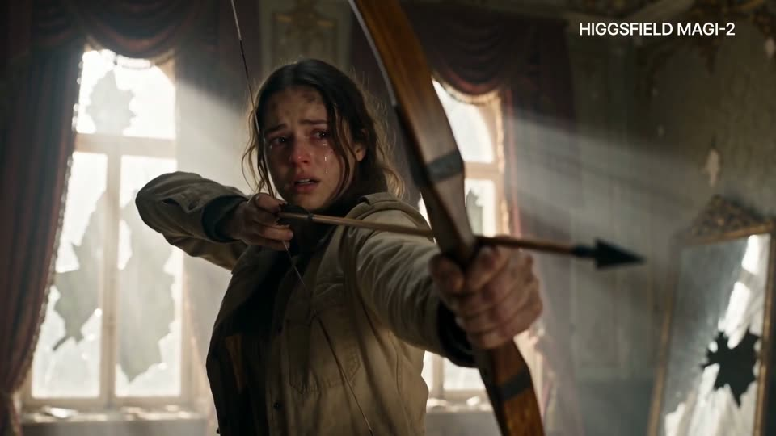

<!-- Generated by scripts/build_readme.py. Edit site.config.json, content/prompts.json, and generator scripts. -->

<a id="case-cms-6f1b1086"></a>

# 放下弓的重逢

[← Back to collection](../../README.md)

**Origin**: `community` · **Task**: `T2V` · **Audio**: `Yes` · **Status**: `Source-linked`

Create an ultra-realistic, emotional, cinematic multi-shot sequence with hard cuts between shots. Maintain perfect character consi…

<a href="https://awesome.raphael.app/materials/0a94138a-ce7f-4a86-b5d6-55ae3b7c7dc0.mp4"></a>

▶ **[Watch audio-enabled MP4](https://awesome.raphael.app/materials/0a94138a-ce7f-4a86-b5d6-55ae3b7c7dc0.mp4)**

**Full Prompt**

```text
Create an ultra-realistic, emotional, cinematic multi-shot sequence with hard cuts between shots. Maintain perfect character consistency throughout. No background music or score — only natural diegetic sound.

SHOT 1

A young woman in her mid-20s, with messy dark brown hair, warm brown eyes, a dusty beige jacket, dark trousers and worn boots, stands inside an abandoned ornate mansion. She holds a traditional wooden bow with an arrow drawn, aiming toward someone standing in the shadows. Her face is exhausted, covered in dirt and tears. Her hands tremble. Just as she prepares to release the arrow, she notices something and slowly lowers her bow, visibly shocked and heartbroken.

SHOT 2

Over her shoulder, a wounded young man in his late 20s sits against a broken marble pillar on the debris-covered floor. His clothes are torn, his face is bruised, and blood stains his shirt. He looks weak and barely conscious. Their eyes meet. He tries to smile despite his injuries.

SHOT 3

She slowly approaches him, places the bow and arrow on the floor, kneels beside him and gently touches his face. Tears roll down her cheeks. He raises his trembling hand and wipes one of her tears. She smiles through her sadness and embraces him tightly.

SHOT 4

Extreme close-up of their hands holding each other on the dusty marble floor. A single tear falls onto their joined hands. Hold for a moment before a hard cut.

HARD CUT / TRANSFORMATION

SHOT 5

Same camera angle and composition, but now inside a beautiful sunlit garden surrounded by flowering trees. The man's hand is now healthy, clean and gently holding hers. Both are wearing elegant, clean casual outfits. Warm afternoon sunlight illuminates their hands.

SHOT 6

Wide shot of the peaceful garden. The same couple walks slowly along a flower-lined pathway, smiling and looking into each other's eyes. The woman gently rests her head against his shoulder. He wraps his arm around her.

SHOT 7

Close-up of their faces. They stop walking, look into each other's eyes, smile emotionally and slowly lean toward each other.

SHOT 8 — FINAL KISS

A beautiful cinematic medium close-up as the couple gently kisses. She places both hands on his cheeks while he wraps his arms around her waist. Their kiss feels intimate, emotional and genuine. The camera slowly moves around them as sunlight filters through the trees. End with them embracing, smiling and resting their foreheads together.

CHARACTER CONSISTENCY

Same woman throughout: dark brown messy hair in the mansion, warm brown eyes, beige jacket, dark trousers and brown boots. Same facial features and body proportions after transformation.

Same man throughout: late 20s, short dark hair, light stubble, warm brown eyes and identical facial features. Injured and exhausted in the mansion, completely healthy after transformation.

MANSION ENVIRONMENT

Abandoned ornate mansion, tall arched windows, torn dark-red curtains, peeling wallpaper, shattered mirrors, broken furniture, marble pillars, dust particles and dramatic sunlight beams.

GARDEN ENVIRONMENT

Beautiful romantic garden, flowering trees, lush green grass, stone pathway, soft golden sunlight, gentle breeze and warm late-afternoon atmosphere.

VISUAL STYLE

Ultra-realistic, photorealistic, natural human movement, realistic facial expressions, emotional storytelling, handheld camera, shallow depth of field, ARRI Alexa 35 cinematic look, warm cinematic colour grading, subtle film grain.

AUDIO

ONLY natural breathing, footsteps, clothing movement, wind, birds chirping and subtle environmental sounds. Include realistic kissing and embrace sounds. ABSOLUTELY NO BACKGROUND MUSIC OR MUSICAL SCORE.
```

| Parameter | Value |
| --- | --- |
| Model | MAGI-2 (flagship) |
| Task type | t2v |
| Duration / FPS | 30.3s · 30 fps |
| Resolution / Ratio | 1080p · 16:9 |
| Audio mode | music (audio=True) |

[Original source](https://x.com/AIwithkhan/status/2125640284830835088) · Creator: [@AIwithkhan](https://x.com/AIwithkhan) · 2026-11-25

> 模型 MAGI-2 为作者自述，未经独立核实。

**[Generate similar on Raphael →](https://raphael.app/ai-video-generator?utm_source=github&utm_medium=repository&utm_campaign=magi_2_launch&utm_content=case_cms-6f1b1086&utm_term=en)**
