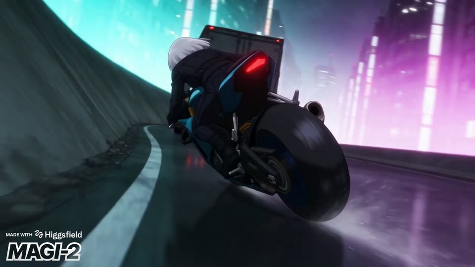

<!-- Generated by scripts/build_readme.py. Edit site.config.json, content/prompts.json, and generator scripts. -->

<a id="case-cms-71c121de"></a>

# 新东京高架上的摩托追逐

[← Back to collection](../../README.md)

**Origin**: `community` · **Task**: `T2V` · **Audio**: `Yes` · **Status**: `Source-linked`

Community MAGI-2 video case (@yachimat_manga): 新东京高架上的摩托追逐.

<a href="https://awesome.raphael.app/materials/deef9581-1583-452f-b7cb-8a78085e6372.mp4"></a>

▶ **[Watch audio-enabled MP4](https://awesome.raphael.app/materials/deef9581-1583-452f-b7cb-8a78085e6372.mp4)**

**Full Prompt**

```text
Keep the exact art style, line art, colours, muted sepia-and-lavender palette and lighting of the start frame; same character, same outfit, same world. Beautiful anime compositing: soft diffusion bloom on the highlights, thin light rays, drifting dust and tiny sparkles catching the light, shallow depth of field with round bokeh, a slight handheld drift. Flat hand-drawn 2D anime, not 3D, not photoreal. No text, no logo, no watermark, no extra people.。

参考<画像1>は主人公の人物設定。成人女性、銀白色の短いボブ、長い前髪が右目の一部へ自然に重なる。左右とも灰緑色の瞳が前髪の隙間から見え、目元は素肌と銀髪だけで構成する。黒いハイネックのライディングウェア、暗い下衣、黒い脚衣とブーツを全鏡頭で保つ。画像内のベージュ背景、設定画レイアウト、複数の人物像、立ちポーズは映像へ持ち込まない。

参考<画像2>はバイクと舞台の設定。青黒色の重いスポーツバイク、太いタイヤ、一体型カウル、濡れたネオ東京高架高速道路、シアンとマゼンタのネオン、低い後方視点を使用する。バイク形状と色を全鏡頭で保つ。

全体の運動ルール：主人公は同じ東向き高架高速道路を止まらず走り続ける。前の動作の反動と姿勢回復が、そのまま次の動作の準備になる。バイクは横へ瞬間移動しない。スロットル、制動荷重、カウンターステア、リーン、タイヤの接地、サスペンションの沈みと反発を順番に描く。シアンの高層ビルは進行方向の左、マゼンタの縦看板は右、中央高架は正面に保ち、背景と車線を途中でリセットしない。

鏡頭1、約0.0〜2.6秒：路面40センチ、後輪の約2.5メートル後方からの低いFPV追跡。配送バンが前方で左から右へ横滑りする。主人公はスロットルを戻して前ブレーキを徐々にかけ、フォークが沈み、上体が前へ移る。バンの後方に一度だけ生まれた左側の隙間へカウンターステアし、滑らかな一つの円弧で回避する。回避の出口では反対方向へ振り返さず、車体を直立へ戻しながら加速する。カメラは後輪との距離を保って同じ円弧を追う。

鏡頭2、約2.6〜4.6秒：低い左側面の平行追跡。前の回避から車体を戻す途中で、低く折れた標識梁と散らばった小さなコンクリート片へ入る。主人公は肘を曲げ、頭部と上体をタンクに沿わせて低くする。両輪は接地したまま梁の下を通る。瓦礫を踏むたびにタイヤが潰れ、フォークが短く沈み、上体と銀髪が一拍遅れて上下する。カメラは路面と平行に走り、跳躍や浮遊を見せない。

鏡頭3、約4.6〜6.6秒：旋回外側からの斜め後方FPV追跡。ジャックナイフした大型車両の手前で主人公は小さく加速し、後輪サスペンションが沈む。左側の傾斜約20度の保守用道路へ現実的なカウンターステアから中程度のリーンで入り、両輪を斜面へ接地させたまま一つの長い円弧で大型車両を回避する。道路へ戻る際、車体の傾きと水平線が慣性を残して半拍遅れて水平へ戻る。左右へ蛇行しない。

鏡頭4、約6.6〜10.1秒：高い斜め後方の広角FPV追跡から始める。前方左のガラス張り超高層ビルが重力で道路側へ回転し、下端の巨大な鉄骨梁と路面の隙間がバイク三台分から一台分へ連続して狭くなる。カメラは倒壊全体を一瞬だけ見せた後、主人公の後方へ高度を落とし、縮む隙間へ一直線に追随する。主人公は左右へ振らず、両輪を接地させたままスロットルを開け、上体をタンクへ伏せて最小シルエットになる。

間一髪の成功を必ず時間順に描く。前輪、風防、主人公、後輪の順に梁の下を一度だけ通過する。通過中の全フレームで、銀髪・背中・バイク上端と梁の下端の間に、細く途切れないシアンの光の線を明確に残す。人物とバイクの輪郭を梁から完全に分離し、接触、擦過、火花を起こさない。後輪まで抜け切り、バイク全体が梁より前方へ完全に出て、梁との間にバイク二台分の水平距離が生まれる。そこで約0.35秒、明るく開けたネオン道路へ飛び出す姿を見せ、主人公の上体が少し起き、サスペンションが伸び、銀髪が後方へ解放される。観客が「抜けた」と確認した後、四〜六フレーム遅れて梁が主人公の背後の路面へ激突する。火花は梁と路面の衝突点だけから出る。粉塵と圧力波が背後から追い、カメラは衝撃に同期して一度だけ強く上下へ揺れる。粉塵が画面を覆った瞬間にハードカットする。同じ通過を繰り返さない。

鏡頭5、約10.1〜10.8秒：主人公の顔の短い特写。銀白色の前髪が風で後ろへ流れ、左右の灰緑色の瞳が見える。主人公は前方の停止地点を認識し、瞳を絞り、息を止め、顎を締めたあと、左肩越しにカメラへ冷たい視線を返す。カメラは顔との距離を固定し、眼差しだけを主役にする。

鏡頭6、約10.8〜15.0秒：道路中心線上、路面60センチの低い正面カメラ。カメラは主人公より前方にいて、一定速度で後退しながら、バイクが画面奥方向へ進む姿を正面から捉える。主人公が急ブレーキを開始すると、フロントフォークが深く沈み、タイヤが潰れ、上体と銀髪が遅れて前へ流れる。バイクは前進慣性を残したまま90度だけ鋭くヨーし、画面左向きの完全な側面姿勢へ入る。車体上部をカメラ側へ約40度深く傾ける。左脚は膝を伸ばし切って路面へ接地し、左ブーツが削れる。両輪はロックするが、バイクは横向きのまま画面奥へ約1.7秒滑り続ける。二本のタイヤと左ブーツから三本の独立した白煙、水煙、火花の軌跡が画面手前へ伸びる。主人公は左肩越しにカメラを見続ける。

画面中央の中距離で停止する。停止の瞬間は、タイヤ変形、フォークの底付き、車体の前下方への沈み、上体の遅れ、銀髪の遅れ、強い一回の反発、小さな収束の順に見せる。停止後も車体をすぐ直立させず、約0.55秒だけ深い傾きと視線を保持する。白煙が手前へ流れ、火花と破片が遅れて止まり、速度の余韻だけが残る。

画面：現代日本の劇場版フルカラー2Dアクションアニメ。精密な顔、銀白色のボブ、シャープな線画、深い黒、三段階のセル影、硬いシアンのリムライト、濡れた路面の反射。高速ピークだけ一〜二枚の不透明な黒・コバルト色の荒い作画スメアを使い、直後に精密な原画へ戻す。半透明の残像にしない。

音：台詞とBGMなし。電動エンジン、濡れたタイヤ、風切り音、ドローンの空気抵抗、瓦礫の接触、ビル倒壊、長いロックタイヤ音。カメラの揺れは画面内の物理衝撃と同期させる。

制約：参照するのは<画像1>と<画像2>だけ。動画の動き、動画のカメラ、動画の構図を参照しない。左右の灰緑色の瞳と自然な目元を維持し、目元へ装飾品や覆いを追加しない。主人公一人、バイク一台を維持する。バイク形状を変えない。実写、写実、3D、ゲームCG、水彩、紙質にしない。瞬間的な横移動、単調な左右反復、アーケードドリフト、垂直ウォールライド、大ジャンプ、浮遊、空中旋回をしない。背景をリセットしない。ランドマークの左右を交換しない。カメラを瞬間移動させない。ビルを静止したトンネルにしない。梁と人物・バイクを接触させない。成功確認より先に梁を路面へ落とさない。同じ通過を繰り返さない。最後を正面接近、横追跡、旋回、直立停止にしない。人物やバイクの複製、余分な手足や車輪、字幕、文字、ロゴ、水印を生成しない。
```

| Parameter | Value |
| --- | --- |
| Model | MAGI-2 (flagship) |
| Task type | t2v |
| Duration / FPS | 25.6s · 30 fps |
| Resolution / Ratio | 1080p · 16:9 |
| Audio mode | mixed (audio=True) |

[Original source](https://x.com/yachimat_manga/status/2126084218660827582) · Creator: [@yachimat_manga](https://x.com/yachimat_manga) · 2026-11-26

> MAGI-2 为作者自述，未经独立核实。

**[Generate similar on Raphael →](https://raphael.app/ai-video-generator?utm_source=github&utm_medium=repository&utm_campaign=magi_2_launch&utm_content=case_cms-71c121de&utm_term=en)**
