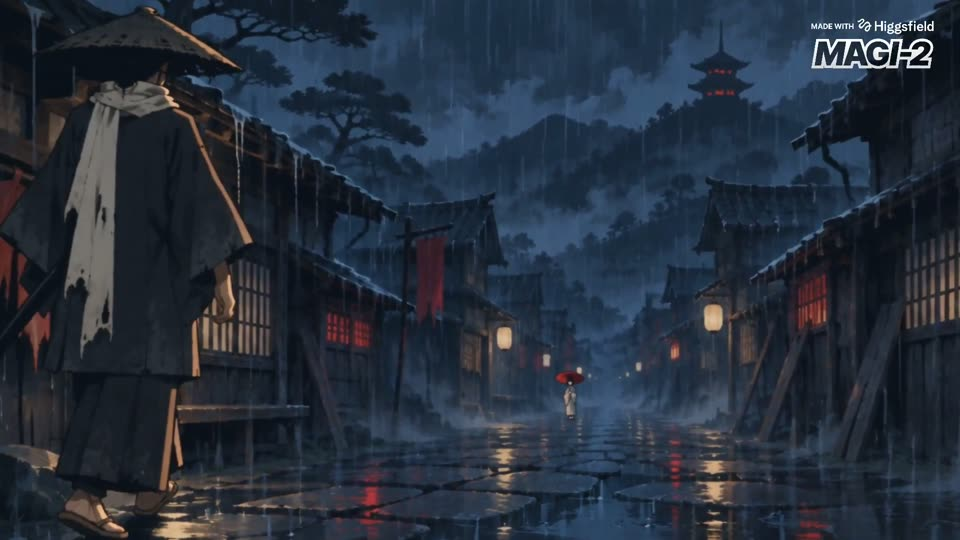

<!-- Generated by scripts/build_readme.py. Edit site.config.json, content/prompts.json, and generator scripts. -->

<a id="case-cms-81c6ef3d"></a>

# 盲剑客与红伞少女

[← Back to collection](../../README.md)

**Origin**: `community` · **Task**: `T2V` · **Audio**: `Yes` · **Status**: `Source-linked`

Create a 15-second cinematic 2D animated dark-folklore sequence featuring a blind swordsman, a mysterious girl with a crimson umbr…

<a href="https://awesome.raphael.app/materials/e9f449c4-7dbd-4581-8fcc-ebdf5556ac1c.mp4"></a>

▶ **[Watch audio-enabled MP4](https://awesome.raphael.app/materials/e9f449c4-7dbd-4581-8fcc-ebdf5556ac1c.mp4)**

**Full Prompt**

```text
Create a 15-second cinematic 2D animated dark-folklore sequence featuring a blind swordsman, a mysterious girl with a crimson umbrella, and an ancient shadow creature. Set in a rain-soaked Japanese village with hand-painted gouache textures, bold silhouettes, and a dark midnight-blue palette. The story unfolds through atmospheric camera movements, supernatural shadows, a dramatic katana strike, and an unexpected final twist. Maintain consistent characters, fluid 2D animation, and cinematic sound design throughout.
```

| Parameter | Value |
| --- | --- |
| Model | MAGI-2 (flagship) |
| Task type | t2v |
| Duration / FPS | 15.1s · 60 fps |
| Resolution / Ratio | 1080p · 16:9 |
| Audio mode | sfx (audio=True) |

[Original source](https://x.com/oggii_0/status/2125791629982437711) · Creator: [@oggii_0](https://x.com/oggii_0) · 2026-11-26

> MAGI-2 为作者自述，未经独立核实。

**[Generate similar on Raphael →](https://raphael.app/ai-video-generator?utm_source=github&utm_medium=repository&utm_campaign=magi_2_launch&utm_content=case_cms-81c6ef3d&utm_term=en)**
