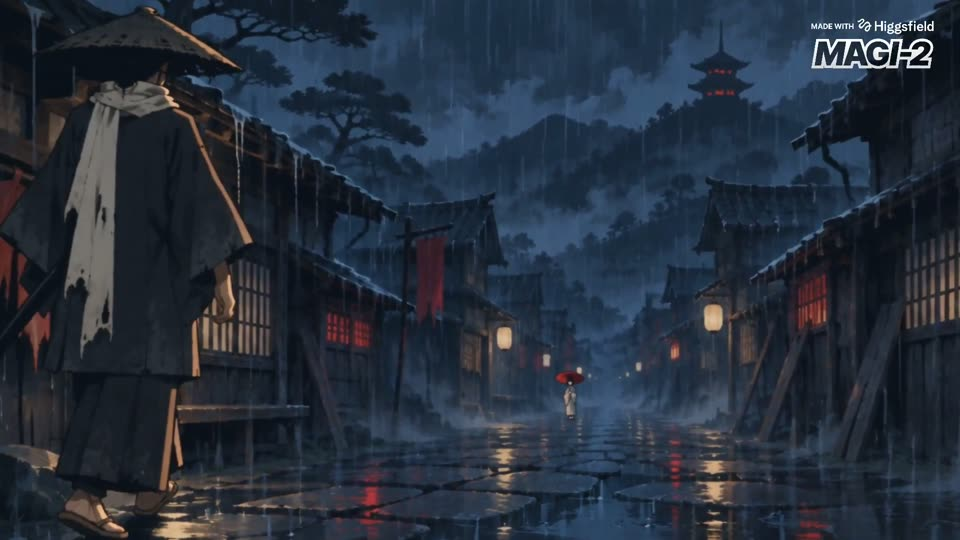

<!-- Generated by scripts/build_readme.py. Edit site.config.json, content/prompts.json, and generator scripts. -->

<a id="case-cms-81c6ef3d"></a>

# 盲剑客与红伞少女

[← 返回合集](../../README.zh-CN.md)

**来源类型**: `community` · **任务**: `T2V` · **音画**: `Yes` · **状态**: `来源收录`

社区 MAGI-2 视频案例（@oggii_0）：盲剑客与红伞少女。

<a href="https://awesome.raphael.app/materials/e9f449c4-7dbd-4581-8fcc-ebdf5556ac1c.mp4"></a>

▶ **[播放有声视频原片](https://awesome.raphael.app/materials/e9f449c4-7dbd-4581-8fcc-ebdf5556ac1c.mp4)**

**完整原始提示词**

```text
Create a 15-second cinematic 2D animated dark-folklore sequence featuring a blind swordsman, a mysterious girl with a crimson umbrella, and an ancient shadow creature. Set in a rain-soaked Japanese village with hand-painted gouache textures, bold silhouettes, and a dark midnight-blue palette. The story unfolds through atmospheric camera movements, supernatural shadows, a dramatic katana strike, and an unexpected final twist. Maintain consistent characters, fluid 2D animation, and cinematic sound design throughout.
```

| 参数 | 配置 |
| --- | --- |
| 模型 | MAGI-2 (flagship) |
| 任务类型 | t2v |
| 时长 / 帧率 | 15.1s · 60 fps |
| 分辨率 / 比例 | 1080p · 16:9 |
| 音频模式 | sfx (audio=True) |

[原始来源](https://x.com/oggii_0/status/2125791629982437711) · 作者: [@oggii_0](https://x.com/oggii_0) · 2026-11-26

> MAGI-2 为作者自述，未经独立核实。

**[在 Raphael 上生成同类视频 →](https://raphael.app/ai-video-generator?utm_source=github&utm_medium=repository&utm_campaign=magi_2_launch&utm_content=case_cms-81c6ef3d&utm_term=zh-CN)**
