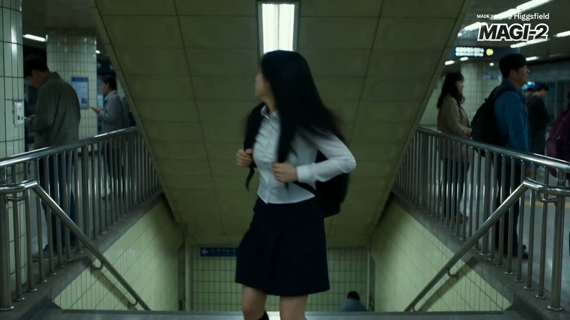

<!-- Generated by scripts/build_readme.py. Edit site.config.json, content/prompts.json, and generator scripts. -->

<a id="case-cms-830f5f4b"></a>

# 末班列车的丧尸危机

[← Back to collection](../../README.md)

**Origin**: `community` · **Task**: `T2V` · **Audio**: `Yes` · **Status**: `Source-linked`

TITLE: THE LAST TRAIN HOME. Create a 30-second ultra-realistic live-action Korean zombie-apocalypse horror sequence. The protagoni…

<a href="https://awesome.raphael.app/materials/6bc36a7a-5b24-4d40-835c-b868df74c3f6.mp4"></a>

▶ **[Watch audio-enabled MP4](https://awesome.raphael.app/materials/6bc36a7a-5b24-4d40-835c-b868df74c3f6.mp4)**

**Full Prompt**

```text
TITLE: THE LAST TRAIN HOME. Create a 30-second ultra-realistic live-action Korean zombie-apocalypse horror sequence. The protagonist is the same beautiful young adult Korean university student throughout: long straight black hair, natural Korean facial features, fitted white blouse, dark pleated skirt, black knee-high socks and casual sneakers. Preserve her exact face, hairstyle, body proportions and clothing. 00:00–00:04: Wide cinematic shot of an underground Seoul subway platform late evening. Fluorescent lights flicker, a few passengers wait silently. The girl rushes down the stairs clutching her backpack, looks behind her, terrified. A distant emergency announcement echoes. 00:04–00:08: She notices a male passenger standing motionless beside a vending machine, head tilted unnaturally, dark liquid at his mouth, fingers twitching. She steps backward. 00:08–00:12: He violently turns and charges. She screams and dodges; he crashes into the vending machine, drinks scatter, passengers flee. 00:12–00:17: A subway train arrives with metallic screech. She runs inside as terrified passengers push past. In the train window reflection, infected figures sprint down the platform. Doors close as infected passengers slam their hands against the glass. 00:17–00:22: Train moves. She collapses into a seat gasping. Across the carriage, an elderly passenger sits motionless staring at her. A child beside him points toward her backpack. 00:22–00:26: She turns. Her backpack moves by itself; scratching comes from inside. She unzips it slightly and a bloodied infected hand reaches out. She recoils. The elderly passenger raises his head, revealing completely black eyes. 00:26–00:30: Carriage lights switch off one by one. Emergency red lights illuminate her terrified face. She looks toward camera. Her nose bleeds, black veins spread from wrist toward neck, eyes turn completely black. She lunges directly toward camera. CUT TO BLACK. Native realistic audio: subway ambience, distant Korean announcements, footsteps, electrical buzzing, subway braking, door chimes, glass impacts, screams, heavy breathing, metallic rattling, infected growls, sudden silence. No background music. Photorealistic Korean zombie-horror movie, cinematic live action, practical infection makeup, detailed skin, realistic expressions and body movement, handheld camera, subway lighting, dramatic shadows, motion blur, suspenseful pacing, cinematic color grading. Negative: anime, cartoon, illustration, plastic skin, artificial CGI, excessive gore, graphic dismemberment, duplicated characters, face morphing, changing clothes, inconsistent identity, distorted anatomy, extra limbs, floating objects, impossible physics, subtitles, text, logos, watermarks.
```

| Parameter | Value |
| --- | --- |
| Model | MAGI-2 (flagship) |
| Task type | t2v |
| Duration / FPS | 30.2s · 60 fps |
| Resolution / Ratio | 1080p · 16:9 |
| Audio mode | sfx (audio=True) |

[Original source](https://x.com/oggii_0/status/2125849409078645150) · Creator: [@oggii_0](https://x.com/oggii_0) · 2026-11-26

> MAGI-2 为作者自述，未经独立核实。

**[Generate similar on Raphael →](https://raphael.app/ai-video-generator?utm_source=github&utm_medium=repository&utm_campaign=magi_2_launch&utm_content=case_cms-830f5f4b&utm_term=en)**
