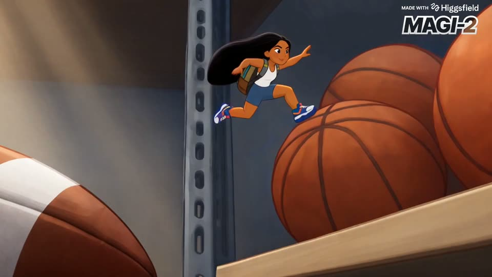

<!-- Generated by scripts/build_readme.py. Edit site.config.json, content/prompts.json, and generator scripts. -->

<a id="case-cms-8868357e"></a>

# 迷你女孩闯进体育用品店

[← 返回合集](../../README.zh-CN.md)

**来源类型**: `community` · **任务**: `T2V` · **音画**: `Yes` · **状态**: `来源收录`

社区 MAGI-2 视频案例（@john_my07）：迷你女孩闯进体育用品店。

<a href="https://awesome.raphael.app/materials/43165285-b728-4af8-aaf4-76e2513e275d.mp4"></a>

▶ **[播放有声视频原片](https://awesome.raphael.app/materials/43165285-b728-4af8-aaf4-76e2513e275d.mp4)**

**完整原始提示词**

```text
High-quality 2D animated adventure film, expressive hand-drawn characters, beautifully illustrated environments, rich colors, detailed backgrounds, fluid character animation, cinematic lighting, layered parallax, dynamic camera movements, polished animation with a premium feature-film aesthetic. Playful, energetic and full of visual surprises. 16:9 widescreen, 4K.

CHARACTER CONSISTENCY

One athletic young miniature woman, approximately 1:5 scale, with consistent facial features, hairstyle, outfit, sneakers, backpack and body proportions throughout the entire sequence. She must remain visibly tiny compared to the enormous sports equipment.

STORY – THE MINIATURE SPORTS CHALLENGE

Create a 30-second fast-paced animated adventure inside a gigantic sports equipment store.

The adventure begins when the miniature woman runs across a massive football display. She jumps onto a basketball rolling off a shelf and rides it like a moving platform, balancing with her arms stretched out. The ball suddenly bounces, launching her onto a towering pile of colorful volleyballs.

She spots an enormous cricket bat leaning against a display. Using its handle as a climbing rope, she reaches the top, slides down its curved body and lands inside a basket of oversized tennis balls. One ball suddenly launches from a nearby tennis machine, sending her flying onto a giant racket.

Next, she discovers a row of enormous running shoes. She jumps between their laces, climbs over a sneaker tongue and slides down the side of a shoe. A giant football rolls toward her, forcing her to dive through the opening of a nearby sports bag.

Emerging from the other side, she encounters a gigantic gym section. She climbs a vertical rack of dumbbells, swings from a resistance band and leaps onto a giant boxing glove. The glove compresses under her weight and springs her into the air.

She lands on a skateboard moving across the shop floor. Racing along its surface, she dodges oversized water bottles before grabbing a dangling basketball net. She swings through the air and lands on the edge of a giant basketball hoop.

FINAL SEQUENCE

She makes one final daring jump onto a towering display of colorful sports balls. After climbing to the very top, she stands triumphantly with her hands on her hips.

The camera gradually pulls back, revealing the enormous sports store, towering equipment displays, bright aisles and ordinary-sized shoppers moving around in the background. Her tiny size becomes the final visual surprise.

ENDING TITLE

"BIG DREAMS. LITTLE ADVENTURER."

Followed by:

"EVERY GAME IS A GIANT ADVENTURE."

CAMERA & ANIMATION

Dynamic 2D tracking shots, dramatic perspective shifts, expressive poses, exaggerated but believable cartoon physics, smooth squash-and-stretch, layered background movement, cinematic transitions, energetic close-ups, wide establishing shots and strong foreground parallax. Maintain consistent character design and scale in every shot.

SOUND DESIGN

Energetic adventure music, bouncing balls, squeaking sneakers, skateboard wheels, fabric movement, springy impacts, equipment clattering, rushing air and playful environmental sound effects.

NEGATIVE PROMPT

No 3D rendering, photorealism, live-action, CGI, anime styling, character duplication, inconsistent character design, outfit changes, distorted anatomy, random scene changes, floating objects, inconsistent miniature scale, static compositions, narration or subtitles.
```

| 参数 | 配置 |
| --- | --- |
| 模型 | MAGI-2 (flagship) |
| 任务类型 | t2v |
| 时长 / 帧率 | 30.3s · 30 fps |
| 分辨率 / 比例 | 1080p · 16:9 |
| 音频模式 | mixed (audio=True) |

[原始来源](https://x.com/john_my07/status/2125940546598293935) · 作者: [@john_my07](https://x.com/john_my07) · 2026-11-26

> 模型 MAGI-2 为作者自述，未经独立核实。

**[在 Raphael 上生成同类视频 →](https://raphael.app/ai-video-generator?utm_source=github&utm_medium=repository&utm_campaign=magi_2_launch&utm_content=case_cms-8868357e&utm_term=zh-CN)**
