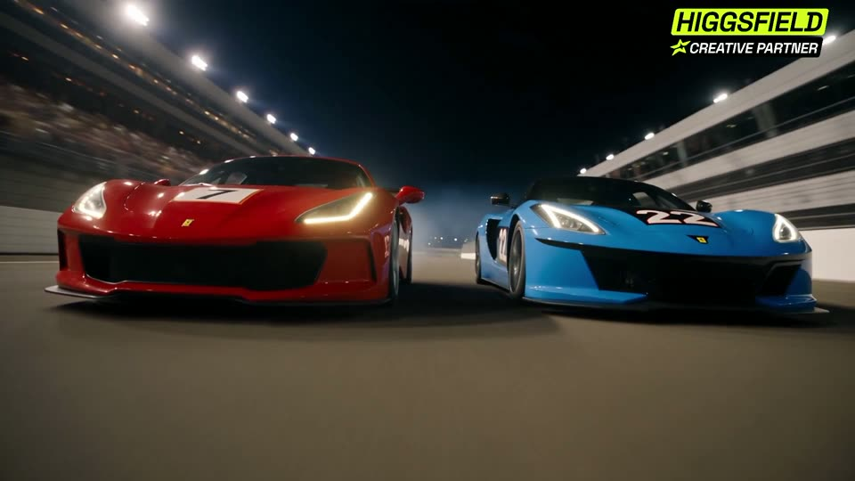

<!-- Generated by scripts/build_readme.py. Edit site.config.json, content/prompts.json, and generator scripts. -->

<a id="case-cms-889ad968"></a>

# 终点线上的毫秒之争

[← Back to collection](../../README.md)

**Origin**: `community` · **Task**: `T2V` · **Audio**: `Yes` · **Status**: `Source-linked`

GENRE: Cinematic racing sports drama DURATION: Exactly 30 seconds, 16:9, photorealistic live-action film look STYLE: Shot like a r…

<a href="https://awesome.raphael.app/materials/43790e28-1714-4625-a5c2-b302ac4ce321.mp4"></a>

▶ **[Watch audio-enabled MP4](https://awesome.raphael.app/materials/43790e28-1714-4625-a5c2-b302ac4ce321.mp4)**

**Full Prompt**

```text
GENRE: Cinematic racing sports drama
DURATION: Exactly 30 seconds, 16:9, photorealistic live-action film look

STYLE: Shot like a real racing movie. Natural real-time motion at normal speed, NO slow motion, NO time-lapse. Fast tracking shots, low-angle car shots, in-car cockpit cameras, shallow depth of field, realistic skin texture, floodlit night track, warm orange and cool blue color grade, subtle film grain, realistic motion blur.

CHARACTERS (keep identical in every shot):
- Mina: 27-year-old Korean woman, black hair in a low ponytail, red and white racing suit, red helmet with visor, determined expression. Drives a red sports car with number 7.
- Chloe: 29-year-old woman, blonde hair in a braid, blue and black racing suit, blue helmet. Drives a blue sports car with number 22.
(Generic fictional race cars, no real brand logos.)

SETTING: A professional circuit at night, bright floodlights, grandstands with a cheering crowd, a checkered finish line, light tire smoke.

SHOT 1 (0-6s): Wide low-angle tracking shot. The red car and blue car race side by side on the final lap, engines roaring. Cut to a cockpit view of Mina gripping the steering wheel, eyes locked ahead.

SHOT 2 (6-13s): Cockpit close-up of Chloe glancing sideways at Mina, then smiling confidently. Exterior shot: Chloe's blue car takes the inside line at the final corner and pulls ahead by half a car length. Tires squeal.

SHOT 3 (13-20s): Mina's cockpit, close-up of her eyes in the helmet visor. She says through the radio: "Not yet." She shifts gear and hits the accelerator. Exterior side shot: the red car swings wide on the outside line, wheels gripping hard, engine screaming.

SHOT 4 (20-26s): Front-facing tracking shot of both cars charging down the final straight toward the checkered finish line, crowd blurred on both sides, the cars neck and neck.

SHOT 5 (26-30s): Wide shot at the finish line: the red car crosses first by a tiny margin. Close-up of Mina's gloved hand raised in victory, Chloe's blue car slowing beside her, Chloe nodding with a respectful smile. Cut to black. White text on screen: "PHOTO FINISH".

AUDIO: Roaring engines, tire squeals, gear shifts, crowd cheering, wind rush, radio crackle, driving high-energy cinematic score. English dialogue with natural voice, no music lyrics.

AVOID: Slow motion, crashes, fire, blood, real car brand logos, cartoon look, slideshow effect, static images, face or outfit changes between shots, cars changing color or number between shots.
```

| Parameter | Value |
| --- | --- |
| Model | MAGI-2 (flagship) |
| Task type | t2v |
| Duration / FPS | 30.2s · 60 fps |
| Resolution / Ratio | 1080p · 16:9 |
| Audio mode | mixed (audio=True) |

[Original source](https://x.com/Hope_Ai01/status/2126045556946731324) · Creator: [@Hope_Ai01](https://x.com/Hope_Ai01) · 2026-11-26

> MAGI-2 为作者自述，未经独立核实。

**[Generate similar on Raphael →](https://raphael.app/ai-video-generator?utm_source=github&utm_medium=repository&utm_campaign=magi_2_launch&utm_content=case_cms-889ad968&utm_term=en)**
