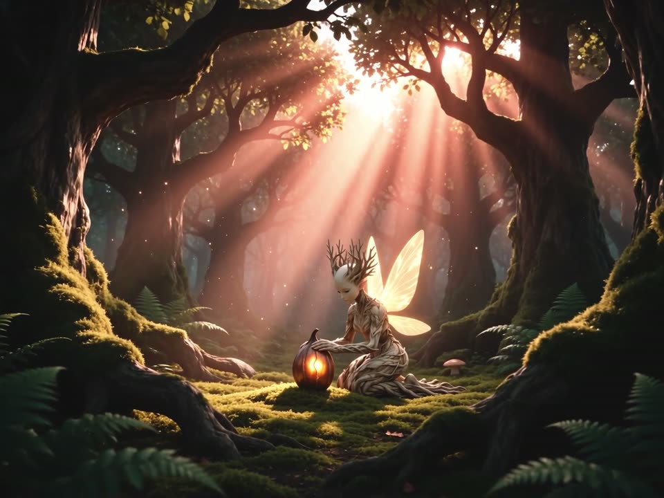

<!-- Generated by scripts/build_readme.py. Edit site.config.json, content/prompts.json, and generator scripts. -->

<a id="case-cms-9011c6c1"></a>

# 木精灵女王唤醒森林

[← 返回合集](../../README.zh-CN.md)

**来源类型**: `community` · **任务**: `T2V` · **音画**: `Yes` · **状态**: `来源收录`

社区 MAGI-2 视频案例（@maxescu）：木精灵女王唤醒森林。

<a href="https://awesome.raphael.app/materials/64f5da66-fd1d-4da4-9aef-568f998ec493.mp4"></a>

▶ **[播放有声视频原片](https://awesome.raphael.app/materials/64f5da66-fd1d-4da4-9aef-568f998ec493.mp4)**

**完整原始提示词**

```text
[Generation Goal]
Dawn in an ancient forest glade: the Wooden Faerie Queen kneels beside a glowing seed pod, helps a tiny newborn sapling sprite out into the world, steadies its first wobbling steps, and then guides it to press its feet into the earth beside hers, until roots grow from both of them into the ground and golden light runs out through the soil, waking the whole glade: the youngling has become one with the mother land. A premium 3D animated feature fantasy in ten shots, cutting between intimate close-ups and the glade awakening around them, played for wonder, gentleness and a bond between guide and newborn.

[Characters]
[image1] as QUEEN ASHWEN's complete design: the supplied model sheet shows the same single character from the front, the side, the back and in a face close-up; every view is Queen Ashwen, and every detail is copied from it one to one. Queen Ashwen is a tall, slender faerie whose body is grown from wood. Her head is smooth, pale ivory and porcelain-like, completely hairless and doll-smooth, with small pointed elfin ears, large almond-shaped deep-black eyes, a small fine nose and a small calm mouth; her expression is serene and ancient. From the top of her head rise two wide clusters of pale, bleached, many-forked branches like driftwood antlers. Her neck, shoulders, arms and whole figure are made of countless twisting strands of pale grey-beige driftwood and root, wound together like muscle and flowing into a long, close-fitting gown of twisting wood that flares at the floor into a spreading base of roots. Her arms are long and slender with long wooden fingers. Four translucent wings rise from her back, two large and two small, pale gold and veined, glowing warmly at their edges. Original English voice: a soft, deep, airy alto, like wind in old timber.

THE YOUNGLING, a newborn sapling sprite without a sheet, designed in the same 3D style and clearly different from the Queen: tiny, only as tall as her knee, with a round head and a smooth face of warm acorn-brown bark, two big round amber eyes with long lashes, a little button nose, and a single bright-green leaf curling up from the top of its head. Its small body is made of soft, tender green shoots and young green bark, with stubby fingers and two crumpled, damp, pale-green wings folded against its back. Wholesome, wide-eyed and curious. Original English voice: a tiny, breathy, wondering voice.

Exactly two characters appear: Queen Ashwen and the Youngling. Small forest life (fireflies, moths, a deer far off, birds) may move in the glade, but no other characters. The model sheet's backdrop, layout, labels and lettering never appear in the film.

[Global Settings]
LOOK. A premium 3D animated feature film. The whole world is rebuilt as dimensional CGI with sculpted, rounded forms, real volume and depth. The Queen keeps the palette of the supplied sheet, pale driftwood beige, ivory and glowing gold, set inside a forest of mossy greens, deep browns and soft dawn rose. Physically based materials respond believably: twisted grain and fibre in her wood, polished porcelain on her face, sheer veined wing membranes, soft moss, rich dark soil, dew on fern fronds, damp tender shoots, cracked seed-pod husk. Fine micro-detail everywhere: grain, cracks, dust, tiny roots and pollen. Soft cinematic global illumination from the dawn sun breaking through the canopy in long shafts, gentle ambient occlusion among the roots, subtle subsurface scattering glowing through leaves, wings and the Youngling's shoots, realistic soft shadow falloff, warm rim light. When the roots take, threads of golden light travel through the soil and up into plants. Shallow depth of field, light volumetric mist and pollen drifting in the sun shafts. Stylized realism in the spirit of a top-tier animation studio, polished high-end render, ultra detailed and crisp.

PLACE AND SCREEN DIRECTION. A round glade in an ancient old-growth forest at dawn, ringed by colossal mossy oaks with huge roots, ferns and mushrooms on the floor, a carpet of moss and fallen leaves, closed flowers and curled fern heads. In the centre, a seed pod the size of a melon, ribbed and bronze, glows softly from inside. Queen Ashwen kneels at screen-right of the pod; the Youngling emerges and stands at screen-left, facing her. No lettering anywhere.

CAMERA AND EDIT. Ten shots joined by gentle hard cuts. Close-ups sit low near the ground at the Youngling's eye level; the wide shots of the awakening glade rise and glide outward. Every shot starts with its action already under way, and a wide is always followed by a medium or a close-up.

PERFORMANCE. Alive, tender acting. The Youngling behaves like a newborn creature discovering the world: blinking at the light, flinching at a sound, trembling knees, curling its fingers, wobbling, gasping, then giggling with delight. Queen Ashwen moves with ancient, patient grace and real warmth: she tilts her head, extends a long wooden finger for it to grip, steadies it with both hands, kneels to its level, and her porcelain face softens into a proud, loving smile. Their chemistry is mother and newborn, guide and follower. Every spoken line shows on the face before the first word, and whoever listens reacts all through it. Lips in sync; each scripted line is spoken once, clearly and in full.

SOUND. Recorded like a documentary on location with on-set microphones only: what happens in frame, the forest around it, breath and the voices. Between those sounds there is only the ambience of the place: dawn birdsong calls, creaking branches, dripping dew, a gentle breeze in the leaves.

[Stage 1] 0-6s. The pod.
Shot 1 (0-3s) · Wide shot gliding into the glade through shafts of dawn light and drifting pollen. At its centre the bronze seed pod glows on the moss, and Queen Ashwen kneels beside it, wings softly glowing, her long wooden fingers resting on its ribbed husk.
Shot 2 (3-6s) · Close-up at ground level. The husk cracks along its ribs and peels open under her fingertips; inside, curled up and damp, the Youngling uncurls, its leaf springing up, its big amber eyes blinking open at the light.
Primary event: the Queen opens the pod and the Youngling is born.
End state: the Youngling sits blinking in the open husk, the Queen leaning over it.

[Stage 2] 6-12s. First steps.
Shot 3 (6-9s) · Close-up of Queen Ashwen's porcelain face, tilted, black eyes gentle, a warm smile spreading as she reaches out one long finger. Queen Ashwen, English, soft as wind: {Do not be afraid, little one.}
Shot 4 (9-12s) · Medium shot. The Youngling grips her finger with both stubby hands, climbs out of the husk and wobbles to its feet on the moss, knees shaking; it lurches, she steadies it with both hands, and it lets out a startled little giggle.
Primary event: the Youngling takes its first steps with the Queen's help.
End state: the Youngling stands on the moss at screen-left, holding her finger.

[Stage 3] 12-18s. The earth.
Shot 5 (12-15s) · Medium two-shot low to the ground. The Queen kneels lower and presses her own wooden palm flat to the soil, then gently guides the Youngling's small hand down beside hers; its eyes go wide at the touch. Queen Ashwen, English, warm and low: {Feel her? The land breathes for you.}
Shot 6 (15-18s) · Close insert of their feet side by side in the dark soil: her root-woven base and its tiny green feet. Fine roots begin to curl out of both of them, threading down into the earth together, tips glowing gold.
Primary event: the Queen and the Youngling begin to root into the earth together.
End state: roots from both of them reach into the soil, glowing.

[Stage 4] 18-24s. The awakening.
Shot 7 (18-21s) · Close-up of the Youngling, morning sun dappling its bark face, its leaf trembling as the soil under it stirs, a gasp of wonder. The Youngling, English, tiny and amazed: {She's warm!}
Shot 8 (21-24s) · Wide shot rising over the glade. The moss and soil ripple and crack as roots spread outward from their joined feet like a branching map, and wherever they reach, curled ferns unroll with a rustle, closed flowers split open, a startled frog hops off a stone, and moths lift from the grass in the dawn air.
Primary event: the whole glade wakes as the bond is made.
End state: the glade is in bloom around the two of them.

[Stage 5] 24-30s. Belonging.
Shot 9 (24-27s) · Medium shot. The Youngling's crumpled damp wings unfold, dry and pale green, and it flutters them in delight; Queen Ashwen laughs softly and touches her brow to the top of its head beside the leaf.
Shot 10 (27-30s) · Close two-shot as the sun breaks fully through the canopy behind them. The Youngling looks up into the Queen's face with shining amber eyes. The Youngling, English, wondering, a first word: {Mother.} The Queen's porcelain face breaks into a proud, tender smile, and she wraps one great golden wing around it. The film ends on this shot: the picture stays bright and fully lit by the dawn and both keep moving right up to the last frame.
Primary event: the Youngling knows where it belongs.
End state: rooted side by side in the blooming glade, the Queen's wing around the Youngling, at sunrise.

[Audio]
Use [audio1] as the sound-world reference only: a raw location effects recording of leaves, insects and air with no music in it; match that plain, music-free texture and do not copy its events or voices.
<dawn birdsong in the canopy>, <dew dripping from leaves>, <a seed husk cracking open>, <a tiny gasp and a giggle>, <moss crunching under small feet>, <soil shifting as roots spread>, <a deep warm creak of wood>, <ferns unrolling with a soft rustle>, <flowers opening with faint pops>, <moths and fireflies fluttering>, <a breeze moving through the glade>, <damp wings unfolding>. Every word of speech is in English. Scripted speakers one at a time: Queen Ashwen two lines, the Youngling two lines. No other speech, no narration, no subtitles. No music of any kind at any point: no score, no song, no instruments, no choir, no humming, no swelling chords or magical shimmer tones when the roots grow or the glade lights up; only the sounds made by what is on screen. Between sounds the glade holds only its own quiet: leaves stirring, water dripping, insects, soft breathing, creaking wood. 

[Maintain Consistency]
Queen Ashwen keeps exactly the design of the supplied sheet in every shot: the hairless ivory porcelain head with small pointed ears and large black almond eyes, the two clusters of pale driftwood branches rising from her head, the body and long gown of twisting pale driftwood and root flaring into a root base, the long wooden fingers, and the four glowing golden veined wings. The Youngling keeps its acorn-brown bark face, amber eyes, single green leaf and green-shoot body; its wings are crumpled until shot 9 and open after it. The Youngling is always at screen-left, the Queen at screen-right. Dawn light in every shot. Do not introduce other faeries, people, lettering, logos, subtitles or captions. Do not introduce night, fire, danger, or any change to the Queen's design.
```

| 参数 | 配置 |
| --- | --- |
| 模型 | MAGI-2 (flagship) |
| 任务类型 | t2v |
| 时长 / 帧率 | 30.3s · 25 fps |
| 分辨率 / 比例 | 1080p · 4:3 |
| 音频模式 | mixed (audio=True) |

[原始来源](https://x.com/maxescu/status/2125709346759929957) · 作者: [@maxescu](https://x.com/maxescu) · 2026-11-25

> MAGI-2 为作者自述，未经独立核实。 提示词来自作者回复 https://x.com/maxescu/status/2125709351713190191

**[在 Raphael 上生成同类视频 →](https://raphael.app/ai-video-generator?utm_source=github&utm_medium=repository&utm_campaign=magi_2_launch&utm_content=case_cms-9011c6c1&utm_term=zh-CN)**
