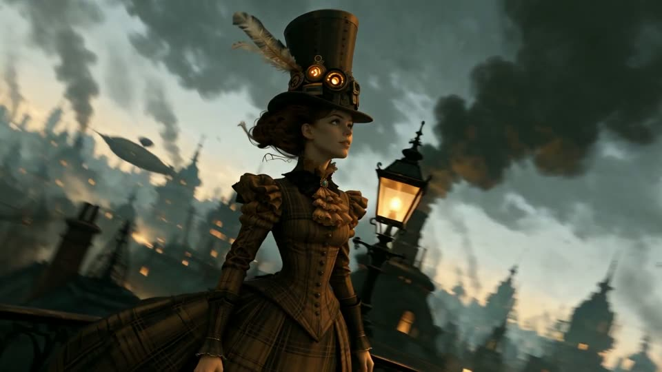

<!-- Generated by scripts/build_readme.py. Edit site.config.json, content/prompts.json, and generator scripts. -->

<a id="case-cms-92e103f1"></a>

# 蒸汽朋克城市的循环镜头

[← 返回合集](../../README.zh-CN.md)

**来源类型**: `community` · **任务**: `T2V` · **音画**: `Yes` · **状态**: `来源收录`

社区 MAGI-2 视频案例（@minuitIA）：蒸汽朋克城市的循环镜头。

<a href="https://awesome.raphael.app/materials/07610e4c-664b-4c49-921b-2fd5c07da7c1.mp4"></a>

▶ **[播放有声视频原片](https://awesome.raphael.app/materials/07610e4c-664b-4c49-921b-2fd5c07da7c1.mp4)**

**完整原始提示词**

```text
30 seconds, 16:9, single continuous shot, designed as a perfect seamless loop. Use <<<image_1>>> as the opening frame and strict visual style reference.
Create a high-energy premium 2D animated sequence with a hand-painted steampunk aesthetic. Everything must remain clearly 2D: painted backgrounds, frame-by-frame character animation, multiplane depth, redrawn perspective shifts, layered parallax, stylized motion smears, foreground wipes, and dynamic 2D camera choreography. Never feel like 3D CGI.
The elegant Victorian woman stands in the foreground admiring the city, but nothing is calm or static. From frame one, she is alive: breathing, blinking, slight head turn, shifting gaze, hair moving, feather whipping, dress rippling in the wind. The entire city is in constant motion: smoke drifting, steam bursting, birds circling, airships moving, propellers spinning, pedestrians crossing bridges, gears rotating, clock hands advancing, lights flickering, fabrics fluttering, distant silhouettes moving in windows.
[0–4s] Start instantly with a bold, unexpected movement: the camera whips from behind a passing foreground smoke plume into a fast curved slingshot orbit around the woman, creating strong multiplane parallax and a sense of acceleration. She turns her head with wonder as the city opens behind her.
[4–8s] Without slowing down, the camera snaps over her shoulder and gets pulled forward into the city in a diagonal descending rush. Use aggressive 2D parallax and hand-painted perspective redraws. Foreground rooftops, cables, chimneys and bridge elements slash across frame with energetic motion.
[8–13s] The camera dives between tall painted buildings in a fast S-curve path, banking left then right, skimming close to glowing windows, iron balconies, moving gears and steam vents. Add stylized 2D motion smears and rapid foreground occlusions to make the movement feel visceral and original.
[13–18s] The camera shoots under a suspended bridge crowded with moving pedestrians, then gets visually “kicked” upward by a blast of steam into a sudden rising arc. It passes beside a moving carriage and through a flock of birds, with layered 2D depth constantly shifting.
[18–22s] A giant steampunk airship crosses the frame. The camera hooks around its nose in a sharp curved swing, races alongside its spinning propellers and hanging cables, then whips away in a dramatic change of direction toward the clock tower.
[22–26s] The camera performs a fast spiral climb around the giant clock tower, but not as a smooth elegant circle: make it more surprising and graphic, with elastic acceleration, fluctuating distance, extreme parallax, spinning gears, moving clock hands, birds exploding outward, drifting smoke and flashing light through the tower structure.
[26–30s] Instead of ending on a reveal, the camera gets flung outward from the tower in a wide arcing return, slicing through layers of smoke and architecture, then reconnects to a framing extremely close to the opening position around the woman. The end must match the beginning in composition, motion direction and energy, so the last frame loops invisibly back into the first frame. The loop must feel like a perpetual kinetic orbit, not a scene with a conclusion.
Keep the motion continuously alive and varied across the whole shot. No static beats, no calm plateau, no dead time. Every second must introduce new parallax, new depth interaction, or a fresh directional shift. Make the camera choreography feel bold, playful, inventive and viral, like a thrilling 2D rollercoaster through a living steampunk painting.
Strictly preserve the original painterly 2D identity at all times: visible brushstrokes, textured painted surfaces, Gothic Victorian steampunk architecture, dark bronze and desaturated teal palette, glowing amber windows, dramatic clouds, rich chiaroscuro, atmospheric haze, and a handcrafted animated-film look. Newly revealed city areas must feel like natural extensions of the same painted world.
No photorealism, no 3D rendering, no CGI look, no plastic textures, no static hold, no slow contemplative pacing, no frozen background, no still-image panning, no puppet-like cutout motion, no texture flicker, no ending freeze, no hard reset, no cuts, no teleportation, no architecture morphing, no music, no subtitle
```

| 参数 | 配置 |
| --- | --- |
| 模型 | MAGI-2 (flagship) |
| 任务类型 | t2v |
| 时长 / 帧率 | 30.2s · 60 fps |
| 分辨率 / 比例 | 1080p · 16:9 |
| 音频模式 | mixed (audio=True) |

[原始来源](https://x.com/minuitIA/status/2126392321587720222) · 作者: [@minuitIA](https://x.com/minuitIA) · 2026-11-27

> MAGI-2 为作者自述，未经独立核实。 提示词来自作者回复 https://x.com/minuitIA/status/2126392473895272572

**[在 Raphael 上生成同类视频 →](https://raphael.app/ai-video-generator?utm_source=github&utm_medium=repository&utm_campaign=magi_2_launch&utm_content=case_cms-92e103f1&utm_term=zh-CN)**
