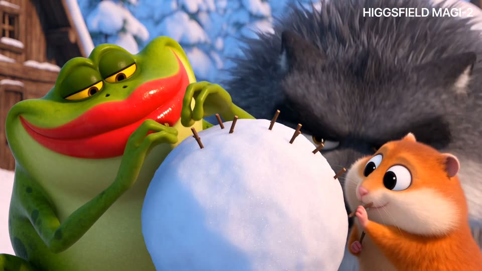

<!-- Generated by scripts/build_readme.py. Edit site.config.json, content/prompts.json, and generator scripts. -->

<a id="case-cms-93c5b8fa"></a>

# 雪山村的列车大冒险

[← Back to collection](../../README.md)

**Origin**: `community` · **Task**: `T2V` · **Audio**: `Yes` · **Status**: `Source-linked`

Create an exactly 30-second, premium-quality 3D animated slapstick comedy featuring four original animal characters in a beautiful…

<a href="https://awesome.raphael.app/materials/c40d19b0-6f77-49fd-9014-2428cf755485.mp4"></a>

▶ **[Watch audio-enabled MP4](https://awesome.raphael.app/materials/c40d19b0-6f77-49fd-9014-2428cf755485.mp4)**

**Full Prompt**

```text
Create an exactly 30-second, premium-quality 3D animated slapstick comedy featuring four original animal characters in a beautiful snowy mountain village. High-end theatrical animation, expressive faces, detailed fluffy fur, vibrant colours, cinematic winter lighting, 16:9, 24fps, fluid animation, hilarious physical comedy and energetic pacing.

CHARACTER LOCK — keep identical throughout:

- FROG: Chubby bright-green frog, enormous glossy red lips, bulging yellow eyes, dramatic expressions.
- HAMSTER: Tiny orange-and-cream hamster, round cheeks, huge shiny black eyes.
- WOLF: Large shaggy grey wolf, light-grey belly, pale eyes, grumpy villainous expression.
- HYENA: Goofy spotted brown hyena with a messy hair bun, buck teeth and exaggerated expressions.

SCENE 1 (0–7s) — The Snowball Incident

A peaceful snowy village surrounded by enormous pine trees. FROG proudly builds a giant snowball while HAMSTER decorates it with tiny sticks. WOLF sneaks behind them, preparing to scare them. Suddenly, the snowball rolls downhill, collecting more snow until it becomes enormous. WOLF gets caught directly in its path.

SCENE 2 (7–14s) — Out of Control

WOLF is trapped inside the rolling snowball, with only his head sticking out. HYENA jumps onto it, treating it like a carnival ride. The snowball crashes through a wooden snowman, launches over a small bridge and races toward a frozen lake. FROG and HAMSTER chase after it on tiny wooden sleds.

SCENE 3 (14–22s) — Frozen Surprise

The giant snowball bursts apart on the frozen lake. WOLF and HYENA slide wildly across the ice, spinning like dancers. FROG attempts to stop them but slips, spinning uncontrollably. HAMSTER grabs FROG's tongue and uses it like a rope, accidentally pulling all three into a perfectly synchronized spinning circle.

SCENE 4 (22–30s) — The Biggest Snow Surprise

A gigantic snow-covered pine tree shakes above them. A massive pile of snow drops onto the group, leaving four little heads poking out. They stare at each other in silence. Suddenly, WOLF sneezes, triggering a huge avalanche of fluffy snow that sweeps the entire group downhill. Final shot: all four emerge from the snow in a perfectly arranged row, blinking at the camera, while a tiny snowball drops onto WOLF's head.

ANIMATION & SOUND:

Maintain exact character identity, proportions, fur colours and facial features across every shot. Use expressive reactions, exaggerated squash-and-stretch, believable snow physics, dynamic tracking shots, fast comedic cuts and cinematic close-ups. Every action should flow naturally into the next.

Crisp cinematic cartoon audio: rushing snow, rolling rumbles, icy sliding, funny impacts, boings, squeals, wolf growls, hyena laughter and nonverbal screams. Bright orchestral comedy soundtrack with a satisfying final musical punchline.

No dialogue, no text, no subtitles, no logos, no references to existing films or characters.
```

| Parameter | Value |
| --- | --- |
| Model | MAGI-2 (flagship) |
| Task type | t2v |
| Duration / FPS | 30.3s · 30 fps |
| Resolution / Ratio | 1080p · 16:9 |
| Audio mode | mixed (audio=True) |

[Original source](https://x.com/john_my07/status/2125562735350169860) · Creator: [@john_my07](https://x.com/john_my07) · 2026-11-25

> MAGI-2 为作者自述，未经独立核实。 提示词见同一作者的回复 https://x.com/john_my07/status/2125562953453953405

**[Generate similar on Raphael →](https://raphael.app/ai-video-generator?utm_source=github&utm_medium=repository&utm_campaign=magi_2_launch&utm_content=case_cms-93c5b8fa&utm_term=en)**
