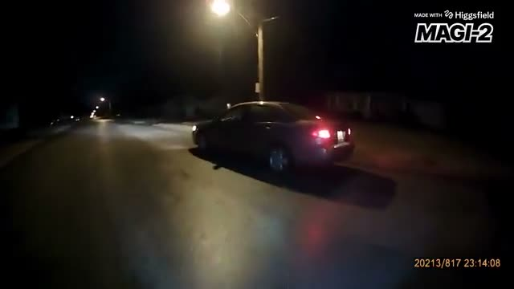

<!-- Generated by scripts/build_readme.py. Edit site.config.json, content/prompts.json, and generator scripts. -->

<a id="case-cms-974b571c"></a>

# 深夜例行检查

[← Back to collection](../../README.md)

**Origin**: `community` · **Task**: `T2V` · **Audio**: `Yes` · **Status**: `Source-linked`

16:9, 12 seconds, chest-mounted bodycam, wide fisheye lens with edge distortion, slightly overexposed highlights, compression arti…

<a href="https://awesome.raphael.app/materials/3f869d36-19f3-45ad-96b9-e85cd79ad069.mp4"></a>

▶ **[Watch audio-enabled MP4](https://awesome.raphael.app/materials/3f869d36-19f3-45ad-96b9-e85cd79ad069.mp4)**

**Full Prompt**

```text
16:9, 12 seconds, chest-mounted bodycam, wide fisheye lens with edge distortion, slightly overexposed highlights, compression artifacts, timestamp overlay in the corner reading 23:14:08. Setting: a dark suburban street at night, one flickering streetlight, a parked sedan with its engine running, breath fogging in the cold. 0-4s: The camera sways with walking steps toward the car, flashlight beam sweeping across the rear window, radio chatter crackling. 4-8s: The beam lands on the driver, a man in his 40s in a gray hoodie, who keeps his hands on the wheel and says, "I didn't do anything, man." Camera stays steady, hand briefly entering frame. 8-11s: The man's hands slowly rise off the wheel and his eyes flick to the passenger seat. 11-12s: The footage cuts abruptly to black. Audio: radio static, boots on asphalt, idling engine, tense breathing, no music.
```

| Parameter | Value |
| --- | --- |
| Model | MAGI-2 (flagship) |
| Task type | t2v |
| Duration / FPS | 12.4s · 30 fps |
| Resolution / Ratio | 360p · 16:9 |
| Audio mode | mixed (audio=True) |

[Original source](https://x.com/weiinberg/status/2125873134322733507) · Creator: [@weiinberg](https://x.com/weiinberg) · 2026-11-26

> MAGI-2 为作者自述，未经独立核实。

**[Generate similar on Raphael →](https://raphael.app/ai-video-generator?utm_source=github&utm_medium=repository&utm_campaign=magi_2_launch&utm_content=case_cms-974b571c&utm_term=en)**
