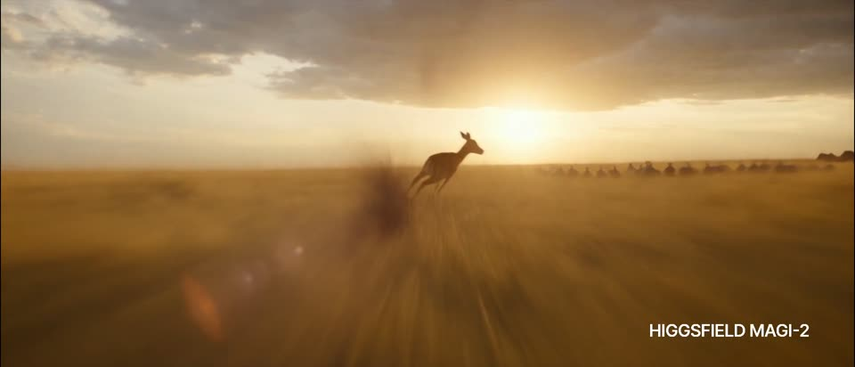

<!-- Generated by scripts/build_readme.py. Edit site.config.json, content/prompts.json, and generator scripts. -->

<a id="case-cms-977d291c"></a>

# 非洲草原上的猎豹追逐

[← Back to collection](../../README.md)

**Origin**: `community` · **Task**: `T2V` · **Audio**: `Yes` · **Status**: `Source-linked`

One CONTINUOUS FPV drone shot, no cuts, one unbroken take, EXTREME real-time speed. The footage NEVER reverses or plays backward.…

<a href="https://awesome.raphael.app/materials/43dc7333-d8e1-4c24-bcc1-fa3eefd2ae74.mp4"></a>

▶ **[Watch audio-enabled MP4](https://awesome.raphael.app/materials/43dc7333-d8e1-4c24-bcc1-fa3eefd2ae74.mp4)**

**Full Prompt**

```text
One CONTINUOUS FPV drone shot, no cuts, one unbroken take, EXTREME real-time speed. The footage NEVER reverses or plays backward. NO slow motion except one half-second beat at the reveal, then an instant snap back to full speed. Photoreal point-blank FPV framing. GROUND LOCK: the animals stay on the ground at all times — NOTHING rises into the sky, ever. The camera flies LOW, at grass and knee height, its only altitude change one downward drop off the riverbank. NO ESCAPE, no fade to black — the take runs until time runs out, still inside the chaos.

CINEMATIC CAPTURE: real FPV drone footage — ultra-wide 14mm lens, barrel distortion, 180-degree shutter, heavy motion blur on fast pans, fine 35mm grain, lens flares off the low sun, dust and water hitting the lens. Golden-hour light under a bruised storm sky, one shaft of low gold raking the plain, a living savannah, herds and birds throughout. Grade: dry ochre and bleached gold, documentary contrast — the texture of a BBC nature documentary from a racing drone, NOT a game engine, NOT animation.

The shot opens ALREADY at full speed, skimming grass tips inches behind a sprinting cheetah at 110 km/h, claws throwing dirt at the lens. Ahead — seen ONLY from behind and flank, NEVER its face — an impala jinks hard right; the camera BANKS 90 degrees with it, tearing sideways through grass as guinea fowl burst around the lens. The impala zigzags; the camera snaps left, right, left with each cut, the cheetah's shoulder filling frame. Ahead a zebra herd grazes; the two tear into it and the herd EXPLODES — zebras rear, wheel and bolt in every direction, throwing a wall of dust. The camera stays LOW and threads THROUGH the stampede at knee height, swerving between hammering legs and striped bodies, dust raking the lens, then bursts out the far side back onto the cheetah's tail. Ahead a SHALLOW RIVER CHANNEL cuts the plain — muddy water, black mud. The impala plunges in; the camera drops VERTICALLY off the bank lip after it, out across the water, spray hitting the lens. THE ENTIRE CLIMAX HAPPENS HERE, IN THE WATER AND MUD — the channel never leaves frame. THE REVEAL: half-second slow motion — the cheetah at full stretch in its final lunge, low and flat over the shallows, claws out, seen from behind — then an INSTANT SNAP back to full speed. The paw hooks the flank at an angle; both crash sideways into the shallows, muddy water erupting, the camera driving THROUGH the splash, orbiting tight and low as they thrash, bodies soaked black. The jaws lock; the cheetah drags the kill through the mud, water streaming off its coat, the camera circling recklessly close. It plants its feet in the water over the body, flanks heaving with ragged open-mouthed panting, and lets rip a HIGH, PIERCING CHEETAH YOWL — a rasping chirp-scream breaking into a snarl and hiss, teeth bared, NOT a lion's roar. Vultures drop past the lens, the zebra herd stampedes on the far bank, the camera still arcing around the soaked, snarling cheetah as the runtime runs out mid-chaos.

Sound: a howling wall of grass-rush and wind pitching with every bank and drop, stampeding hooves, a driving score — dropping to one held breath of near-silence at the slow-motion reveal, then a MASSIVE concussive water impact, then sustained escalating chaos: thrashing water, ragged panting, hissing snarls, the piercing yowl, vulture wings, herd thunder, the score building to the final frame.

Global style lock: photoreal cinematic FPV; the camera stays low, the animals stay grounded, nothing rises into the sky; the climax escalates rather than resolves, no directed ending; the prey NEVER turns to face the predator or camera while running; EVERY background animal REACTS and keeps moving — nothing stands still as the chase passes; the river persists through the climax; no lion roar; no distortion, no subtitles, no watermarks.
```

| Parameter | Value |
| --- | --- |
| Model | MAGI-2 (flagship) |
| Task type | t2v |
| Duration / FPS | 20.4s · 30 fps |
| Resolution / Ratio | 720p · 2.35:1 |
| Audio mode | music (audio=True) |

[Original source](https://x.com/abulu8/status/2125537498659225849) · Creator: [@abulu8](https://x.com/abulu8) · 2026-11-25

> MAGI-2 为作者自述，未经独立核实。

**[Generate similar on Raphael →](https://raphael.app/ai-video-generator?utm_source=github&utm_medium=repository&utm_campaign=magi_2_launch&utm_content=case_cms-977d291c&utm_term=en)**
