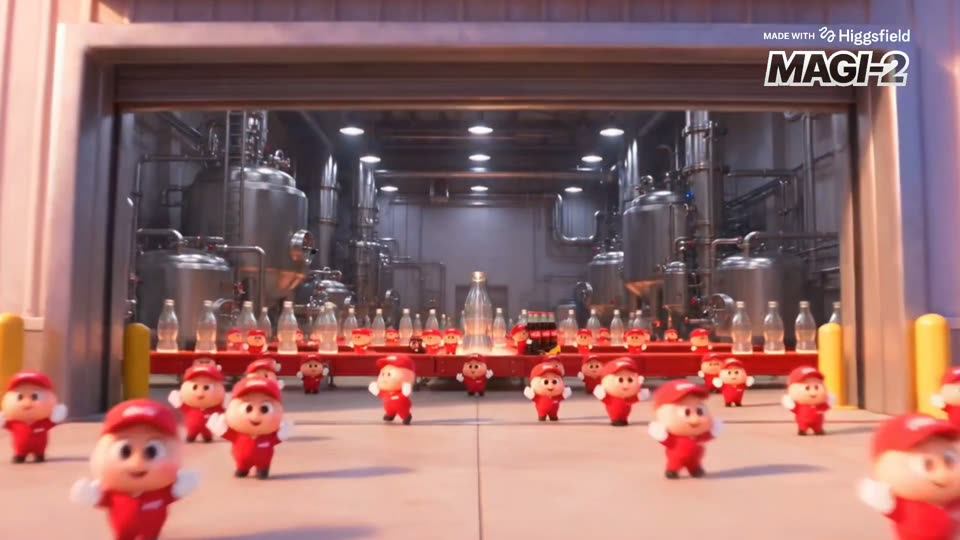

<!-- Generated by scripts/build_readme.py. Edit site.config.json, content/prompts.json, and generator scripts. -->

<a id="case-cms-9f948804"></a>

# 迷你工人的可口可乐工厂

[← 返回合集](../../README.zh-CN.md)

**来源类型**: `community` · **任务**: `T2V` · **音画**: `Yes` · **状态**: `来源收录`

社区 MAGI-2 视频案例（@AIwithSynthia）：迷你工人的可口可乐工厂。

<a href="https://awesome.raphael.app/materials/9535425e-b48d-49fa-83b6-ca268cda5787.mp4"></a>

▶ **[播放有声视频原片](https://awesome.raphael.app/materials/9535425e-b48d-49fa-83b6-ca268cda5787.mp4)**

**完整原始提示词**

```text
Create a heartwarming, ultra-cute 3D chibi animated commercial inside a massive, magical soft drink factory operated entirely by tiny chibi workers. The factory is bright, spotless, colorful, and beautifully organized, featuring enormous stainless-steel machines, sparkling glass bottles, glowing red conveyor belts, and warm cinematic lighting. Every worker has oversized sparkling eyes, rosy cheeks, tiny proportions, expressive faces, and adorable waddling movements. All workers wear miniature red uniforms, little white gloves, and matching caps.

SCENE 1 – THE GRAND FACTORY ENTRANCE

The video opens with a spectacular cinematic fly-through entering the enormous beverage factory. Hundreds of adorable miniature workers enthusiastically run around, waving to each other and preparing for the day's production. Giant empty glass bottles travel along conveyor belts while tiny workers guide them into position. Some workers operate miniature forklifts carrying stacks of bottles, while others proudly inspect the production lines.

SCENE 2 – THE MAGICAL BEVERAGE PRODUCTION

The camera glides alongside enormous industrial mixing tanks filled with a rich, dark fizzy beverage. Tiny workers in protective uniforms carefully monitor the machines, turn miniature control wheels, and inspect the flowing liquid. One adorable worker stands on a tiny ladder, checking a pressure gauge while another gives an enthusiastic thumbs-up. Bubbles rise through transparent pipes, creating a mesmerizing visual spectacle.

SCENE 3 – BOTTLE FILLING STATION

Transition into a spectacular automated bottling station. Rows of sparkling glass bottles move beneath giant filling machines as the dark fizzy drink pours into each bottle with perfect precision. Tiny workers carefully supervise the process, enthusiastically cheering whenever a bottle gets filled. One little worker proudly holds up a perfectly filled bottle while his colleagues celebrate with tiny high-fives.

SCENE 4 – THE BUBBLE MAGIC

Capture beautiful macro close-ups of sparkling carbonation, tiny bubbles rising inside freshly filled bottles, condensation forming on chilled glass surfaces, and refreshing droplets sliding down the bottles. Miniature workers admire the finished drinks. One worker playfully tries to catch a floating bubble while another carefully polishes a bottle with an oversized cleaning cloth.

SCENE 5 – THE PACKAGING DEPARTMENT

The camera moves through a lively packaging section where hundreds of bottles are automatically capped, labeled, and packed into colorful red cartons. Tiny workers coordinate everything with incredible enthusiasm. Some carefully arrange bottles inside cartons, others seal the packages, while miniature forklifts transport finished products toward the warehouse. One tiny worker proudly stands on top of a carton, directing traffic like a factory supervisor.

SCENE 6 – THE GRAND FINALE

The entire factory becomes a celebration. Hundreds of adorable workers gather around a giant beautifully presented chilled bottle surrounded by sparkling droplets and refreshing ice cubes. They cheer, clap, wave their tiny hands, and perform adorable victory dances. One little worker proudly raises a miniature bottle toward the camera as everyone celebrates another successful production day.

The camera slowly pulls backward and rises above the factory floor, revealing the enormous, beautifully illuminated production facility filled with busy miniature workers and endless rows of finished bottles.
```

| 参数 | 配置 |
| --- | --- |
| 模型 | MAGI-2 (flagship) |
| 任务类型 | t2v |
| 时长 / 帧率 | 30.3s · 30 fps |
| 分辨率 / 比例 | 1080p · 16:9 |
| 音频模式 | mixed (audio=True) |

[原始来源](https://x.com/AIwithSynthia/status/2125821453266546701) · 作者: [@AIwithSynthia](https://x.com/AIwithSynthia) · 2026-11-26

> MAGI-2 为作者自述，未经独立核实。

**[在 Raphael 上生成同类视频 →](https://raphael.app/ai-video-generator?utm_source=github&utm_medium=repository&utm_campaign=magi_2_launch&utm_content=case_cms-9f948804&utm_term=zh-CN)**
