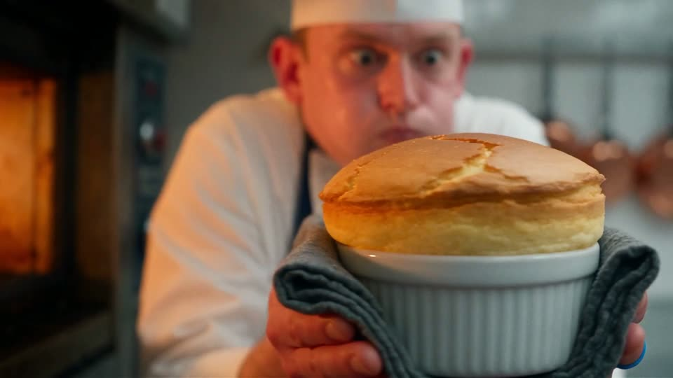

<!-- Generated by scripts/build_readme.py. Edit site.config.json, content/prompts.json, and generator scripts. -->

<a id="case-cms-a1430d20"></a>

# 厨房里的舒芙蕾危机

[← 返回合集](../../README.zh-CN.md)

**来源类型**: `community` · **任务**: `T2V` · **音画**: `Yes` · **状态**: `来源收录`

社区 MAGI-2 视频案例（@maxescu）：厨房里的舒芙蕾危机。

<a href="https://awesome.raphael.app/materials/62db0979-3248-4372-8fff-a317f49c2395.mp4"></a>

▶ **[播放有声视频原片](https://awesome.raphael.app/materials/62db0979-3248-4372-8fff-a317f49c2395.mp4)**

**完整原始提示词**

```text
[Generation Goal]
In a cramped restaurant kitchen a tyrannical French chef whisper-directs a terrified junior cook carrying a towering souffle from oven to pass: it survives a squeaking clog, a falling copper lid and a bellowing waiter, then sinks at the chef's own sneeze. A live-action suspense comedy in twelve shots, close-ups and inserts alternating with three wider side views, played in whispers.

[Characters]
HORTENSE DUVAL, the chef. A 55-year-old French woman. Pale skin under matte face powder, fine upright lines above the lip, two deep creases between the brows. A long narrow face, a thin high-bridged nose, a mouth painted dark red. Sharp black eyes that look over half-moon steel-rimmed glasses worn low on the nose on a silver chain. Steel-grey hair in a hard chignon. An immaculate white double-breasted chef's jacket, a black neckerchief, a long black waist apron. Small, narrow, straight-backed, chin raised, short exact steps. Her right hand carries a long steel tasting spoon that she points and jabs with; her left is empty, palm out. A tyrant who commands in a hiss: the lips hardly part, the nostrils flare, the eyebrows do the shouting. Original English voice: a low, dry contralto with a strong French accent.

WOJTEK 'WOJ' NOWAK, the junior cook, on his second day. A 22-year-old Polish man. Fair skin flushed in blotches, bright pink ears that stick out, sweat beading on the upper lip. A long face on a long neck with a bobbing Adam's apple, a wide rubbery mouth, round pale-blue eyes with almost white lashes. Straw-fair hair pokes out under a tall white paper cap. A white chef's jacket two sizes too big, a blue-and-white striped bib apron, black rubber clogs; small blue adhesive bandages on three fingers of his left hand. Lanky, all wrists and knees, stooped over the hot ramekin that both hands hold through a folded grey cloth at chest height. Terrified and heroic: cheeks puffed with held breath, shoulders up at his ears, eyes swivelling from dome to Chef and back. Original English voice: a light, breathy tenor with a soft Polish accent.

BRUNO, the waiter. A 35-year-old Italian man: tanned olive skin, shiny round cheeks, thick black curls, a full black moustache, merry dark eyes. A burgundy waistcoat over a white shirt. Big and barrel-chested; a round steel tray is clamped under his left arm. Original English voice: a booming, jolly baritone with an Italian accent.

THE SOUFFLE. A golden-brown dome a full hand's height above a white fluted ceramic ramekin, a soft cracked crust trailing a thread of steam.

Exactly three people appear. Do not add other cooks, porters, diners or any fourth face.

[Global Settings]
LOOK. Photographed on a Sony VENICE 2 with ZEISS Supreme Prime lenses at T2.8: neutral colour balance, natural skin tones, clean digital rendering with natural edge detail. Light comes only from the room: one long frosted daylight-balanced ceiling panel over the oven end sends soft side light down the aisle from screen-left, with gentle shadow edges; three orange heat lamps over the pass answer from screen-right; the lamp inside the open oven glows amber. Clearly resolved: hammered copper, glazed white ceramic, the grain of brushed steel, the cracked crust, powder on her skin, sweat on his, white cotton rolling off gradually into its brightest folds. The background falls gently out of focus: in her close-ups the heat lamps far behind her are three soft orange discs, in his the oven is a soft amber block; eyes are always sharp. Deep charcoal shadows under the benches retain texture.

PLACE AND SCREEN DIRECTION. A narrow professional kitchen in dinner service, one aisle with a red tile floor. LOCKED ROOM. At screen-left the oven wall, the upper steel oven open on its amber interior. At screen-right, four metres away, the pass: a waist-high brushed-steel counter under three orange heat lamps, carrying a stack of white plates and, on its near corner, an open steel bowl of ground black pepper. Along the back wall a steel bench under a rail of hanging copper pans and lids, and in its centre a swing door with a round window onto a dim amber dining room. Woj travels one way only, screen-left to screen-right; Hortense backs away in front of him, facing him. Set down, the ramekin stands beside that bowl, between them. The oven wall is behind Woj in his singles, the pass and its lamps behind Hortense in hers. The camera is always on the near side of the aisle. No lettering anywhere: no order slips, labels or clock faces.

CAMERA AND EDIT. Twelve shots joined by hard cuts on action. The handheld camera rides at the height of the ramekin: it creeps at their tiptoe pace, makes small adjustments to follow hands, spoon and faces, and flinches a fraction late at each noise. Every shot starts with its action already under way.

THE SOUFFLE RULE. Sound is the enemy: at each noise the dome shudders, leans and rights itself, as tall as before. It collapses once only, in shot 11 after the sneeze.

PERFORMANCE. She needs his steady hands, he needs her nod more than air, and tyrant and underling turn into accomplices halfway down the aisle. Hortense and Woj whisper until the dome falls, then speak aloud. Nobody is ever idle: the speaker acts each line with eyebrows, spoon, shoulders and weight, the listener reacts all through it, and each line shows on the face before the first word. They speak to each other, never to the lens. Lips in sync; every scripted line is spoken once, clearly and in full.

[Stage 1] 0-6s. Out of the oven.
Shot 1 (0-2s) · Close-up of the souffle, level with its rim. The white ramekin is already sliding out of the open oven at screen-left, gripped through the grey cloth by Woj's two shaking hands; the golden dome trembles with his wrists and a thread of steam bends off its crust. Above it, soft, his round eyes and puffed cheeks follow it out as he turns with it toward screen-right.
Shot 2 (2-4s) · Close-up of Hortense, three-quarter, past the soft dome and Woj's shoulder at screen-left, the heat lamps soft far behind her. She is backing one short step away, left palm flat toward him, the spoon upright beside her cheek; her black eyes snap over the glasses from the dome to his face and her eyebrows climb. Hortense, English, a hiss through nearly closed teeth: {Nobody. Breathes.}
Shot 3 (4-6s) · Close-up of Woj, three-quarter, past her blurred white shoulder at screen-right, the amber oven soft behind him. Cheeks puffed, he lets the answer out on a nod so hard that the paper cap slides toward his eyebrows. Woj, English, a breathless whisper from one corner of his mouth: {Yes, Chef.} Her spoon comes in from screen-right and tips the cap level; his eyes cross to follow it as his lips clamp shut again.
Primary event: the souffle leaves the oven and Hortense imposes silence.
End state: Woj holds the ramekin at chest height at the oven end; Hortense is one step ahead at screen-right, facing him.

[Stage 2] 6-11s. The crossing.
Shot 4 (6-9s) · Medium wide side two-shot, the copper rail and the shut swing door behind them. Woj's rubber clog is already squeaking on the red tile under his high-lifted foot at screen-left: the dome shudders and both hunch, Woj on tiptoe with elbows locked, Hortense at screen-right backing ahead of him in short exact steps, pressing the air down with the spoon. Hortense, English, a furious whisper, the spoon jabbing at his clogs, then at the dome: {Softer feet. It can hear you.} Through it his eyes drop to his feet in horror, then creep up to the dome, and he tiptoes on toward screen-right, rising higher on his toes.
Shot 5 (9-11s) · Close insert at bench height, front three-quarter on Woj's legs. A copper lid, knocked off its hook on the rail above by his paper cap, is already falling down the front of the steel bench; his far thigh shoots sideways and traps it flat and silent against the bench front. At the top of the frame the dome sways once and rights itself; Hortense's left hand reaches in from screen-right and takes the lid by its rim.
Primary event: a copper lid falls and Woj traps it silently with his thigh.
End state: mid-aisle, Hortense holds the lid in her left hand, Woj the level ramekin, facing each other.

[Stage 3] 11-19s. Bruno.
Shot 6 (11-14s) · Medium three-shot from the near side. Hortense at screen-right, her left hand pressing the rescued lid flat on the bench, is dipping her chin at Woj in one curt nod, which he returns, when the swing door between them slams open and the copper pans jangle. Bruno fills the doorway, tray under his left arm, right arm flung wide, beaming. Bruno, English, a cheerful full-chested boom: {Table six wants ketchup!} On his first word Woj curls his whole upper body round the ramekin like a shield, one knee in the air, and Hortense's shoulders jump to her ears, her left palm flying up off the lid at Bruno; then all three heads snap down to the dome.
Shot 7 (14-17s) · Close-up of Hortense across the dome, three-quarter, the pass lamps soft behind her. In the foreground the dome shudders, leans toward her and rights itself; her eyes never leave it. Her nostrils flare, and without turning her head she swings the spoon out to point at the door. Hortense, English, a venomous whisper: {Out.}
Shot 8 (17-19s) · Medium close shot of Bruno in the doorway, the amber dining room dim behind him. Grin gone, lips pressed shut, the tray hugged to his chest under his left arm, he is already backing out on tiptoe, one polished shoe lifted high, his right hand drawing the swing door closed in front of him until one wide eye fills its round window.
Primary event: Bruno's bellow shakes the dome, it stands, and Hortense sends him out with one word.
End state: the door is shut on Bruno, the lid is on the bench; Woj holds the unharmed ramekin two steps from the pass.

[Stage 4] 19-24s. The pass.
Shot 9 (19-21s) · Close two-shot at the pass, counter height, Woj at screen-left, Hortense at screen-right. Woj's hands are just setting the ramekin, on its folded grey cloth, onto the near corner of the steel beside the pepper bowl and letting go; the dome wobbles and stands. Both sag at once: his puffed cheeks empty in one long gust across the bowl, lifting a grey puff of pepper into the orange lamp light, and her left hand clamps his forearm in a hard squeeze; his eyes go round at the hand, then at her.
Shot 10 (21-24s) · Close-up of Hortense, low three-quarter from the steel, the white plates soft behind her. She bends until her nose is a hand's width from the crust, the dark-red mouth softening in admiration; pepper dust drifts up through the orange light into her face. Her nostrils twitch, her nose wrinkles, her eyes water and squeeze shut, her head rears back, and an enormous sneeze jerks her head and shoulders forward, stopping a hand's width above the dome, which rocks in the blast and stands, the glasses jolting down her nose.
Primary event: the ramekin reaches the pass intact and Hortense sneezes over it.
End state: the ramekin is on the pass between them, Hortense bent over it.

[Stage 5] 24-30s. The crater.
Shot 11 (24-27s) · Low close two-shot along the pass, the ramekin in the centre foreground, Woj's face above it at screen-left, Hortense's at screen-right. The dome is already sinking: a soft sigh of steam, and it folds to a wrinkled crater below the rim. Both pairs of eyes follow it down; Woj's jaw drops and both his hands hover over it. Hortense's eyes dart to him and back; without straightening she nudges her glasses up with a left knuckle and lifts her chin at him as his eyes creep up to hers. Hortense, English, aloud, with icy dignity: {That was you.} His open mouth swings from the crater to her.
Shot 12 (27-30s) · Medium side two-shot at the pass, the crater between them under the orange lamps. Woj's eyes slide from the crater to her, his Adam's apple bobs and he straightens to his full height. Woj, English, aloud, grave and gallant: {Yes, Chef.} Through it Hortense straightens, tugs her jacket hem flat with her left hand and lifts her chin, looking past him. Then her nose wrinkles again, and Woj's bandaged left hand pinches the grey cloth and slides the ramekin along the steel away from her, shoulders shaking with a swallowed laugh. The film ends on this shot: the picture stays bright and fully lit and both keep moving right up to the last frame.
Primary event: the dome collapses and Hortense blames Woj, who takes it.
End state: the crater stands on the pass; Woj slides it away from Hortense, whose next sneeze is coming.

[Audio]
<an extractor fan whirring low>, <a rubber clog squeaking on tile>, <a copper lid sliding off its hook>, <a swing door slamming open>, <copper pans jangling on a rail>, <a door hinge creaking shut>, <two long held breaths let go>, <an enormous sneeze>, <a soft sigh of escaping steam>, <a swallowed snort of laughter>. Every word of speech is in English. Scripted speakers one at a time: Hortense four lines, Woj two lines, Bruno one line. No other speech, no narration, no subtitles. No music of any kind at any point: no score, no song, no instruments; only the sounds made by what is on screen.

[Maintain Consistency]
Hortense keeps the same powdered face, dark-red mouth, half-moon glasses on their chain, steel-grey chignon, white double-breasted jacket, black neckerchief and black apron; the spoon never leaves her right hand. Woj keeps the same pink-eared face, straw hair, tall white paper cap, oversized white jacket, blue-striped apron and three blue finger bandages; both hands hold the ramekin through the grey cloth until he sets it, cloth underneath, on the pass in shot 9. Bruno keeps his black curls, moustache, burgundy waistcoat and steel tray, and appears only in shots 6 and 8, only in the doorway. Exactly three people, one souffle and one pepper bowl; the one fallen copper lid lies on the bench from shot 6 on. The dome keeps its full height through shot 10; release its shape only in shot 11, where sinking to a crater is the priority event; it is a crater in shot 12. Woj is always at screen-left of Hortense and travel runs screen-left to screen-right.
Do not introduce other cooks, diners, flames, spills, broken crockery or a second souffle.
Do not introduce lettering, logos, subtitles or captions, or shouting from Hortense or Woj.
```

| 参数 | 配置 |
| --- | --- |
| 模型 | MAGI-2 (flagship) |
| 任务类型 | t2v |
| 时长 / 帧率 | 30.2s · 24 fps |
| 分辨率 / 比例 | 1080p · 16:9 |
| 音频模式 | mixed (audio=True) |

[原始来源](https://x.com/maxescu/status/2125623155960017230) · 作者: [@maxescu](https://x.com/maxescu) · 2026-11-25

> MAGI-2 为作者自述，未经独立核实。完整提示词来自作者回复 https://x.com/maxescu/status/2125623162629173447

**[在 Raphael 上生成同类视频 →](https://raphael.app/ai-video-generator?utm_source=github&utm_medium=repository&utm_campaign=magi_2_launch&utm_content=case_cms-a1430d20&utm_term=zh-CN)**
