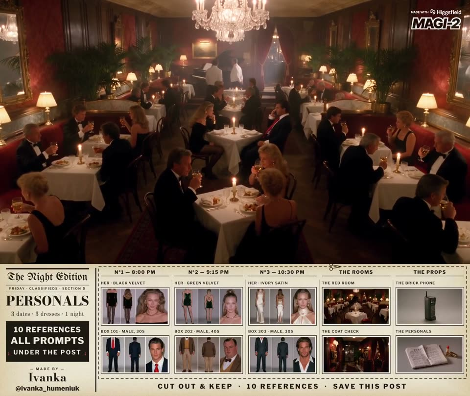

<!-- Generated by scripts/build_readme.py. Edit site.config.json, content/prompts.json, and generator scripts. -->

<a id="case-cms-a1baa303"></a>

# 烛光餐厅的三场约会

[← Back to collection](../../README.md)

**Origin**: `community` · **Task**: `T2V` · **Audio**: `Yes` · **Status**: `Source-linked`

📌 PROMPT ( Video Episode 1): STRICT RULE: Absolutely no music, only diegetic sounds. Realism cinematic, real skin with pores and s…

<a href="https://awesome.raphael.app/materials/db161e86-3512-492a-a5d9-e53e49e012dc.mp4"></a>

▶ **[Watch audio-enabled MP4](https://awesome.raphael.app/materials/db161e86-3512-492a-a5d9-e53e49e012dc.mp4)**

**Full Prompt**

```text
📌 PROMPT ( Video Episode 1):

STRICT RULE: Absolutely no music, only diegetic sounds.
Realism cinematic, real skin with pores and small marks, natural eyes, people and set lit only by this place's named sources: the tall candle burning on every table, lighting each face softly from below and in front, the far corners of the room and the gaps between the tables left dark; 1990 Kodak 35mm colour-negative film grade with softly faded shadows, soft halation around every flame and clearly visible organic film grain; still air with a faint haze.
Framed on the rule of thirds, with a light anamorphic lens character: softly oval out-of-focus highlights in the background, and a fine 35mm film grain.
Image reference 1 (location Restaurant Dining Room): the Restaurant Dining Room 100% as in the reference.
Image reference 2 (character Stella): Stella, face, hair, body and clothes 100% as in the reference.
Image reference 3 (character Brad): Brad, face, hair, body and clothes 100% as in the reference.
Image reference 4 (character Tony): Tony, face, hair, body and clothes 100% as in the reference.
Image reference 5 (prop Brick Phone): the Brick Phone 100% as in the reference.
Image reference 6 (prop Newspaper): the Newspaper 100% as in the reference.
Continuity: Stella is clean and unchanged from the reference, with no stain, mark or damage; Brad is clean and unchanged from the reference, with no stain, mark or damage; Tony is clean and unchanged from the reference, with no stain, mark or damage.
In frame only: Stella, Brad, Tony and the background diners. Every other table is taken by elegant diners in 1990 evening wear who eat, talk and raise glasses, the whole room filled with their soft, wordless murmur and the clink of glasses and cutlery, and two waiters in white jackets pass far behind, always soft and out of focus, never near the leads; the grand piano closed. Stella and Brad sit face to face at the small candlelit table for two in the middle of the room, Stella screen left, Brad screen right, an arm's length apart across the table. Tony works the room behind them and comes to the table in S4 and S6. The brick phone stays at Brad's right ear the whole clip. The newspaper, folded and clean with no marks on it, and its gold lipstick stay in the pocket of Stella's long black wool coat, hung on a brass coat stand by the curtained arch, until S10. Eyelines never at the camera.
Opening: diners moving between the tables; Brad seated, the brick phone at his ear; Stella seated across from him, her chin on her hand, an arm's length away.
Brad speaks aloud 1 time between 1.3s and 3.5s and never again; silent before 1.3s and from 3.5s to the end.
Tony speaks aloud 1 time between 7.8s and 10.0s and never again; silent before 7.8s and from 10.0s to the end.
Stella speaks aloud 2 times between 10.4s and 17.9s and never again; silent before 10.4s and from 17.9s to the end.
The background diners never speak a clear word in this clip.
Performance: naturalistic screen acting, as in a serious drama shot on film; small, real reactions in the eyes, brows, mouth and jaw, nothing exaggerated.
Stella is out to leave this date without one awkward word; once Tony brings the fake call she walks out toward her next date, with willpower.
Brad is out to close his deal on the phone, rocking and turning in his chair, and never once looks at Stella, with persistence.
Tony is out to rescue the lady as he has done before; he brings the fake call with a straight face, with perseverance.
Pace: loud and comic at the start, then sly and quick; every shot opens in motion, a beat only where a line lands.
S1 0.0-1.2s · wide, high, from the far end of the room, slow push-in · diners at every table lift glasses and lean in to talk, a waiter in a white jacket crosses the aisle; in the middle of the room, small at their candlelit table, Brad leaning back with the phone at his ear, Stella across from him.
S2 1.2-3.6s · medium, two-shot across the table, eye level, slow push-in · Brad, leaning back in his chair, shouts into the brick phone, his free hand chopping the air, his eyes on the far tables; Stella, screen left, rests her chin on her hand, her eyes on him; soft diners behind; his voice begins at 1.3s and ends at 3.5s.
S3 3.6-5.0s · close, cut at the collarbones, three-quarter from Brad's side, eye level, slow push-in · Stella's eyes stay on Brad, then slide right, past him, toward the room; her chin on her hand, her gold cuff in the candlelight; her look passing right of the lens, level; Brad's soft shoulder near right.
S4 5.0-6.4s · insert, at tablecloth height, static · Stella's hand slides a folded banknote under the small silver saucer by the candle; a waiter's hand in a white sleeve comes in from the right and lifts the saucer away with the note under it.
S5 6.4-7.6s · close, cut at the collarbones, front three-quarter, eye level, slow push-in · Tony, the saucer in his hand, meets Stella's look and gives one very small nod, his face still under the moustache; his look passing left of the lens, level; soft diners behind him.
S6 7.6-10.2s · medium, three-shot at the table, eye level, handheld · Tony steps up beside the table, screen right behind Brad, and bends toward Stella, one hand behind his back; Brad sits half turned away in his chair, the phone at his ear, grinning; Stella screen left looks up at Tony; his voice begins at 7.8s and ends at 10.0s.
S7 10.2-12.4s · close, cut at the collarbones, three-quarter from the right, eye level, tilting up with her · Stella presses her hand flat to her chest, her brows lifting, and rises from her chair; her voice begins at 10.4s and ends at 12.2s; her look passing right of the lens toward Brad, then rising; soft diners behind her.
S8 12.4-13.6s · medium_close on Brad, over Stella's soft standing shoulder, eye level, static · Brad, the phone at his ear, glances at his gold watch and waves her off with the back of his free hand without turning his head; Tony soft behind him, screen right.
S9 13.6-15.6s · medium, down the centre aisle, camera travelling backward ahead of her, eye level · Stella walks between the full candlelit tables toward the curtained arch and lifts her long black wool coat off the brass coat stand by the arch onto her arm without stopping; soft diners on both sides.
S10 15.6-17.2s · insert, the newspaper in her hands at the arch, from above, static · the gold lipstick in Stella's hand draws one red line through a personal ad, then a small red cross beside the ad just below it; the coat over her forearm.
S11 17.2-20.0s · close, cut at the collarbones, three-quarter, slightly low, slow push-in · Stella folds the newspaper against her coat, the corners of her mouth lifting; her voice begins at 17.4s and ends at 17.9s; her look passing left of the lens, low, on the newspaper; the red velvet curtain behind her.
All speech is in English. Only the words inside double quotation marks are ever spoken aloud; every voice direction and every other word of this text stays silent.
S2 (1.3-3.5s) Brad into the phone, to his broker, a man's voice of about 32, a loud, fast tenor with a light American accent, shouting: "Sell it, Jerry! Sell all of it!"
S6 (7.8-10.0s) Tony to Stella, a man's voice of about 50, a dry, gravelly baritone with a light New York accent, low and formal: "Miss, a call for you. It's urgent."
S7 (10.4-12.2s) Stella to her date across the table, a woman's voice of about 26, a bright, smooth mezzo with a light American accent, light and polite: "Oh no. Excuse me, Brad."
S11 (17.4-17.9s) Stella to herself, quiet and dry: "Next."
No speech in S1, S3, S4, S5, S8, S9, S10.
Restrictions:
- No music of any kind: no score, no soundtrack, no background music, no melody, no drone, no pad, no sting, no swell.
- No added sound effects: no whoosh, no boom, no impact hit, no riser.
- Only diegetic sound: the characters' voices and the natural sounds of this place.
- No words but the quoted lines, each only inside its own Audio window; outside them no one on screen speaks, whispers or mouths a word.
- Background people never copy the face or hair of any image reference; each referenced character appears once, as themselves.

📌 PROMPT ( Video Episode 2):

STRICT RULE: Absolutely no music, only diegetic sounds. Realism cinematic, real skin with pores and small marks, natural eyes, people and set lit only by this place's named sources: the tall candle burning on every table, lighting each face softly from below and in front, the far corners of the room and the gaps between the tables left dark; 1990 Kodak 35mm colour-negative film grade with softly faded shadows, soft halation around every flame and clearly visible organic film grain; still air with a faint haze. Framed on the rule of thirds, with a light anamorphic lens character: softly oval out-of-focus highlights in the background, and a fine 35mm film grain. Image reference 1 (location Restaurant Dining Room): the Restaurant Dining Room 100% as in the reference. Image reference 2 (character Stella): Stella, face, hair, body and clothes 100% as in the reference. Image reference 3 (character Eugene): Eugene, face, hair, body and clothes 100% as in the reference. Image reference 4 (character Tony): Tony, face, hair, body and clothes 100% as in the reference. Image reference 5 (prop Newspaper): the Newspaper 100% as in the reference. Continuity: Stella is clean and unchanged from the reference, with no stain, mark or damage; Eugene is clean and unchanged from the reference, with no stain, mark or damage; Tony is clean and unchanged from the reference, with no stain, mark or damage. In frame only: Stella, Eugene, Tony, Eugene's mother and the background diners. Every other table is taken by elegant diners in 1990 evening wear, the whole room filled with their soft, wordless murmur and the clink of glasses and cutlery, always soft and out of focus, never near the leads. Eugene's mother, a woman in her sixties with a neat silver bob, a navy suit and a gold brooch, sits alone with a teacup at the neighbouring table across the aisle, behind Eugene. Stella and Eugene sit face to face at the small candlelit table for two in the middle of the room, Stella screen left, Eugene screen right, an arm's length apart. Stella's small gold clutch lies on the table by her hand, the folded newspaper and a gold lipstick tucked under it. A man in a charcoal suit sits alone at a table near the curtained arch, his back to the camera, never showing his face. Eyelines never at the camera. Opening: diners talking and lifting glasses; Eugene leaning across the table, an open brown leather wallet in his hand; Stella seated across from him, her eyes on the wallet. Eugene speaks aloud 3 times between 0.2s and 12.2s and never again; silent before 0.2s and from 12.2s to the end. Tony speaks aloud 1 time between 6.7s and 8.8s and never again; silent before 6.7s and from 8.8s to the end. Stella speaks aloud 2 times between 9.8s and 16.6s and never again; silent before 9.8s and from 16.6s to the end, her lips closed. Eugene's mother, the man in the charcoal suit and the background diners never speak a clear word in this clip. Performance: naturalistic screen acting, as in a serious drama shot on film; small, real reactions in the eyes, brows, mouth and jaw, nothing exaggerated. Stella is out to leave this date without one awkward word; once Tony brings the fake call she walks out to look for a better man, with willpower. Eugene is out to win Stella over by sharing his mother with her; once she rises he still hopes to keep her, with zeal. Tony is out to rescue the lady once more; he brings the fake call with a straight face, with perseverance. Pace: sweet and awkward at the start, then sly and quick; every shot opens in motion, a beat only where a line lands. S1 0.0-2.9s · medium, two-shot across the table, eye level, slow push-in · Eugene leans in and holds the open wallet up, a photo of an older woman inside; Stella, screen left, looks at the photo, then at him; his mother soft behind him; his voice begins at 0.2s and ends at 2.8s. S2 2.9-3.6s · close, cut at the collarbones, three-quarter from Eugene's side, eye level, slow push-in · Stella's fingers touch the gold collar at her throat, then drop back to the tablecloth; her look passing right of the lens, level; soft diners behind her. S3 3.6-5.8s · medium_close, cut at mid-chest, three-quarter from Stella's side, eye level, slow push-in · Eugene twists in his chair and points across the aisle; behind him his mother lifts her teacup and waves; his voice begins at 3.7s and ends at 5.7s; his look passing left of the lens, level. S4 5.8-6.6s · medium, cut at the waist, three-quarter from the left, eye level, slow push-in · Stella's eyes slide right across the room as her left fingertip taps twice on the wide gold link bracelet on her right wrist on the tablecloth; her look passing right of the lens, level; soft diners behind her. S5 6.6-9.0s · close, cut at the collarbones, three-quarter from Stella's side, slightly low, handheld · Tony bends in beside the table toward Stella, his eyes open on her; Eugene soft in the right background; his voice begins at 6.7s and ends at 8.8s; his look passing left of the lens, low. S6 9.0-10.9s · close, cut at the collarbones, three-quarter from the right, eye level, tilting up with her · Stella rises from her chair, lifting her clutch and the folded newspaper from the table; her voice begins at 9.8s and ends at 10.7s; her look passing right of the lens, low; soft diners behind her. S7 10.9-12.3s · close, cut at the collarbones, front three-quarter, slightly high, slow push-in · Eugene, still holding the open wallet, follows her with his eyes as she rises; his voice begins at 11.0s and ends at 12.2s; his look passing left of the lens, rising; soft diners behind him. S8 12.3-13.4s · medium, down the centre aisle, camera travelling backward ahead of her, eye level · Stella walks away from the table between the full candlelit tables toward the curtained arch, the clutch and the folded newspaper in her hand, her ponytail swinging; soft diners on both sides. S9 13.4-14.2s · insert, the newspaper in Stella's hands by the curtained arch, from above, static · the personal ads page, one ad already marked with a small red cross; the gold lipstick in her hand draws a red line through the ad just below it. S10 14.2-16.6s · close, cut at the collarbones, three-quarter, slightly low, slow push-in · Stella, by the arch, reads the ad over the newspaper, one brow lifting; her voice begins at 14.3s and ends at 16.6s; her look passing left of the lens, low, on the newspaper; the red velvet curtain behind her. S11 16.6-17.4s · medium, over Stella's soft near shoulder, eye level, slow push-in · beyond her, the man in the charcoal suit, alone at his table with his back to the camera, turns his head after her; soft diners around him; Stella's lips closed. S12 17.4-20.0s · close, cut at the collarbones, profile, eye level, slow push-in · Stella tucks the newspaper into her clutch, then her eyes rise toward the room, her lips closed in a small smile; her look passing right of the lens, level; the red velvet curtain of the arch behind her. All speech is in English. Only the words inside double quotation marks are ever spoken aloud; every voice direction and every other word of this text stays silent. S1 (0.2-2.8s) Eugene to Stella, a man's voice of about 34, a soft, slightly nasal tenor with a light American accent, earnest and proud: "Mother says a lady never wears gold after six." S3 (3.7-5.7s) Eugene to Stella, cheerful and helpful: "She picked this table. She's right there." S5 (6.7-8.8s) Tony to Stella, a man's voice of about 50, a dry, gravelly baritone with a light New York accent, low and formal: "Miss, a call for you. It's urgent." S6 (9.8-10.7s) Stella to Eugene, a woman's voice of about 26, a bright, smooth mezzo with a light American accent, sweet and quick: "Excuse me, Eugene." S7 (11.0-12.2s) Eugene to Stella, anxious and small: "Should I tell Mother?" S10 (14.3-16.6s) Stella to herself, low and amused: "Hmm. Independent athlete. His mother wrote this. Next." No speech in S2, S4, S8, S9, S11, S12. Restrictions: - No music of any kind: no score, no soundtrack, no background music, no melody, no drone, no pad, no sting, no swell. - No added sound effects: no whoosh, no boom, no impact hit, no riser. - Only diegetic sound: the characters' voices and the natural sounds of this place. - No words but the quoted lines, each only inside its own Audio window; outside them no one on screen speaks, whispers or mouths a word. - Background people never copy the face or hair of any image reference; each referenced character appears once, as themselves.

📌 PROMPT ( Video Episode 3):

STRICT RULE: Absolutely no music, only diegetic sounds.
Realism cinematic, real skin with pores and small marks, natural eyes, people and set lit only by this place's named sources: the tall candle burning on every table, lighting each face softly from below and in front, the far corners of the room and the gaps between the tables left dark; 1990 Kodak 35mm colour-negative film grade with softly faded shadows, soft halation around every flame and clearly visible organic film grain; still air with a faint haze.
Framed on the rule of thirds, with a light anamorphic lens character: softly oval out-of-focus highlights in the background, and a fine 35mm film grain.
Image reference 1 (location Restaurant Dining Room): the Restaurant Dining Room 100% as in the reference.
Image reference 2 (character Stella): Stella, face, hair, body and clothes 100% as in the reference.
Image reference 3 (character Jack): Jack, face, hair, body and clothes 100% as in the reference.
Image reference 4 (character Tony): Tony, face, hair, body and clothes 100% as in the reference.
Continuity: Stella is clean and unchanged from the reference, with no stain, mark or damage; Jack is clean and unchanged from the reference, with no stain, mark or damage; Tony is clean and unchanged from the reference, with no stain, mark or damage.
In frame only: Stella, Jack, Tony and the background diners. Every other table is taken by elegant diners in 1990 evening wear who eat, talk and raise glasses, the whole room filled with their soft, wordless murmur and the clink of glasses and cutlery, and two waiters in white jackets pass far behind, always soft and out of focus, never near the leads; the grand piano closed. Stella and Jack sit face to face at the small candlelit table for two in the middle of the room, Stella screen left, Jack screen right, an arm's length apart across the table. On the table: the candle, two crystal champagne flutes and a green champagne bottle; no telephone anywhere. Tony works the room behind them, comes to the table in S6 and then stands at a side table, screen right, in S8. Eyelines never at the camera.
Opening: diners moving between the tables; Jack seated, tilting the champagne bottle over Stella's flute; Stella seated across from him, leaning in on her forearms, an arm's length away.
Jack speaks aloud 2 times between 0.4s and 16.0s and never again; silent before 0.4s and from 16.0s to the end.
Stella speaks aloud 1 time between 6.3s and 8.7s and never again; silent before 6.3s and from 8.7s to the end.
Tony speaks aloud 1 time between 10.8s and 13.1s and never again; silent before 10.8s and from 13.1s to the end.
The background diners never speak a clear word in this clip.
Performance: naturalistic screen acting, as in a serious drama shot on film; small, real reactions in the eyes, brows, mouth and jaw, nothing exaggerated.
Stella is out to win this man for real tonight; once he walks away mid-date she meets her own trick, with resilience.
Jack is out to give Stella a taste of her own trick; he charms her, then rises and leaves her at the table, with persistence.
Tony is out to play his part for the gentleman this time; he brings the call, then keeps his eyes off the lady, with perseverance.
Pace: warm and easy for the first ten seconds, then a sudden turn and a cold, quiet close; every shot opens in motion, a beat only where a line lands.
S1 0.0-3.0s · medium, two-shot across the table, eye level, slow push-in · Jack fills Stella's flute from the champagne bottle, his eyes on her; Stella, screen left, leans in on her forearms, her eyes on him; soft diners behind; his voice begins at 0.4s and ends at 2.8s.
S2 3.0-4.8s · close, cut at the collarbones, three-quarter from Jack's side, eye level, handheld · Stella laughs and tosses her hair back over her shoulder, her diamond earrings swinging; her look passing right of the lens, level; Jack's soft shoulder near right.
S3 4.8-6.0s · insert, at table height over the candle, static · two crystal flutes rise into frame and touch with a bright clink at 5.2s, bubbles running up through the champagne; the candle flame between them.
S4 6.0-8.8s · medium_close, over Jack's soft shoulder onto Stella, slightly low, slow push-in · Stella leans toward him across the table, her flute in her hand; her voice begins at 6.3s and ends at 8.7s; her look passing right of the lens, level; soft diners behind her.
S5 8.8-10.6s · close, cut at the collarbones, three-quarter from Stella's side, eye level, slow push-in · Jack's eyes stay on her, the corner of his mouth lifting; then his eyes move up and right to someone coming; his look passing left of the lens, rising; soft diners behind him.
S6 10.6-13.6s · medium, three-shot at the table, eye level, handheld · Tony steps up beside the table, screen right behind Jack, and bends toward him, one hand behind his back; Jack looks up at Tony; Stella, screen left, her flute still raised, the corners of her mouth still lifted; Tony's voice begins at 10.8s and ends at 13.1s.
S7 13.6-16.2s · close, cut at the collarbones, three-quarter from Stella's side, slightly low, tilting up with him · Jack lays his napkin on the table and rises from his chair; his voice begins at 14.8s and ends at 16.0s; his look passing left of the lens, down toward her; soft diners behind him.
S8 16.2-17.2s · medium, over Stella's soft near shoulder, eye level, static · Jack walks away down the centre aisle between the full tables toward the curtained arch; Tony, at a side table screen right, turns his eyes away from her and wipes an already clean glass with a white cloth.
S9 17.2-20.0s · close, cut at the collarbones, front three-quarter, eye level, slow push-in · the smile slowly leaves Stella's face as her eyes settle on the empty chair across from her; Jack's flute still fizzing by the candle, soft in the near right foreground; her look passing right of the lens, low.
All speech is in English. Only the words inside double quotation marks are ever spoken aloud; every voice direction and every other word of this text stays silent.
S1 (0.4-2.8s) Jack to Stella, a man's voice of about 30, a calm, low baritone with a light American accent, warm and teasing: "I have a confession. I hate telephones."
S4 (6.3-8.7s) Stella to Jack, a woman's voice of about 26, a bright, smooth mezzo with a light American accent, soft and warm: "Where have you been all my life?"
S6 (10.8-13.1s) Tony to Jack, a man's voice of about 50, a dry, gravelly baritone with a light New York accent, low and formal: "Sir, a call for you. It's urgent."
S7 (14.8-16.0s) Jack to his date, light and easy: "Excuse me, Stella."
No speech in S2, S3, S5, S8, S9.
Restrictions:
- No music of any kind: no score, no soundtrack, no background music, no melody, no drone, no pad, no sting, no swell.
- No added sound effects: no whoosh, no boom, no impact hit, no riser.
- Only diegetic sound: the characters' voices and the natural sounds of this place.
- No words but the quoted lines, each only inside its own Audio window; outside them no one on screen speaks, whispers or mouths a word.
- Background people never copy the face or hair of any image reference; each referenced character appears once, as themselves.

📌 PROMPT ( Video Episode 4):

STRICT RULE: Absolutely no music, only diegetic sounds.
Realism cinematic, real skin with pores and small marks, natural eyes, people and set lit only by this place's named sources: the brass wall sconces with pleated cream shades along both walls, lighting the faces softly from the side, the coat alcove and the far corners left dark; 1990 Kodak 35mm colour-negative film grade with softly faded shadows, soft halation around every lamp and clearly visible organic film grain; still air with a faint haze.
Framed on the rule of thirds, with a light anamorphic lens character: softly oval out-of-focus highlights in the background, and a fine 35mm film grain.
Image reference 1 (location Restaurant Lobby): the Restaurant Lobby 100% as in the reference.
Image reference 2 (character Stella): Stella, face, hair, body and clothes 100% as in the reference.
Image reference 3 (character Jack): Jack, face, hair, body and clothes 100% as in the reference.
Continuity: Stella is clean and unchanged from the reference, with no stain, mark or damage; Jack is clean and unchanged from the reference, with no stain, mark or damage.
In frame only: Stella, Jack, the coat-check girl and a few passing guests. The coat-check girl, a young woman in a plain black dress, stands behind the mahogany counter by the glass entrance doors, far back right, soft; two or three guests in evening coats pass far behind toward the doors, soft, never near the leads; the soft murmur of the dining room drifts in through the curtained arch, near right. The brass wall telephone hangs on the left wall and never rings in this clip. Stella stands at the telephone, near left; Jack stands at the counter by the doors, far back right, five steps from her, taking his long charcoal wool overcoat from the coat-check girl. Eyelines never at the camera.
Opening: guests passing toward the doors; Stella stepping in toward the brass telephone on the left wall; Jack at the counter by the doors, five steps behind her, his back to her.
Stella speaks aloud 2 times between 4.4s and 12.1s and never again; silent before 4.4s and from 12.1s to the end, her lips closed.
Jack speaks aloud 3 times between 5.9s and 21.0s and never again; silent before 5.9s and from 21.0s to the end, his lips closed.
The coat-check girl and the passing guests never speak a clear word in this clip.
Performance: naturalistic screen acting, as in a serious drama shot on film; small, real reactions in the eyes, brows, mouth and jaw, nothing exaggerated.
Stella is out to keep Jack from walking out on her; once she hears why he did it, she owns her fault and walks away hurt, with resilience.
Jack is out to make Stella feel what she did to her dates; once she walks away hurt he goes after her, with willpower.
Pace: quiet and hurt, then warm; every shot opens in motion, a beat only where a line lands.
S1 0.0-1.4s · medium_wide, from the curtained arch, eye level, slow push-in · Stella steps in from the right toward the brass telephone on the left wall; guests in coats pass soft toward the glass doors far behind.
S2 1.4-3.0s · close, cut at the collarbones, profile from the wall side, eye level, slow push-in · Stella lays her hand on the brass telephone and slowly runs her fingertips down over it, her eyes dropping; her look passing right of the lens, low; the red damask wall behind her.
S3 3.0-4.2s · medium, over Stella's soft near shoulder, eye level, slow push-in · Stella's hand slides off the telephone; far back right by the glass doors, Jack takes his overcoat from the coat-check girl and slips one arm into it, his back to her.
S4 4.2-5.4s · close, cut at the collarbones, front three-quarter, slightly high, handheld · Stella's brows drawing together, her lips pressed, her face turned toward the doors; her voice begins at 4.4s and ends at 5.2s; her look passing right of the lens, level; the sconce soft behind her.
S5 5.4-9.3s · close, cut at the collarbones, three-quarter from the doors side, slightly low, slow push-in · Jack turns to her, his overcoat half on; his voice begins at 5.9s and ends at 9.2s; his look passing left of the lens, level; the glass doors soft behind him.
S6 9.3-12.2s · extreme_close, brows to lips, front three-quarter, slightly high, slow push-in · Stella's eyes lower, her chin dropping; her voice begins at 9.4s and ends at 12.1s; her look passing right of the lens, low.
S7 12.2-14.2s · medium, from behind her, eye level, camera travelling behind her · Stella turns away and walks toward the curtained arch, near right, her head down; Jack soft far back by the doors, watching her go.
S8 14.2-15.8s · medium, two-shot by the curtained arch, eye level, handheld · Jack crosses the lobby, the overcoat hanging off one shoulder, and catches up with Stella at the arch, his hand on her elbow, an arm's length apart; she turns to him, screen left.
S9 15.8-17.5s · close, cut at the collarbones, three-quarter from Stella's side, eye level, slow push-in · Jack, his eyes on hers, the corners of his mouth lifting; his voice begins at 16.3s and ends at 17.3s; his look passing left of the lens, level; the red velvet curtain soft behind him.
S10 17.5-18.9s · medium, two-shot at the curtained arch, eye level, slow push-in · Stella steps in and wraps her arms around Jack's neck; he holds her close, the overcoat sliding off his shoulder; the red velvet curtain behind them.
S11 18.9-21.0s · close, cut at the collarbones, three-quarter over Stella's soft near shoulder, eye level, slow push-in · Jack, holding her, his chin by her hair, the corners of his mouth lifting; his voice begins at 18.9s and ends at 21.0s; his look passing left of the lens, low; the curtain soft behind him.
S12 21.0-22.0s · close, cut at the collarbones, profile, eye level, slow push-in · Stella's cheek on Jack's shoulder, her eyes closing, a small closed-lip smile; the curtain soft behind her.
S13 22.0-23.0s · close, cut at the collarbones, front three-quarter, eye level, static · Jack's face over her shoulder, his eyes on the room beyond the arch, his lips closed in a smile; his look passing right of the lens, level; the curtain soft behind him.
All speech is in English. Only the words inside double quotation marks are ever spoken aloud; every voice direction and every other word of this text stays silent.
S4 (4.4-5.2s) Stella to Jack, a woman's voice of about 26, a bright, smooth mezzo with a light American accent, calling across the room, hurt: "Jack! Wait."
S5 (5.9-9.2s) Jack to Stella, a man's voice of about 30, a calm, low baritone with a light American accent, quiet and dry: "I watched you run from your dates. You needed a lesson."
S6 (9.4-12.1s) Stella to Jack, soft and sad: "Oh... I get it. That wasn't very nice."
S9 (16.3-17.3s) Jack to Stella, warm and gentle: "Okay. Lesson learned."
S11 (18.9-21.0s) Jack to Stella, low and tender: "You're my best newspaper find too."
No speech in S1, S2, S3, S7, S8, S10, S12, S13.
Restrictions:
- No music of any kind: no score, no soundtrack, no background music, no melody, no drone, no pad, no sting, no swell.
- No added sound effects: no whoosh, no boom, no impact hit, no riser.
- Only diegetic sound: the characters' voices and the natural sounds of this place.
- No words but the quoted lines, each only inside its own Audio window; outside them no one on screen speaks, whispers or mouths a word.
- Background people never copy the face or hair of any image reference; each referenced character appears once, as themselves.
```

| Parameter | Value |
| --- | --- |
| Model | MAGI-2 (flagship) |
| Task type | t2v |
| Duration / FPS | 83.9s · 30 fps |
| Resolution / Ratio | 1080p · 32:27 |
| Audio mode | music (audio=True) |

[Original source](https://x.com/ivanka_humeniuk/status/2125805598239269190) · Creator: [@ivanka_humeniuk](https://x.com/ivanka_humeniuk) · 2026-11-26

> 作者自述使用 MAGI-2，未经独立核实。原帖视频为四段合辑。第一段提示词见原帖，第二至四段提示词见同一作者回复 https://x.com/ivanka_humeniuk/status/2125805606736953683。

**[Generate similar on Raphael →](https://raphael.app/ai-video-generator?utm_source=github&utm_medium=repository&utm_campaign=magi_2_launch&utm_content=case_cms-a1baa303&utm_term=en)**
