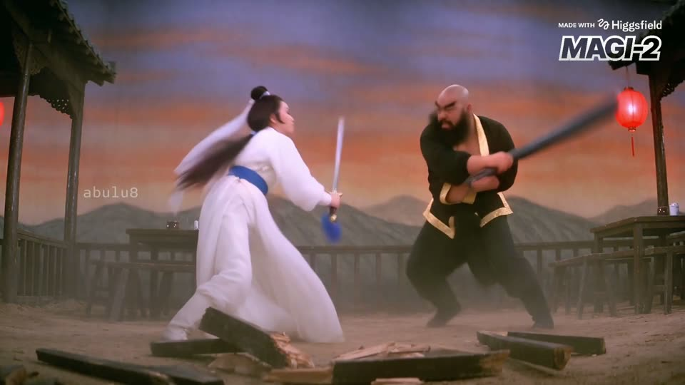

<!-- Generated by scripts/build_readme.py. Edit site.config.json, content/prompts.json, and generator scripts. -->

<a id="case-cms-ae78a185"></a>

# 复古武侠片

[← 返回合集](../../README.zh-CN.md)

**来源类型**: `community` · **任务**: `T2V` · **音画**: `Yes` · **状态**: `来源收录`

社区 MAGI-2 视频案例（@abulu8）：复古武侠片。

<a href="https://awesome.raphael.app/materials/72b2e161-6fbe-42a9-ad94-0b57eeb22fe6.mp4"></a>

▶ **[播放有声视频原片](https://awesome.raphael.app/materials/72b2e161-6fbe-42a9-ad94-0b57eeb22fe6.mp4)**

**完整原始提示词**

```text
【全局前置设定：画质与质感】

1970 年代香港武侠电影质感。Techniscope 2.35:1 宽银幕，褪色偏暖的 Eastmancolor 胶片色调，厚重的胶片颗粒，轻微的片门抖动与画面边缘暗角，偶尔出现细小的划痕与灰尘斑点。

布景是那个年代的摄影棚质感：手绘的远山与晚霞背景板、夯实的黄土地面、木结构客栈、纸灯笼。暖色钨丝灯模拟黄昏，硬光、强轮廓光、人物脸上有明显的油彩妆感。

所有特效都是实拍物理效果：吊威亚的腾跃、真实碎裂的木器、铁器撞击的火星、黄土扬尘。全片绝对没有能量光效、气功光、彩色剑气或数字特效。

声音是那个年代的后期配音质感：兵器碰撞声、拳脚声略微过响、过干净；每一次重击配一记鼓点或锣声；急促的鼓点从第一帧贯穿到最后一帧，一刻不停。

【柳寒霜·白衣女侠】

成年东亚女性，身高 5 英尺 6 寸，身形修长挺拔，体态轻盈。黑色长发在头顶束成高髻，细长眉眼，那个年代的油彩妆容。白色交领长袍，蓝色宽腰带，袖口收紧，下摆宽大，腾跃时如花瓣展开。白色布鞋。手持细长直剑，深褐色木剑鞘，蓝色剑穗。

她快、准、狠。出手幅度小，速度极快，以巧破力。全程神情冷静、专注。

【熊霸天·黑衣山贼头目】

成年东亚男性，身高 6 英尺 2 寸，体型魁梧厚重，肩宽背阔。光头，浓密的黑色络腮胡垂到胸口，粗眉，一颗金牙。黑色短打长袍镶金色滚边，敞胸，粗布腰带，黑色布靴。手持粗重铁棍，棍身黝黑，两端包铁。

他凶、猛、重。每一棍都用尽全力，攻势一浪接一浪，砸到哪里哪里碎。

【体型比例·必须严格遵守】

柳寒霜 5 英尺 6 寸，熊霸天 6 英尺 2 寸。同框时柳寒霜的头顶只到熊霸天的下巴，熊霸天体宽是她的两倍。全程严格保持。

【场景：黄昏客栈后院】

荒野客栈的夯土后院。压实的黄土地面，散落干草与枯叶。一侧是两层木结构客栈，二楼有木栏杆回廊，深褐色木廊柱。院中有长木凳、木桌、木酒桶，墙角堆着一摞土陶酒坛。屋檐下一排红色纸灯笼。背景是手绘远山晚霞背景板。

【可破坏结构】长木凳、木桌、酒桶、酒坛、回廊栏杆与栏柱、纸灯笼、木柱——全部可以被砸碎、踢飞、劈断、点燃。已损坏处永久保持。

【刚性空间锚点】客栈、二楼回廊、木柱、墙角酒坛、远山背景板，全片绝不漂移、消失或改变数量。

【全片从第一帧到最后一帧都是恶斗·必须严格遵守】

第 0 帧两人已经在交手，兵器正在相撞。没有开场对峙、没有亮相、没有出鞘的仪式。

第 0 秒到第 30 秒，两人的兵器始终在交击，任何一秒都不允许出现没有攻防的画面。最后一帧依然处在高速运动中。

绝对禁止：对峙、凝视、慢慢走近、站着不动、单独的表情镜头、单独的反应镜头、僵持、蓄力、摆架势、慢动作、停顿、收剑、转身离开、结尾的静止画面、定格。

变焦急推（crash zoom）只作为 0.3 秒的插入，插在两次交击之间，插完立刻回到打斗。

每一招都有起手、轨迹、目标、接触反馈与收势；每一次移动都交代从哪里到哪里；每一次格挡都有火星、木屑、扬尘或身体后滑的真实反馈。

【密度】全片每秒 6—8 次清晰的攻防状态变化，下方每段都写明了交击次数，必须全部打出来。速度快至巅峰，但不是快进，不用模糊残影掩盖动作。

【伤害等级 0】无血、无伤口。凶狠体现为：衣袍被划破、兵器撞出火星、器物被砸碎、扬尘、被震退滑行。

【胜负】柳寒霜赢。

【对白规则】本片没有任何台词、对白、旁白或内心独白。所有文字都是画面说明，绝对不得念出、不得配音。

【运镜·七十年代武侠语法】

不使用现代手持晃动与 FPV。使用：横移跟拍跟随追打；腾跃时低角度仰拍；固定广角交代走位；0.3 秒的变焦急推插入作为节奏重音。

近景与广角交替：每一段贴身快打之后立即切回广角让观众看清走位，绝不长时间停留在近景里。

━━━━━━━━━━━━━━━━━━

【0.0—3.0 秒｜开打·十次交击】

第 0 帧：固定低角度广角，黄昏客栈后院正中央，熊霸天的铁棍正当头砸下，柳寒霜已经侧身让过——木凳被砸成两截，木屑飞溅。

紧接着：她连刺三剑取胸口，他横棍连挡三下，三串火星；他回棍横扫腰际，她竖剑硬架，被震退半步；他扫堂棍扫脚踝，她翻身跃起越过铁棍；落地即反手一削，他仰身让过；他借仰身之势一棍上挑，她剑压棍头卸开。

每一次碰撞配一记鼓点。

【3.0—5.5 秒｜追打上廊·八次交击】

横移跟拍。柳寒霜踩上酒桶借力，吊威亚跃上二楼回廊栏杆，白袍展开。

熊霸天追到廊下向上连抡，她在栏杆顶上边跑边挡：一棍——她剑格开，栏柱断；二棍——她跳过，栏柱断；三棍——她踩住棍头借力，再断一根；四棍——她俯身反刺他肩头，他缩肩避开。灯笼被震落，在地上燃起小火。

每断一根栏柱配一记锣声。

【5.5—8.0 秒｜翻越反击·九次交击】

0.3 秒近景插入：她的脚在最后一根栏柱上一蹬。

切回广角：她从他头顶翻过，空中就已出剑——反手一剑划开他后背的黑袍，金滚边耷拉下来。落地瞬间他头也不回反手横扫，她矮身让过；他转身连砸三棍，她左、右、左连闪，三棍砸在地上黄土炸开；她趁他收棍连刺两剑取手腕，他转棍格开两下。

【8.0—11.0 秒｜贴身快打·十二次交击】

紧凑双人近景，全片最快的节奏之一：

棍尾捣腹——剑脊格开；剑削手腕——转棍挡住；棍头砸肩——她沉肩让过；剑刺肋下——他扭身避开；肘撞——她掌推卸开；膝顶——她提膝封住；她剑挑下巴——他后仰；他回棍压剑——她旋腕脱开；她剑劈膝——他竖棍挡下；他棍尾撞胸——她侧身；她剑扫——他低头；他铁棍勾住她的剑身一绞——

剑从她手中脱飞，旋转着钉进院中的木柱。

【11.0—14.0 秒｜空手·十次交击】

立刻切回广角，一拍都不停。柳寒霜空手迎着铁棍冲上去：

他当头砸下，她侧滑躲过，一掌拍在棍身上把棍路拍偏；他横扫，她跃起踩住棍身借力，一脚踢在他胸口，他后退两步；他怒吼连砸四棍，她连闪四步，每一棍都砸碎一样东西——木桌、酒桶、长凳、一只酒坛；她已经被逼到墙角那摞酒坛前，转身就抬脚。

【14.0—16.5 秒｜酒坛·八次交击】

她连踢三只酒坛砸向他——他抡棍连挡三下，三只酒坛在棍上接连炸开，酒水喷了他满头满脸。

他眼前一片模糊，胡乱横扫，她从棍下滑过冲向木柱，三步蹬上柱身，下落时拔出剑，落地的同时连劈两剑——他凭感觉举棍连挡两下，火星四溅，被震退一步。

【16.5—20.0 秒｜旋风·十四次交击】

广角与近景交替，全片密度最高段。

熊霸天一边抹眼睛一边把铁棍抡成旋风直冲过来，卷起一圈黄尘，剩下的灯笼一盏接一盏被风吹灭。

柳寒霜正面迎上，剑与旋转的铁棍连续交击：上、下、左、右、上、上、下、左、下、右——每一下都迸出火星，每一下都配一记鼓点。两人在院子里边打边转圈，踩过碎木与酒水，脚下黄土不断扬起，又撞翻了一条长凳。

【20.0—23.0 秒｜回廊下·十次交击】

两人边打边移到回廊底下的木柱之间。

他一棍横扫，她绕柱闪过，木柱被砸出一道裂口；她从柱后刺出，他侧身；他一棍从柱旁捅来，她踩住廊下的木栏借力翻上半空；空中连劈三剑，他举棍连挡三下；她落在他身侧，他回身就砸，她滚地躲开，铁棍砸进地面半尺深，黄土炸开。

【23.0—26.0 秒｜破棍·九次交击】

他从地里拔出铁棍，双手高举全力劈下——这是他最重的一击。

柳寒霜不退反进，迎着铁棍冲上去，剑刃贴着铁棍向下一滑——铁棍沿长度方向被劈成两半，左右两截飞了出去。

他手里只剩两截短棍，左右开弓疯狂乱砸：左、右、左、右——她连格四下，火星连成一线；第五下她旋身贴到他胸前，剑刃从他下巴前一掠而过。

【26.0—28.5 秒｜胡子·八次交击】

0.3 秒变焦急推插入：熊霸天的眼睛瞪圆。

他那把浓密的络腮胡被齐齐削断，正在空中飘散——他还不肯停，双手各持半截短棍又扑上来：左砸、右砸、双棍交叉合击——她连闪三下，一脚踹在他胸口，他倒飞出去撞上酒坛堆，酒坛哗啦倒了一片，又一脚踢飞他左手的短棍，一剑挑飞他右手的短棍。

两截短棍在空中翻转。

【28.5—30.0 秒｜收尾·仍在运动中】

熊霸天从酒坛堆里挣扎着要爬起来，柳寒霜已经凌空扑到——她的剑尖在他光秃秃的下巴前一寸处急停，同一瞬间她借冲势在他头顶上方翻身而过，白袍在空中展开，落向他身后。

两截被挑飞的短棍正从空中落下，砸在他身边的地上弹起。

最后一帧依然在高速运动中：柳寒霜正在空中翻身，白袍飞扬；熊霸天跌坐在碎坛与酒水之中，惊恐地抬头；短棍还在弹跳；碎木与黄尘还在飞。横移跟拍随着她的翻身持续移动，画面在运动中结束。

━━━━━━━━━━━━━━━━━━

【全局约束】

masterpiece, highest quality，1970 年代香港武侠片质感。

柳寒霜始终白袍蓝腰带高发髻，熊霸天始终光头黑袍金滚边。熊霸天的胡子只在 26 秒被削掉。

全场只有两件兵器。剑在 11—16.5 秒钉在木柱上，由柳寒霜亲手拔回。铁棍在 23 秒被劈成两半，此后熊霸天手持两截短棍，28 秒被全部打飞。

破坏只能单向累积，必须由实际接触触发。两人体型差全程保持。

全片 30 秒无任何静止时刻，最后一帧处于运动中。

【负面提示词】

开场对峙，亮相，拔剑仪式，对视，凝视，慢慢走近，站着不动，单独的表情镜头，单独的反应镜头，长时间的面部特写，变焦急推超过 0.3 秒，僵持，蓄力，摆架势，停顿，节奏缓慢，打斗中断，一招一停，互相等待，轮流表演，全片慢动作，收剑入鞘，转身离开，走出画面，结尾静止，定格帧，冻结画面，最后一帧静止；

能量光效，气功光，彩色剑气，发光武器，数字特效，CGI 质感，粒子特效；

现代数字摄影质感，饱和鲜艳的现代调色，手持晃动，FPV 运动，无人机镜头；

快进感，跳帧加速，动作没有重量，模糊残影掩盖动作；

流血，伤口，死亡；

台词，对白，旁白，字幕，人名字幕，Logo，水印；

换脸，换装，柳寒霜头发散开，熊霸天胡子提前消失，兵器复制，出现第三件兵器，出现第三个人；

体型差消失，柳寒霜比熊霸天高；

客栈消失，回廊消失，夜景，白天正午，现代建筑，背景板变成真实山景，破坏复原；

硬切成黑屏，镜头瞬移，人物出画，低清晰度，卡顿，卡通渲染，动漫风格，3D 渲染。
```

| 参数 | 配置 |
| --- | --- |
| 模型 | MAGI-2 (flagship) |
| 任务类型 | t2v |
| 时长 / 帧率 | 29.5s · 30 fps |
| 分辨率 / 比例 | 1080p · 16:9 |
| 音频模式 | dialogue (audio=True) |

[原始来源](https://x.com/abulu8/status/2125761364677529817) · 作者: [@abulu8](https://x.com/abulu8) · 2026-11-26

> MAGI-2 为作者自述，未经独立核实。

**[在 Raphael 上生成同类视频 →](https://raphael.app/ai-video-generator?utm_source=github&utm_medium=repository&utm_campaign=magi_2_launch&utm_content=case_cms-ae78a185&utm_term=zh-CN)**
