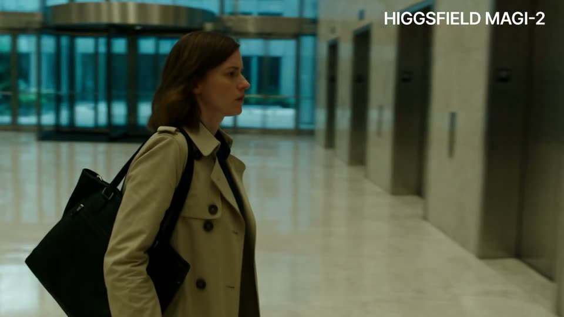

<!-- Generated by scripts/build_readme.py. Edit site.config.json, content/prompts.json, and generator scripts. -->

<a id="case-cms-b52d2b0b"></a>

# 电梯里的第十三层

[← Back to collection](../../README.md)

**Origin**: `community` · **Task**: `T2V` · **Audio**: `Yes` · **Status**: `Source-linked`

GENRE: Cinematic mystery thriller DURATION: Exactly 30 seconds, 16:9, photorealistic live-action film look STYLE: Shot like a real…

<a href="https://awesome.raphael.app/materials/9f405e26-08c6-4cff-8412-826fef20f0f7.mp4"></a>

▶ **[Watch audio-enabled MP4](https://awesome.raphael.app/materials/9f405e26-08c6-4cff-8412-826fef20f0f7.mp4)**

**Full Prompt**

```text
GENRE: Cinematic mystery thriller
DURATION: Exactly 30 seconds, 16:9, photorealistic live-action film look

STYLE: Shot like a real feature film. Natural real-time motion at normal speed, NO slow motion, NO time-lapse. Handheld-steady cinematography, shallow depth of field, realistic skin texture, cold fluorescent lighting, subtle film grain. Moody teal and green color grade.

CHARACTER (keep identical in every shot):
Emma, 30-year-old woman, shoulder-length brown hair, beige trench coat, black work bag on her shoulder, tired but alert expression.

SETTING: A modern 12-floor office building, late at night, empty and quiet.

SHOT 1 (0-6s): Medium tracking shot. Emma walks quickly across the empty lobby, heels clicking on marble. She presses the elevator button, the doors open, she steps in and checks her phone. Natural walking speed.

SHOT 2 (6-13s): Inside the elevator, close-up on the button panel: floors 1 to 12, and above them an extra glowing button labeled "13". Emma notices it, frowns, and says quietly: "This building only has twelve floors." She presses "Lobby". The elevator starts moving UP instead, the floor display counting 10... 11... 12... 13.

SHOT 3 (13-20s): The elevator dings and stops. Doors open slowly at normal speed to a dim corridor with flickering lights. Emma hesitates, then steps out. Camera follows from behind as she walks down the hallway. Her footsteps echo. The elevator doors close behind her.

SHOT 4 (20-26s): The corridor opens into an office floor that is an exact copy of her own workplace: same desks, same posters, same coffee mug. On the last desk, her own desk, a phone starts ringing. Emma approaches, looks at the phone screen. Close-up of her face reflecting the glow of the screen.

SHOT 5 (26-30s): Close-up on the phone screen: caller ID reads "EMMA". Emma whispers: "That's... my number." Sudden cut to black. White text on screen: "THE 13TH FLOOR".

AUDIO: Empty building ambience, fluorescent light hum, elevator ding, echoing footsteps, ringing phone, low tense cinematic score building slowly. English dialogue with natural voice, no music lyrics.

AVOID: Slow motion, horror, ghosts, monsters, blood, cartoon look, slideshow effect, static images, face or outfit changes between shots.
```

| Parameter | Value |
| --- | --- |
| Model | MAGI-2 (flagship) |
| Task type | t2v |
| Duration / FPS | 30.2s · 60 fps |
| Resolution / Ratio | 1080p · 16:9 |
| Audio mode | mixed (audio=True) |

[Original source](https://x.com/Hope_Ai01/status/2125920173903184107) · Creator: [@Hope_Ai01](https://x.com/Hope_Ai01) · 2026-11-26

> 模型 MAGI-2 为作者自述，未经独立核实。

**[Generate similar on Raphael →](https://raphael.app/ai-video-generator?utm_source=github&utm_medium=repository&utm_campaign=magi_2_launch&utm_content=case_cms-b52d2b0b&utm_term=en)**
