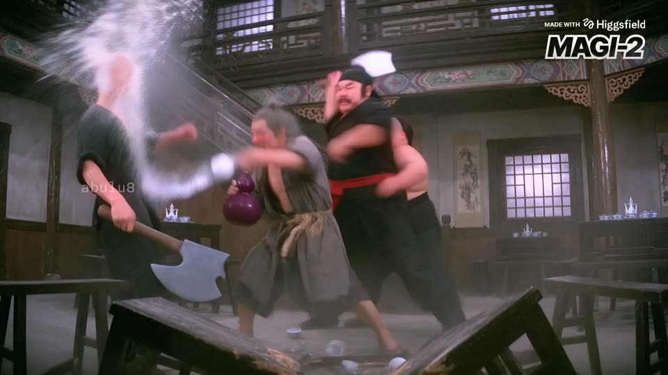

<!-- Generated by scripts/build_readme.py. Edit site.config.json, content/prompts.json, and generator scripts. -->

<a id="case-cms-b6a12ce7"></a>

# 醉仙翁大战三兄弟

[← 返回合集](../../README.zh-CN.md)

**来源类型**: `community` · **任务**: `T2V` · **音画**: `Yes` · **状态**: `来源收录`

社区 MAGI-2 视频案例（@abulu8）：醉仙翁大战三兄弟。

<a href="https://awesome.raphael.app/materials/f49b589b-fa4a-4401-b97f-7f4b5b1e3235.mp4"></a>

▶ **[播放有声视频原片](https://awesome.raphael.app/materials/f49b589b-fa4a-4401-b97f-7f4b5b1e3235.mp4)**

**完整原始提示词**

```text
【全局前置设定：画质与质感】

1970 年代香港武侠电影质感。Techniscope 2.35:1 宽银幕，褪色偏暖的 Eastmancolor 胶片色调，厚重的胶片颗粒，轻微的片门抖动与画面边缘暗角，偶尔出现细小的划痕与灰尘斑点。

布景是那个年代的摄影棚质感：两层木结构茶楼内景，彩绘的木梁，油灯与灯笼的暖黄光，硬光、强轮廓光、人物脸上有明显的油彩妆感。空气中漂浮着茶水的热气与扬起的灰尘。

所有特效都是实拍物理效果：吊威亚的腾跃、真实碎裂的木器与瓷器、斧刃撞击的火星、扬尘、泼溅的茶水与酒。全片绝对没有能量光效、气功光或数字特效。

声音是那个年代的后期配音质感：拳脚声、器物碎裂声略微过响、过干净；每一次重击配一记鼓点或锣声；一段轻快俏皮的笛子与锣鼓配乐从第一帧贯穿到最后一帧。

【醉仙翁·醉拳老头】

成年东亚男性，约六十岁，身高 5 英尺 4 寸，身形精瘦干巴，看起来弱不禁风。乱糟糟的花白头发在头顶扎成一个歪斜的小髻，稀疏的山羊胡，红通通的酒糟鼻，两颊醉红，眯缝着一双醉眼，常常咧嘴傻笑露出缺了一颗的门牙。身穿洗得发白的灰褐色破旧长衫，衣襟敞着，袖子一长一短，腰上系一根草绳，草绳上挂着一只紫红色的大酒葫芦。脚上一双磨破的草鞋。

他打的是醉拳：身体永远东倒西歪，脚步踉跄打晃，好像随时要摔倒——但每一次"摔"都恰好躲开攻击，每一次"晃"都恰好打中对方。他边打边喝酒，酒葫芦从不离手，既是酒壶也是兵器。他全程笑嘻嘻的，从不认真，从不生气。

【斧头三兄弟】

三兄弟穿同样的黑色短打，腰系红布带，手持同样的短柄宽刃板斧，但体型完全不同，必须一眼区分：

老大·铁牛：身高 6 英尺 3 寸，最高最壮，方脸，满脸横肉，粗黑八字胡，头戴黑色布头巾。双手各持一把板斧。动作最重最猛。

老二·瘦猴：身高 5 英尺 10 寸，又高又瘦，长脸尖下巴，光头，两颗龅牙。单手持一把板斧。动作最快最滑。

老三·肥狗：身高 5 英尺 6 寸，又矮又胖，圆脸大肚子，脑后拖一根细长辫子。单手持一把板斧。动作最笨，总是被自己人撞到。

三人全程是三个人，绝不增减，外貌绝不互换。

【体型比例·必须严格遵守】

醉仙翁 5 英尺 4 寸，全场最矮。铁牛 6 英尺 3 寸，比醉仙翁高出一个多头。瘦猴 5 英尺 10 寸。肥狗 5 英尺 6 寸，宽度是醉仙翁的两倍。全程严格保持。

【场景：醉仙楼·两层茶楼】

一座两层木结构的老茶楼内堂。一楼摆着十几张八仙桌与长条板凳，桌上有茶壶、茶碗、碟子、酒坛。一侧是一道宽木楼梯通往二楼，楼梯扶手是长长的光滑木栏。二楼是一圈环形回廊，木栏杆围着天井，可以俯瞰一楼。天井正上方从横梁上吊下一盏巨大的圆形红灯笼。墙上挂着字画与鸟笼。柜台后面是一排酒坛架子。窗户是木格纸窗。

【可破坏结构】八仙桌、板凳、茶壶茶碗、酒坛、楼梯扶手、二楼栏杆、纸窗、鸟笼、字画、柜台、酒坛架子、吊灯笼——全部可以被砸碎、劈开、踢飞、撞穿。已损坏处永久保持。

【刚性空间锚点】楼梯的位置、二楼回廊、天井上方的大灯笼、柜台与酒坛架，全片绝不漂移、消失或改变数量。

【全片从第一帧到最后一帧都是恶斗·必须严格遵守】

第 0 帧已经在打。没有开场对峙、没有亮相、没有介绍人物。

第 0 秒到第 30 秒，攻防一刻不停，任何一秒都不允许出现没有攻防的画面。最后一帧依然处在高速运动中。

绝对禁止：对峙、凝视、站着不动、单独的表情镜头、单独的反应镜头、僵持、蓄力、摆架势、慢动作、停顿、结尾的静止画面、定格。

变焦急推只作为 0.3 秒的插入，插完立刻回到打斗。

每一招都有起手、轨迹、目标、接触反馈与收势；每一次移动交代从哪里到哪里。

【醉拳的物理·必须严格遵守】

醉仙翁的每一个躲闪都必须看起来像是意外：脚下一滑、身子一歪、打个酒嗝、弯腰去捡掉下的东西——恰好让斧头擦身而过。他的每一次反击都必须看起来像是顺势：倒下时一脚踢出、晃过去时一肘撞上、举起葫芦喝酒时葫芦底正好砸中对方的下巴。

他的身体软得像没有骨头，但每一次接触都结结实实，对手被打得真实地踉跄、倒飞、撞碎家具。

【密度】全片每秒 6—8 次清晰的攻防状态变化，下方每段写明了交击次数，必须全部打出来。速度快至巅峰，但不是快进，不用模糊残影掩盖动作。

【伤害等级 0】无血、无伤口。斧刃从不砍中身体，只砍中家具与器物。狼狈只体现为：被打得踉跄倒飞、撞翻桌子、被茶水泼一脸、摔个四脚朝天、衣服被撕破。

【胜负】醉仙翁赢，三兄弟全部倒下。

【对白规则】本片没有任何台词、对白、旁白或内心独白。所有文字都是画面说明，绝对不得念出、不得配音。醉仙翁的酒嗝与笑声是声音，不是台词。

【运镜·七十年代武侠语法】

不使用现代手持晃动与 FPV。使用：横移跟拍跟随追打；腾跃时低角度仰拍；固定广角交代走位；从二楼俯拍一楼的天井视角；0.3 秒的变焦急推插入作为节奏重音。

近景与广角交替：每一段贴身快打之后立即切回广角让观众看清四个人的走位。

━━━━━━━━━━━━━━━━━━

【0.0—3.0 秒｜开打·十次交击】

第 0 帧：固定低角度广角，一楼正中，铁牛的双斧正当头劈下——醉仙翁打了个酒嗝，身子往后一仰，双斧劈进他刚坐的八仙桌，桌子从中间裂成两半，茶碗飞起。

紧接着：瘦猴从左边一斧横砍，醉仙翁脚下一滑弯腰捡起一只掉落的茶碗，斧头从他头顶掠过；他起身时茶碗里的热茶正好泼在瘦猴脸上；肥狗从右边扑来，醉仙翁一歪身，肥狗扑空撞在铁牛身上；铁牛推开肥狗再砍，醉仙翁像不倒翁一样往左一倒、往右一弹，两斧都落空；他顺势举起酒葫芦喝了一口，葫芦底正好砸在铁牛的下巴上，铁牛仰头后退两步。

每一次碰撞配一记鼓点。

【3.0—6.0 秒｜板凳·十一次交击】

横移跟拍。醉仙翁用脚尖一挑，一条长板凳飞起落在他手里。

三把斧子同时砍来——他把板凳横在身前一挡，三把斧子全剁进板凳里卡住；他把板凳一拧，三兄弟被带得东倒西歪；他抽身一转，板凳一头扫中瘦猴的膝弯，瘦猴跪下；另一头撞中肥狗的肚子，肥狗弹开；铁牛拔出斧头连劈两下，板凳被劈成三截；醉仙翁手里只剩一截短凳腿，他用凳腿连敲铁牛的手腕三下，铁牛一只斧头脱手飞出，钉进柜台。

【6.0—9.0 秒｜上楼·十次交击】

0.3 秒近景插入：醉仙翁打了个大大的酒嗝，眯眼笑。

切回广角：他踉跄着往楼梯跑，一步三晃，三兄弟紧追。

楼梯上的追打：瘦猴从下往上砍他的脚踝，他一抬脚斧头砍进台阶；肥狗抓他的衣角，他转身一屁股坐下把肥狗压了个趔趄；铁牛从后面一斧劈来，他往扶手上一趴，斧头劈断一截扶手；他从扶手上滚到另一侧，脚一勾把瘦猴勾得从楼梯上滚了下去；瘦猴撞翻楼梯口的两张桌子，碗碟碎了一地。

【9.0—12.0 秒｜二楼回廊·十二次交击】

醉仙翁晃上二楼回廊，铁牛和肥狗追上来，一前一后把他堵在中间。

紧凑近景，贴身快打：铁牛单斧横扫，他后仰几乎躺倒在栏杆上，斧头砍进栏杆；肥狗从背后扑来，他向前一歪，肥狗扑空撞在铁牛怀里；两人分开同时出手，他蹲下，两人的手在他头顶撞在一起；他站起时脑袋顶中肥狗的下巴；铁牛一斧劈下，他用酒葫芦一挡，斧刃在葫芦上滑开迸出火星；他摘下墙上的鸟笼扣在肥狗头上；肥狗看不见，抡着斧头乱砍，砍碎了一扇纸窗和一幅字画；醉仙翁趁乱一脚把他踹得撞穿另一扇纸窗，半个身子卡在窗格里，两条短腿乱蹬。

【12.0—15.0 秒｜天井·十次交击】

从二楼俯拍天井的视角。

瘦猴从一楼重新冲上楼梯。铁牛双手抡斧连劈三下，把醉仙翁逼到天井栏杆边——醉仙翁往后一仰，翻出栏杆，一把抓住了天井中央那盏巨大圆灯笼的吊绳。

他吊在灯笼上荡了出去，从天井上空荡过整个二楼，两脚连踢——瘦猴刚冲上楼，被一脚踢中胸口，顺着楼梯又滚了下去；荡回来时又一脚踢中铁牛的肩膀，铁牛踉跄后退撞断了一段栏杆。

【15.0—18.0 秒｜滑扶手·九次交击】

醉仙翁松手落回二楼，跳上楼梯扶手，骑着扶手一路往下滑，酒葫芦还举在嘴边喝着。

铁牛在楼梯上追着砍，每一斧都砍在他刚滑过的扶手上，扶手一截一截断开；他滑到底的瞬间一个后空翻落地，正好落在刚爬起来的瘦猴面前；瘦猴一斧横砍，他一歪身躲开，一指戳在瘦猴的腋下，瘦猴整条胳膊软了，斧头掉在地上；他一肘撞在瘦猴的后背，瘦猴扑倒在一张八仙桌上，桌子塌了。

【18.0—21.0 秒｜酒坛·十二次交击】

广角与近景交替，全片密度最高段。

肥狗从窗格里挣脱出来，带着头上的鸟笼从二楼直接跳下，砸在一楼地上；铁牛从楼梯冲下来。两人一左一右夹击。

醉仙翁退到柜台前，抓起酒坛就扔：一坛砸中肥狗的肚子炸开，酒水泼了他一身；一坛被铁牛一斧劈碎；一坛他自己举起来喝了一大口，转身把一口酒喷在铁牛脸上；铁牛眼前一花乱砍，三斧全砍在柜台上，柜台碎成几块；醉仙翁趁乱踩着肥狗的大肚子跳起来，在空中连踢铁牛的胸口两脚；落地时一把扯住肥狗脑后的辫子，抡起来转了半圈甩出去，肥狗撞在酒坛架上，整排酒坛哗啦倒下砸在他身上。

【21.0—24.0 秒｜铁牛·十次交击】

只剩铁牛。他从柜台残骸里拔出钉在那里的另一把斧头，双手持斧，暴怒地冲上来。

双斧连环快砍：左、右、左、右、交叉劈、上撩——醉仙翁全程东倒西歪地躲，每一下都差一寸：仰身、侧倒、弯腰、扭腰、转圈、往后一坐坐在板凳上。他坐着的那条板凳被铁牛一斧劈开，他顺势往后一翻，两脚蹬在铁牛的肚子上，铁牛倒退三步撞在一根柱子上。

【24.0—27.0 秒｜醉八仙·十一次交击】

0.3 秒变焦急推插入：醉仙翁的醉眼猛地睁开了一瞬，又眯了回去。

他仰头把酒葫芦里最后一口酒灌下去，然后整个人像一根柳条一样摇摇晃晃地扑向铁牛：

一肘撞胸、一膝顶腹、一掌拍肩、转身一屁股撞腰、倒地一脚扫踝、起身一拳捣肚、歪头躲过一斧、葫芦砸手腕——铁牛一把斧头飞出去；再一葫芦砸另一只手腕——另一把斧头也飞出去；铁牛空手抡拳砸来，他一歪身，铁牛的拳头砸进柱子里卡住了；他踮起脚，用葫芦底在铁牛的光脑门上轻轻一敲。

【27.0—30.0 秒｜收尾·仍在运动中】

铁牛的眼睛转了两圈，直挺挺地往后倒下——正好砸在刚从酒坛堆里爬起来的肥狗身上，两人一起倒在地上；刚爬起来的瘦猴被倒下的铁牛一脚踢中，又摔了回去，三兄弟叠成一堆。

两把飞出去的斧头还在空中翻转，"哆"、"哆"两声，一左一右钉在三兄弟脑袋两边的地板上。

醉仙翁打了一个大大的酒嗝，晃晃悠悠地转身，脚下一滑——一个踉跄跳上一张还没碎的八仙桌，又从桌上一步跨上另一张，摇摇晃晃地往门口走，酒葫芦倒过来摇了摇，里面已经空了。

最后一帧依然在运动中：醉仙翁正在八仙桌上东倒西歪地迈步，空葫芦举在头顶摇晃；身后三兄弟叠成一堆在地上蠕动，头上还扣着鸟笼；天井上方的大灯笼还在来回摆荡；碎瓷、木屑与茶水还在飞溅落地。横移跟拍随着他的脚步持续移动，画面在运动中结束。

━━━━━━━━━━━━━━━━━━

【全局约束】

masterpiece, highest quality，1970 年代香港武侠片质感。

醉仙翁始终是花白歪髻、灰褐破长衫、草绳腰带、紫红酒葫芦。酒葫芦全程不离手，直到 30 秒被喝空。

三兄弟全程是三个人，体型与外貌绝不互换：铁牛最高最壮戴头巾持双斧；瘦猴高瘦光头龅牙；肥狗矮胖拖辫子，12 秒后头上一直扣着鸟笼。

斧头只有四把：铁牛两把、瘦猴一把、肥狗一把。被打飞的斧头钉在哪里就留在哪里，除非被拔出。

醉仙翁的醉拳躲闪必须全部看起来像意外，从不摆出正经的武术架势。

破坏只能单向累积，必须由实际接触触发。所有人体型全程保持。

全片 30 秒无任何静止时刻，最后一帧处于运动中。

【负面提示词】

开场对峙，亮相，对视，凝视，站着不动，单独的表情镜头，单独的反应镜头，长时间的面部特写，变焦急推超过 0.3 秒，僵持，蓄力，摆架势，停顿，节奏缓慢，打斗中断，一招一停，互相等待，轮流表演，全片慢动作，结尾静止，定格帧，冻结画面，最后一帧静止；

醉仙翁摆出正经武术架势，醉仙翁站得笔直，醉仙翁表情严肃，醉仙翁生气，醉仙翁放下酒葫芦，酒葫芦消失；

斧头砍中身体，流血，伤口，断肢，死亡，暴力血腥；

能量光效，气功光，发光武器，数字特效，CGI 质感，粒子特效；

现代数字摄影质感，饱和鲜艳的现代调色，手持晃动，FPV 运动，无人机镜头；

快进感，跳帧加速，动作没有重量，模糊残影掩盖动作；

台词，对白，旁白，字幕，人名字幕，Logo，水印；

三兄弟人数变化，出现第四个敌人，三兄弟外貌互换，铁牛变矮，肥狗变瘦，瘦猴长出头发，出现第五把斧头，人物复制，分身，茶楼客人加入打斗；

醉仙翁变高，体型差消失；

茶楼消失，楼梯消失，二楼回廊消失，大灯笼消失，室外场景，现代建筑，破坏复原；

硬切成黑屏，镜头瞬移，人物出画，低清晰度，卡顿，卡通渲染，动漫风格，3D 渲染。
```

| 参数 | 配置 |
| --- | --- |
| 模型 | MAGI-2 (flagship) |
| 任务类型 | t2v |
| 时长 / 帧率 | 30.3s · 30 fps |
| 分辨率 / 比例 | 1080p · 16:9 |
| 音频模式 | music (audio=True) |

[原始来源](https://x.com/abulu8/status/2125909905882415605) · 作者: [@abulu8](https://x.com/abulu8) · 2026-11-26

> 模型 MAGI-2 为作者自述，未经独立核实。

**[在 Raphael 上生成同类视频 →](https://raphael.app/ai-video-generator?utm_source=github&utm_medium=repository&utm_campaign=magi_2_launch&utm_content=case_cms-b6a12ce7&utm_term=zh-CN)**
