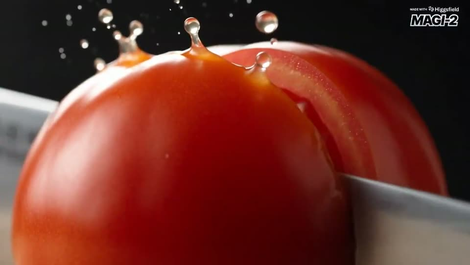

<!-- Generated by scripts/build_readme.py. Edit site.config.json, content/prompts.json, and generator scripts. -->

<a id="case-cms-ba7672e8"></a>

# 日式精致料理广告

[← 返回合集](../../README.zh-CN.md)

**来源类型**: `community` · **任务**: `T2V` · **音画**: `Yes` · **状态**: `来源收录`

社区 MAGI-2 视频案例（@ChillaiKalan__）：日式精致料理广告。

<a href="https://awesome.raphael.app/materials/93c720b4-adec-485f-bcd5-0f5ec06d7df9.mp4"></a>

▶ **[播放有声视频原片](https://awesome.raphael.app/materials/93c720b4-adec-485f-bcd5-0f5ec06d7df9.mp4)**

**完整原始提示词**

```text
Create a 15-second premium cinematic food commercial featuring an experienced Japanese master chef preparing an extraordinary fine-dining dish. The chef wears a perfectly clean white uniform and a dark apron.
SHOT 01 | 0–3s: Extreme macro shot of a razor-sharp Japanese knife slicing a fresh red tomato. Juice droplets hang in the air.
SHOT 02 | 3–6s: Rapid close-ups of vegetables being chopped, flames rising from a pan and ingredients falling in slow motion.
SHOT 03 | 6–9s: The chef tosses ingredients into a pan. A beautiful flame briefly illuminates his focused face.
SHOT 04 | 9–12s: Delicate sauce is poured onto a handmade ceramic plate. Every ingredient is positioned with surgical precision.
SHOT 05 | 12–15s: The completed dish rotates slowly under dramatic restaurant lighting. Steam rises as the camera pushes into the final presentation.
BGM: Sophisticated jazz mixed with rhythmic kitchen sounds, knife impacts, sizzling butter and subtle orchestral accents.
```

| 参数 | 配置 |
| --- | --- |
| 模型 | MAGI-2 (flagship) |
| 任务类型 | t2v |
| 时长 / 帧率 | 15.2s · 60 fps |
| 分辨率 / 比例 | 720p · 16:9 |
| 音频模式 | mixed (audio=True) |

[原始来源](https://x.com/ChillaiKalan__/status/2125853960187888050) · 作者: [@ChillaiKalan__](https://x.com/ChillaiKalan__) · 2026-11-26

> MAGI-2 为作者自述，未经独立核实。

**[在 Raphael 上生成同类视频 →](https://raphael.app/ai-video-generator?utm_source=github&utm_medium=repository&utm_campaign=magi_2_launch&utm_content=case_cms-ba7672e8&utm_term=zh-CN)**
