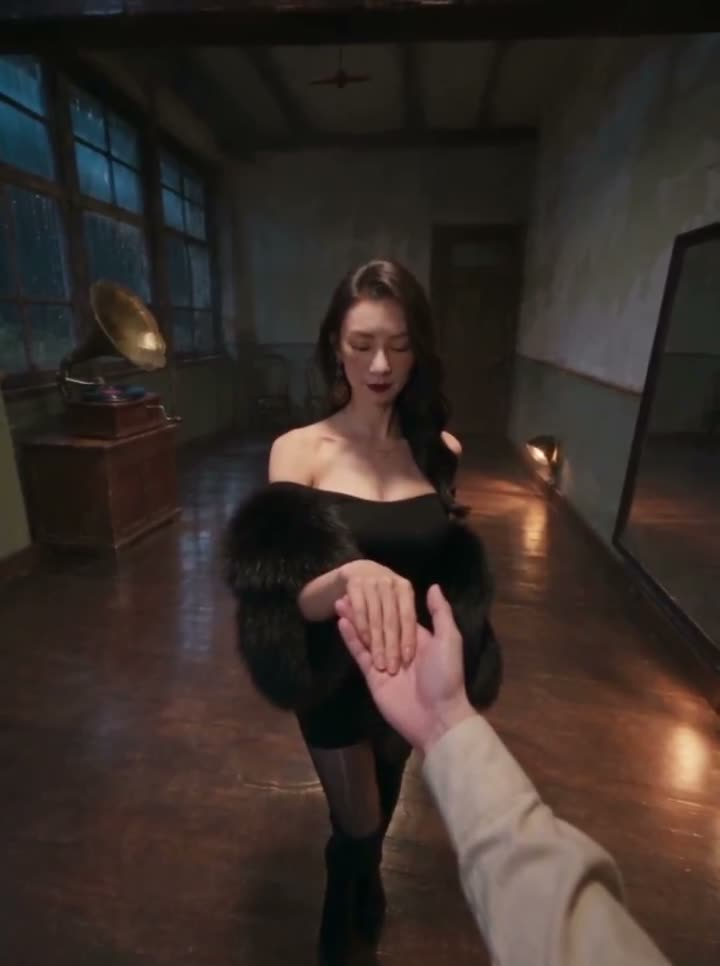

<!-- Generated by scripts/build_readme.py. Edit site.config.json, content/prompts.json, and generator scripts. -->

<a id="case-cms-bd4ae1e1"></a>

# 无底洞里走回来的鞋

[← 返回合集](../../README.zh-CN.md)

**来源类型**: `community` · **任务**: `OMNI-REF` · **音画**: `Yes` · **状态**: `来源收录`

社区 MAGI-2 视频案例（@john87445528）：无底洞里走回来的鞋。

<a href="https://awesome.raphael.app/materials/3cb8ab95-e891-4b12-9f62-afb844947ae3.mp4"></a>

▶ **[播放有声视频原片](https://awesome.raphael.app/materials/3cb8ab95-e891-4b12-9f62-afb844947ae3.mp4)**

**完整原始提示词**

```text
【参考图】

@图1@3c698b39-7c86-468b-8c6a-7d02f34cac25锁定女子的面容、眉眼和栗黑色高盘发。她约28岁，鬓边有两缕碎发，戴短铜坠耳环。

本次上传的服装图@3b12acd3-8eab-4e6e-9212-9ea460dd7c73锁定黑金豹纹挂颈短裙。古铜金底、黑色斑纹、细碎亮片、挂颈深V、前襟窄横带、收腰，裙摆落在大腿上段。油灯移动时，转到光里的几片亮片依次亮起来。

@图3@@7a831d83-2028-49b7-9804-ac0d89e6f27c锁定淡藕粉色薄丝袜，细密袜面有柔和珠光，大腿处可见浅粉花纹袜口。@图6锁定女子在正片中的完整造型和比例，鞋为黑漆皮尖头细高跟，鞋底朱红。右鞋前掌外缘磨掉一弯红漆，露出浅色月牙，左鞋底完整。

@图4@c5333246-e095-45e6-a8d9-e7f467768b4d仅供唐三藏、孙悟空、猪八戒、沙僧的面容、体格、衣物与道具参考。@图5锁定洞内地形。女子开场时左脚穿鞋，空的右鞋斜搁在井沿。定装照里的双脚着鞋状态只在右脚归位后出现。

【摄影、布景与站位】

1974年意大利电影的35毫米Techniscope胶片质感，按竖幅构图。褪色Eastmancolor、粗颗粒、柔和老镜头、零星尘点与细划痕。唐代志怪电影的实体洞窟布景，湿石暗灰偏青。左后方洞口漏进一线阴天散光。沙僧右手提油灯，暖光只照到近处人脸、井沿和井口以下约一米。沙僧一收手，照在井壁上的光就跟着退回来。

我站在石台中央，左侧是悟空、八戒，沙僧紧跟在我左后肩。女子侧坐在我右前方的矮石上，左脚着地，右膝在坐石背面，右小腿被石头和井沿挡住。她右手撑在石沿上，空鞋就在她手边。开场同一眼能看清她的脸、落地的左鞋、井沿上空着的右鞋。实拍视野约28毫米。风吹动我的袈裟，只有我挪脚、低头、失去平衡时，视线才跟着晃。

【00—06秒｜她手边有一只空鞋】

我进洞停步。女子坐在矮石上，左脚往回收了一点，细鞋跟在石上轻轻一响。沙僧的灯从我肩后送过来。我顺着声音看过去，先看见黑鞋口里淡粉色的袜踝，再看见旁边那只斜躺的右鞋。鞋口朝我，里面空着。鞋底翘起的一边露出朱红色，前掌那弯磨白的月牙正好迎光。

女子向我伸出左手。等我从鞋上移开目光，她才轻声说：“长老，扶我一下。”

【06—11秒｜她刚站起来，鞋就掉了】

我递出右手。她握住我的手腕，左脚踩实，右手撑石起身。石面潮湿，她撑着的手掌往外滑了一寸，手背碰上空鞋的细跟。鞋在井沿上晃了半圈。

我怕她跟着跌下去，赶紧托住她腰侧。她的重量落进我掌心，左手顺势覆在我的手背上。她抬脸看我，右耳的铜坠轻碰我胸前的袈裟搭扣。就在这声轻响后面，空鞋终于翻下去。红底朝上闪了一下，消失。 她仍靠着我，目光却已经落在井口，像在等人上来。

【11—18秒｜等来的是一个人的脚步】

八戒弯腰想捞。悟空横过金箍棒，轻轻拦住他胸口。几个人一起听。先留半拍风声和滴水。

井下响起一声清脆的“嗒”。我以为是鞋跟撞了石头。紧接着，黑暗里传来前掌把水压开的湿响。隔一拍，又是鞋跟落下、前掌踩实，这一步离我们近多了。

沙僧把灯往井口探。我低头，一只黑色尖头鞋正沿竖壁向上迈步。它抬脚时，朱红鞋底翻进灯光，外缘是刚才那道浅色月牙。脚再落下，这次我看清了鞋口：刚才看得见鞋垫的地方，现在紧紧裹着一只淡粉袜脚。 石壁上的水还在往下淌。它踩住水痕，一步一步往上走。

【18—24秒｜她终于把重量从我手上移开】

我沿着井沿俯低一点。左边，女子的左鞋还在原处，那只细跟牢牢抵着石面；右边，井里的右鞋已经翻过井唇。两只鞋第一次同时出现在我眼前。

右鞋落在她身边，本该穿鞋的人却还没站到它上面。灯光擦过它后方：连着脚踝的淡粉袜腿仍有长长一截垂在井壁外，越过石唇，在坐石背后连回她屈着的右膝。她把右膝慢慢伸直。那一截过长的小腿贴着湿石往回收，水珠被袜面一路带上井沿。最后，膝盖、脚踝、鞋跟落到同一条承重线上。右鞋跟轻响一下。

我掌心里忽然轻了。 她已经能用双脚站稳，我便想把手抽回来。她却在这一刻收拢手指，扣住了我的右腕。

【24—30秒｜原来她要我扶她下去】

“长老，扶稳。”她靠近我耳边，语气和刚才一样，“底下的路长着呢。”

话说到一半，她已经侧过身。右脚踩上竖直的内壁，细跟先点石，前掌随后压实。左脚离开石台，跟着走下去。她与我错身时，铜坠第二次碰响袈裟搭扣，这次声音由胸前往下掠过。我的布鞋尖擦到井沿，视线被她牵得向黑处一沉。

背后袈裟猛地绷紧。沙僧用空着的左手攥住我，提灯的右手也随身体后撤。暖光滑回石台。女子的手指这才从我腕上松开。

最后一眼，我的僧袖悬在井沿外。人已经走出灯光，下面却听得清清楚楚：右跟一声，左跟一声，她穿齐了那双鞋，正从容地往下走。 第二声的回音刚起，画面截断。

【声音】 全片只用洞风、滴水、衣料、两次铜坠碰扣、细鞋跟点石与湿鞋底受力的声音。女子只说两句。第一次井下鞋跟响起时，把它拍成空鞋撞石也能发出的寻常动静；直到紧随其后的前掌踩实声，观众才意识到底下有一只脚。无旁白、无字幕、无配乐。
```

| 参数 | 配置 |
| --- | --- |
| 模型 | MAGI-2 (flagship) |
| 任务类型 | omni-ref |
| 时长 / 帧率 | 60.1s · 30 fps |
| 分辨率 / 比例 | 720p · 3:4 |
| 音频模式 | mixed (audio=True) |

[原始来源](https://x.com/john87445528/status/2125760471340839051) · 作者: [@john87445528](https://x.com/john87445528) · 2026-11-26

> MAGI-2 为作者自述，未经独立核实。

**[在 Raphael 上生成同类视频 →](https://raphael.app/ai-video-generator?utm_source=github&utm_medium=repository&utm_campaign=magi_2_launch&utm_content=case_cms-bd4ae1e1&utm_term=zh-CN)**
