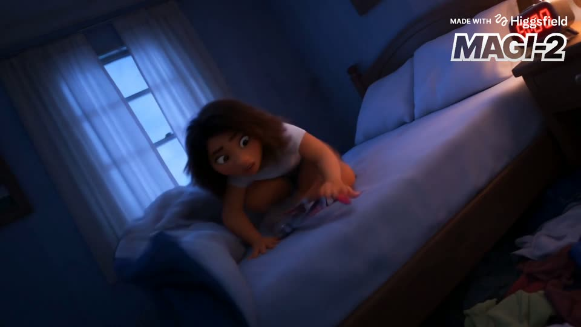

<!-- Generated by scripts/build_readme.py. Edit site.config.json, content/prompts.json, and generator scripts. -->

<a id="case-cms-c8128797"></a>

# 差点错过航班的动画旅程

[← Back to collection](../../README.md)

**Origin**: `community` · **Task**: `T2V` · **Audio**: `Yes` · **Status**: `Source-linked`

Create a fast-paced, cinematic 30-second animated travel adventure following a young woman who nearly misses her flight. STORY FLO…

<a href="https://awesome.raphael.app/materials/01526aa2-ec0c-41ff-b619-49d6bc6f0ece.mp4"></a>

▶ **[Watch audio-enabled MP4](https://awesome.raphael.app/materials/01526aa2-ec0c-41ff-b619-49d6bc6f0ece.mp4)**

**Full Prompt**

```text
Create a fast-paced, cinematic 30-second animated travel adventure following a young woman who nearly misses her flight.

STORY FLOW: She wakes up late to a blaring alarm, scrambles out of bed, gets ready in a hurry, brushes her teeth, fixes her hair, and grabs a quick coffee. After changing into a casual crop top and shorts, she packs her handbag, grabs her passport, and rushes out with her rolling suitcase.

A taxi speeds through rainy city streets as she watches the clock anxiously. At the airport, she races through the terminal, checks the departure screens, completes check-in and security, and sprints toward her boarding gate. Just as boarding is about to close, she makes it onto the plane.

Inside, she finally relaxes by the window, watching the glowing city disappear beneath the clouds. The final sequence shows her arriving at a hotel late at night, dragging her suitcase into the room, collapsing onto the bed, and giving the camera a sleepy, relieved smile before falling asleep.

VISUAL DIRECTION: Premium 3D animated feature-film quality, expressive facial animation, detailed environments, cinematic lighting, lively character movements, dramatic camera angles, quick tracking shots, overhead compositions, whip pans, dynamic close-ups, and creative match cuts. Build tension during the airport rush and transition into slower, peaceful shots during the flight and hotel arrival.

EDITING: 30 distinct shots with rhythmic, beat-matched transitions at 145 BPM. Maintain clear storytelling, smooth scene continuity, and consistent character appearance, hairstyle, and proportions.

TECHNICAL: 30 seconds, 4K, 24fps, 16:9 widescreen.

NEGATIVE: No subtitles, text overlays, logos, watermarks, duplicate characters, distorted faces, inconsistent outfits, flickering, unnatural physics, stiff animation, or abrupt scene jumps.
```

| Parameter | Value |
| --- | --- |
| Model | MAGI-2 (flagship) |
| Task type | t2v |
| Duration / FPS | 30.3s · 30 fps |
| Resolution / Ratio | 1080p · 16:9 |
| Audio mode | music (audio=True) |

[Original source](https://x.com/mehvishs25/status/2125933866666037271) · Creator: [@mehvishs25](https://x.com/mehvishs25) · 2026-11-26

> 视频使用 MAGI-2 为作者自述，未经独立核实。X 原视频：https://video.twimg.com/amplify_video/2125932962483253248/vid/avc1/1920x1080/o7-txaR8aUHpWMaz.mp4?tag=29

**[Generate similar on Raphael →](https://raphael.app/ai-video-generator?utm_source=github&utm_medium=repository&utm_campaign=magi_2_launch&utm_content=case_cms-c8128797&utm_term=en)**
