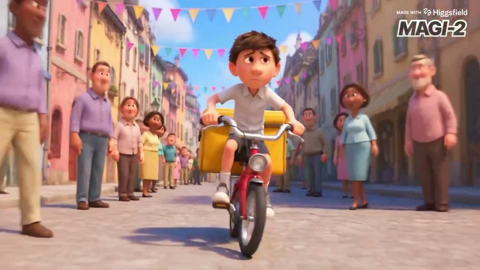

<!-- Generated by scripts/build_readme.py. Edit site.config.json, content/prompts.json, and generator scripts. -->

<a id="case-cms-ca066ab7"></a>

# 海滨小城的意外英雄

[← Back to collection](../../README.md)

**Origin**: `community` · **Task**: `T2V` · **Audio**: `Yes` · **Status**: `Source-linked`

Create a Pixar-inspired 3D animated comedy short set in a colorful seaside city on a beautiful sunny morning. A clumsy young deliv…

<a href="https://awesome.raphael.app/materials/ea40562e-5864-491b-ac79-b8dd61105de8.mp4"></a>

▶ **[Watch audio-enabled MP4](https://awesome.raphael.app/materials/ea40562e-5864-491b-ac79-b8dd61105de8.mp4)**

**Full Prompt**

```text
Create a Pixar-inspired 3D animated comedy short set in a colorful seaside city on a beautiful sunny morning.

A clumsy young delivery boy riding a small bicycle accidentally crashes into a street magician's performance. His delivery bag flies into the air, scattering dozens of colorful balloons. One balloon gets tangled around a wealthy man's wrist, pulling him away just as a giant runaway wedding cake rolls down the street.

The delivery boy panics and jumps onto his bicycle, chasing the runaway cake. In the chaos, he accidentally saves a little girl standing in its path. The crowd gasps, then cheers.

But the adventure is far from over.

The runaway cake crashes into a fruit stall, sending hundreds of watermelons bouncing across the street. The delivery boy slips on one, flies into the air, and lands perfectly inside a passing parade float shaped like a giant golden eagle.

The float suddenly takes off down the main street. The boy grabs its wings, accidentally steering it through a spectacular parade. The audience believes he is performing an incredible stunt. Cameras flash, people cheer, and the crowd starts chanting his name.

Finally, the float stops directly in front of the city's mayor. The mayor, completely impressed, presents the terrified delivery boy with a giant golden medal for bravery.

Just as everyone celebrates, the little girl he saved runs forward and gives him a warm hug. His worried mother arrives, sees the medal, and bursts into tears of happiness.

Final scene: The boy rides his tiny bicycle home proudly, wearing his oversized golden medal. His delivery bag is still empty, but his face is glowing with happiness. A little puppy runs alongside him as golden sunlight fills the street.

On-screen text appears:

"Sometimes, you don't need a plan to become someone's hero." ❤️

Visual style: High-end Pixar-inspired 3D animation, expressive facial expressions, hilarious slapstick comedy, exaggerated physics, colorful environments, cinematic tracking shots, dynamic camera movements, seamless scene transitions, emotional storytelling, playful orchestral music, beautiful lighting, polished animated short-film quality, 16: 9 aspect ratio.
```

| Parameter | Value |
| --- | --- |
| Model | MAGI-2 (flagship) |
| Task type | t2v |
| Duration / FPS | 30.1s · 30 fps |
| Resolution / Ratio | 720p · 16:9 |
| Audio mode | mixed (audio=True) |

[Original source](https://x.com/AIwithkhan/status/2125811678889791810) · Creator: [@AIwithkhan](https://x.com/AIwithkhan) · 2026-11-26

> MAGI-2 为作者自述，未经独立核实。

**[Generate similar on Raphael →](https://raphael.app/ai-video-generator?utm_source=github&utm_medium=repository&utm_campaign=magi_2_launch&utm_content=case_cms-ca066ab7&utm_term=en)**
