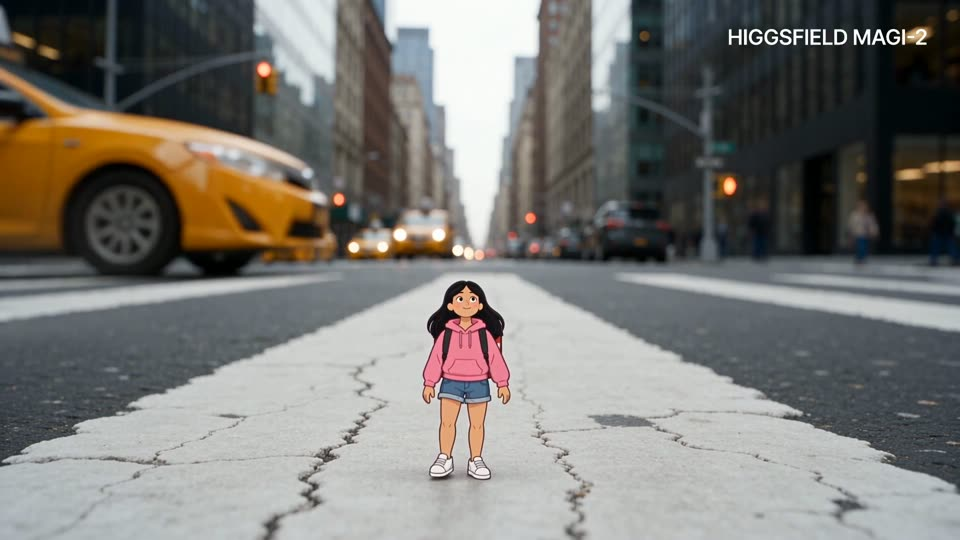

<!-- Generated by scripts/build_readme.py. Edit site.config.json, content/prompts.json, and generator scripts. -->

<a id="case-cms-d2d8aa9f"></a>

# 微型送货女孩闯纽约

[← 返回合集](../../README.zh-CN.md)

**来源类型**: `community` · **任务**: `T2V` · **音画**: `Yes` · **状态**: `来源收录`

社区 MAGI-2 视频案例（@AIwithSynthia）：微型送货女孩闯纽约。

<a href="https://awesome.raphael.app/materials/5eb34644-bc78-4a69-b6b7-fc6625c8dbfb.mp4"></a>

▶ **[播放有声视频原片](https://awesome.raphael.app/materials/5eb34644-bc78-4a69-b6b7-fc6625c8dbfb.mp4)**

**完整原始提示词**

```text
Create a whimsical mixed-reality animation featuring a miniature hand-drawn 2D young woman with long black hair, a pink hoodie, denim shorts, white sneakers, and a tiny red delivery backpack exploring a gigantic photorealistic New York street. She encounters a massive pedestrian crossing where passing cars create powerful gusts of wind that nearly blow her away, climbs onto a giant sneaker left on the pavement, slides down a newspaper stand, discovers a giant hot-dog cart where she narrowly escapes a rolling pickle, sails across a huge puddle using a discarded coffee cup lid as a boat, and gets lifted into the air by a gust of wind using her delivery bag as an improvised parachute. Finally, she lands on top of a giant pizza slice and celebrates triumphantly until a human hand suddenly picks up the slice, leaving her dangling in disbelief.
Combine expressive hand-drawn 2D animation with photorealistic urban environments, exaggerated scale, playful physics, cinematic macro close-ups, smooth camera movements, and seamless mixed-media compositing. Include realistic city ambience, traffic, footsteps, car horns, street vendor sounds, water splashes, wind, and playful comedic sound effects. No dialogue. Ultra-detailed visuals, consistent character design, cinematic depth of field, and high-end commercial animation quality.
```

| 参数 | 配置 |
| --- | --- |
| 模型 | MAGI-2 (flagship) |
| 任务类型 | t2v |
| 时长 / 帧率 | 30.3s · 30 fps |
| 分辨率 / 比例 | 1080p · 16:9 |
| 音频模式 | mixed (audio=True) |

[原始来源](https://x.com/AIwithSynthia/status/2125574502285529485) · 作者: [@AIwithSynthia](https://x.com/AIwithSynthia) · 2026-11-25

> 视频使用 MAGI-2 为作者自述，未经独立核实。X 原视频：https://video.twimg.com/amplify_video/2125574401056002049/vid/avc1/1920x1080/n56BFO-hjB3r4J7Z.mp4?tag=29

**[在 Raphael 上生成同类视频 →](https://raphael.app/ai-video-generator?utm_source=github&utm_medium=repository&utm_campaign=magi_2_launch&utm_content=case_cms-d2d8aa9f&utm_term=zh-CN)**
