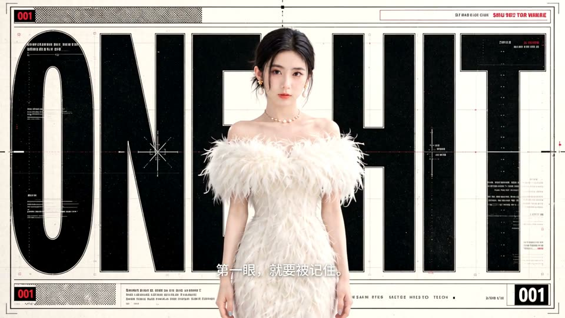

<!-- Generated by scripts/build_readme.py. Edit site.config.json, content/prompts.json, and generator scripts. -->

<a id="case-cms-de6cd92d"></a>

# ONE HIT 时装换装广告

[← Back to collection](../../README.md)

**Origin**: `community` · **Task**: `T2V` · **Audio**: `Yes` · **Status**: `Source-linked`

Create a 15-second 16:9 fashion lookbook MV combining rapid outfit changes, magazine editorial graphics, and beat-synced transitio…

<a href="https://awesome.raphael.app/materials/d2ef3d5b-4cc2-4ec9-8745-cf9097f4b48b.mp4"></a>

▶ **[Watch audio-enabled MP4](https://awesome.raphael.app/materials/d2ef3d5b-4cc2-4ec9-8745-cf9097f4b48b.mp4)**

**Full Prompt**

```text
Create a 15-second 16:9 fashion lookbook MV combining rapid outfit changes, magazine editorial graphics, and beat-synced transitions.
The video is not narrative-driven. Core structure:
Locked camera → Typography reveal → Close-up → Rapid Look switches → Hero Ending
Keep the same female character centered in frame throughout the video. Preserve facial identity, body proportions, skin tone, and overall appearance across every outfit.
0.0–1.5s
Pure white studio, girl standing naturally in the center.
Camera locked.
Huge black typography “ONE HIT” rapidly expands behind her.
Magazine elements appear on the beat:
barcode, scan lines, crosshair, numbers, thin borders, grid graphics.
The clean studio instantly becomes a bold fashion magazine poster.
1.5–3.0s
Fast camera push-in to a close-up.
The girl gently turns toward camera, hair moving naturally, direct eye contact, calm and confident expression.
Black-and-white editorial background with subtle film grain.
3.0–4.5s
Look 01.
Instant outfit change on the beat.
Character stays centered and makes a natural fashion pose.
Background switches to a completely new magazine layout with oversized headline, barcode and numbering.
4.5–6.0s
Look 02.
New outfit.
Medium shot. Girl takes one confident step forward.
Background typography rapidly changes.
Black and white remain dominant with stronger red accents.
6.0–7.5s
Look 03.
New outfit.
Girl makes a gentle half-turn, hair swinging naturally.
Background changes to red-and-white editorial graphics with huge English typography, numbers, coordinates, scan lines and borders.
7.5–9.0s
Look 04.
Sporty fashion outfit.
Girl leans slightly forward with a relaxed confident smile.
Subtle low-angle camera.
Large red magazine typography slides into frame on the beat.
9.0–10.5s
Look 05.
New outfit.
Girl moves into a stylish crouching pose.
Quick camera push-in.
Background layout completely rearranges, creating a new visual impact.
10.5–12.0s
Look 06.
Girl stands again.
Camera pulls back to medium shot.
Bold yellow fashion uniform with long blue hair styling.
Background returns to black-and-white editorial design with large headline and barcode elements.
12.0–13.5s
Look 07.
Sharp tailored suit.
Girl walks confidently toward camera.
Background switches to red-and-black magazine design.
New headline, number codes, scan lines and graphic grids appear rapidly.
Pacing becomes faster.
13.5–15.0s
Final Hero Shot.
Girl wears a minimal black fashion look.
Arms crossed, standing confidently in the center.
Camera settles into a clean medium shot.
Background gradually simplifies, leaving only a few premium magazine graphics.
Final logo or visual mark appears naturally.
Freeze on the final beat.
Overall Style
Premium Korean fashion lookbook, editorial fashion photography, Y2K magazine design, high-end commercial photography.
Black and white base with red accents.
Oversized English typography, barcode, scan lines, crosshair, coordinates, numbering, grids, thin borders, subtle film grain.
Switch to a new outfit or visual layout every 1–1.5 seconds, synchronized closely with the music beat.
Keep the camera relatively controlled. Use quick push-ins, subtle pull-backs, pose changes, graphic transitions, and layout swaps.
Character must always remain near the center of frame.
Maintain realistic hair movement, fabric physics, natural poses, clean studio lighting, and high-contrast premium photography.
Avoid
No face drift, character replacement, body morphing, extra limbs, distorted hands, unstable proportions, messy typography, chaotic camera movement, random backgrounds, cartoon style, low-quality CGI, watermark, or unwanted subtitles.
Final result should feel like a high-end Korean fashion campaign mixed with a Y2K magazine cover and beat-synced music video.
```

| Parameter | Value |
| --- | --- |
| Model | MAGI-2 (flagship) |
| Task type | t2v |
| Duration / FPS | 14.8s · 30 fps |
| Resolution / Ratio | 1080p · 16:9 |
| Audio mode | music (audio=True) |

[Original source](https://x.com/joshesye/status/2125557298135245012) · Creator: [@joshesye](https://x.com/joshesye) · 2026-11-25

> 作者在 X 原帖中称使用 MAGI-2，模型未经独立核实。完整提示词来自同一作者的回复：https://x.com/joshesye/status/2125557476208570465

**[Generate similar on Raphael →](https://raphael.app/ai-video-generator?utm_source=github&utm_medium=repository&utm_campaign=magi_2_launch&utm_content=case_cms-de6cd92d&utm_term=en)**
