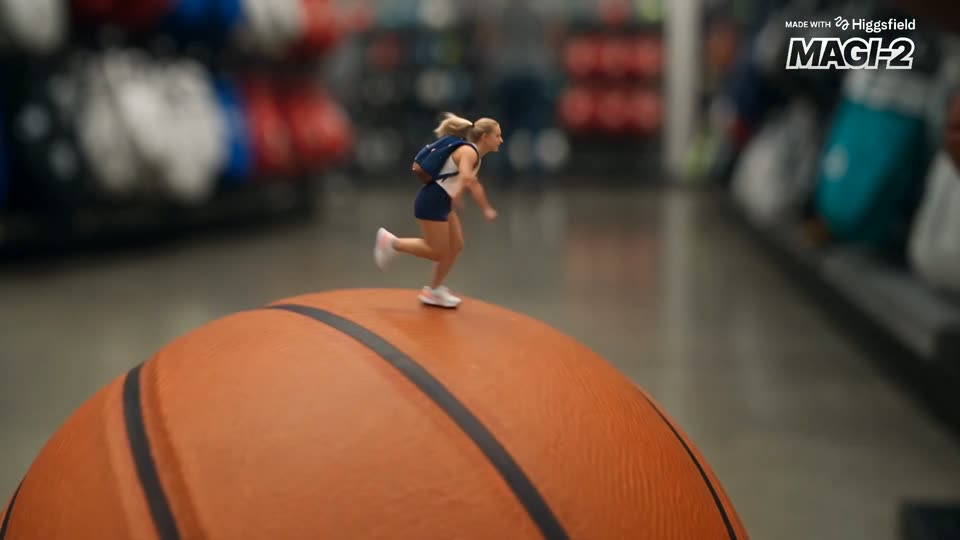

<!-- Generated by scripts/build_readme.py. Edit site.config.json, content/prompts.json, and generator scripts. -->

<a id="case-cms-df2a04e9"></a>

# 微型运动员的体育商店冒险

[← Back to collection](../../README.md)

**Origin**: `community` · **Task**: `T2V` · **Audio**: `Yes` · **Status**: `Source-linked`

STYLE: Photorealistic live-action miniature-person VFX, cinematic macro photography, ultra-shallow depth of field, authentic moder…

<a href="https://awesome.raphael.app/materials/119185ea-a847-43f2-9d48-dc07286c75ca.mp4"></a>

▶ **[Watch audio-enabled MP4](https://awesome.raphael.app/materials/119185ea-a847-43f2-9d48-dc07286c75ca.mp4)**

**Full Prompt**

```text
STYLE: Photorealistic live-action miniature-person VFX, cinematic macro photography, ultra-shallow depth of field, authentic modern sports equipment store, dynamic handheld camera, dramatic practical lighting, realistic physics, detailed material textures, premium viral commercial aesthetic, 4K.

Create a 30-second cinematic adventure featuring one athletic miniature woman at approximately 1:5 scale inside a massive sports shop. Maintain her exact face, hairstyle, outfit, body proportions, sneakers, backpack, and miniature scale consistently throughout the entire video.

She begins by sprinting across a giant basketball, jumping onto another basketball as it rolls across the shop floor. She leaps onto a towering display of footballs, running across their curved surfaces like stepping stones.

Next, she slides down the handle of an enormous cricket bat and lands on a pile of cricket balls. A giant cricket ball suddenly rolls toward her, and she narrowly escapes by jumping onto the blade of another cricket bat.

She climbs a gigantic tennis racket, runs across its strings, and jumps onto a moving display of tennis balls. She grabs the edge of a hanging sports jersey and swings across the aisle before landing on an enormous pair of running shoes.

Suddenly, a giant dumbbell rolls toward her. She dodges it, climbs its handle, and jumps onto a towering stack of colorful gym weights. She then slides down a massive boxing glove and narrowly avoids a giant football being kicked across the store.

For the next sequence, she races across oversized skateboards, jumps over giant water bottles, and uses a hanging basketball net as a swing. She lands on the rim of a giant basketball hoop, balances for a moment, and performs an incredible jump onto a massive pile of sports balls.

For the final sequence, she climbs a towering display of sports equipment and reaches the top shelf. She stands proudly beside a giant football while the camera slowly pulls back, revealing the entire sports shop, endless shelves of equipment, and customers shopping in the background. The final wide shot emphasizes how incredibly tiny she is in this enormous world.

CAMERA & VISUALS: Dynamic macro tracking shots, dramatic low angles, smooth aerial-style camera movements, strong foreground parallax, realistic reflections and shadows, shallow depth of field, detailed rubber, leather and fabric textures, natural human movement, believable physics, seamless transitions, cinematic lighting.

ENDING TITLE: “SMALL ATHLETE. GIANT ADVENTURE.” followed by “THE GAME IS BIGGER THAN YOU THINK.”

SFX: Tiny footsteps, basketball bouncing, football rolling, cricket bat impacts, tennis ball bouncing, dumbbell clanking, shoes squeaking, jersey fluttering, skateboard rolling, basketball hoop rattling, shop ambience, rushing air and cinematic impact sounds.

NEGATIVE: No cartoon, anime, toy-like appearance, animation, duplicated character, face or outfit changes, distorted anatomy, floating, inconsistent scale, unrealistic physics, narration or subtitles.
```

| Parameter | Value |
| --- | --- |
| Model | MAGI-2 (flagship) |
| Task type | t2v |
| Duration / FPS | 30.3s · 30 fps |
| Resolution / Ratio | 1080p · 16:9 |
| Audio mode | mixed (audio=True) |

[Original source](https://x.com/AIwithkhan/status/2125869765927596471) · Creator: [@AIwithkhan](https://x.com/AIwithkhan) · 2026-11-26

> MAGI-2 为作者自述，未经独立核实。

**[Generate similar on Raphael →](https://raphael.app/ai-video-generator?utm_source=github&utm_medium=repository&utm_campaign=magi_2_launch&utm_content=case_cms-df2a04e9&utm_term=en)**
