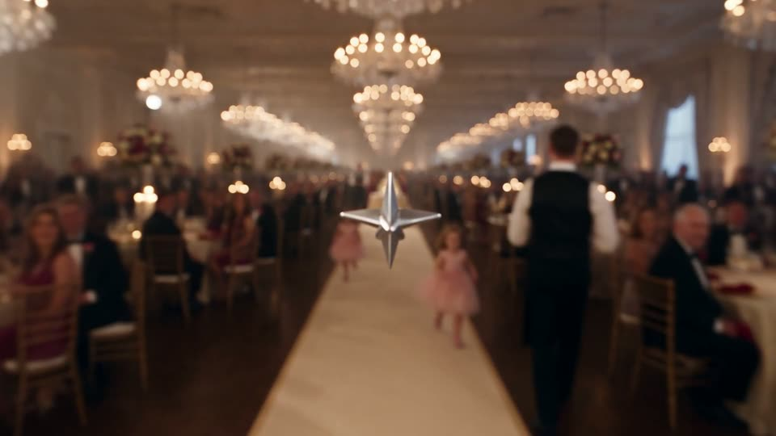

<!-- Generated by scripts/build_readme.py. Edit site.config.json, content/prompts.json, and generator scripts. -->

<a id="case-cms-e4f16f6e"></a>

# 穿过婚宴大厅的飞镖

[← Back to collection](../../README.md)

**Origin**: `community` · **Task**: `T2V` · **Audio**: `Yes` · **Status**: `Source-linked`

SCENE CONTEXT One continuous 30-second chase shot through a wedding banquet hall at , running from the head table, down the 2.5-me…

<a href="https://awesome.raphael.app/materials/27789327-3870-40e3-b5b9-06f69b670488.mp4"></a>

▶ **[Watch audio-enabled MP4](https://awesome.raphael.app/materials/27789327-3870-40e3-b5b9-06f69b670488.mp4)**

**Full Prompt**

```text
SCENE CONTEXT
One continuous 30-second chase shot through a wedding banquet hall at , running from the head table, down the 2.5-meter aisle between the round tables, past the stage, to the dessert table at the far end where a bullseye cake stands 1.15 meters off the floor. The bride in @Image1 stands at the aisle mouth. The flight line runs along the aisle's center axis at 1.15 meters.

ACTIVE REFERENCES
@Image1 (thrower) = The bride — face, hair and build 100% match the reference. She wears an ivory silk gown; the gown replaces the outfit in the reference. Reference pose, background and lighting are not inherited.

LOCATION MAP
Foreground: dark parquet dance floor with an ivory aisle runner.
Midground: eight round tables per side in ivory linen with gold chargers, wine-red napkins and tall floral centrepieces; a champagne tower on the left; crystal chandeliers hanging at 4 meters.
Background: the stage with a red-and-ivory floral arch, the dessert table with the bullseye cake, and 300 guests falling away into warm bokeh.
The camera runs on the aisle's center axis at 1.15 meters. Chandeliers at 2800K, stage wash at 3200K, a 5600K rim from the hall's rear windows for separation.

FIRST FRAME / BLOCKING
A stable shot from behind and just over the left shoulder of @Image1 standing at the aisle mouth, her veil and the back of her head filling the left third of the frame. Her right hand is raised beside her head with a small silver dart between two fingers, tip pointing down the aisle. Ahead on the right, a waiter in a black waistcoat walks away from camera with a tray. A flower girl is already running across the aisle 20 meters ahead. 300 guests are already moving, toasting and turning in their seats from frame one.

FORMAT MODE
One continuous shot, the camera does not cut on its own. Real-time speed throughout.

OPTICS
Rectilinear lens. FOV per segment, no drift mid-segment: 0–3s at 47°, 3–30s at 63°. The dart stays in sharp focus; background focus pulls to the next target as the dart nears it. Natural motion blur.

CAMERA
At the release the camera swings forward past her hand and settles 45 centimeters behind the dart's tail and 10 centimeters above its line, matching its speed within 5%. The dart is a 12-centimeter silver dart with a star-shaped cross at the tail; it sits in the lower center of the frame, pointing away from the lens, filling about one fifth of the frame width. The camera travels a straight line with the dart, carrying a 1-centimeter handheld tremor, with no banking and no sideways drift. It passes between the tables on the same line the dart passes. Everything ahead of the dart stays in clear view above it.

ACTION
0–3s — She winds her right arm back 40 centimeters and snaps her wrist forward; the dart leaves her fingers with a metallic tsk. Her veil lifts in the pressure wave. The camera pushes past her hand and locks in behind the dart. The dart accelerates from 0 to 70 km/h, then eases to 25 km/h.
END STATE: the dart is 4 meters up the aisle at chest height; the veil is still rising; the waiter's shoulder is starting to turn.

3–6s — A champagne tower stands on the left at 1.15 meters, its coupes filled. At 5s the dart takes the top glass; champagne bursts in a gold ribbon across the lens. The waiter 40 centimeters to the left freezes with his mouth open and his tray still level.
END STATE: gold spray hangs across the lens; the top coupe tips over; the waiter's tray stays level.

6–9s — A bridesmaid tosses the bouquet above the aisle; it spins and lands on the line at 1.15 meters. At 8s the dart passes through the bouquet's center; rose petals explode outward and tumble past the lens as streamers. The bridesmaids freeze mid-pose, eyes first, then mouths, then shoulders.
END STATE: petals fall in a slow spiral; six bridesmaids hold a frozen pose with open mouths.

9–12s — A flower boy of nine in a tiny waistcoat holds a party confetti popper straight up at 1.15 meters. The dart passes 25 centimeters from his cheek and fires the cartridge at 11s; paper confetti bursts past the lens. His eyes go from half to full over six frames, then he bursts into delighted laughter and jumps once.
END STATE: confetti falls past his shoulders; his mouth is wide open in laughter.

12–15s — A dessert cart rolls across the aisle left to right at 15 km/h, side-on to the dart, carrying a stacked tower of ring donuts. The dart flies straight through the center hole of the donut at 1.15 meters and out the far side, passing 30 centimeters from the server's chest. He throws both arms up in a frozen whoa pose while the cart keeps rolling.
END STATE: one donut spins on its ring; the server's elbows are pinned at his ears; the cart rolls on.

15–18s — At the head table an older couple is being teased into a kiss, a red heart balloon on a ribbon between them at 1.15 meters. The dart passes 30 centimeters from the woman's face and pops the balloon at 17s; the shredded rubber curls and drops. They freeze an inch apart, then jump back laughing with their hands over their mouths.
END STATE: curled red shreds drop between two laughing faces held an inch apart.

18–21s — A guest along the aisle raises a champagne flute in a toast wave. The dart passes 25 centimeters from his face and punches through the flute at 20s; champagne sprays in a slow arc past the lens. The guests beside him raise their glasses in sequence, a ripple that follows the camera down the line.
END STATE: champagne hangs in an arc; the broken flute swings; a wave of raised glasses runs down the aisle.

21–24s — The picture ramps to half speed at 21s and returns to full speed at 23.5s. Two groomsmen are mid-high-five across the aisle, palms about 10 centimeters apart on the line. The dart threads the gap with 5 centimeters of clearance on each side. Both turn their heads in sync and their eyes follow the dart past them.
END STATE: two open palms still hang apart on the line; both faces are turned after the dart.

24–27s — The flower girl stands in the aisle holding a circular floral hoop upright, its open centre on the line at 1.15 meters. The dart passes through the hoop's centre at 26s without touching the flowers; the hoop shivers and loose petals let go.
END STATE: the hoop still stands upright with its centre exactly on the line.

27–30s — A bullseye cake stands on the dessert table 15 meters ahead, black and white rings on ivory fondant with a red center. The hall sound drops away. The dart accelerates to 30 km/h. At 28s it sinks into the red fondant center. The camera brakes hard and stops 45 centimeters behind the tail. The cake shudders, the bride-and-groom topper sways and stays standing. One heartbeat of near-silence, then the whole hall erupts and glasses go up.
END STATE: the camera is locked 45 centimeters behind a dart standing in the red center of the cake; the topper is upright; nobody in frame is harmed.

PERFORMANCE
Faces carry real skin texture, visible pores, living eyes and catch-lights from the chandeliers. Every person the dart passes reacts in order: eyes widen first, then the mouth, then the shoulders pull back. The flower boy's reaction turns from shock into laughter.

PHYSICS
Petals and confetti tumble with air drag. Champagne sprays forward in the dart's direction, breaks into droplets and catches the light. The donut spins on its ring. The balloon rubber stretches taut then curls into shreds. The fondant takes the dart and the cake settles. The hoop shivers on its stems.

LIGHTING
Warm crystal chandeliers at 2800K from overhead as key, a 3200K stage wash raking from the left, a cool 5600K rim from the rear windows separating the silhouettes; candle flames on every table as a third, flickering source. Haze at 30% density visible 20 meters down the aisle.

COLOR GRADE
Rich and controlled at about 40% saturation. Deep wine-red shadows, ivory mid-tones, gold highlights. Saturated accents punch out: the red heart balloon, the gold champagne, the wine-red napkins, the red bullseye center. Lifted blacks near 4%, soft highlight roll-off, fine natural grain.

WARDROBE
Ivory silk gown on the bride with matte tulle veil. Groomsmen in navy suits with wine-red ties, bridesmaids in wine-red satin, staff in black waistcoats. Fabrics are matte and natural; satin catches the chandeliers.

AUDIO
No music of any kind — no band, no DJ track, no strings. <silk flick and a rising whoosh at the release; the room tone of 300 guests talking and laughing; glass ring and champagne splash; petal rustle; confetti pop; cart wheels on parquet; balloon pop; champagne splash; hoop stems rustle; a soft fondant thud and one china clink at 28s>. From 27s the hall drops to near-silence with only the air over the dart, then the room erupts into cheers, applause and a single champagne cork.

STYLE
Photoreal cinematic commercial film look, shallow depth of field, fine grain, natural motion blur, true-to-life skin, satin and fondant texture.

OUTPUT SETTINGS
 vertical, 24 fps, 30 seconds, one take, real-time speed throughout.

POSITIVE LOCKS
The dart flies one dead-straight line along the aisle's center axis at a constant 1.15 meters from the release to the cake. The camera stays 45 centimeters behind the dart's tail the whole time and the dart stays in the lower center of frame at about one fifth of the frame width. The dessert cart crosses side-on and the dart passes straight through the donut's centre hole. The dart passes every person with 20 to 40 centimeters of clearance and every person stays unharmed and visibly shocked or delighted. The floral hoop is passed through without contact. The thrower is the bride and her face and hair match @Image1 exactly. The champagne tower, the confetti popper, the dessert cart and the cake stay identical throughout. One continuous take, the camera cuts on its own never.
```

| Parameter | Value |
| --- | --- |
| Model | MAGI-2 (flagship) |
| Task type | t2v |
| Duration / FPS | 30.2s · 25 fps |
| Resolution / Ratio | 1080p · 16:9 |
| Audio mode | mixed (audio=True) |

[Original source](https://x.com/VeraVCreates/status/2126127498358649073) · Creator: [@VeraVCreates](https://x.com/VeraVCreates) · 2026-11-27

> MAGI-2 为作者自述，未经独立核实。

**[Generate similar on Raphael →](https://raphael.app/ai-video-generator?utm_source=github&utm_medium=repository&utm_campaign=magi_2_launch&utm_content=case_cms-e4f16f6e&utm_term=en)**
