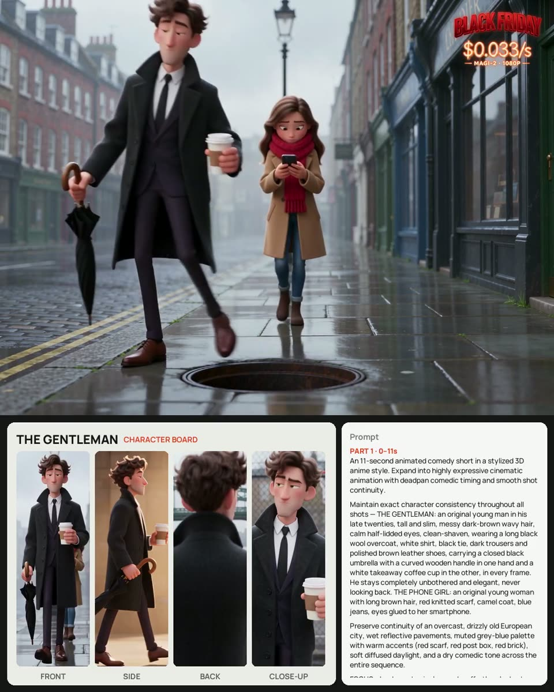

<!-- Generated by scripts/build_readme.py. Edit site.config.json, content/prompts.json, and generator scripts. -->

<a id="case-cms-e5251a4a"></a>

# 雨伞与咖啡的无声喜剧

[← 返回合集](../../README.zh-CN.md)

**来源类型**: `community` · **任务**: `T2V` · **音画**: `Yes` · **状态**: `来源收录`

社区 MAGI-2 视频案例（@Mayz1169）：雨伞与咖啡的无声喜剧。

<a href="https://awesome.raphael.app/materials/a769dfcd-bc5e-4ee1-b5cd-eae7f9a1f0a4.mp4"></a>

▶ **[播放有声视频原片](https://awesome.raphael.app/materials/a769dfcd-bc5e-4ee1-b5cd-eae7f9a1f0a4.mp4)**

**完整原始提示词**

```text
A 41-second animated comedy short in a stylized 3D anime style. Expand into highly expressive cinematic animation with deadpan comedic timing and smooth shot continuity.

Maintain exact character consistency throughout all shots — THE GENTLEMAN: an original young man in his late twenties, tall and slim, messy dark-brown wavy hair, calm half-lidded eyes, clean-shaven, long black wool overcoat, white shirt, black tie, dark trousers, polished brown leather shoes, a closed black umbrella with a curved wooden handle in one hand and a white takeaway coffee cup in the other, in every frame. He stays completely unbothered and elegant, never looking back. THE PHONE GIRL: an original young woman with long brown hair, red knitted scarf, camel coat, blue jeans, eyes glued to her smartphone.

Preserve continuity of an overcast, drizzly old European city, wet reflective pavements, muted grey-blue palette with warm accents (red scarf, red post box, red brick, red coat, orange fruit), soft diffused daylight, and a dry comedic tone across the entire sequence.

FOCUS: deadpan physical comedy, effortless luck, chaos happening around a calm gentleman, perfect comedic timing.

[0s – 4s] SHOT 1 — THE MANHOLE. Wide street shot. An open manhole lies on the wet pavement. The gentleman strolls toward it, glances down for a split second and smoothly side-steps around it without breaking stride. Behind him the phone girl walks the same line staring at her phone and drops straight down into the manhole with a comic yelp. SFX: rain patter, footsteps, a cartoonish "whoop" and a hollow thud. Camera: static wide shot, eye level.
[4s – 8s] SHOT 2 — THE FALLING SHEET. Narrow brick alley, a cat sits on the wall. A neighbour above shakes a white bedsheet out of a window and it slips, fluttering down. Without looking up, the gentleman raises his closed umbrella overhead; the sheet lands perfectly draped on the umbrella tip. He lowers it and lets the sheet slide off into a puddle, walking on spotless. SFX: cloth flapping, soft splash, cat meow. Camera: slow backward dolly, then a low ground-level angle.
[8s – 11s] SHOT 3 — THE RAT. Grand old station entrance. A plump rat drags a slice of pizza across the floor; the gentleman sips his coffee and strolls past, the rat freezes and hides behind a metal trash bin. SFX: tiny squeak, footsteps echo. Camera: side tracking shot, left to right.
[11s – 15s] SHOT 4 — THE TAXI. Grand colonnaded street, a black cab pulls up. A businessman with a briefcase sprints for it, slips on a puddle and slides past the door; the gentleman opens the cab door with the curved umbrella handle, then simply closes it again and strolls on. SFX: tyres on wet road, a squeaky slide, door click. Camera: medium tracking shot.
[15s – 20s] SHOT 5 — THE BASKETBALL. Outdoor court behind a fence, teenagers playing. A stray ball flies toward his head; without looking he lifts the umbrella and the ball lands balanced, spinning on the umbrella tip; he flicks it back over the fence, swish, and sips his coffee. SFX: ball bounce, spin whirr, net swish, kids cheering. Camera: front-facing backward dolly, eye level.
[20s – 24s] SHOT 6 — THE WATERING CAN. Pastel terrace houses with flower boxes. An old lady on a balcony tips a watering can; he pops open the umbrella at the exact moment, the water splashes harmlessly off the canopy, he closes it and walks on dry. SFX: water pouring, umbrella pop, splash. Camera: low angle looking up, then medium shot.
[24s – 29s] SHOT 7 — THE ORANGES. Narrow street with an open delivery van; a stack of crates topples and dozens of bright oranges roll toward him; he steps lightly between them like a dance without breaking stride. SFX: crates clatter, oranges bouncing, light footsteps. Camera: ground-level shot as oranges roll toward the lens, then tracking.
[29s – 33s] SHOT 8 — THE PAINTER. Riverside promenade; an elderly painter in a flat cap paints the bridge. The gentleman pauses, adds one tiny dab to the canvas with the umbrella tip, nods, and walks on; the painter stares, then realises it is better. SFX: river ambience, brush tap, seagull. Camera: over-the-shoulder medium shot.
[33s – 37s] SHOT 9 — THE LITTLE GIRL. Plaza with a big stone fountain. A little girl in a red coat looks sad, her red mitten floating in the fountain; he hooks it out with the umbrella handle and hangs it on her hand without stopping; she beams. SFX: fountain splashing, tiny giggle. Camera: medium shot, slight push-in on her smile.
[37s – 41s] SHOT 10 — THE CALLBACK. Back at the open manhole from the beginning; the phone girl's hand reaches up out of the hole. The gentleman lowers the curved umbrella handle, she grabs it and he lifts her out effortlessly, hands her his coffee, and walks away into soft light. SFX: echoing "help", gentle pull, relieved sigh. Camera: high angle, then wide final shot.

FINAL VISUAL: the gentleman walking away down the wet street, umbrella swinging, while the phone girl holds his coffee and stares after him. Ending mood: smug, charming, effortlessly lucky.

Audio: light playful jazz instrumental (upright bass, brushed drums, muted trumpet) with no vocals, plus natural ambience.

NO SUBTITLES. NO ON-SCREEN TEXT OR CAPTIONS. No real people, no existing characters, no logos, brands or famous landmarks. All mishaps stay cartoonish and harmless.

STYLE: stylized 3D anime render, soft toon shading on detailed 3D characters, large expressive anime eyes, glossy hair strands, warm golden rim light, soft global illumination, shallow depth of field, cozy miniature-like environments, Japanese animated feature film look, rich saturated color.
```

| 参数 | 配置 |
| --- | --- |
| 模型 | MAGI-2 (flagship) |
| 任务类型 | t2v |
| 时长 / 帧率 | 41.2s · 25 fps |
| 分辨率 / 比例 | 1080p · 3:4 |
| 音频模式 | sfx (audio=True) |

[原始来源](https://x.com/Mayz1169/status/2126346676583780818) · 作者: [@Mayz1169](https://x.com/Mayz1169) · 2026-11-27

> MAGI-2 为作者自述，未经独立核实。 提示词来自作者回复 https://x.com/Mayz1169/status/2126347637020676128

**[在 Raphael 上生成同类视频 →](https://raphael.app/ai-video-generator?utm_source=github&utm_medium=repository&utm_campaign=magi_2_launch&utm_content=case_cms-e5251a4a&utm_term=zh-CN)**
