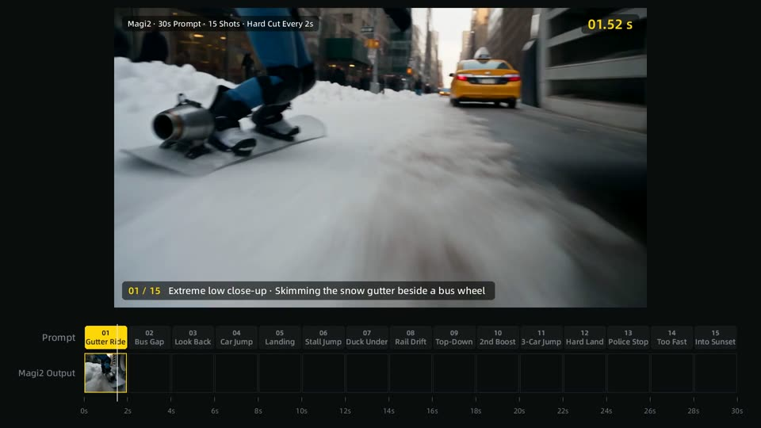

<!-- Generated by scripts/build_readme.py. Edit site.config.json, content/prompts.json, and generator scripts. -->

<a id="case-cms-ea3e77d5"></a>

# 暴风雪后的雪板追逐

[← 返回合集](../../README.zh-CN.md)

**来源类型**: `community` · **任务**: `OMNI-REF` · **音画**: `Yes` · **状态**: `来源收录`

社区 MAGI-2 视频案例（@magiai_hq）：暴风雪后的雪板追逐。

<a href="https://awesome.raphael.app/materials/d2f9eab6-8225-4012-92dd-5086d9596091.mp4"></a>

▶ **[播放有声视频原片](https://awesome.raphael.app/materials/d2f9eab6-8225-4012-92dd-5086d9596091.mp4)**

**完整原始提示词**

```text
Reference Material Notes
@Image 1: The female protagonist's identity reference. Strictly use the same adult woman's face shape, facial proportions, skin tone, age appearance, hairline, hair color, and hairstyle as in the reference image. In frontal, side, looking-back, bent-over, airborne, and distant views she is always the same person; do not redesign the face.

The reference image is used only to lock the character's identity, hair, and body proportions. Clothing, gear, scene, lighting, and actions are regenerated according to the prompt below.

Core Concept
A strictly 30-second, hyper-realistic winter city chase with a strong sense of speed and pressure: the woman from the reference image rides a modified snowboard with twin rocket boosters mounted at the tail, continuously threading through moving traffic gaps, vehicles, market stalls, and low obstacles in a busy downtown after a blizzard, relying on real carving, skidding, snow-slope jumps, and short rocket boosts to shake off two police cars.

The action is tight, danger keeps closing in, and the woman always observes ahead, judges quickly, and actively chooses her route. The environment changes at the same time: foreground objects sweep past at high speed, the midground carries the action, and the background continuously advances the pursuit. Do not let vehicles and pedestrians stand still waiting for the woman to pass.

The final officer says in English: "She's too fast." Then cut back to the woman still carving at high speed, ending as she slips into a streetscape under the setting sun.

Timing and Editing Rules
Landscape 16:9, 4K HDR, 24fps, total duration strictly 30 seconds, 720 frames in total. Fixed 15 shots, each strictly 2 seconds / 48 frames.

All cuts between shots are clean hard cuts; no dissolves, flash-whites, black frames, or morph transitions. Cut points fixed at 02, 04, 06, 08, 10, 12, 14, 16, 18, 20, 22, 24, 26, 28 seconds.

Hard cuts must carry the action across:
If the previous shot is mid-carve, the next continues the same carve; if the previous shot is airborne, the next continues the same flight phase; if the previous shot is landing, the next absorbs the impact. After a cut, motion simply continues in normal time — no replays, no skipping key contacts, no instant pose changes.

In side shots, the woman primarily moves from frame left to frame right. Frontal, rear, and overhead angles may alternate, but spatial direction must stay clear via the road, vehicles, snow slopes, or building corners.

Full normal speed throughout. No slow motion, speed ramps, hovering showcases, or long posed holds. Speed is conveyed mainly through close foreground pass-bys, fast parallax, tire and edge detail, quick breathing, constantly approaching obstacles, and continuous motion.

Character, Wardrobe, and Snowboard Lock
The woman's face and hair strictly follow @Image 1. Keep the reference hairstyle; during motion it only shows natural wind-blown and inertial movement.

Fixed wardrobe throughout:
Dark grey, pattern-free, logo-free slim long-sleeve cropped athletic top, crew neck, matte stretch fabric, hem fixed above the waistline.
Mid-blue high-waist slim jeans, full-length, no rips, no prints, cuffs at the ankles.
White-grey low-top sneakers, white upper with light grey panels and sole, no logos.
Black snug lightweight knee pads, black elbow pads, black full-finger sports gloves.
No added coat, backpack, scarf, sunglasses, or streamers. Clothing colors, lengths, fits, and pad positions stay identical throughout.

The woman always rides the same silver-grey wide-body snowboard, black base, slightly upturned nose. Board structure and length-width ratio stay fixed.

Regular stance with the left foot forward: left foot near the nose, right foot near the tail, both feet strapped across the deck, two black modified bindings firmly wrapping soles and ankles. She controls the board through ankles, knees, hips, and body lean. Feet never loosen, never swap positions, and never become a forward-facing stance.

Two compact rocket boosters are mounted symmetrically left-right at the same board's tail, metallic-grey housings, dark nozzles all pointing rearward past the tail. Boosters are not mounted on boots, do not float, and do not change size. Thrust acts along the board's forward axis for short acceleration bursts.

Environment and Chase Route
The same downtown after a blizzard, winter afternoon near sunset. Cold-blue snow, wet black tire tracks, and warm gold reflections on glass facades form the contrast.

Roads show clear surface differences: loose snow, compacted grooves, thin ice, snow ridges pushed up by wheels, compact snowbanks piled by plows. The board reacts with different friction, vibration, spray, and skid on each surface.

The route is continuous:
Crowded main street → snowbank beside cars → market entrance → low scaffolding → railing corner → market side alley → large plowed snowbank → street behind buildings.

Taxis, buses, delivery vans, bicycles, vendors, pedestrians, and snow-removal equipment all keep definite positions. Environmental reactions come in order: first noticing her approach, then stepping back, turning heads, braking, or dodging. No one is hit or injured.

Strict Timeline
Shot 01 | 00.00–02.00 | Ultra-low-angle close shot: straight into high speed

Character and action:
Opens with the woman already at high speed; no start-up prep. The camera hugs the road, following the same board skimming the snow groove beside a bus wheel. At 00.30 the nose slices through crumbled snow; at 00.80 the bus's right wheel throws up a sheet of slush and she flexes her knees to steady the board. At 01.30 she begins carving left, the board sliding from the deep groove onto smoother snow, the tail whipping out a long thin ribbon of snow.

Camera:
A front-quarter close shot about 20 cm off the ground, the subject being the board, bindings, sneakers, and knee flex. The bus wheel recedes fast in the near field; a distant yellow taxi anchors the next shot's position. The camera tracks the board with strong background parallax.

Sound:
Opens with urgent edge scraping, wheel roar, and slush hitting the ground; short breathing from the woman. Boosters off.

Hard-cut continuity:
The cut at 02.00 lands mid-left-carve. The next shot keeps the same lean direction, the same snow ribbon, and the bus position.

Shot 02 | 02.00–04.00 | High oblique-down wide shot: revealing the narrowing gap

Character and action:
She continues the left carve from the previous shot, passing between the bus and a taxi nosing slowly outward. The taxi's front wheel is turning; the gap narrows gradually. At 02.60 she reads the space ahead of the taxi, drops her shoulder, tucks her elbows, and sweeps past the hood along a continuous arc.
A pedestrian about to step off the curb sees her and pulls his foot back; she passes through the empty snow lane in front of him. At 03.60 she returns to a straighter glide and starts turning her head back.
Camera:
Tracked from floor height at an oblique-down angle, fully showing the bus, taxi, pedestrian, and her route. A traffic-light pole sweeps the foreground fast without covering the key dodges. Her speed reads through how fast she crosses the distance between vehicles.

Sound:

A short taxi honk, a pedestrian's soles scraping snow, and the first clear distant siren.

Hard-cut continuity:
Hard cut at 04.00 mid head-turn; the next shot continues the turn.

Shot 03 | 04.00–06.00 | Front-quarter face close-up: pursuers close in, sudden boost

Character and action:
The same woman finishes the head-turn, her reference face clearly recognizable. She sees two police cars behind, one after the other, pressing over the snow grooves, light bars flashing on wet bodywork and glass.

At 04.60 her brow tightens and she snaps her gaze forward. At 05.00 both knees drop and her torso pitches forward; from 05.20 to 05.60 the twin tail boosters fire a synchronized short burst, then shut off. Under acceleration her body first takes the rearward inertia, then actively presses her weight back; hair and fabric pull rearward and the tail churns up a thick snow mist.

Camera:
A tight front-quarter medium close-up tracking shot, the face in sharp focus, the police lights behind still legible. On the burn, the camera falls slightly behind her so she briefly crowds the frame edge, giving a burst-out sense of speed.
Sound:
The siren closes in; she inhales; the twin boosters give one short, low burst; base-of-board friction rapidly densifies.

Hard-cut continuity:
Cut at 06.00 on the post-burst forward lean; speed, posture, and snow mist stay continuous.

Shot 04 | 06.00–08.00 | Axle-height side wide shot: charging the bank, clearing the car

Character and action:
She approaches a compact roadside snowbank; ahead, a small car is slowly crossing the intersection. She pre-aims at the landing zone beyond the car's roof as the board climbs the bank.

At 06.80 she compresses both legs; at 07.10 the slope provides upward speed and the board leaves the ground. She tucks her knees, lifting the base over the car's roof, hips stable, arms opening to both sides for control.

By 08.00 she has passed the mid-roof and begun descending. Boosters off.

Camera:
An axle-height side wide shot tracking laterally. The car's hood sweeps the foreground while her full body, the board, roof clearance, and the landing spot ahead always stay in frame. The car body must not block the airborne phase.

Sound:
Edge-scrape grows heavier on the climb, cuts out sharply at liftoff, replaced by wind and the engine below.
Hard-cut continuity:

Cut at 08.00 as she extends her legs for landing. The next shot continues the descent with the nose heading unchanged.

Shot 05 | 08.00–10.00 | Low frontal medium-wide: landing impact toward camera

Character and action:
At 08.30 the board touches down on the snow-covered stretch ahead of the car. Her knees, hips, and waist compress together; the deck flexes and rebounds; loose snow blasts out to both sides of the camera.

She does not pause. At 08.90 her eyes swing to the market entrance; at 09.20 she begins carving right, the tail dragging a continuous arc of snow. Behind her, the car's driver looks up at her; the police lights behind are briefly swallowed by the snow mist.

Camera:
Low frontal medium-wide; the camera retreats fast, taking a short jolt as she lands. Spray may sweep the frame edges, but the face, deck, and landing motion stay legible.

Sound:
A heavy landing thud, deck rebound, continuous edge scrape, and a short exhale on impact. The siren still closes in through the mist.

Hard-cut continuity:
Hard cut at 10.00 with the right-turn arc unfinished; the next shot continues the same turn from a higher angle.

Shot 06 | 10.00–12.00 | High oblique-down extreme wide: flying over the market stall

Character and action:
She completes the right turn into the market entrance. On the left, a vendor pulls his cart in beside the stall; on the right, pedestrians stop to clear the snow lane.

She reads the short bank formed by the plow pile; takes off at 10.50, clearing a low, open-top stall counter. She tucks her legs so the board fully leaves the counter surface; gloves and knees touch nothing. The vendor looks up from the side, paper bags fluttering in the airflow.

At 11.60 she drops into the empty snow lane behind the stall, flexes to absorb, and immediately eyes the low scaffolding ahead. Boosters off.

Camera:
A high oblique-down extreme wide moving along the route, showing the bank, the stall, safe clearances, and the landing zone. Stall awnings sweep the near frame for depth without covering her.

Sound:
Market chatter, cart wheels, a short gasp, takeoff and landing in the snow. No rocket sound.

Hard-cut continuity:
Cut at 12.00 on the post-landing crouch; the next shot inherits the knee flex directly.

Shot 07 | 12.00–14.00 | Head-on low-angle medium: threading under the obstacle

Character and action:
She spots the low temporary scaffold ahead, eyes quickly sizing the gap. At 12.20 she presses her body lower, chest near her thighs, arms tucked to her sides, board hugging the ground.

From 12.70 to 13.10 she passes at high speed beneath the crossbeam, the beam sweeping just over her head with clear clearance. Her reference face briefly sits at frame center, expression tense and focused.

At 13.30, past the obstacle, she starts rising while pre-carving to slow down, loading for the corner turn ahead.

Camera:
A head-on low-angle medium shot retreating fast, the camera inside the safe lane under the same obstacle. The beam first presses on the top of the frame, then falls rapidly behind her — strong spatial compression.

Sound:
Ski friction up close, fabric and wind briefly swell; no collision sound through the obstacle.

Hard-cut continuity:
Cut at 14.00 as her body rises and the board starts a skidding brake; the next shot continues the same decelerating turn.

Shot 08 | 14.00–16.00 | Outside-railing low full-body: skid fishtail out of the corner

Character and action:
She holds the skid, burning speed in a long snow trail, then carves around the street corner. Her body leans into the turn; the tail sweeps a fan of snow outward.

At 14.70 her left hand briefly braces the railing's corner post, helping gauge her body's distance to the corner — the arm must not carry the whole turning load. At 15.10 she releases; shoulder, hips, then nose align onto the new street in order.

At 15.60 the skid ends and she accelerates out along the board's length, leaving the snow curtain behind the bend.

Camera:
A low full-body shot outside the railing, using truck left + pan right to follow the turn. Railing posts whip past the foreground in sequence while she and the whole board stay visible. No orbiting the character that inverts the space.

Sound:
The sharp scrape of edge on ice, a light glove-on-metal rasp, fine snow ticking on the railing.

Hard-cut continuity:
Hard cut at 16.00 as the nose locks onto the new line; the next shot continues along it.

Shot 09 | 16.00–18.00 | Top-down extreme wide: picking lines through moving gaps

Character and action:
She enters a narrow market side alley. A bicycle rolls slowly out from the right; a cart of cardboard boxes is being pulled in on the left. She reads the bike's wheels, then the cart, and carves continuously through the gap already forming between them.

At 17.20 a slow snowplow appears in the side branch, its blade shoving thick snow to block it. She instantly abandons the branch and keeps charging the straight lane toward open road.

Behind the alley mouth, the two police cars are forced to slow by a delivery van and the narrow lane; the pursuit gap starts to open.

Camera:
A top-down extreme wide tracking fast forward, like a route map unfolding. She, both moving flanks, the blocked branch, and the exit ahead all legible; no impossible-to-cross gaps.

Sound:
A bicycle bell, cart wheels rolling, the plow shoving snow, sirens reflecting off alley walls.

Hard-cut continuity:
At 18.00, as she exits the alley, cut to a frontal on-axis shot, keeping the exit building and the same snow groove as landmarks.

Shot 10 | 18.00–20.00 | Frontal telephoto medium-wide: the oppressive final run-up

Character and action:
She hits the open stretch. Ahead, behind a large compacted snowbank, three small cars are parked side by side; beyond them, a clearly empty snow landing strip.

She scans bank top, car roofs, then landing zone in order; lips tighten, body presses lower again. From 18.60 to 19.10 the twin tail boosters fire in sync, then shut off. Thick snow curls backward off the tail.

At 19.40 the board charges up the bank, the slope lifting her body; legs compress for takeoff.

Camera:
Frontal telephoto medium-wide, the camera dollying back along the bank's shoulder. The long lens stacks the police lights behind with her fast approach in one depth plane; snow chunks rake the lower frame — the run-up reads fast.

Sound:
Her urgent breathing, one short booster burst, board vibration and scrape growing heavier.

Hard-cut continuity:
Cut at 20.00 on the still-climbing compressed posture; the next shot keeps climbing — no re-burn, no new run-up.

Shot 11 | 20.00–22.00 | Side-high long shot: the fully released leap

Character and action:
She keeps charging; at 20.40 she leaves the bank top, arcing a parabola over the three parked cars.

She tucks her knees, keeping the board beneath her, nose slightly above tail. Over the rooftops, her hips and legs make small posture adjustments; the body does not tumble and does not change course mid-air.

At 21.70 she looks to the landing zone and begins extending her legs, arms opening slightly to absorb. At 22.00 the board is close to the strip. Boosters off the whole time.

Camera:
A side-high long shot tracking laterally — the first full reveal of her, the row of cars, and the city's scale. Keep real time: rooftops pass quickly beneath the board, no hovering showcase.

A near lamp post sweeps the frame edge; far behind, the police cars have just emerged from the alley — foreground, mid, and background all in motion at once.

Sound:
Edge scrape stops at liftoff; wind takes over; cars and sirens stay distant; no sustained rocket roar.
Hard-cut continuity:

At 22.00, just before touchdown, cut to an ultra-low front-quarter; flight direction, board angle, and leg extension stay continuous.

Shot 12 | 22.00–24.00 | Ultra-low front-quarter full-body: hard landing, skid, gaze thrown off

Character and action:
At 22.10 the board lands, tail kissing the loose snow first, then the whole base loading. Knees and waist compress hard; the deck flexes and rebounds; snow blasts out both sides.

A brief controlled skid; her shoulder sways, expression tense for an instant — then she drives her weight back down and the edges re-bite. At 22.90 she looks to the building corner; at 23.20 she cuts into the side street on a continuous arc.

At 23.70 she is fully gone behind the corner, only the arced snow track and the still-spreading snow curtain left.

Camera:
Ultra-low front-quarter full-body; the camera retreats to catch the landing, then pans fast but continuously through the exit. Spray rakes the lens edge; the shot ends on the empty corner — the camera does not pass through walls.

Sound:
The heaviest landing thud of the film, then deck rebound, edge biting ice, and one sharp exhale; the siren still behind.

Hard-cut continuity:
At 24.00, out of the still-drifting snow curtain, hard cut to the police cars on the same stretch, continuing the mist's drift direction.

Shot 13 | 24.00–26.00 | Low extreme wide beside the snowbank: the pursuers forced to stop

Character and action:
The two police cars enter from behind, already braking early. The first completes its final braking stretch before the snowbank; the second stops staggered behind it. Wheels push thin snow; the bodywork takes real braking pitch but stays in control — no out-of-control collision.

At 24.80 both cars are fully stopped. The first officer pushes his door open, one foot sinking into the snow, gripping the door to rise; the second car's door opens after. Her arced snow track runs from behind the bank toward the empty corner.

Camera:
A low extreme wide: the police car noses enter and stop in the foreground, the snowbank and the direction she vanished both in frame. The light bars illuminate the not-yet-settled snow grains — a strong pursuit afterglow.

Sound:
Tires pressing snow, brakes, engines, doors. At 25.00 the siren stops, suddenly exposing the officer's breathing and the snow grains landing.

Hard-cut continuity:
Cut at 26.00 as the first officer just steadies himself and looks up toward the empty street.

Shot 14 | 26.00–28.00 | Two-shot medium: the English line, a brief release of tension

Character and action:
The first officer keeps looking up, shoulder and trouser cuff wet with snowmelt, staring down the empty street, shaking his head slowly in disbelief.

From 26.40 to 27.40 he says clearly in English, in frame:
"She's too fast."

The second officer, catching his breath by the rear car, follows the snow track to the corner with his eyes, then leans on the car, drops his hands, and gives up the chase.

Camera:
A two-shot medium: the first officer sharp in the foreground, the second and the flashing lights behind. The camera pushes in slightly, keeping their sightlines to the empty street.

Sound:
Only this one English line — no Chinese, no repeats, no narration. Delivery natural, slightly breathless; ambience dips. No subtitles.

Hard-cut continuity:
At 28.00, after the second officer leans on the car, hard cut back to her. The line ends; it does not bleed into the next shot.

Shot 15 | 28.00–30.00 | Close side-rear widening to wide: still fast, vanishing into the city

Character and action:
She still glides fast along the snow-covered street behind the buildings, boosters off, riding existing momentum. At 28.20 she glances back briefly to confirm no pursuit, her face still strictly the reference face.

At 28.70 she looks forward again, shoulders relaxing without slowing; the board carves lightly along the wheel tracks, skirting a parked snow-removal rig.

At 29.30 she enters the depth of the sunset-lit street, glass facades sweeping gold reflections, her trailing snow mist backlit. At 30.00 she is still advancing in the distance.

Camera:
Starting as a tight side-rear medium tracking shot, the camera gradually slows, letting her break out of close range and glide naturally into deep perspective. Near rails recede quickly; distant buildings hold steady — a clear speed reference. She must not suddenly shrink or vanish into thin air.

Sound:
The close edge sound fades away; wind and city ambience return; no rockets, no sirens, no added dialogue.

Ending:
Ends directly at 30.00 — no freeze frame, no fade-out, no added tail.

Unified Execution Constraints

Action density:
Every shot keeps one clear core action while foreground, mid, and background each change in related ways. Vehicles keep driving, wheels keep turning, pedestrians react naturally, snow mist spreads on inertia — the environment never becomes a static backdrop. Before every route change she reads it with her eyes first; no unmotivated turns.

Speed and tension:
Full speed on straights; visible braking before turns; glide continues out of them. The camera sells speed via axle height, ground-hugging tracking, near foreground, telephoto compression, and near-far alternation. Obstacles enter the viewer's field first, then she handles them — a "see danger, judge fast, thread through" rhythm. Never shoot the action as a relaxed cruise.

Board physics:
Always the one same board, both feet fixed to the same deck. Jumps rely on visible slopes; airborne phases follow parabolas; landings show deck flex and body absorption. Carves, skids, and turns obey inertia — no unmotivated lateral teleports, no sudden spins around railings at speed.

Boosters:
Fire only at 05.20–05.60 and 18.60–19.10. Off otherwise. Flames are short, rearward, away from people and flammables; they never lift the body or sustain hovering. Both big jumps get their upward speed from the snowbanks.

Identity and wardrobe:
Face and hair strictly locked to @Image 1, one same person across all shot sizes. The dark grey long-sleeve cropped top, mid-blue slim jeans, white-grey sneakers, black pads, and gloves stay consistent. Motion may add natural creases, snow accumulation, and a little meltwater — never a change of style.

Visuals:
Photoreal, premium action-film cinematography, natural winter light, clear warm-cool contrast, real skin, fabric, metal, snow-and-ice, and vehicle materials. Motion blur matches a 24fps look; key faces, board structure, and contact moments always legible. Camera moves always track a subject — no unmotivated shake.

Sound:
Non-diegetic music: N/A. Build rhythm from edge scrape, tires, wind, bursts, sirens, breathing, and landings. Action ambience flows across cuts without unmotivated breaks. The officer's single English line: "She's too fast." No other dialogue, no narration, no subtitles.

Negative prompt:
No injuries, no gore, no blast damage, no collisions hurting people; no extra limbs, no duplicated protagonist, no face swaps, no facial-feature drift, no hairstyle changes, no wardrobe changes, no added accessories; no board splitting, no feet leaving bindings, no foot swaps, no booster deformation; no sustained hovering, no mid-air teleports, no slope-less takeoffs, no inertia-violating dead stops or whip turns; no repeated takeoffs or landings, no action replays, no posture resets after cuts; no slow motion, no speed ramps, no frozen backgrounds, no vehicle teleports, no clipping, no flicker; no text, no logos, no subtitles, no watermarks.
```

| 参数 | 配置 |
| --- | --- |
| 模型 | MAGI-2 (flagship) |
| 任务类型 | omni-ref |
| 时长 / 帧率 | 29.9s · 25 fps |
| 分辨率 / 比例 | 1080p · 16:9 |
| 音频模式 | dialogue (audio=True) |

[原始来源](https://x.com/magiai_hq/status/2125811625198522612) · 作者: [@magiai_hq](https://x.com/magiai_hq) · 2026-11-26

> 模型 MAGI-2 为作者自述，未经独立核实。 作者在同一串帖中标注模型：https://x.com/magiai_hq/status/2125811617145528821

**[在 Raphael 上生成同类视频 →](https://raphael.app/ai-video-generator?utm_source=github&utm_medium=repository&utm_campaign=magi_2_launch&utm_content=case_cms-ea3e77d5&utm_term=zh-CN)**
