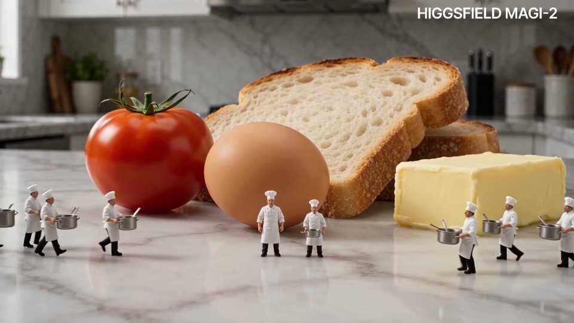

<!-- Generated by scripts/build_readme.py. Edit site.config.json, content/prompts.json, and generator scripts. -->

<a id="case-cms-eaba3dd3"></a>

# 迷你厨师做巨型早餐

[← 返回合集](../../README.zh-CN.md)

**来源类型**: `community` · **任务**: `T2V` · **音画**: `Yes` · **状态**: `来源收录`

社区 MAGI-2 视频案例（@RuzainaMeer）：迷你厨师做巨型早餐。

<a href="https://awesome.raphael.app/materials/6984e195-375f-4798-9164-3b90a112edbf.mp4"></a>

▶ **[播放有声视频原片](https://awesome.raphael.app/materials/6984e195-375f-4798-9164-3b90a112edbf.mp4)**

**完整原始提示词**

```text
Create a 30-second ultra-realistic cinematic video in 16:9 widescreen, 4K, 24fps, featuring 8–10 tiny human chefs cooking a giant breakfast in a modern real-life kitchen. The tiny chefs should look like realistic miniature humans, not cartoons or toys. Maintain consistent faces, clothing, body proportions, and kitchen layout throughout the video.

SCENE 1 (0–6 seconds): Start with a cinematic macro wide shot of a kitchen countertop. Tiny chefs arrive carrying miniature cooking equipment. In front of them are a gigantic egg, a huge tomato, a massive slice of bread, and a large block of butter. The head chef points toward the ingredients, directing the team.

SCENE 2 (6–12 seconds): Two chefs climb a small ladder to crack the giant egg into a frying pan. Other chefs carefully slice a tomato using tiny knives. Another chef struggles to push a huge piece of butter across the countertop. Show realistic teamwork and physical effort.

SCENE 3 (12–18 seconds): The chefs begin cooking on a miniature stove. The egg mixture sizzles naturally in the frying pan. One chef uses a tiny spatula to flip the enormous omelette while another carefully sprinkles seasoning. Realistic steam rises from the pan.

SCENE 4 (18–24 seconds): The team works together to lift a gigantic cheese slice onto the omelette. One chef briefly slips on a tiny drop of oil, but another quickly catches him. The other chefs continue working. Keep every action physically believable.

SCENE 5 (24–30 seconds): Reveal the finished giant golden omelette with melted cheese and tomato slices, served beside toasted bread. The tiny chefs proudly gather around the plate. One chef climbs onto the edge of the plate, raises both arms in celebration, and the camera smoothly pulls back to reveal the entire miniature cooking operation.

VISUAL STYLE: Photorealistic macro cinematography, realistic miniature human anatomy, detailed skin and facial expressions, natural food textures, accurate cooking physics, realistic steam and oil, cinematic lighting, shallow depth of field, smooth connected camera movements, consistent character appearances, and believable scale.

AUDIO: Realistic chopping, sizzling eggs, footsteps, utensils clinking, subtle kitchen ambience, and cheerful reactions from the tiny chefs. No narration, no subtitles, no background music.

IMPORTANT: Every scene must connect naturally to the next. Avoid sudden cuts, inconsistent characters, floating objects, exaggerated movements, cartoon visuals, distorted hands, or artificial-looking food. The final result must look like a professionally filmed miniature cooking documentary.
```

| 参数 | 配置 |
| --- | --- |
| 模型 | MAGI-2 (flagship) |
| 任务类型 | t2v |
| 时长 / 帧率 | 30.2s · 30 fps |
| 分辨率 / 比例 | 1080p · 16:9 |
| 音频模式 | mixed (audio=True) |

[原始来源](https://x.com/RuzainaMeer/status/2125832298574590127) · 作者: [@RuzainaMeer](https://x.com/RuzainaMeer) · 2026-11-26

> MAGI-2 为作者自述，未经独立核实。

**[在 Raphael 上生成同类视频 →](https://raphael.app/ai-video-generator?utm_source=github&utm_medium=repository&utm_campaign=magi_2_launch&utm_content=case_cms-eaba3dd3&utm_term=zh-CN)**
