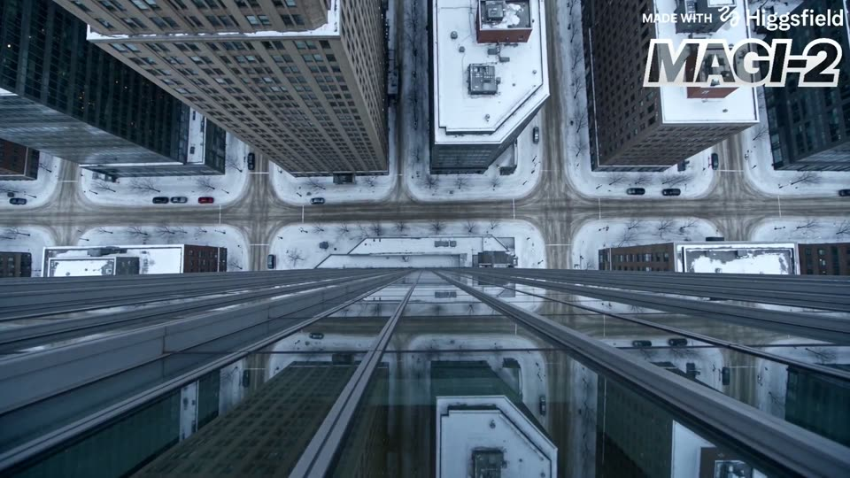

<!-- Generated by scripts/build_readme.py. Edit site.config.json, content/prompts.json, and generator scripts. -->

<a id="case-cms-eeb1c07c"></a>

# 摩天楼玻璃上的圣诞雪花

[← 返回合集](../../README.zh-CN.md)

**来源类型**: `community` · **任务**: `T2V` · **音画**: `Yes` · **状态**: `来源收录`

社区 MAGI-2 视频案例（@airina_xyz）：摩天楼玻璃上的圣诞雪花。

<a href="https://awesome.raphael.app/materials/85f58f1e-57d9-4c58-b70c-23419b78e0db.mp4"></a>

▶ **[播放有声视频原片](https://awesome.raphael.app/materials/85f58f1e-57d9-4c58-b70c-23419b78e0db.mp4)**

**完整原始提示词**

```text
No music. 20-second spectacular urban Christmas film following two professional window cleaners on a securely suspended maintenance platform outside a modern skyscraper. One wears a navy waterproof jacket and the other a red jacket. They decide to surprise the office employees by drawing a gigantic festive snowflake using removable white window-cleaning foam. Beautiful winter cityscape, dramatic perspective and realistic glass architecture.
00:00–00:02: Extreme downward-looking shot revealing the dizzying height above a snowy city street.
00:02–00:04: Wide aerial shot of the maintenance platform suspended outside the skyscraper.
00:04–00:06: Close-up of a gloved hand drawing a long white foam line on the glass.
00:06–00:08: Interior office shot of curious employees looking toward the window.
00:08–00:10: Exterior side shot as both window cleaners rapidly add symmetrical branches to their design.
00:10–00:12: Macro shot of delicate foam bubbles against the reflective glass.
00:12–00:14: Interior reaction shot as the employees realize what the workers are drawing.
00:14–00:17: Sweeping aerial pullback revealing the enormous completed snowflake covering several window panels.
00:17–00:20: The two workers wave from their platform as the employees applaud through the glass.
Maintain consistent skyscraper geometry, platform construction, safety equipment and snowflake design. Realistic glass reflections, foam texture, atmospheric perspective and coherent interior-exterior spatial relationships. SFX: wind, squeaking squeegees, platform machinery and muffled applause. No music.
```

| 参数 | 配置 |
| --- | --- |
| 模型 | MAGI-2 (flagship) |
| 任务类型 | t2v |
| 时长 / 帧率 | 20.3s · 30 fps |
| 分辨率 / 比例 | 1080p · 16:9 |
| 音频模式 | music (audio=True) |

[原始来源](https://x.com/airina_xyz/status/2125953505529823573) · 作者: [@airina_xyz](https://x.com/airina_xyz) · 2026-11-26

> 模型 MAGI-2 为作者自述，未经独立核实。

**[在 Raphael 上生成同类视频 →](https://raphael.app/ai-video-generator?utm_source=github&utm_medium=repository&utm_campaign=magi_2_launch&utm_content=case_cms-eeb1c07c&utm_term=zh-CN)**
